# HUD redesign — "phần cứng của cùng một cỗ máy"

Phản hồi người chơi: HUD "trông hơi AI". Skill `frontend-design` không có trong phiên này (đã tìm, không thấy), nên làm theo đúng các nguyên tắc của nó được nêu trong yêu cầu: bám chủ đề, kế hoạch token trước, tự soi lỗi "mặc định AI", dồn độ táo bạo vào MỘT chỗ.

## 1. Chủ đề
Trận đánh diễn ra trên một khay máy công nghiệp màu xám: thép dập, đinh tán, sọc nguy hiểm, cáp, đèn LED/số đoạn, nút bấm cơ khí. HUD phải là **linh kiện của cùng khay đó**, không phải lớp kính neon nổi lên trên.

## 2. Token
| Tên | Hex | Dùng cho |
|---|---|---|
| plate | `#2b2e33` | mặt thép dập (tấm Wave, tấm mana, đèn tim, mép khay) |
| edge | `#4b5059` | mép vát bắt sáng 1 px |
| well | `#0b0c0e` | hốc lõm: cửa sổ LED, dải đoạn, ray thẻ |
| amber | `#f0b429` | **chỉ** nút Summon + sọc nguy hiểm (+ nút Start ở màn chọn) |
| mana | `#c592ff` | số LED mana, giá mana (màu viên ngọc) |
| red / ok / you | `#ff4b3e` / `#63d68b` / `#5aa8ff` | nguy hiểm-trùm-tim / đủ mana-đồng đội / bạn |

Chữ: **Oxanium 800** cho số và chữ trên phím (Wave số, LED mana, giá, "Summon"); **Saira Semi Condensed 600/800** cho chữ nhỏ ("Boss in 8", "1 leak loses", You/Rival/Ally). Bỏ giãn chữ (letter-spacing) trên HUD.

## 3. Khung bố cục (390 px)
```
┌───────────────────────────────────────────────┐
│[Wave   2]     ☠ Boss in 8        [● 1 leak loses]│ ← tấm khắc · dải 10 ô · đèn báo
│              ▮▮▯▯▯▯▯▯▯█                        │
│                 … khay / sân …                │
╞═══════════ mép khay thép, đinh tán ══════════╡
│┌LED─────┐ ╔/////// SUMMON ///////╗ [1×] [❚❚] │ ← cửa sổ LED · phím nhấn vàng · keycap
││◆   162 │ ║ ◉  Summon  [◆10]    •║            │
│└────────┘ ╚//////////////////////╝            │
│[▔▔][▔▔][▔▔][▔▔][▔▔]          [▔▔ chỉ huy]     │ ← thẻ = hộp đạn cắm vào ray
│ ══════════ ray ══════════                     │
└───────────────────────────────────────────────┘
```

## 4. Nguyên tắc
1. Mỗi bộ phận một hình khối riêng (tấm thép vuông có đinh tán, ô LED lõm, phím cơ, hộp đạn) — không còn "viên thuốc viền neon" lặp lại.
2. Màu mang nghĩa: tím = mana, đỏ = nguy hiểm/trùm/tim, xanh lá = đủ mana, xanh dương = bạn. Không gradient trang trí.
3. Điểm nhấn duy nhất: phím **Summon** vàng hổ phách trong viền sọc nguy hiểm, nắp lún 5 px khi chạm. Đèn "sẵn sàng" tĩnh thay cho quầng nhấp nháy vô hạn.
4. Chữ thường, ngắn: "Boss in 8", "1 leak loses", "You / Ally / Rival", "Summon".
5. Chuyển động chỉ khi người chơi chạm (phím lún); tôn trọng `prefers-reduced-motion`.

## 5. Tự soi lỗi "mặc định AI" và sửa kế hoạch
- Bản nháp đầu vẫn giữ Summon màu tím (mana) → trùng màu ô LED, lại thành "nút tím phát sáng" quen thuộc. **Sửa:** Summon vàng hổ phách + sọc nguy hiểm, tím chỉ còn ở số mana/giá.
- Bản nháp đầu cho Wave cũng là LED → hai ô LED cạnh tranh nhau. **Sửa:** Wave là tấm khắc chữ trắng; chỉ mana là LED.
- Đèn tim dùng ảnh trái tim → giữ nguyên tim lớn trên lõi (session khác làm), còn trên thanh trên đổi thành bóng đèn báo tròn để không trùng ký hiệu.
- Thẻ có quầng xanh khi đủ mana → đổi thành một chấm LED xanh cạnh giá.

## 6. Thay đổi kỹ thuật
- `thap/css/hud.css` (mới, nạp sau `game.css`): toàn bộ lớp da phần cứng — tách file để không đụng các session khác.
- `thap/index.html`: link `hud.css`, `#tb-seg` (dải đoạn), nắp `.tr-cap` + đèn `.tr-led` trong nút Summon.
- `thap/js/ui.js`: dựng/cập nhật dải 10 ô tới trùm (chỉ ghi DOM khi wave đổi), đèn báo tim, lớp `.an` cho trạng thái nhấn (iOS không tự bật `:active`).
- `thap/js/render.js` (`veNhanBan` thôi): nhãn You/Ally/Rival trên canvas thành tấm thép nhỏ + đèn màu phe.
- `thap/js/text.js`: chữ sentence case.

## 7. Kiểm tra
- 360×780, 390×844, 430×860: không tràn ngang (scrollWidth = innerWidth), không lỗi trang.
- FPS (390, solo): trước 60.3 → sau 60.3.
- Mọi nút ≥ 44 px logic (Summon 186×74, keycap 52×60, thẻ 64×92).

## 8. Trước / sau (390 px)
| | Trước | Sau |
|---|---|---|
| Solo | 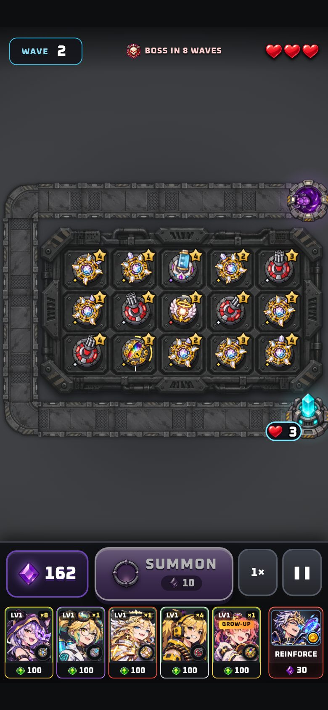 | 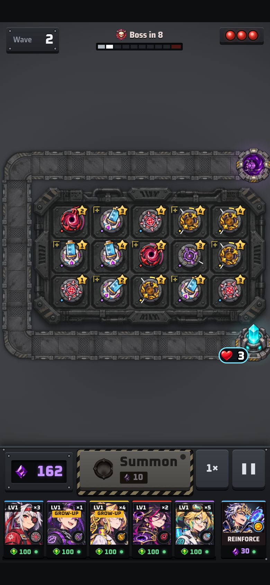 |
| Co-op | 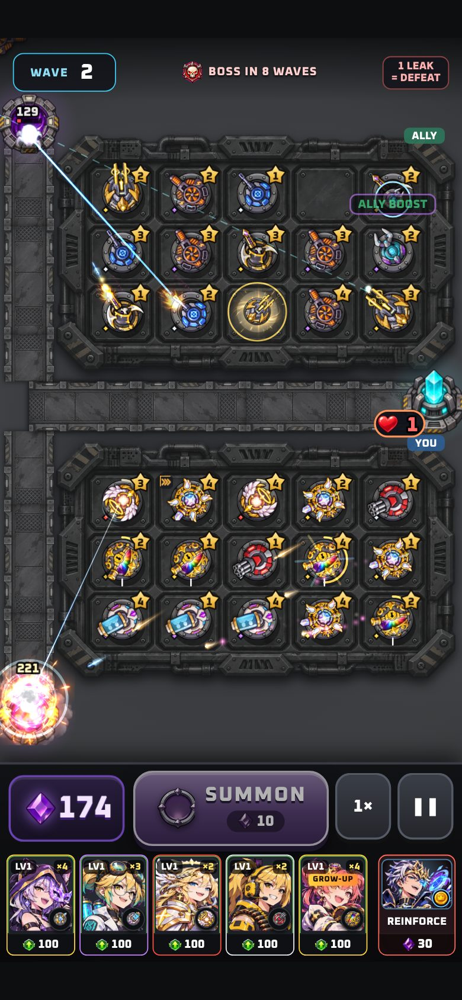 | 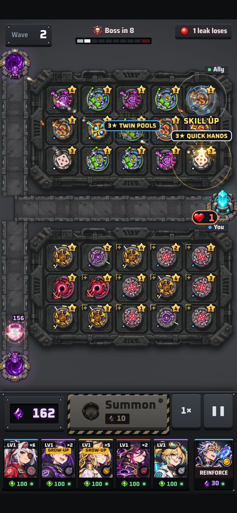 |
| PvP | 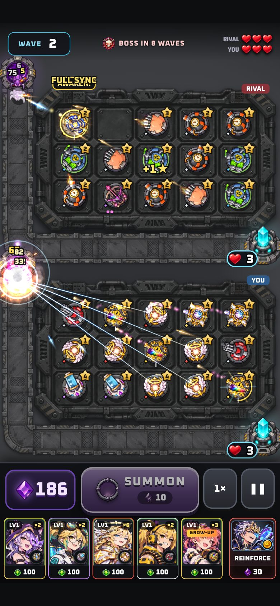 | 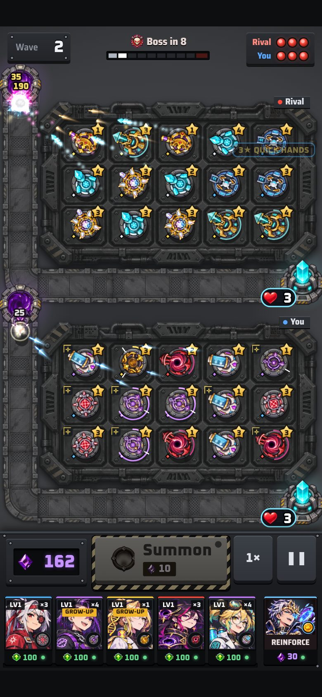 |
| Chọn bộ | 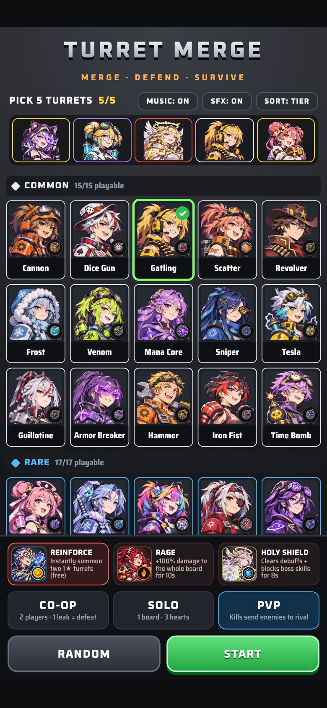 | 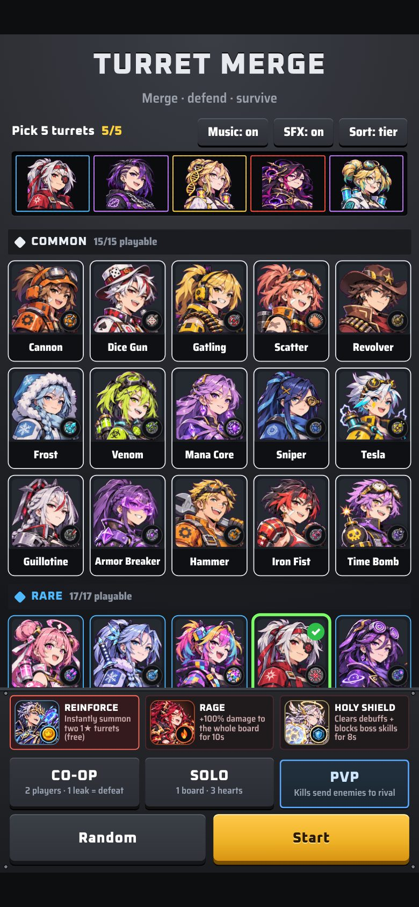 |

Summon sẵn sàng / đang nhấn: 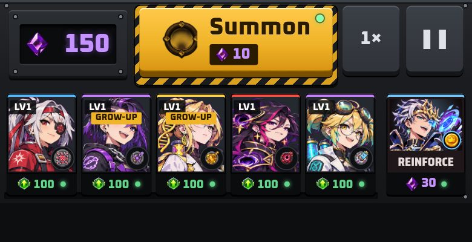 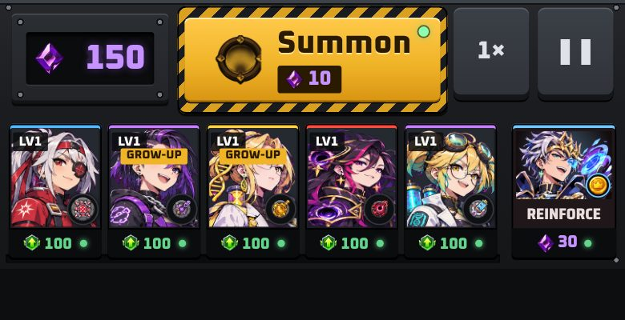

Kích thước khác: 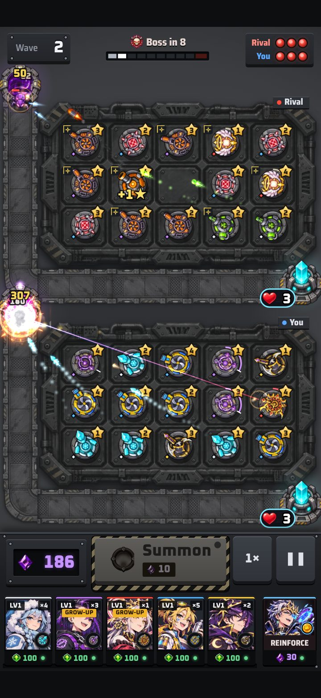 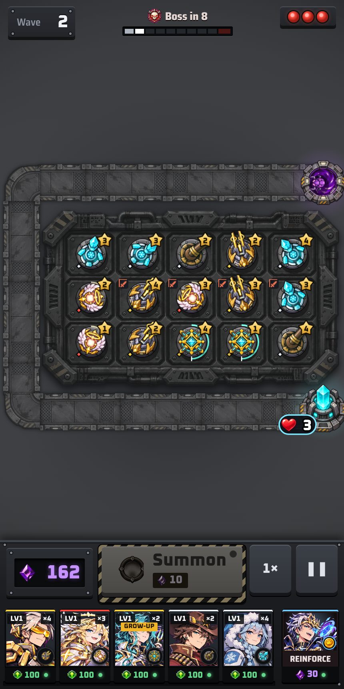
