# BÁO CÁO KIỂM THỬ (QA) — TURRET MERGE · 06/11/2026

Máy giả lập: **iPhone 13** (Chromium + Playwright), chạy bản trong thư mục `thap/`.
Trang thật (github.io) không mở được từ máy kiểm hôm nay (mạng của máy kiểm chặn trang đó), nên chưa kiểm lại trên trang thật — bản sửa sẽ lên trang thật sau khi xuất bản.
Phần chơi online dùng máy chủ giả (2 máy chơi CO-OP với nhau).

Kiểm lại tự động bất cứ lúc nào: `tools/thap-kt-qa-mang.js` (54 bước, **54/54 ĐẠT** sau khi sửa; bản cũ trượt ngay từ bước tắt mạng ở menu). Bài kiểm hồi quy cũ (`tools/thap-kt-hoiquy.js`, iPhone 13) cũng **XANH** sau khi sửa.

---

## 1. Lỗi bạn báo: bảng "BACK ONLINE" che Test range

**Chuyện gì xảy ra:** tắt mạng rồi bật lại → mở TURRET FILE (vd. Blood Circuit 81/93) → khung "test range" bị che bởi bảng **BACK ONLINE – Connection restored – BACK TO MENU**.

**Vì sao:** game có MỘT chỗ "nghe" mạng chung cho cả game (không phân biệt đang ở đâu). Hễ điện thoại báo mất mạng là game bật bảng "CONNECTION LOST" — kể cả khi đang ở menu, trang ụ, hay khung Test range (khung này thực chất là một bản game nhỏ chạy bên trong, nên nó cũng tự bật bảng riêng). Tệ hơn: sau đó game **ngừng tải mọi hình** cho tới khi bấm BACK TO MENU, nên Test range đứng đen.

**Đã sửa (gốc rễ):** bảng mất mạng giờ **chỉ** hiện ở 2 chỗ:
1. đang đánh **trận ONLINE (CO-OP qua phòng)** — đúng chỗ của nó;
2. màn tải **lần đầu** khi chưa vào được game (thiếu hình thì không chơi được).

Ở menu, Turret File, Test range, SOLO, đánh với máy, màn kết quả: mất mạng **không hiện gì**, game chạy tiếp; có mạng lại thì hình nào lỡ tải hỏng sẽ tự tải lại. Sau trận online, bấm BACK TO MENU là bảng biến mất hẳn, không dính lại.

| Trước | Sau |
|---|---|
|  | 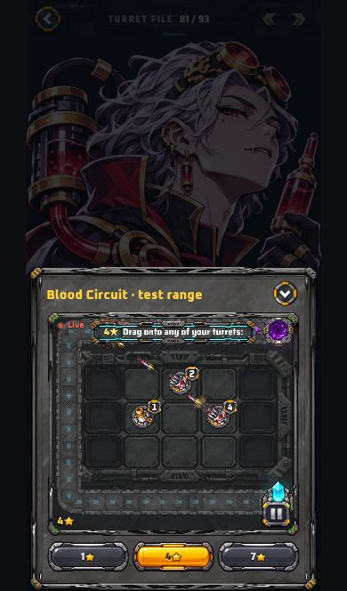 |

---

## 2. Bảng tổng hợp lỗi

| # | Mức độ | Mô tả (lỗi gì, làm sao gặp) | Đã sửa chưa |
|---|---|---|---|
| 1 | 🔴 Nghiêm trọng | **Bảng "CONNECTION LOST / BACK ONLINE" hiện ở menu, Turret File, Test range.** Cách gặp: ở menu tắt mạng 1–2 giây rồi bật lại → bảng che màn; mở Turret File → Test range bị che và đứng đen. (Lỗi bạn báo.) | ✅ Đã sửa |
| 2 | 🔴 Nghiêm trọng | **Mất mạng vài giây trong trận SOLO là trận bị huỷ.** Cách gặp: đang đánh SOLO (không cần mạng), đi vào thang máy / tắt 4G 2 giây → trận biến mất, hiện "The match has ended". | ✅ Đã sửa — trận SOLO chạy tiếp bình thường |
| 3 | 🔴 Nghiêm trọng | **Mở game khi đang mất mạng (đã từng mở, game đã lưu trong máy) → bị chặn ngay bằng bảng mất mạng**, dù game chơi offline được. | ✅ Đã sửa — chỉ báo khi thật sự thiếu hình (sửa theo mã; máy kiểm không có bản lưu sẵn để thử, cần thử trên iPhone thật) |
| 4 | 🟠 Cao | **Test range đen mãi** nếu khung xem trước được nạp đúng lúc mất mạng (game nạp sẵn khung này ~1,5 giây sau khi vào menu). Bật mạng lại vẫn đen cho tới khi tải lại cả game. | ✅ Đã sửa — có mạng lại / mở Test range là tự nạp lại khung |
| 5 | 🟠 Cao | **Bấm Back (vuốt lùi) nhanh có thể THOÁT KHỎI GAME.** Cách gặp: mở hồ sơ ụ → Back → chạm ngay thẻ ụ khác (trong 0,2 giây) → Back lần nữa → rời trang game. | ✅ Đã sửa |
| 6 | 🟡 Trung bình | **Màn kết quả không vừa 1 màn trên iPhone 13**: nút EDIT DECK bị lọt xuống dưới mép màn (dải REWARDS mới đẩy xuống). | ✅ Đã sửa — một phiên làm việc song song đã sửa cùng lúc (bỏ bớt mục, nút ghim đáy); tôi đã kiểm lại: 2 nút luôn thấy, không cuộn |
| 7 | 🟡 Trung bình | **Băng "BOSS INCOMING" nằm đè lên màn kết quả** nếu thua đúng lúc trùm sắp ra. | ✅ Đã sửa — hết trận là dọn mọi băng thông báo |
| 8 | 🟢 Thấp | Turret File trên màn thấp (iPhone 13 trong Safari): dòng giá "300" ở ô cấp thẻ đè lên viền khung 2 px (bài kiểm hồi quy bắt được). | ✅ Đã sửa |

Ghi chú (không phải lỗi, để bạn biết):

| Mục | Ghi chú |
|---|---|
| Nút đổi tiếng Việt (VN) trong Turret File | Game **chưa có** nút đổi ngôn ngữ — chữ kỹ năng chỉ có tiếng Anh. Chữ hiện đúng với kỹ năng của từng ụ. |
| Cửa hàng / Vòng quay / Nhiệm vụ / Sự kiện | Vừa được phiên khác thêm vào trong lúc kiểm — đã kiểm thêm: 4 tab mở được, tắt/bật mạng trong Cửa hàng không hiện bảng, mở/đóng 14 lần không rò. |
| Back ở màn Bộ bài | Vuốt lùi ở màn Bộ bài/HOME sẽ rời trang (cách trình duyệt hoạt động, như mọi trang web). Hồ sơ ụ thì Back đóng hồ sơ, đúng. |
| Xoay ngang | Game giữ khung dọc, thu nhỏ vào giữa màn — đúng thiết kế, không vỡ hình. |
| Trận CO-OP online mất mạng | Hiện "CONNECTION LOST", có mạng lại → "BACK ONLINE" → BACK TO MENU về menu sạch. Đây là chỗ DUY NHẤT bảng này được phép hiện. |

---

## 3. Ảnh trước / sau

**Menu, tắt mạng**

| Trước (bảng che cả menu) | Sau (không có gì, menu dùng bình thường) |
|---|---|
| 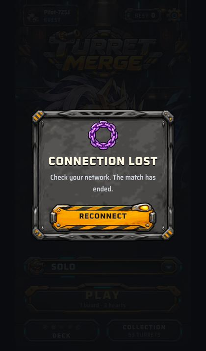 | 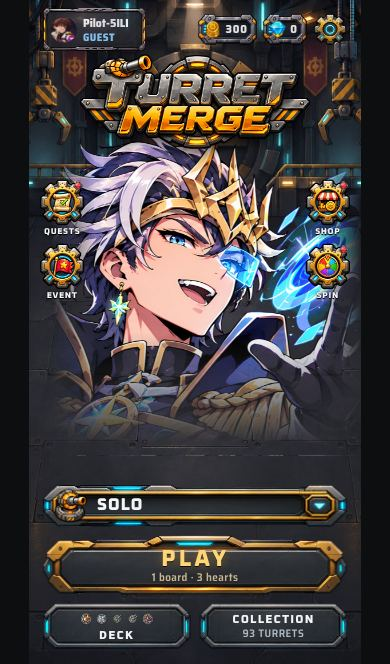 |

**Đang xem Test range, tắt mạng**

| Trước | Sau (demo vẫn chạy) |
|---|---|
| 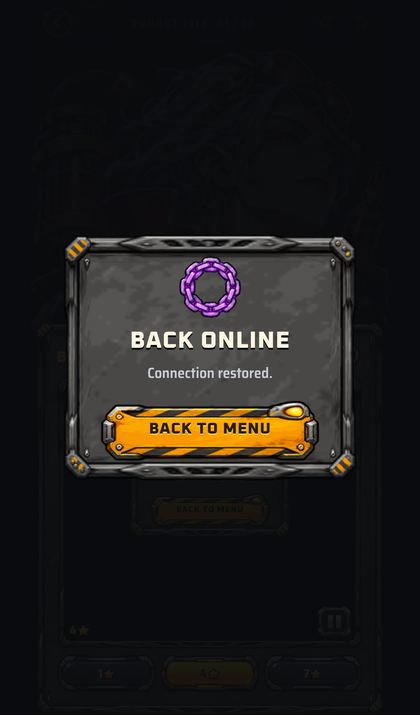 | 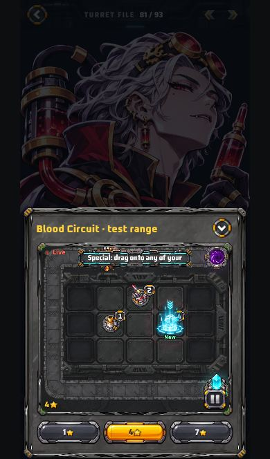 |

**Đổi sang ụ khác sau khi có mạng lại**

| Trước (đứng, không chạy) | Sau |
|---|---|
| 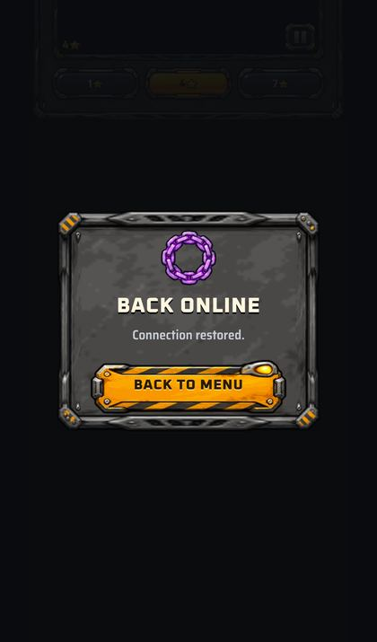 | 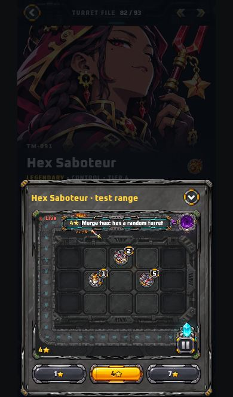 |

**Trận SOLO, tắt mạng 3 giây**

| Trước (trận bị huỷ) | Sau (trận chạy tiếp) |
|---|---|
| 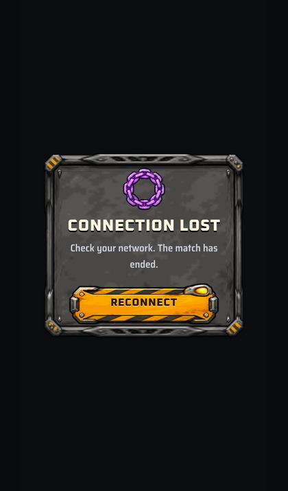 | 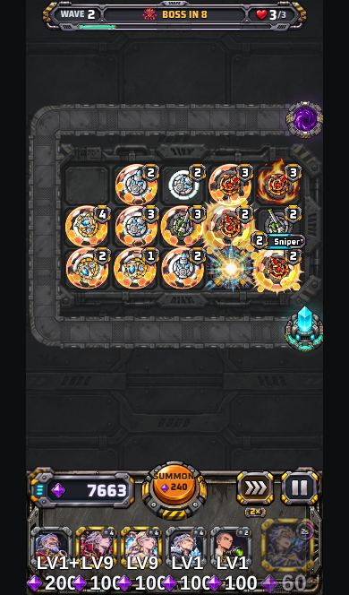 |

**Màn kết quả (iPhone 13)**

| Trước (băng trùm đè, EDIT DECK lọt mép) | Sau (không băng trùm, vừa 1 màn) |
|---|---|
| 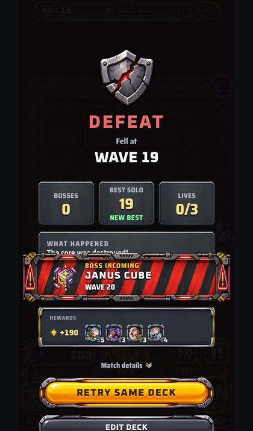 | 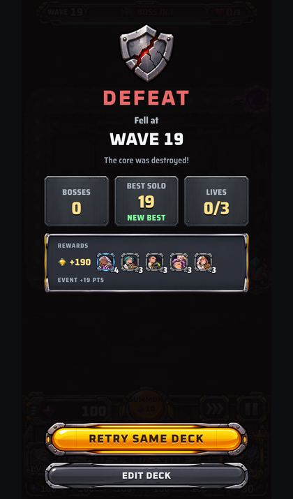 |

**Trận CO-OP online — bảng mất mạng hiện ĐÚNG chỗ, rồi về menu sạch**

| Mất mạng | Có mạng lại | Bấm BACK TO MENU |
|---|---|---|
| 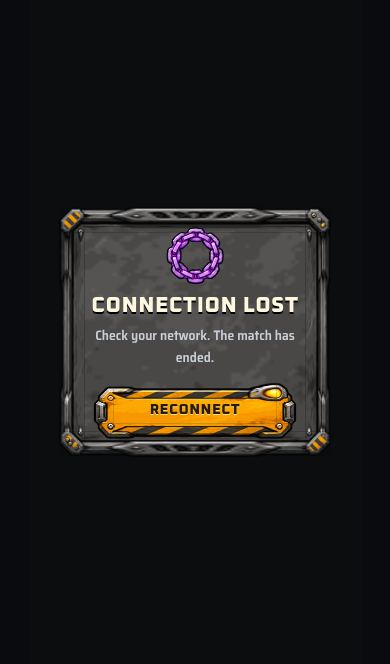 | 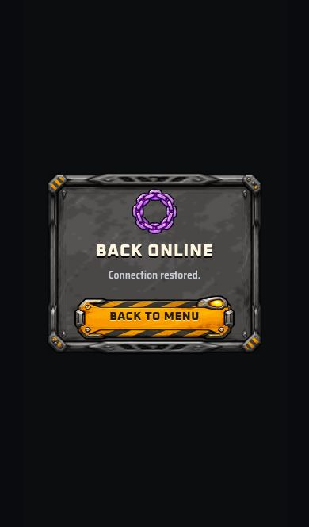 | 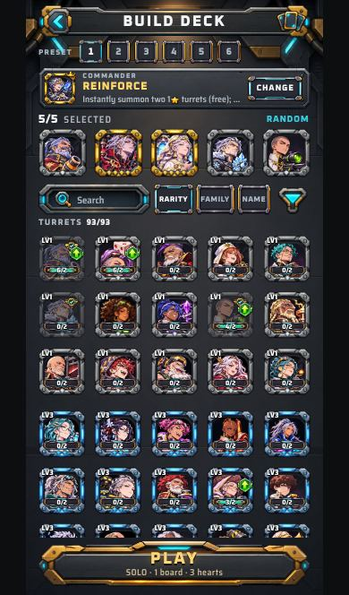 |

Sau trận online, tắt/bật mạng rồi mở Turret File: sạch, demo chạy → 

---

## 4. Những gì đã kiểm và ĐẠT

- Mở game lần đầu: màn tải → menu trong ~2,3 giây (máy kiểm). Không lỗi.
- Bộ bài: chạm ô để bỏ ụ, chạm đôi thẻ chỉ mở 1 hồ sơ.
- Turret File: Blood Circuit (81/93), Hex Saboteur (82), Sanctum (83), Prism Thief (84) — các ụ vàng mới — và Cannon: Test range chạy, chữ kỹ năng đúng.
  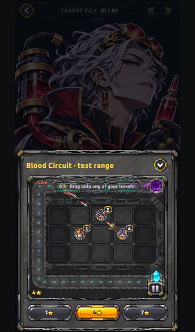 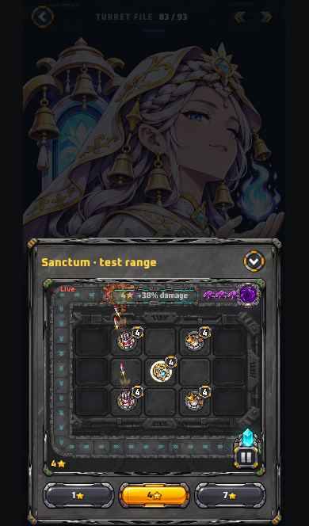
- Cài đặt mở/đóng được.
- Cửa hàng (SHOP / SPIN / QUESTS / EVENT): mở được cả 4, tắt/bật mạng không có bảng, mở/đóng 14 lần không tăng bộ hẹn giờ.
   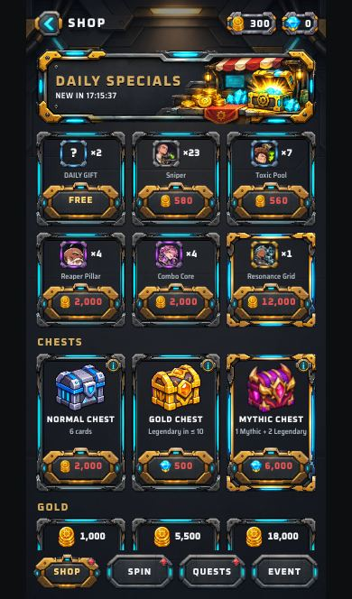
- 1 trận SOLO đầy đủ: triệu ụ, ghép 1★+1★ → 2★, nâng cấp, ụ vàng (Blood Circuit, Sanctum) đánh, trùm ra ở wave 10, thua → màn kết quả → về menu.
  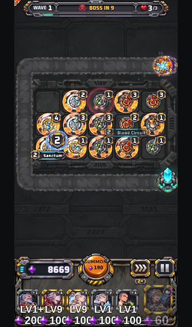 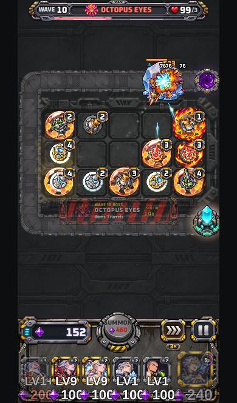 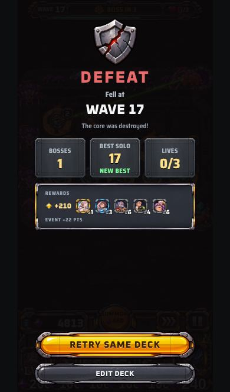
- Chạm đôi nút PLAY: chỉ vào 1 trận.
- Ẩn app rồi mở lại giữa trận: trận còn nguyên.
- Mở lại Bộ bài / Turret File / Cài đặt **20 lần**: không tăng bộ nghe sự kiện (48→48), không tăng bộ hẹn giờ (4→4), bộ nhớ gần như không đổi (8,7→9,2 MB), không tải lại cả game.
- Không có lỗi JavaScript / console trong cả vòng kiểm.

---

## 5. Đã sửa ở đâu (cho người lập trình)

- `thap/js/taitai.js` — gốc rễ: bộ nghe `offline`/`online` toàn cục giờ có phạm vi (`TAI.canChe()` = màn tải đầu hoặc trận online `ONS.on`); ngoài phạm vi đó tải hình chỉ **đợi mạng** (`TAI.choMang`) chứ không bật `TAI.mat`; có mạng lại → `REN.thuLaiLoi()`; bỏ chặn ngay khi mở game lúc offline.
- `thap/js/unitpage.js` — khung Test range nạp hỏng lúc mất mạng tự nạp lại (`UP.cuuXem`, dựa vào tin "đã nghe" `tmXemSS`); mở hồ sơ trong lúc đang trượt ra vẫn ghi lịch sử Back.
- `thap/js/game.js` — `anBangTran()` khi hiện kết quả (dọn BOSS INCOMING / băng wave / cut-in).
- Màn kết quả vừa 1 màn: do phiên song song sửa (`thap/css/thebai.css`, commit b2b9739); đã kiểm lại bằng `tools/thap-kt-ketqua-vua.js` (315/315 đạt) và bài QA này.
- `thap/css/thebai.css` — ô cấp thẻ cao 56 → 58 px trên màn thấp.
- `tools/thap-kt-qa-mang.js` — bài kiểm mới (vòng QA này). `tools/thap-kt-hoiquy.js` — bước "mất mạng ở menu" đổi theo luật mới (KHÔNG được hiện bảng).
