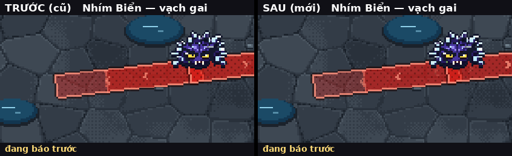
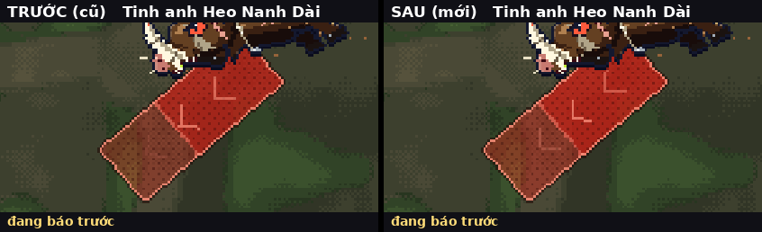
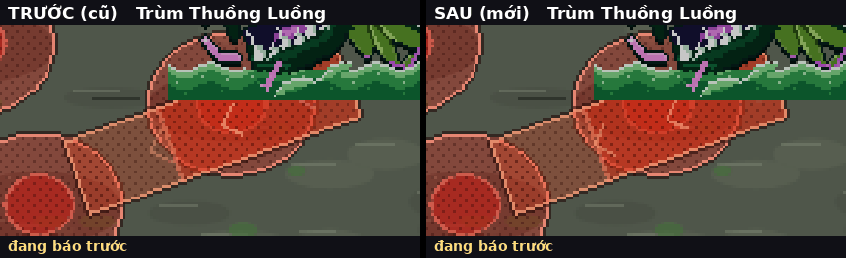

# Hình báo trước tắt ngay khi đòn ra (17/10)

Chủ game báo (chơi trên iPhone, ảnh `binh-mau-goc/anh-chu-game.png`): *"Báo trước xong thì phải tắt đi chứ."*

## Tóm tắt cho chủ game

- **Đã sửa.** Trước đây, mỗi khi đòn của quái ra, hình đỏ báo trước (vòng, dải, quạt, vành) chưa tắt ngay mà **còn chớp sáng thêm khoảng 0,22 giây** rồi mới tan. Khi quái chết hoặc bị choáng, hình còn mờ dần thêm **0,16 giây**, có khi lâu hơn vì lúc hạ quái game "khựng hình" một nhịp. Có ca hình còn hiện tới **0,95 giây** sau khi quái bị choáng (Chồn Bóng).
- **Bây giờ:** đòn ra thì hình báo **tắt trong 0,1 giây** (chỉ còn một chớp rất nhanh đúng lúc nổ). Quái chết, bị choáng hay bị ngắt chiêu thì hình **tắt ngay** (mờ 0,08 giây).
- **Không đổi gì về luật chơi:** thời gian báo trước, lúc ra đòn, vùng trúng và sát thương giữ nguyên. Chỉ đổi lúc **hình** biến mất.
- **Vẫn giữ hình báo** khi đòn **vẫn nổ thật**. Ví dụ: quái đã ném bom hay bào tử rồi mới chết thì quả bom vẫn nổ, nên vòng đỏ chỗ bom rơi vẫn hiện. Trùm bị choáng thì các vùng trùm đã đặt vẫn nổ đúng giờ, nên hình vẫn hiện. Tắt hình ở những ca này thì Cu Tí sẽ ăn đòn mà không biết chỗ nào nguy hiểm.
- **Vũng kéo dài** (vũng độc, vệt lửa, vũng điện, vũng băng) vốn đã là **hình vũng riêng** (ảnh `hu-vung-*`). Hình báo trước của đòn tạo vũng cũng tắt sau 0,1 giây, còn vũng thì vẫn hiện đúng chỗ gây sát thương thật.
- **Muốn xem lại như cũ:** thêm `?baotat=0` vào địa chỉ game.

## Đo bằng bot (không chơi tay)

Công cụ: `game/tests/bao_truoc_tat.py` (+ `bao_truoc_tat_lib.js`). Mỗi cảnh dựng một phòng, Cu Tí bất tử đi vòng chậm giữa phòng. Bot chạy thật và **vẽ từng khung như game**. Với mỗi hình báo trước, bot ghi khung đầu, khung cuối còn vẽ (phần báo / chớp nổ / mờ khi huỷ) và **lúc đòn thật ra**:

- vùng gây sát thương: lúc chính vùng đó nổ;
- vùng chỉ để báo (không có sát thương, ví dụ vạch gai của Nhím Biển): sự kiện đầu tiên của cùng con quái nằm trong vùng báo (vùng sát thương nổ, đạn bay ra từ gốc vạch, quái ra đòn, vật lăn xuất hiện).

Có 4 vùng × (8 quái thường + 2 tinh anh + trùm nhỏ + trùm vùng; trùm vùng 4 là Thuồng Luồng mới). Mỗi con chạy 4 cảnh:

1. **chạy tự nhiên**: quái 22 giây, trùm nhỏ 40 giây, trùm vùng 70 giây; máu trùm được hạ để qua đủ các pha;
2. **giết quái** đúng lúc hình báo đang hiện;
3. **làm choáng** đúng lúc hình báo đang hiện;
4. **đưa Cu Tí sang phòng khác** (trừ trùm vùng).

Kết quả gốc: `do-truoc.json` (`?baotat=0`) và `do-sau.json`.

### Bảng trước / sau

| Nhóm | Vùng | Số hình báo đo (chạy tự nhiên) | Ca còn hiện > 0,1 s sau khi đòn ra (mọi cảnh): trước → sau | Lâu nhất: trước → sau | Còn hiện khi quái chết / choáng (đòn đã huỷ): trước → sau | Rời phòng |
|---|---|---|---|---|---|---|
| Quái thường | Rừng già | 77 | 77 → **0** | 0,23 s → 0 s | 12 → **0** | 0 → 0 |
| Tinh anh | Rừng già | 18 | 13 → **0** | 0,23 s → 0 s | 2 → **0** | 0 → 0 |
| Trùm nhỏ | Rừng già | 48 | 11 → **0** | 0,23 s → 0 s | 0 → **0** | 0 → 0 |
| Trùm vùng | Rừng già | 119 | 68 → **0** | 0,23 s → 0 s | 0 → **0** | 0 → 0 |
| Quái thường | Biển | 196 | 209 → **0** | 0,23 s → 0 s | 48 → **0** | 0 → 0 |
| Tinh anh | Biển | 12 | 10 → **0** | 0,23 s → 0 s | 6 → **0** | 0 → 0 |
| Trùm nhỏ | Biển | 27 | 26 → **0** | 0,23 s → 0 s | 0 → **0** | 0 → 0 |
| Trùm vùng | Biển | 87 | 86 → **0** | 0,23 s → 0 s | 0 → **0** | 0 → 0 |
| Quái thường | Lâu đài | 116 | 116 → **0** | 0,23 s → 0 s | 24 → **0** | 0 → 0 |
| Tinh anh | Lâu đài | 13 | 17 → **0** | 0,23 s → 0 s | 6 → **0** | 0 → 0 |
| Trùm nhỏ | Lâu đài | 17 | 18 → **0** | 0,23 s → 0 s | 0 → **0** | 0 → 0 |
| Trùm vùng | Lâu đài | 25 | 23 → **0** | 0,23 s → 0 s | 0 → **0** | 0 → 0 |
| Quái thường | Sông sâu | 89 | 89 → **0** | 0,23 s → 0 s | 12 → **0** | 0 → 0 |
| Tinh anh | Sông sâu | 17 | 19 → **0** | 0,23 s → 0 s | 4 → **0** | 0 → 0 |
| Trùm nhỏ | Sông sâu | 39 | 40 → **0** | 0,23 s → 0 s | 0 → **0** | 0 → 0 |
| Trùm vùng | Sông sâu | 45 | 47 → **0** | 0,23 s → 0 s | 0 → **0** | 0 → 0 |
| **Tổng** | | 945 | 869 → **0** | | 114 → **0** | |

"Ca" là một hình báo trong một cảnh. Cảnh giết / choáng / rời phòng cũng được tính, nên số ca có thể lớn hơn cột "số hình báo đo".

- Lâu nhất sau khi **quái chết**: trước 0,28 giây → sau **0,08 giây**. Lâu nhất sau khi **bị choáng**: trước 0,95 giây → sau **0,08 giây**.
- **Đổi pha** (trùm nhỏ, trùm vùng): luật chơi vốn đã xoá ngay mọi vùng của trùm khi đổi pha, nên trước và sau đều 0. Vẫn còn một nhịp chớp nổ 0,22 giây nếu đòn nổ ngay trước lúc đổi pha; nay còn 0,1 giây.
- **Rời phòng:** trước và sau đều 0. Hình báo của phòng cũ không bao giờ vẽ sang phòng mới.
- **Ca giữ hình vì đòn vẫn nổ thật:** trước 65 ca, sau 58 ca (cảnh giết / choáng). Gồm bào tử Hoa Phun, hạt dẻ Sóc, vũng điện Sứa, cú đáp của Cá Chuồn, bùa tam giác Tiểu Yêu, và vùng của trùm khi trùm choáng (Mộc Tinh "Mưa quả độc", Ngư Tinh "Bổ rìu san hô", Nấm Chúa, Cua Đá, Thuồng Luồng "Vòng thân"…). Các vùng này vẫn nổ và vẫn trúng Cu Tí, nên hình báo phải còn.

### Các loại "còn hiện" tìm được

1. **Chớp nổ 0,22 giây** sau MỌI đòn có hình báo: vòng, dải, quạt, vành, tường nước, vòng chỗ quái mọc. Đây là ca chính chủ game thấy. Ví dụ Nhím Biển: vòng đỏ dựng gai (1,4 giây) chớp lố 0,25 giây sang lúc hai vạch gai đã hiện; hai vạch gai chớp thêm 0,2 giây trong lúc gai đang bay ra. **Sửa:** chớp còn 0,1 giây (khung 8 "chớp nổ" của ảnh báo trước).
2. **Mờ khi huỷ 0,16 giây** cộng nhịp khựng hình lúc hạ quái (~0,1 giây): quái chết hoặc bị choáng mà hình chưa tắt ngay. **Sửa:** vùng nào luật chơi chắc chắn sẽ huỷ ở lượt tính kế tiếp thì tắt hình ngay khung đó (mờ 0,08 giây). Đó là: quái chết, quái bị choáng khi đòn chưa ra, vùng `knHuy`.
3. **Vùng chỉ để báo của quái đang choáng** (Chồn Bóng: vòng đỏ chỗ sẽ hiện ra, sau khi đã lặn): trước còn hiện suốt lúc choáng (~0,95 giây). **Sửa:** tắt ngay khi bị choáng.
4. Không thấy ca nào phần **báo (lấp dần)** còn chạy sau khi đòn ra. Mọi vùng báo đều hết đúng lúc đòn ra; chỉ có phần chớp nổ là lố.

Về ảnh chủ game (vòng đỏ dưới Nhím Biển): vòng đó là vòng **dựng gai**. Nó hiện 1,4 giây, sau đó tới 0,8 giây hai vạch gai, rồi gai mới bắn. Vòng hết đúng lúc vạch gai hiện, nhưng còn chớp lố 0,25 giây (đã sửa). Nếu Cu Tí đánh bật Nhím lùi lại trong lúc dựng gai thì vòng nằm lệch khỏi thân Nhím. Vòng là vị trí lúc bắt đầu dựng gai và tắt trước khi gai bắn. Phiên này không đổi chỗ vòng, vì đó không phải lỗi "hình tồn tại sai lúc".

## GIF trước / sau

Mỗi GIF có hai nửa: bên trái là **TRƯỚC** (`?baotat=0`), bên phải là **SAU**. GIF phát chậm 3 lần. Dòng chữ dưới cho biết đòn đã ra bao lâu và hình báo còn hiện hay đã tắt. Số đo: trước còn hiện 8 khung chụp (~0,27 giây) sau khi đòn ra, sau chỉ còn ≤ 0,1 giây.

| Nhím Biển (vạch gai) | Tinh anh Heo Nanh Dài | Trùm Thuồng Luồng (Phun nước đen) |
|---|---|---|
|  |  |  |

Ở GIF Thuồng Luồng: sau khi tia nước ra, phần còn lại là **vệt độc** (hình vũng riêng, gây sát thương thật), không phải hình báo trước. Các vòng đỏ khác trong khung là "Vòng thân" vẫn đang trong lúc báo.

Dựng lại GIF: `cd game && python3 tests/bao_truoc_tat_gif.py ../docs/review/ke-hoach-cai-thien/bao-truoc-tat`.

## Đã sửa ở đâu

Chỉ một tệp game: `game/js/bao_truoc.js`.

- `FLASH` 0,22 → **0,1** giây và `CANCEL` 0,16 → **0,08** giây (đọc lại mỗi khung theo `G.BAO_TAT`). `BT.dat` lọc chớp / mờ đã hết giờ **trước** khi vẽ (trước đây lố thêm một khung).
- `seHuy(z)`: vùng của quái thường / tinh anh mà luật chơi sẽ huỷ (quái chết + `cancel`; choáng / đông băng + `knHuy` hoặc đòn chưa ra; vùng chỉ để báo của quái đang choáng) thì tắt hình ngay (`z._btTat`, không chớp nổ, mờ 0,08 giây). Không đụng vùng `knGiu` (vật đã ném ra) và vùng của trùm nhỏ / trùm vùng.
- Cờ `?baotat=0` (hoặc `G.BAO_TAT = false`): như cũ hoàn toàn.

Không đụng: đăng nhập Google, lưu mây, `?cloud=0`, thời gian báo trước, lúc ra đòn, vùng trúng, sát thương.

## Kiểm tra

- `node --check` các tệp JS đã sửa / thêm: đạt.
- `python3 game/build.py` (bản một tệp **29,89 MB** / trần 30 MB) và `python3 game/build.py --hai-tep` (tải đầu **5,54 MB** / trần 20 MB): đạt.
- Mở headless `dist/linh-khi.html` (mặc định, `?baotat=0`, `?cloud=0`) và `dist/linh-khi-nhe.html` qua máy chủ thử, vào ải cả 4 vùng: **0 lỗi JS**. Bản hai tệp có một dòng 404 của `sw.js`. Đó là vì máy chủ thử không có tệp này (workflow đăng web mới thêm vào), không phải lỗi JS, và trước phiên này cũng vậy.
- `bao_truoc_tat.py` mặc định và `?baotat=0`: 0 lỗi JS. Bảng ở trên.
- `tests/bao_truoc.py`: 20/21. Mục hỏng ("thân bé bị phủ đỏ 4 điểm", đường vẽ cũ `?baoanh=0`) **hỏng y hệt khi chạy trên mã trước phiên này**, không do phiên này.
