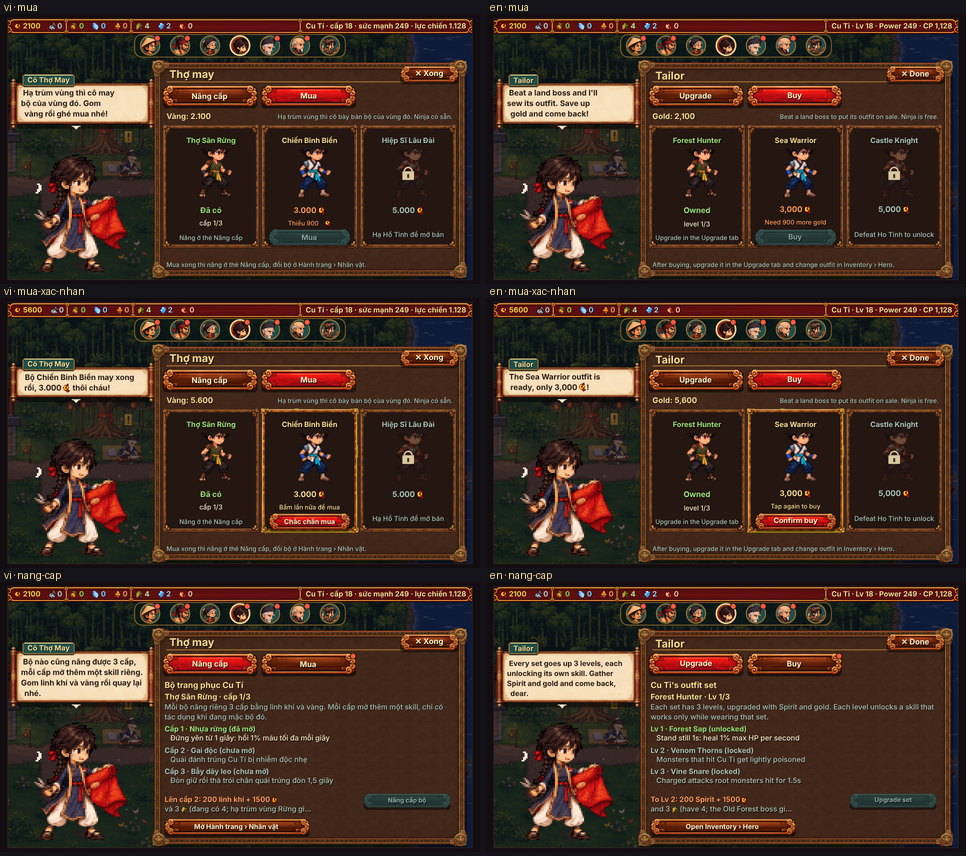

# Bộ đồ Cu Tí mua bằng vàng ở Cô Thợ May (15/10/2026)

Chủ game quyết (15/10 23:08): các bộ trang phục của Cu Tí phải **mua bằng vàng** ở Cô Thợ May; hạ trùm vùng thì bộ đó mới **mở bán**
(Ninja có sẵn; Rừng sau Mộc Tinh, Biển sau Ngư Tinh, Lâu đài sau Hồ Tinh).

## 1. Đã làm gì

| Chỗ | Thay đổi |
|---|---|
| `game/js/data.js` | `G.BO_MUA.gia` (bảng giá duy nhất), `G.BO_MUA_BAT` (cờ), `G.zedBoGia`, `G.zedBoHa` (đã hạ trùm vùng của bộ, mọi độ khó), `G.zedBoBan` (đang bày bán). `G.zedBoMo` giữ nghĩa "đã CÓ" (mặc / nâng được). Câu mẹo về Cô Thợ May viết lại; thành tựu "Tủ đồ": "Có đủ 4 bộ trang phục". Vàng nâng bộ cấp 1: 500 → 300 (bù, mục 3). |
| `game/js/stage.js` | Hạ trùm vùng **không tặng bộ nữa**: ghi `save.zed.boBan[bộ] = 1`, `save.zed.boMua = 1`, dấu báo `save.zed.boBanBao`; bảng kết quả thêm dòng "Cô Thợ May đã có bộ …, ghé mua nhé!". `?bocu=1`: tặng như cũ. |
| `game/js/engine.js` (`G.fixSave`) | Bù an toàn bản lưu cũ (xem mục 2). Chuẩn hoá `boMo`, `boBan`, `boBanBao`, `boXem`. |
| `game/js/vk_moi.js` | `VM.boMuaDuoc` (lý do: Đã có / Chưa mở bán / Thiếu vàng), `VM.muaBo` (trừ vàng, thêm vào `boMo`), `VM.boDangBan`, `VM.coTheMuaBo` (chấm đỏ), `VM.daXemBan`. `VM.boDuoc` báo "Chưa mua bộ". `VM.canLai` (cân lại một lần cho bản lưu cũ) không còn tặng bộ chỉ mới mở bán. `VM.boPanel` có tuỳ chọn bỏ dòng "Các bộ" (bảng Cô Thợ May đã có thẻ Mua). |
| `game/js/vk_moi_lang.js` | Bảng Cô Thợ May có 2 thẻ **Nâng cấp \| Mua**. Thẻ Mua: số vàng, 3 ô bộ vùng (hình Cu Tí mặc bộ đó, tên, giá; chưa mở bán thì hình mờ + ổ khoá + "Hạ <trùm> để mở bán"; đã có thì "Đã có · cấp x/3"), nút **Mua bấm 2 lần** (lần 1 → "Chắc chắn mua" + "Bấm lần nữa để mua"), thiếu vàng thì nút tắt + "Thiếu N vàng". Mọi chữ trong ô bằng `T.chuTrongKhung`. Mở bảng: có bộ mới bán chưa xem / đủ vàng thì vào thẳng thẻ Mua. |
| `game/js/village_scene.js` | Chấm đỏ Cô Thợ May khi có bộ vừa mở bán chưa xem hoặc đủ vàng mua; về làng báo một lần "Cô Thợ May đã có bộ …, ghé mua nhé!". Câu chào của cô: "Hạ trùm vùng là cô may bộ mới, gom vàng ghé mua nhé." |
| `game/js/hanh_trang.js` | Dưới hình Zed: "Mua <bộ> ở Cô Thợ May" (đang bán) / "Hạ <trùm> để mở bán <bộ>" (chưa bán). Dòng công dụng vàng thêm "mua". |
| `game/js/village.js` | Mục trợ giúp mới "Bộ trang phục" ở Cụ Đồ (giá đọc từ `G.BO_MUA`). |
| Chữ tiếng Anh | `tools/ngon-ngu/tu-dien/bo-do-mua.json` (32 câu) + chèn vào `game/js/ngon_ngu_en.js` (không chạy lại `gop.py` vì tệp đang có câu thêm tay của phiên khác, chạy lại sẽ mất). |
| Bot / mô hình | `game/tests/bot_nang.js`: bot mua bộ khi đủ vàng, chưa đủ thì để dành (`G.botMuaBo`, `G.botDeDanh`). `tools/can-bang/tinh.js`: chiến dịch "có mua bộ" mua bằng vàng + để dành; thêm dòng "Bộ tặng như cũ (?bocu=1)" và "Mốc mua bộ". |

## 2. Bản lưu cũ

- Cờ mới `save.zed.boMua = 1` đánh dấu bản lưu đã theo luật mua. `G.fixSave` gặp bản lưu **chưa có cờ** (bản cũ, máy hay mây): mọi bộ đã có giữ nguyên (cấp `boCap` không đổi), bộ của vùng đã hạ trùm mà chưa có thì **tặng bù như luật cũ** (không bắt mua lại), rồi đặt cờ. Từ đó về sau không tặng bù nữa.
- Bản lưu mới: `stage.js` đặt cờ ngay lúc hạ trùm vùng đầu tiên (kể cả khi bản lưu chưa đi qua `fixSave`), nên không lọt đường "tặng bù".
- `VM.canLai` (chạy một lần cho bản lưu chưa cân lại) chỉ giữ bộ đã có mà trùm vùng đã hạ.
- Lưu mây: trường mới nằm trong `save.zed` (đi theo bản lưu, không đổi cách lưu / đăng nhập / `?cloud=0`). `cloud_save_regression.test.js` đạt.

## 3. Giá chốt và cân bằng

**Giá chốt: Rừng 1.500 · Biển 3.000 · Lâu đài 5.000 vàng** (giữ đúng đề xuất). **Bù: vàng nâng bộ cấp 1 500 → 300** (`G.BO_MOI.gia[0].vang`, áp cho cả 4 bộ, Ninja cũng rẻ hơn 200).

### Bot chơi thật trong Node (`python3 tests/cay.py 12 --node`, 12 lượt chiến dịch, kiểu "khuyen")

Bot mua bộ ngay khi đủ vàng, chưa đủ thì để dành (không mài / ép / nâng lò bằng phần vàng dành cho bộ) — như người chơi muốn có bộ.

| | Trước (bộ tặng, mã gốc) | Sau (giá chốt + cấp 1 = 300) | `?bocu=1` trên mã mới |
|---|---|---|---|
| Tổng thời gian qua 15 ải (TB / trung vị) | 192 / 196 phút | **188 / 184 phút (−2%)** | 185 / 180 phút |
| Tổng lần chơi | 40 | 40 | 38 |
| Sức mạnh lúc qua 3-5 | 592 | 578 | 597 |
| Vàng còn lúc qua 3-5 | 2.427 | 1.889 | 1.875 |
| Có bộ Rừng (mua / tặng) | 2-1 (tặng) | **mua ở 2-2** (sớm nhất 1-5, muộn nhất 2-3; 12/12) | 2-1 |
| Có bộ Biển | 3-1 (tặng) | **mua ở 3-2** (3-1 … 3-3; 12/12) | 3-1 |
| Bộ Rừng cấp 2 / Biển cấp 2 | 2-5 / 3-1 | 2-5 / 3-4 | 2-5 / 3-1 |

Số lần chơi trung bình từng ải (trước → sau):

| Ải | 1-1 | 1-2 | 1-3 | 1-4 | 1-5 | 2-1 | 2-2 | 2-3 | 2-4 | 2-5 | 3-1 | 3-2 | 3-3 | 3-4 | 3-5 |
|---|---|---|---|---|---|---|---|---|---|---|---|---|---|---|---|
| Trước | 1.0 | 1.0 | 1.1 | 2.0 | 3.9 | 1.3 | 2.1 | 4.5 | 1.8 | 5.4 | 1.9 | 1.3 | 5.8 | 1.8 | 4.5 |
| Sau | 1.0 | 1.0 | 1.7 | 1.8 | 3.7 | 1.2 | 3.9 | 4.2 | 1.2 | 5.3 | 1.3 | 2.5 | 5.2 | 1.6 | 4.8 |

Nhận xét: tổng thời gian không đổi (dao động giữa hai lượt đo cùng mã ~±5%). Việc để dành vàng mua bộ dồn vài lượt cày vào **2-2** (2,1 → 3,9) và **3-2** (1,3 → 2,5) — đúng lúc vừa vào vùng mới, rồi bộ mới lại giúp qua 2-3, 2-4, 3-3 nhanh hơn. Không ải nào quá 9 lần; mọi luật của `cay.py` đạt.

Các phương án đã thử (bot, cùng 12 lượt):

| Phương án | Tổng thời gian | Mua Rừng | Mua Biển |
|---|---|---|---|
| 1.500 / 3.000, bot tiêu hết vàng (không để dành) | 185 phút | 2-5 | 3-3, chỉ 9/12 lượt mua kịp trước khi hết 3-5 |
| 1.200 / 2.500, bot tiêu hết vàng | 182 phút | 2-4 | 3-1/3-2, 10/12 |
| 1.500 / 3.000, để dành, cấp 1 = 500 | 191 phút | 2-2 | 3-2, 12/12 |
| 1.200 / 2.500, để dành, cấp 1 = 500 | 179 phút | 2-2 | 3-2, 12/12 |
| **1.500 / 3.000, để dành, cấp 1 = 300 (chốt)** | **188 phút** | **2-2** | **3-2, 12/12** |

Kết luận: với giá đề xuất, người chơi chịu để dành mua được bộ vùng ngay đầu vùng kế tiếp (Rừng quanh 2-2, Biển quanh 3-2). Người tiêu hết vàng vào mài vẫn mua được Rừng trong vùng hai nhưng Biển có thể trễ tới cuối vùng ba — thẻ Mua hiện "Thiếu N vàng" và chấm đỏ khi đủ vàng để nhắc.

### Mô hình số (`node tools/can-bang/tinh.js`, dòng "Có mua bộ")

| | Lượt chơi qua 15 ải | Mua Rừng | Mua Biển |
|---|---|---|---|
| Bộ tặng như cũ | 30 | — (có ở 1-5) | — (có ở 2-5) |
| Giá chốt, cấp 1 = 500 | 33 (+10%) | lượt 8 (ải 2-2) | lượt 22 (3-3) |
| **Giá chốt, cấp 1 = 300** | **32 (+7%)** | lượt 8 (2-2) | lượt 22 (3-3) |
| 1.200 / 2.500, cấp 1 = 500 | 31 (+3%) | lượt 7 | lượt 21 |

Mô hình (người chơi tiêu vàng theo kỳ vọng, không tính tay chơi) chậm hơn bot nhưng vẫn trong ±10% sau khi bớt vàng cấp 1. Bộ Lâu đài (5.000) mua sau Hồ Tinh, trong lúc cày vùng 4 (Sông sâu) — chiến dịch 15 ải không đo được.

Thu chi thêm: mỗi bản lưu mới tiêu thêm 1.500 + 3.000 + 5.000 = 9.500 vàng cho 3 bộ, trả lại 4 × 200 = 800 vàng ở cấp 1 → chỗ tiêu vàng mới ròng ~8.700 vàng (giữa / cuối game trước đây dư vàng, xem `LUAT-CAN-BANG.md` mục "kinh tế sau 3-5 không dư thêm": vàng còn lúc qua 3-5 giảm 2.427 → 1.889).

## 4. Cờ quay lui

`?bocu=1` (`G.BO_MUA_BAT = false`): hạ trùm vùng là có bộ ngay như trước, `fixSave` tặng bù theo sao ải trùm như cũ, Cô Thợ May không có thẻ Mua (bảng như cũ), không mua được bộ. Giá cấp 1 = 300 vẫn áp dụng.

## 5. Kiểm

- `node --check` mọi tệp `game/js/*.js`, `tests/bot_nang.js`, `tools/can-bang/tinh.js`: đạt.
- `node game/tests/bo_do_mua.test.js` (mới, 22 điều kiện): bản lưu cũ có bộ Biển cấp 2 đang mặc → vẫn có, cấp 2, đang mặc (cả khi qua `VM.canLai`); bản lưu cũ đã hạ Mộc Tinh → giữ bộ Rừng; bot hạ Mộc Tinh → bộ Rừng mở bán nhưng chưa có, không mặc / nâng được, nạp lại không tặng bù, có dòng báo; mua trừ đúng 1.500 vàng; thiếu 1 vàng không mua, vàng giữ nguyên; bộ chưa mở bán không mua dù đủ vàng; đi qua JSON + `fixSave` (lưu mây) vẫn giữ; `?bocu=1` tặng như cũ; vẽ thẻ Mua / Nâng cấp VI + EN không lỗi.
- `cloud_save_regression`, `vung4`, `thanh_tuu`, `su_kien`, `viec_ngay`, `so_yeu_quai`, `cam_giac_danh` (Node): đạt. `may_luat` bỏ qua (thiếu thư viện Firestore emulator, như trước).
- `python3 game/build.py` và `--hai-tep`: đạt.
- Ảnh soát tĩnh `xem-truoc.png` (VI trái, EN phải; thẻ Mua, Mua lúc chờ bấm lần 2, Nâng cấp): `python3 game/tests/bo_do_mua_shots.py` (mở `dist/linh-khi.html`, đặt bản lưu, vẽ một khung hình — không chơi thử). Chữ chưa dịch: 0; chữ bị cắt "…" trong khung: 0; lỗi console: 0.

