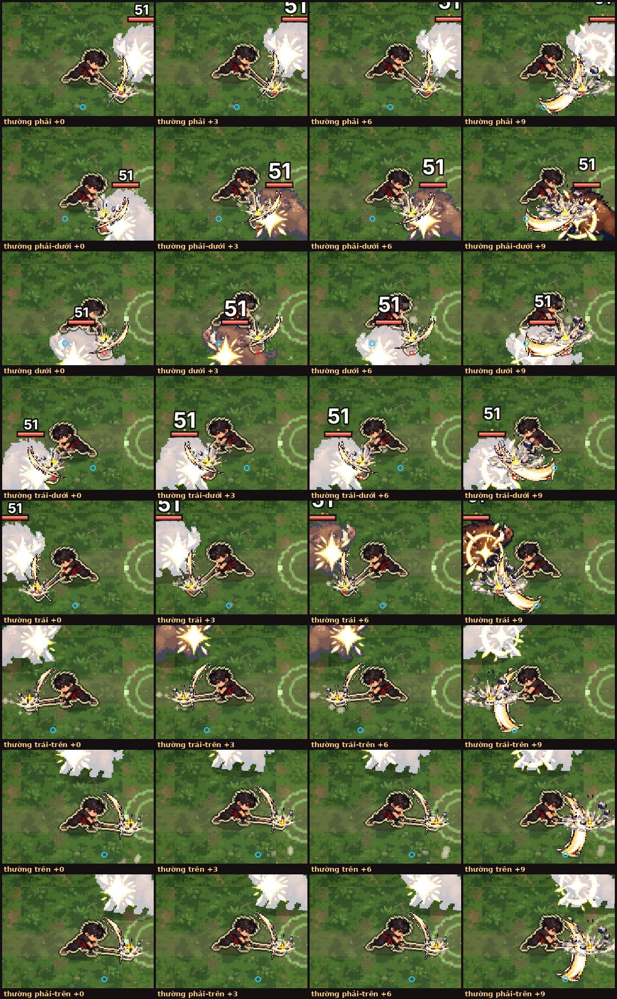
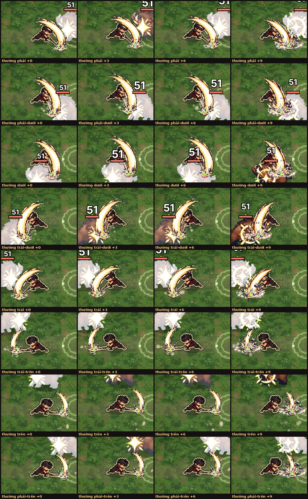
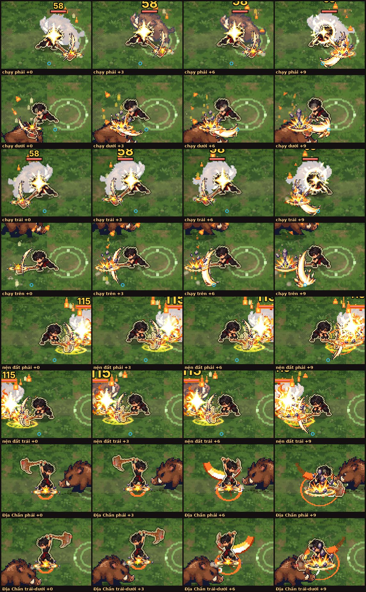
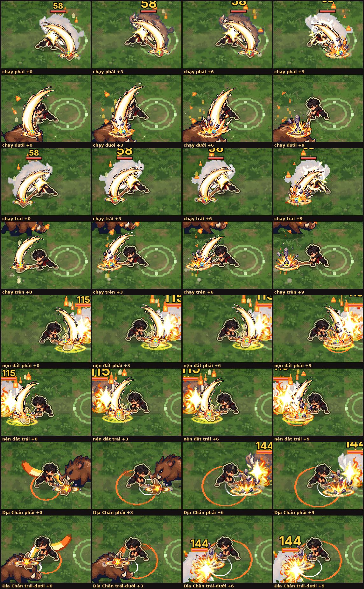
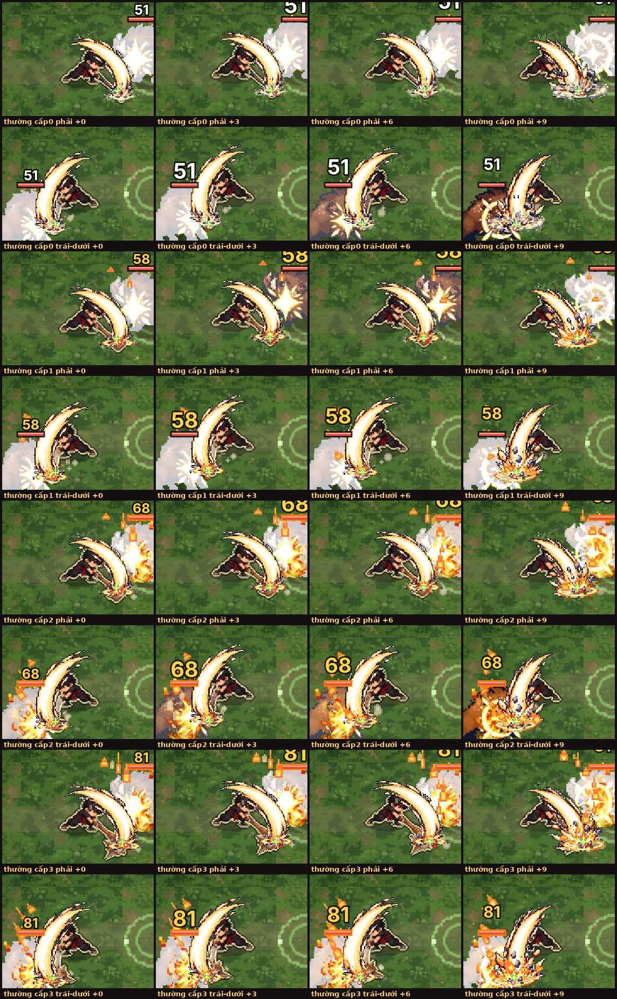

# Búa nện khớp lần 2 (13/10) — báo cáo

Đã chạy game (bản hai tệp `linh-khi-nhe.html`, Playwright) và chụp Zed cầm búa: đòn thường 8 hướng, chạy + đánh, nện đất (giữ rồi thả), Địa Chấn, 4 cấp (Trắng / Mầm / Thành hình / Thức tỉnh). Chỉ sửa phần hình, không đổi sát thương, vùng trúng hay nhịp đòn.

Ký hiệu trên ảnh: **chấm đỏ** = mũi ảnh búa, **dấu + vàng** = vết nứt đất, **vòng xanh** = chỗ toé (mép nện) của ảnh vệt `hu-chem-bua`.

## Nguyên nhân lệch (đo được)

1. **Vệt chém xoay sai.** Lần 1 (`anhVk`/`cungVk`) lấy cung vung trong cửa sổ `WIN.atk.hammer` [0,26–0,64]. Cửa sổ này tính theo nhịp của **thân cũ** (`q.u`). Với Zed mới, trong cửa sổ đó chỉ còn các khung **sau** khi búa đã nằm trên đất. Vì vậy "giữa cung" thực ra là hướng cán búa chúc xuống ~52°, và ảnh vệt bị xoay theo góc đó. Kết quả là mép nện của ảnh rơi ra sau hoặc dưới chân bé, lệch 20–25 điểm ảnh so với đầu búa (ảnh 1 và 3: vòng xanh nằm xa dấu +).
2. **Vết nứt bị kẹp độ cao.** Toạ độ y bị kẹp ≤ +6, nên khi nhắm chéo xuống, vết nứt nằm cao hơn đầu búa khoảng 10 điểm ảnh. Riêng nện đất lại lấy mẫu "xa nhất phía trước", không phải khung đang nện, nên lệch khoảng 8 điểm ảnh.
3. **Địa Chấn nện sai thời điểm.** Bụi và vết nứt hiện ngay dưới chân lúc bấm, khi búa còn giơ sau lưng. Búa chỉ chạm đất trước mặt từ mốc `MOC.db_bua[1]` (0,12).

## Đã sửa (`game/js/fx.js`, `game/js/fx_he.js`)

- `buaDiem(P)` đo trên chính hình đang vẽ:
  - **I** = đầu búa (lùi 3 điểm ảnh từ mũi, tức giữa mặt búa) ở đúng khung đang nện.
  - **T** = chỗ đầu búa cao nhất từ đầu nhát tới lúc nện. Không cho lùi quá 4 điểm ảnh ra sau lưng, để vệt không trùm cả người bé.
- `anhBua`: đặt ảnh vệt bằng phép xoay + co qua hai điểm: đỉnh cung của ảnh trùng T, chỗ toé trùng I. Cỡ ảnh giới hạn trong 0,7–1,35. Ảnh phát từ giây 0,08, nên lúc búa chạm thì cung đã gần trọn và chỗ toé nở ngay tại đầu búa.
- `dauBua` dùng cùng điểm I (bỏ kẹp y), có xoay ngược theo `aimed()` như cũ. Vết nứt, bụi `hu-nen-dat` và hạt hệ đều ở đầu búa. Nện đất dùng chung cách này.
- Địa Chấn: bụi và vết nứt chờ tới khung búa chạm đất rồi đặt dưới đầu búa (`dauBuaDb` + `heStep`, chờ tối đa 0,3 giây). Vòng chấn quanh người và vệt nứt chạy theo hướng nhắm giữ nguyên.
- Cờ `?buakhop=0` (hoặc `G.BUA_KHOP = false`) tắt toàn bộ, về như trước lần 1 (đã chụp kiểm). Không đụng kiếm, giáo, phi tiêu.

## Ảnh

| Trước | Sau |
|---|---|
|  |  |
|  |  |

Bốn cấp sau khi sửa: 

## Kiểm

- Đã chạy `node --check` cho mọi tệp js: đều qua. `cloud_save_regression.test.js`: PASS.
- Đã chạy `python3 game/build.py` (bản một tệp) và `--hai-tep` (bản hai tệp, dùng để chụp).
- Chụp lại bằng `python3 chup.py <tiền tố>`, trong đó `SCN=huong|chay|cap` chọn bộ cảnh và `EXTRA='&buakhop=0'` để tắt cờ. Script viết cho máy thử: cần bản hai tệp đã dựng và `docs/review/kiem-thu-12-10/srv.py`.
- Lúc chụp không có `pageerror`, `G.zedMoi.loi` trống.
