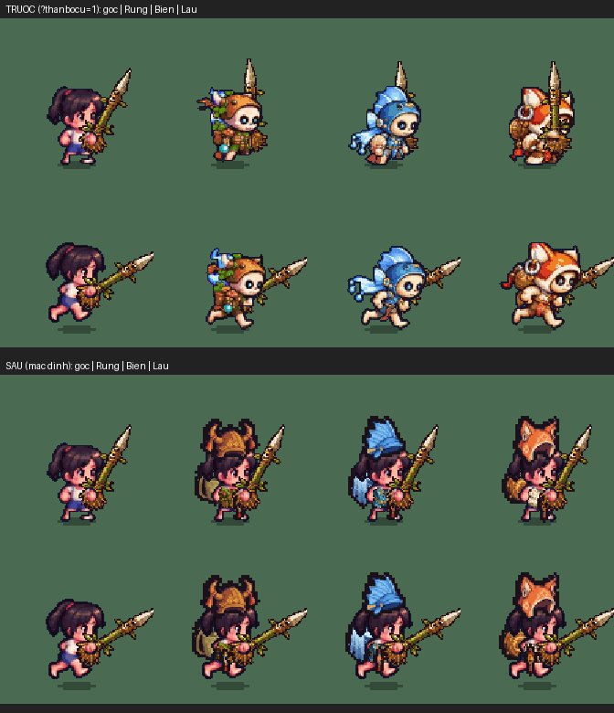

# Tạm tắt 3 thân bộ cũ của Cái Bống (12/10/2026)

**Vì sao:** thân gốc Cái Bống (`em-be-healer`) đã thay bằng bé gái mới, nhưng 3 thân bộ `em-be-healer-rung / -bien / -lau`
vẫn là hình cũ (mặt trắng tròn kiểu bộ xương). Mặc áo của một bộ là game đổi sang thân bộ → Cái Bống "về hình cũ".

## Đã làm

- **Dấu tạm tắt trong tệp:** 3 tệp `game/art/custom/em-be-healer-{rung,bien,lau}.sprite.json` có thêm trường `"cu": true`
  (chèn ngay sau `"ma"`, không đổi gì khác trong tệp). `game/build.py` giữ trường `cu` (thêm vào `RUNTIME_KEYS`).
- **`game/js/sprite_custom.js`:**
  - khi đọc tệp thân bộ: `sp.cu = true` nếu tệp ghi `"cu": true`;
  - `SC.thanBo(key, o)`: thân bộ có `cu` thì trả `null` → `SC.cuaEmBe` về thân gốc `em-be-healer`. Xét `SC.ds` **trước** `SC.get`,
    nên ảnh thân cũ cũng không bị tải;
  - vì thân chọn là thân gốc (`sp.bo = null`), `SC.anBo` trả `null` → mũ, áo, đồ lưng, bùa của bộ **khoác rời** như khi chưa đủ bộ;
  - cờ `G.THAN_BO_CU` / `?thanbocu=1`: dùng lại thân cũ để xem; `SC.thanBoTat()`: liệt kê các thân đang tạm tắt.
- Không đổi chỉ số bộ, thưởng đủ bộ, vầng sáng đủ bộ (`fx.du_bo`, `fx.aura`) — chỉ đổi hình thân.
- 3 em bé kia (Cu Tí, Cu Tũn, Cu Lì) vẫn dùng thân bộ như cũ.

Mọi nơi vẽ em bé (làng, trận, thẻ chọn em bé ở Ông Từ, xem trước bộ ở Thợ May, `hero_tinhlinh.js` khi xét thân AI) đều chọn thân
qua `SC.cuaEmBe` → `SC.thanBo`, nên một chỗ sửa là đủ (đã grep: không còn chỗ nào tự ghép mã `em-be-<key>-<bộ>`).

## Bật lại khi có thân bộ mới

Phiên nhập 3 thân bộ mới (ảnh tham chiếu `docs/anh-goc/2026-10-12/than-bo/tham-chieu/cai-bong-than-*.png`) chỉ cần ghi đè tệp
`em-be-healer-<bộ>.sprite.json`: tệp xuất từ Xưởng Sprite không có `"cu"`, nên game tự dùng lại thân bộ. Nếu sửa tay tệp cũ thì
xoá `"cu":true,`. Nhập lẻ từng bộ cũng được: bộ nào chưa có tệp mới vẫn tắt riêng.

**Ghi cho phiên "Đòn theo vũ khí cho thân bộ":** thân bộ Cái Bống đang tắt bằng `"cu": true`; tệp `em-be-healer-<bộ>-don` (nếu có)
chỉ hiện khi thân bộ mới về. `SC.thanBo` giờ là hàm nhiều dòng (xét `s0.cu`) — gộp cẩn thận.

## Kiểm (bản hai tệp như web)

`LK_HAI_TEP=1 python3 game/build.py --hai-tep`, phục vụ `game/dist` bằng `full-audit/A-nhan-vat/kiem/srv2.py`, mở
`linh-khi-nhe.html?cloud=0`. Script: `kiem/kiem_than_bo.py`.

- Mặc định: Cái Bống × Rừng/Biển/Lâu → `em-be-healer` (thân mới); smith/hunter/wrestler → `em-be-<key>-<bộ>` như cũ.
- `?thanbocu=1`: Cái Bống → `em-be-healer-<bộ>` (hình cũ).
- Mặc đủ 4 món mỗi bộ qua `O.add`/`O.wear`/`O.look` thật: `du_bo` vẫn đúng bộ, thân `em-be-healer`, `anBo = null` (đồ khoác rời).
- 0 pageerror, `SC.loi` rỗng.

Hàng trên (trước, `?thanbocu=1`): thân bộ cũ mặt bộ xương. Hàng dưới (sau): bé gái mới + mũ sừng / mũ vây cá / mũ tai cáo,
áo, đồ lưng, bùa của bộ khoác rời; mỗi ô có đứng và chạy.
