# Còn vẽ tay 8: kiểm kê mọi hình còn vẽ bằng code + prompt gen ảnh thay

Ngày 16/10/2026, nhánh `khoi-tao-du-an`. Chủ game (16/10 19:28): "cứ hình vẽ tay thì phải thay".

Phiên này **chỉ kiểm kê, viết prompt, chuẩn bị ảnh mẫu**. Không sửa game, không sửa `game/js`, không đổi luật chơi, không chơi thử bằng tay. Không đụng đăng nhập Google, lưu mây, `?cloud=0`.

## Tóm tắt

- **50 dòng** trong bảng (mục 2): mỗi dòng là một hình còn vẽ bằng code mà người chơi thấy, hoặc đã tắt mà chưa có ảnh.
- **8 dòng không cần gen**: 7 dòng đã có ảnh trong `game/art/custom`, chỉ cần nối code (đánh dấu **có sẵn**); 1 dòng đề xuất giữ.
- **Cần gen 88 ảnh**: 60 ảnh cho hình code + 28 ảnh cho 4 quái Sông sâu (mỗi con 1 ảnh mẫu + 6 hàng). Thứ tự gen ở mục 4.
- Mỗi dòng có ảnh nhỏ `anh/<mã>.png` để nhận ra, và ảnh mẫu `mau/<mã>.png` (hình code hiện tại phóng ×4) để gửi kèm khi gen.

Ba điều lạ phát hiện khi chạy (chưa sửa, báo để phiên khác xem):

1. **Hiệu ứng trùm vẽ code vẫn hiện** dù vẽ tay 5 ghi "đã tắt": vòng nước lúc Ngư Tinh xuất hiện, lửa quanh Hồ Tinh (`F.lua`), tia gãy của Mộc Tinh (`F.set`), sóng / hạt / lá / gai rễ lúc trùm chết, tia lửa lúc vài quái chết. Phần lớn có thể nối ảnh có sẵn (dòng 23).
2. **Phòng trùm Sông sâu (Thuồng Luồng, đang mượn thân Ngư Tinh) chạy headless rất chậm ở bản mặc định**: khoảng 8 giây cho một khung (thời gian JS chỉ ~8 ms, phần chậm là lúc trình duyệt tô điểm ảnh). Với `?vecode=1` thì nhanh. Máy yếu có thể giật ở phòng này. Nên có phiên đo hiệu năng riêng.
3. **Phòng Sông sâu gần như vẽ code toàn bộ** (sàn ván tre, cọc, lau sậy, bùn đá, cửa), chưa có bộ ảnh nền như ba vùng kia (dòng 16).

## 1. Cách kiểm kê

Công cụ ở `cong-cu/`:

- `hook.js`: móc vào bút canvas trước khi game chạy.
  - Ghi mọi lệnh tô hình bằng code (`fillRect`, `strokeRect`, `fill`, `stroke`, `putImageData`) **thật sự hiện** trên hai canvas người chơi thấy: `#world` (trận, làng) và `#ui` (giao diện, HUD, bảng). Lệnh bị chặn bởi `G.ganChan` không tới được bút gốc nên không bị đếm.
  - Canvas phụ (bộ đệm, khung dựng sẵn, nền phòng): đánh dấu "nhiễm code" theo hàm đã tô lên nó. Khi canvas đó được dán lên màn hình thì ghi là "⇐ hàm gốc".
  - Không tính chữ (`fillText`). Không tính lệnh nhuộm / cắt hình ảnh (`source-in`, `multiply`, `destination-*`...).
  - Mỗi khung có ghi: lưu khung bao hình theo từng hàm và chụp ô quanh hình.
- `kiemke8.py`: chạy bản một tệp `game/dist/linh-khi.html?cloud=0` (cờ mặc định, đang chặn vẽ code), bot tự đánh. Các cảnh:
  - màn chào; làng (giữa làng, đi lại);
  - 16 bảng làng: Bản đồ, Lò rèn (Mài, Linh khí, Nâng lò, Ép đồ), Tiệm đồ, Thợ may, Cụ Đồ (Kỹ năng, Cây chưởng, Hướng dẫn, Bảng vàng), Ông Từ (Nhân vật, Sổ yêu quái, Thành tựu), Anh Mõ (Cài đặt, Việc hôm nay);
  - Hành trang 4 thẻ, Xem vũ khí, Ải ngày, ăn mừng nâng cấp (bảng Linh khí kiểu Vũ khí C);
  - 4 vùng × (phòng bắt đầu, phòng quái, tinh anh, thử thách, lời nguyền + bảng, rương + bảng, suối + bảng, thương nhân + bảng, bảng Tạm dừng / Bản đồ / Hành trang, trùm nhỏ, trùm vùng pha 1–3, trúng đòn, chết + bảng thua, màn kết quả);
  - 4 vũ khí × hệ chia đều 4 vùng (kiếm, thương, búa, phi tiêu × Lửa / Độc / Băng / không hệ, có cả Thức tỉnh), bot tự chém, lộn, ra chiêu, chưởng, đổi vũ khí.
- Lượt riêng:
  - `rieng`: nước dâng trận Ngư Tinh (đặt `W.shrink` để chụp hình, không đổi luật).
  - `song`: 6 phòng Sông sâu có dòng chảy, cầu, vũng sâu, lục bình, đèn dầu; bấm vật cho ra vũng độc / vệt dầu cháy.
  - `THEM='&vecode=1'`: chạy lại bản vẽ code cũ, để lấy hình mẫu cho các chỗ **đã tắt nhưng chưa có ảnh** (đom đóm / sương / cột sáng các vùng, lưỡi lửa, vệt vung...).
- `gom8.py`: đổi dòng của bản một tệp về `game/js/<tệp>:<dòng>`, gộp theo hàm. Kết quả: `cong-cu/ra/gom-*.txt` (238 hàm ở bản mặc định, 250 ở `?vecode=1`).
- `cat_anh.py` + `nguon.json`: cắt `anh/<mã>.png` và `mau/<mã>.png`. Cỡ hình code đo được: `cong-cu/do-co.json`. Ảnh lớn đã giảm còn 256 màu để nhẹ repo.
- `chup_quai_song.py`: chụp 10 quái Sông sâu đang dùng hình tạm.
- `xuat_mau_net.py`: xuất ảnh có sẵn ra `mau/net-*.png` (nền #00FF00, phóng ×4 điểm game) làm mẫu nét.

Kết quả: 0 lỗi trang (pageerror) ở mọi lượt. Lượt trùm vùng Sông sâu chỉ chạy 6 khung mỗi pha vì chậm (điều lạ số 2).

**Không phải hình code (kiểm kê bắt nhầm, đã loại):**

- Nút cảm ứng trong trận (`btn_art.js`): nút Đánh, Đặc biệt, Né, Chưởng, Bình máu, Tạm dừng, cần điều khiển, ô vũ khí. Đây là ảnh AI (`gd-vong-*`, `gd-nut-*`, `gd-can-*`, `gd-o-vk-0`) được dựng lại qua bộ đệm điểm ảnh nên công cụ thấy như "điểm ảnh code".
- Ảnh hiệu ứng / quái / khung được nhuộm hoặc làm sáng (`FA.nhuom`, `khungThan`, `gdBien`).

## 2. Bảng kiểm kê

Cột:

- **Ở đâu**: Trận (lớp `#world`), HUD / Giao diện (lớp `#ui`), Làng.
- **Ảnh có sẵn**: ảnh trong `game/art/custom` thay được ngay (chỉ cần nối code), hoặc "—" (phải gen).
- **Ưu tiên**:
  - 1 = thấy liên tục mỗi trận;
  - 2 = thấy thường xuyên;
  - 3 = thỉnh thoảng (bảng, trùm, màn chào);
  - 4 = nhỏ / đề xuất giữ.
- **Gen**: số ảnh cần gen.
- Ảnh nhỏ: khung tím = chỗ hình code.

### 2a. Trận và HUD: đang hiện

| # | Mã ảnh | Ở đâu (hàm) | Trông thế nào | Ảnh | Ảnh có sẵn | Ưu tiên | Gen |
|---|---|---|---|---|---|---|---|
| 1 | `gd-ruot-thanh` | HUD: `ui_theme.js` `doMau`, lòng thanh `R` qua `khungLop`; thanh tiến độ trong bảng (Lò rèn, Hành trang, kết quả) | Ruột thanh máu đỏ, mana lam, thanh tiến độ vàng: mảng màu phẳng + 1 nét sáng trên, nằm trong vỏ ảnh `gd-khung-mau` | 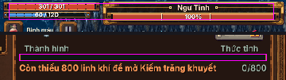 | — (vỏ có sẵn, ruột chưa) | 1 | 1 |
| 2 | `gd-mau-quai-nho` | Trận: `stage.js` `mobBars` 838–840 | Thanh máu 2 điểm cao trên đầu quái: đỏ (thường) / cam (tinh anh), phần vừa mất vàng nhạt | 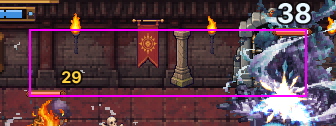 | — | 1 | 1 |
| 3 | `gd-ruot-thanh-trum` | HUD trùm: `ui_theme.js` `T.bossBar` 888–890, `T.bar` 1007–1015 | Vạch trang trí hai bên tên trùm, ruột thanh máu trùm, lớp chớp trắng khi trúng đòn | 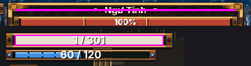 | — | 2 | 1 |
| 4 | `hu-bao-vung` | Trận: `bao_truoc.js` `pxDraw` (vẽ điểm ảnh rồi dán lên `#ui`) | Vùng báo nguy hiểm đỏ / cam: đĩa, vòng, vạch, hình quạt, nhấp nháy, đầy dần (tín hiệu né) | 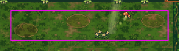 | — | 1 | 2 |
| 5 | `gd-icon-linh-khi` | HUD + Lò rèn + kết quả: `vk_moi.js` `gem` 717–719 | Viên linh khí hình thoi vàng 8×10 (nâu, vàng, chấm sáng) cạnh chữ "Linh khí" | 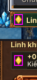 | — | 1 | 1 |
| 6 | (nối) `gd-o-ep-0..6` | HUD: `ep_do.js` `E.vien` 313 | Viền màu bậc ép đồ quanh 2 ô vũ khí trong trận (nét 1,5 điểm) | 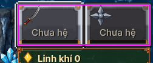 | **có sẵn** `gd-o-ep-0..6` | 1 | 0 |
| 7 | `gd-vien-man-do` | Toàn màn: `fx.js` `vignette`, `noi_gian.js` `vien` | Viền đỏ mờ quanh màn hình khi máu thấp / chết / trùm nổi giận | 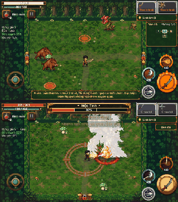 | — | 2 | 1 |
| 8 | `hu-nuoc-dang` | Trận Ngư Tinh: `room_art.js` 2220–2222 | Nước xanh đục 62% phủ phần sàn không đứng được, vạch bọt trắng ở mép | 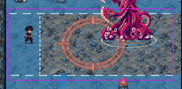 | — | 2 | 1 |
| 9 | `gd-song-dong` | Sông sâu: `song_luat.js` `veDai` | Dải nước xanh thẫm, mép sáng, mũi tên chữ V trắng trôi theo dòng | 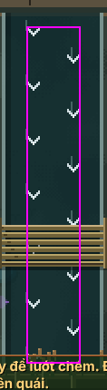 | — | 1 | 1 |
| 10 | `gd-song-cau` | Sông sâu: `veCau` | Cầu ván tre ngang dòng, hai dây chão hai mép | 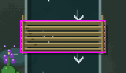 | — | 1 | 1 |
| 11 | `gd-song-vung-sau` | Sông sâu: `veSau` | Vũng nước sâu bầu dục xanh thẫm, viền bọt trắng chạy vòng | 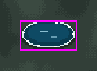 | — | 1 | 1 |
| 12 | `hu-vung-luc-binh` | Sông sâu: `veVung` (lục bình) | Vũng độc tím sau khi đập lục bình: elip tím, hạt tím nảy, lá dập | 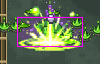 | — | 1 | 1 |
| 13 | `hu-vung-dau-chay` | Sông sâu: `veVung` (đèn dầu) | Vệt dầu cháy: elip cam, 7 lưỡi lửa nhảy, đèn đổ | 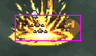 | — | 1 | 1 |
| 14 | `gd-vat-luc-binh` | Sông sâu: `veLucBinh` + quầng mời gọi `quang` | Khóm lục bình 4 lá tròn, cuống hoa tím, nhún nhẹ; quầng tím nhấp nháy dưới chân | 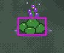 | — | 1 | 1 |
| 15 | `gd-vat-den-dau` | Sông sâu: `veDenDau` + `quang` | Cọc tre cao, cần treo đèn dầu cam đung đưa, quầng cam | 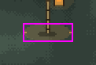 | — | 1 | 1 |
| 16 | `gd-nen-song-*`, `gd-cua-song-*`, `gd-tt-song-*` | Sông sâu: `room_art.js` `River.floors`, `stake`, `reedClump`, `door`, bùn đá 1395, `rampFill` | Cả phòng: sàn ván tre, mặt nước bùn ngoài, cọc tre, lau sậy tiền cảnh, đá bùn, cửa thanh tre | 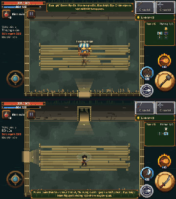 | — | 1 | 16 |
| 17 | `gd-tham-lau` | Lâu đài: `room_art.js` `runners` / `carpet` | Thảm đỏ viền vàng trải từ tâm phòng tới từng cửa | 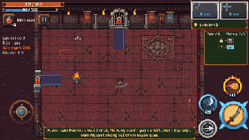 | — | 1 | 1 |
| 18 | `gd-loi-mon-rung` | Rừng già: `room_art.js` `trSan` 861 (điểm ảnh) | Lối mòn đất nâu nhạt nối tâm phòng với các cửa, mép lưới chấm | 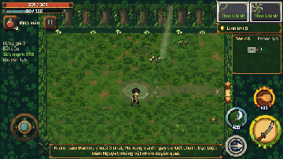 | — | 1 | 1 |
| 19 | `gd-san-thuong-luong` | Trùm Sông sâu: `thuong_luong.js` `veSan` | Sàn nước / bãi bồi của đấu trường Thuồng Luồng | 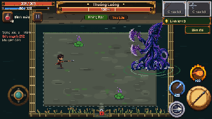 | — | 3 | 1 |
| 20 | `hu-ngu-tinh-mo-man` | Trùm Ngư Tinh xuất hiện: `monster_art.js` 1984–1986 | 3 vòng nước dẹt lan ra, cột nước trắng, bọt tròn, sóng lớn cuối | 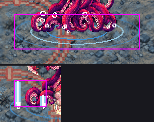 | — | 3 | 1 |
| 21 | `hu-tia-gay` | Mộc Tinh: `monster_art.js` `F.set` | Đường gãy khúc mảnh (tia / vết nứt) nối hai điểm | 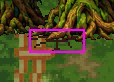 | — | 3 | 1 |
| 22 | `hu-lua-bung` | Hồ Tinh: `monster_art.js` `F.lua` | Ngọn lửa nhiều lớp (đỏ, cam, vàng, trắng) bùng quanh thân | 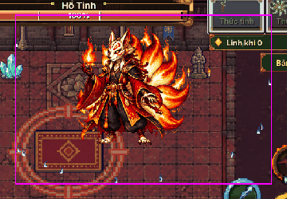 | — | 3 | 1 |
| 23 | (nối) | Trùm / quái: `F.song`, `F.hat`, `F.khoi`, `laRoi`, `gaiRe`, tia chết 2280 / 2420 / 2439 / 1719 | Vòng sóng, hạt, khói, lá rơi, gai rễ, tia lửa nhỏ lúc trùm / quái chết | 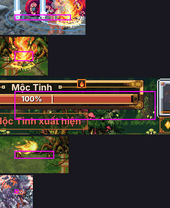 | **có sẵn** `hu-vong-song`, `hu-hat-no`, `hu-khoi-tron`, `hu-moi-truong-rung-la`, `hu-gai-re`, `hu-sao-chop` | 3 | 0 |
| 24 | `hu-bom-song` | Sông sâu (Ma Da ném): `mobs.js` `drawBomb` 696–710 | Quả bom vuông tím / tối 6×6 + bóng | 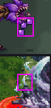 | bóng: **có sẵn** `hu-bong-chan` | 2 | 1 |

### 2b. Làng, màn chào

| # | Mã ảnh | Ở đâu (hàm) | Trông thế nào | Ảnh | Ảnh có sẵn | Ưu tiên | Gen |
|---|---|---|---|---|---|---|---|
| 25 | (nối) | Làng: `village_scene.js` `putNpc` 182, Sen 1082, Cu Tí `zed_moi.js` 624, `hero_tinhlinh.js` 1441 | Bóng elip đen dưới chân người làng và Cu Tí | 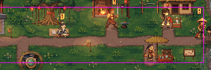 | **có sẵn** `hu-bong-chan` | 2 | 0 |
| 26 | `hu-quang-den` | Làng `ambLight` 930, lớp sáng `dung` 509–511; Lâu đài quầng đuốc / cửa sổ / nến (đã tắt) | Quầng sáng ấm hình elip quanh đèn lồng, đuốc, cửa sổ, chập chờn | 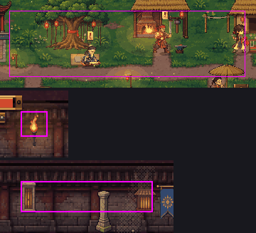 | — | 2 | 1 |
| 27 | `hu-lang-tia-lo` | Làng: `ambLight` 934 (tia lửa), 937 (quầng lò), `luaLo` 953 (khói ống lò) | Tia lửa cam bay lên ở lò rèn, quầng cam, khói tròn bay | 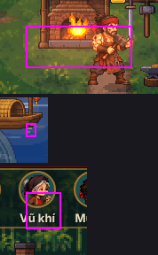 | khói: **có sẵn** `hu-khoi-tron`; quầng: dòng 26 | 2 | 1 |
| 28 | `hu-gon-nuoc` | Làng: `ambGround` 913, 920, sông 1051; Hang biển vũng gợn (đã tắt) | Vòng gợn nước lan ra, vệt sáng trôi trên mặt sông | 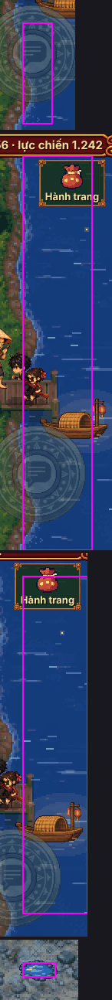 | — | 2 | 1 |
| 29 | (nối) | Làng: `ambTop` 944–945 (lá / hoa rơi), 1109 (đom đóm) | Lá rơi đung đưa, đom đóm vàng lục | 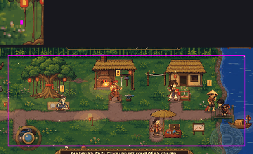 | **có sẵn** `hu-moi-truong-rung-la`, `hu-moi-truong-rung-domdom` | 2 | 0 |
| 30 | `gd-lang-thanh-duoi` | Làng: `VS.drawStrip` 1141, 1147 | Dải tròn góc xanh đen viền đồng sau hàng chân dung NPC; đĩa tròn sau mỗi chân dung (đỏ khi chọn) | 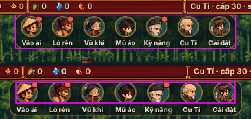 | — | 2 | 1 |
| 31 | `gd-cham-moi` | Làng 1150, nút thẻ `T.btn` 283 | Chấm đỏ báo "có mới" viền tối | 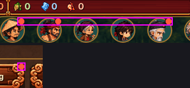 | — | 2 | 1 |
| 32 | `gd-bong-thoai` | Bản đồ: `VS.bubble` 1130–1132 | Bong bóng thoại trắng ngà bo góc, viền mực, đuôi nhọn | 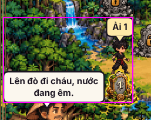 | — | 3 | 1 |
| 33 | `gd-ban-do-cham` | Bản đồ: `VS.mapDash`; khung tranh `vienTranh` | Đường chấm 2×2 nối các ải; viền khung tranh bản đồ | 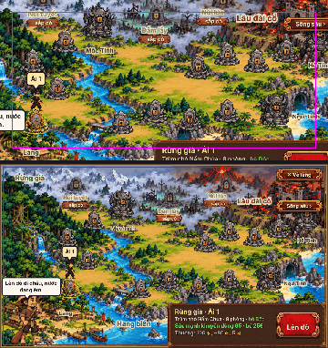 | khung: **có sẵn** `gd-khung-ban-do` | 3 | 1 |
| 34 | `hu-bia-hat` | Màn chào: `bia.js` 119–127 | Hạt sáng / vệt mưa nhỏ trôi trên tranh bìa | 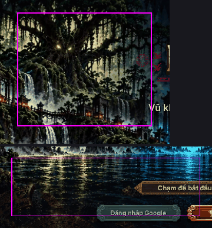 | — | 3 | 1 |
| 35 | `gd-bia-gach` | Màn chào: `village.js` `titleLogo` 918 | Hai gạch ngang vàng đồng hai bên chữ SPIRITBLADE | 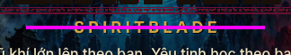 | — | 4 | 1 |
| 36 | (giữ) | Làng 1112 (tối khi mở bảng), 1045 (dải đen trên), màn chào `bia.js` 143–156 (lớp chuyển màu), `hanh_trang.js` 74 (dải tối dưới chân dung) | Lớp phủ màu phẳng / chuyển màu, không phải "hình" | 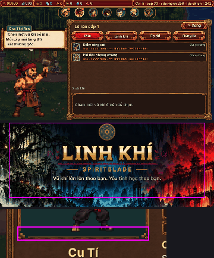 | đề xuất **giữ** | 4 | 0 |

### 2c. Giao diện (bảng)

| # | Mã ảnh | Ở đâu (hàm) | Trông thế nào | Ảnh | Ảnh có sẵn | Ưu tiên | Gen |
|---|---|---|---|---|---|---|---|
| 37 | `gd-o-diem` | Cụ Đồ › Kỹ năng, Hành trang: `engine.js` `ui.rect` 621–622 | Ô vuông 5×5 vàng (đã có) / tối (chưa) đếm cấp kỹ năng | 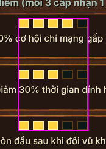 | — | 3 | 1 |
| 38 | `gd-chuong-o` | Cây chưởng: `chuong_ui.js` 82, 89, 102 | Ô cấp 4×3 vàng / tối, vạch nối giữa các nút, nền sáng cột hệ đang chọn | 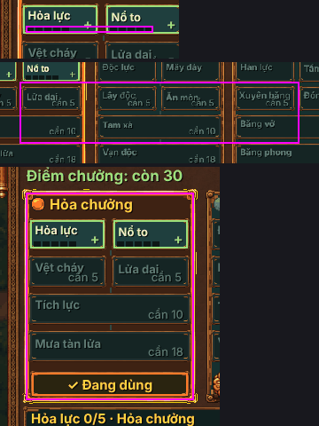 | — | 3 | 1 |
| 39 | `gd-long-khung`, `gd-bong-khung` | Mọi bảng / nút / thanh: `ui_theme.js` `khungLop` (lót + bóng dưới ảnh 9 mảnh), `oConAnh` 778–787 | Màu lót phẳng trong lòng khung, bóng đổ, nét vàng trong ô đang chọn | 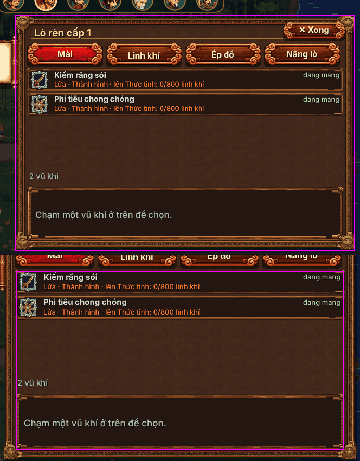 | khung: có sẵn; lót / bóng: — | 4 | 2 |
| 40 | (nối) | Sổ yêu quái: `so_yeu_quai.js` `veQuai` (bóng quái chưa gặp vẽ bằng `MA.draw`), `veO` 437 (viền chọn) | Ô "?" có bóng đen hình quái; viền vàng ô đang chọn | 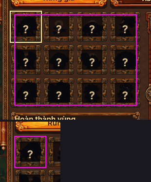 | **có sẵn**: ảnh quái tô đen; `gd-o-con-chon` | 3 | 0 |

### 2d. Đã tắt (không hiện), chưa có ảnh

Hình lấy từ lượt `?vecode=1`.

| # | Mã ảnh | Ở đâu (hàm) | Trông thế nào | Ảnh | Ảnh có sẵn | Ưu tiên | Gen |
|---|---|---|---|---|---|---|---|
| 41 | `hu-hat-bui` | 4 vùng: `room_art.js` `ambLive` `mote`, hạt trong cột sáng `beam` | Hạt bụi / phấn / hơi ẩm 1 điểm trôi chậm, nhấp nháy (mỗi vùng một màu) | 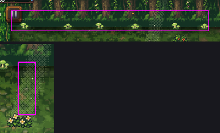 | — | 2 | 1 |
| 42 | `hu-suong-dai` | Rừng / Lâu đài / Sông sâu `emist`, Hang biển `mist` | Dải sương / khói mỏng trôi sát sàn và chân tường | 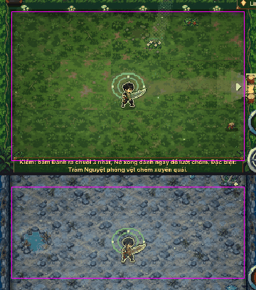 | — | 2 | 1 |
| 43 | `hu-moi-truong-rung-co-lay` | Rừng: `tuft` | Khóm cỏ 3 cọng sát tường lay theo gió | 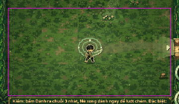 | — | 2 | 1 |
| 44 | `hu-moi-truong-rung-nam-sang` | Rừng: `shroom` | Quầng xanh lục "thở" dưới nấm sáng, hạt bào tử bay lên | 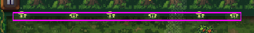 | — | 3 | 1 |
| 45 | `hu-moi-truong-bien-giot` | Hang biển: `drip` | Giọt nước đọng ở chóp nhũ đá, rơi, toé nhẹ | 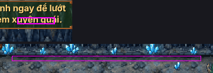 | — | 2 | 1 |
| 46 | (nối) | Hang biển `cry` (tinh thể loé), Sông sâu `fly` (đom đóm vàng), nến / lấp lánh / đom đóm đèn (`live` 2197–2201) | Chớp sáng chữ thập, đom đóm | 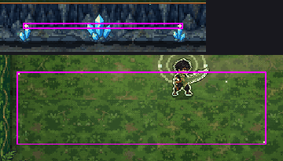 | **có sẵn** `hu-sao-chop`, `hu-moi-truong-rung-domdom`, `hu-quang-den` (dòng 26) | 3 | 0 |
| 47 | `gd-cot-nang-bien`, `gd-cot-nang-lau` | Hang biển, Lâu đài: `shaft` / `lightPass` (nay `boCode`) | Cột sáng chéo từ trần (Hang biển lam nhạt, Lâu đài vàng ấm qua cửa sổ kính) | 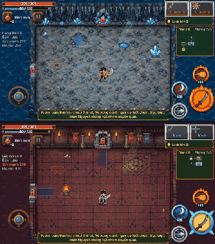 | Rừng đã có `gd-cot-nang-rung` | 2 | 2 |
| 48 | `hu-luoi-lua` | `fx.js` `tongue` (vùng cháy, tên lửa, nhát chém Lửa ngoài vệt chính) | Lưỡi lửa nhỏ cam / vàng nhảy | 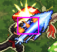 | — | 2 | 1 |
| 49 | `hu-vet-vung` | `fx.js` `trailDraw` / `quad` (vệt vung vũ khí theo sau lưỡi) | Dải cong mờ theo đường vung, màu hệ | 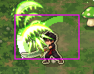 | — | 2 | 1 |
| 50 | (không cần) | `fx.js` `thrust` (chớp mũi đâm) | Không gặp trong lượt chạy: đòn đâm đã dùng ảnh `hu-dam-giao` nên khối code này không chạy. Nếu cần chớp ở mũi thì dùng `hu-sao-chop` | — | **có sẵn** | 4 | 0 |

### 2e. Quái Sông sâu (đang dùng hình tạm: ảnh con khác nhuộm màu)

Không phải vẽ code, nhưng chưa có ảnh riêng. Chủ game yêu cầu làm 4 con trước.

| Mã | Tên | Hình tạm hiện tại | Mượn | Ưu tiên | Gen |
|---|---|---|---|---|---|
| `raiCa` | Rái Cá Cầm Sào | 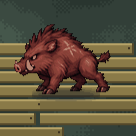 | Heo Rừng Con | 1 | 7 |
| `diaTrau` | Bầy Đỉa Trâu |  | Bầy Cá Con | 1 | 7 |
| `baBa` | Ba Ba Mai Đồng |  | Bọ Hung | 1 | 7 |
| `cocTia` | Cóc Tía Phun Bọt |  | Hoa Phun Bào Tử | 1 | 7 |
| `ranNuoc`, `echPhinh`, `maDa`, `traiGai`, `raiCaChua`, `cocChua`, `caTre`, `thuongLuong` | 6 quái thường / tinh anh khác + trùm nhỏ + trùm vùng | `anh/quai-*.png` | Chồn Bóng, Cá Nóc, Tiểu Yêu, Ốc, Tướng Ma, Nấm Phồng Chúa, Cua Đá, Ngư Tinh | sau | (8 × 7, không tính) |

## 3. Prompt gen

**Quy cách chung** (như bộ `hu-*` ở vẽ tay 5 mục 4):

- pixel art; một hàng N khung xếp ngang, các khung cách xa nhau;
- nền trơn `#00FF00`;
- vẽ gấp đôi (net 2): cỡ ghi trong prompt đã là cỡ gấp đôi điểm game;
- không bóng đổ, không chữ;
- vật trắng thì game tự nhuộm.

**Gửi kèm mỗi prompt** hai ảnh:

1. `mau/<mã>.png`: hình code hiện tại phóng ×4, để AI biết chỗ, cỡ, dáng. (Với dòng nhiều nguồn, các ảnh xếp dọc.)
2. Mẫu nét `mau/net-*.png` ghi ở từng prompt. Mặc định: hiệu ứng thì `net-hu-va-cham.png` + `net-hu-doc-toe.png`; giao diện thì `net-gd-khung-mau.png` / `net-gd-khung-bang.png`.

Tên ảnh nộp: `<mã>.png`, bỏ vào `con-ve-tay-8/anh-gen/` để phiên sau cắt.

### 3a. Trận và HUD

1. `gd-ruot-thanh`. Gửi kèm: `mau/gd-ruot-thanh.png`, `mau/net-gd-khung-mau.png`.
```
Pixel art, 1 column of 5 horizontal bar fills stacked with gaps, flat #00FF00 background: seamless left-right tileable bar fill strips for a game HUD, each 64x8 px: 1 red HP (#c8372d, #e8483a, top highlight #ff9a8a), 2 blue mana (#2a6ac8, #4a90e8, highlight #9fd0ff), 3 gold progress (#c88a1a, #ffd23f, highlight #fff3b0), 4 green (#3f8a2a, #6fc040, highlight #c8f0a0), 5 pure white flash; 1 px light line on top, 1 px dark line at bottom, no outline, no text.
```

2. `gd-mau-quai-nho`. Gửi kèm: `mau/gd-mau-quai-nho.png`, `mau/net-gd-khung-mau.png`.
```
Pixel art, 1 row of 3 frames, flat #00FF00 background: tiny enemy health bar fill strips, 32x4 px each, seamless left-right: 1 red (#e8483a, top line #ff9a8a), 2 orange elite (#ff8a3a, top line #ffc890), 3 pale yellow "just lost" chunk (#ffd98a, top line #fff6e0); no outline, no text.
```

3. `gd-ruot-thanh-trum`. Gửi kèm: `mau/gd-ruot-thanh-trum.png`, `mau/net-gd-khung-trum.png`.
```
Pixel art, 1 row of 3 pieces with gaps, flat #00FF00 background: 1 a seamless boss health bar fill tile 64x10 px, deep red #b8282a with brighter top band #e8483a and 1 px highlight #ff9a8a; 2 a small brass ornament divider for both sides of a boss name, a thin line with a 3x3 gem knob at the end (#a8752f, #f6dc92, dark #3a2010), 48x6 px; 3 a white hit-flash strip 64x10 px; no text.
```

4. `hu-bao-vung` (2 ảnh). Gửi kèm: `mau/hu-bao-vung.png`, `mau/net-hu-doc-toe.png`.
```
Pixel art, 1 row of 4 looping frames, flat #00FF00 background, top-down: a seamless tileable danger warning floor texture, red diagonal hatch stripes (#ff3a22, #ff7a5a) at 40% opacity in 3 hard pixel steps, pulsing brighter each frame, 32x32 px per frame, no outline, no text.
```
```
Pixel art, 1 row of 6 frames, flat #00FF00 background, top-down: a flat red danger ring on the floor (#ff3a22 rim, #ff7a5a inner glow, dashed), the inside filling up from center to rim frame by frame, ellipse 64x40 px per frame, no outline, no text.
```

5. `gd-icon-linh-khi`. Gửi kèm: `mau/gd-icon-linh-khi.png`, `mau/net-hu-hat-linh-khi.png`.
```
Pixel art, 1 frame, flat #00FF00 background: a small glowing spirit crystal icon, vertical diamond shape, golden yellow (#ffd23f, #fff3b0 shine, #c88a1a shade, #7a4a10 edge), 16x20 px, dark outline #14182e, no text.
```

7. `gd-vien-man-do`. Gửi kèm: `mau/gd-vien-man-do.png`.
```
Pixel art, 1 frame, flat #00FF00 background: a screen-edge red vignette frame 240x135 px, deep red (#c8140a) thick at the 4 edges fading to nothing toward the center in 4 hard pixel steps (60%, 40%, 20%, 8% opacity), center fully empty, no text.
```

8. `hu-nuoc-dang`. Gửi kèm: `mau/hu-nuoc-dang.png`, `mau/net-gd-tt-bien-vung-nuoc.png`.
```
Pixel art, 1 row of 4 looping frames, flat #00FF00 background, top-down: a seamless tile of murky deep blue flood water (#3282b9 at 60%, darker #1e5a8a ripples) with a foamy white edge line along the top (#dcf5ff), foam shifting 2 px each frame, 48x24 px per frame, no text.
```

9. `gd-song-dong`. Gửi kèm: `mau/gd-song-dong.png`, `mau/net-gd-nen-bien-san0.png`.
```
Pixel art, 1 row of 4 looping frames, flat #00FF00 background, top-down: a seamless vertical tile of a dark teal river current (#0e2c30, #14404a), pale bank edges on both sides (#c8e0d8), small white chevron arrows (#f0faff) flowing DOWN in 2 lanes, moving 8 px per frame, 32x32 px per frame, no text.
```

10. `gd-song-cau`. Gửi kèm: `mau/gd-song-cau.png`, `mau/net-gd-nen-bien-san0.png`.
```
Pixel art, 1 frame, flat #00FF00 background, top-down: a short bamboo plank bridge crossing a stream, planks running across (#6e6038, highlight #b8a468, knots #4a3e22), two rope rails along the edges (#54482a, #a08a5a), 64x24 px, dark outline #14182e, no text.
```

11. `gd-song-vung-sau`. Gửi kèm: `mau/gd-song-vung-sau.png`, `mau/net-gd-tt-bien-vung-nuoc.png`.
```
Pixel art, 1 row of 4 looping frames, flat #00FF00 background, top-down: a deep cold water hole, flat ellipse, dark navy center (#0a3a4e, #0e4a64), thin white foam rim (#d8eef0) with foam dots circling, 2 light glints sliding (#beefff), 48x26 px per frame, no text.
```

12. `hu-vung-luc-binh`. Gửi kèm: `mau/hu-vung-luc-binh.png`, `mau/net-hu-doc-toe.png`.
```
Pixel art, 1 row of 6 frames, flat #00FF00 background, top-down: a purple poison puddle from a crushed water hyacinth, flat ellipse (#7838a0 at 45%), bubbling purple sparks (#c88cff) popping up, torn green leaf bits (#3e7a3a), fading out in the last 2 frames, 64x28 px per frame, no text.
```

13. `hu-vung-dau-chay`. Gửi kèm: `mau/hu-vung-dau-chay.png`, `mau/net-hu-va-cham.png`.
```
Pixel art, 1 row of 6 looping frames, flat #00FF00 background, side 3/4 view: a burning oil spill, flat orange glow ellipse on the ground (#ff8c28 at 35%), a row of 7 small flame tongues (#ff7a2a, core #ffdc5a) flickering at different heights, a tipped-over small oil lamp at the left (#3a2c20, #c8a040), 64x28 px per frame, no text.
```

14. `gd-vat-luc-binh`. Gửi kèm: `mau/gd-vat-luc-binh.png`, `mau/net-gd-vat-suoi-mau.png`.
```
Pixel art, 1 row of 4 looping frames, flat #00FF00 background, 3/4 view: a floating water hyacinth clump, 4 round glossy leaves (#3e8a3a, dark #1e3a1e), a stem with 5 purple flowers (#7a3ab0, light #d8a8ff, yellow eye #ffe060), bobbing 1 px, a soft purple glow ring on the water under it pulsing (#be78ff at 15%), 32x32 px per frame, dark outline #14182e, no text.
```

15. `gd-vat-den-dau`. Gửi kèm: `mau/gd-vat-den-dau.png`, `mau/net-gd-vat-suoi-mau.png`.
```
Pixel art, 1 row of 4 looping frames, flat #00FF00 background, 3/4 view: a tall bamboo pole (#3a3020, #a08a5a) with a short arm holding a hanging oil lantern, lantern glowing orange (#c88a3a, flame #ff9a30, core #ffe890) swaying 1 px, warm glow around it, soft orange glow ring on the ground (#ffaa50 at 15%), 24x40 px per frame, dark outline #14182e, no text.
```

16. Bộ nền Sông sâu (16 ảnh). Theo đúng quy cách bộ nền vùng cũ: `../dot-6/PROMPT.md` cho sàn lát 3×3; `gd-nen-<vùng>-*`, `gd-cua-<vùng>-*`, `gd-tt-<vùng>-*` cho tường, cửa, đồ trang trí. Gửi kèm: `mau/gd-nen-song.png`, `mau/net-gd-nen-bien-san0.png`, `mau/net-gd-nen-bien-tuong-sau.png`, `mau/net-gd-cua-rung-tren.png`. Bảng màu Sông sâu: ván tre `#6e6038` / `#9a8a54` / `#b8a468`, bùn `#3a4a3e` / `#5f6e62`, nước đục `#2a4a44` / `#14302c`, dây chão `#54482a`.
   - `gd-nen-song-san0`, `-san1`, `-san2` (3 ảnh, đổi N = 1..3):
```
Pixel art square image: a seamless floor pattern of weathered bamboo plank decking over a muddy river bank, repeated EXACTLY 3x3 times with no grid or gaps (tile repeats every 1/3 of width and height). Hard-edged pixels, flat even lighting, only colors #6e6038 #9a8a54 #b8a468 #4a3e22 #3a4a3e #5f6e62. Planks run horizontally, small knots and gaps, a few mud spots. This is tile N of 3: same palette and density, different detail layout. No text, no grid lines, no border, no characters.
```
   - `gd-nen-song-san-nhan` (1): như trên, giữa mỗi mảng có một chi tiết vừa (một vũng bùn nhỏ HOẶC một bó lạt tre HOẶC một tấm ván vá), không chạm mép.
   - `gd-nen-song-mep` (1), `gd-nen-song-ngoai` (1): mép sàn ván tiếp nước, và nước đục ngoài phòng.
```
Pixel art, 1 frame, flat #00FF00 background, top-down: <mep: the edge strip where bamboo decking meets murky river water, plank ends with short wooden stakes, 64x16 px, seamless left-right> / <ngoai: a seamless tile of murky green-brown river water outside the room (#2a4a44, #14302c) with faint reed shadows, 64x64 px>, no text.
```
   - `gd-nen-song-tuong-sau`, `-tuong-ben`, `-tuong-truoc` (3): tường là hàng rào cọc tre buộc dây chão, phía sau là lau sậy.
```
Pixel art, 1 frame, flat #00FF00 background, 3/4 top-down: a <back / side / front> wall of a river camp: a fence of vertical bamboo stakes (#54482a, #a08a5a) tied with rope, tall reeds behind (#2f6a50, #6a9a50), seamless left-right, 128x48 px (side wall: 24x128 px, seamless top-bottom), dark outline #14182e, no text.
```
   - `gd-cua-song-tren`, `-ben`, `-duoi` (3 ảnh, mỗi ảnh 2 trạng thái cạnh nhau: mở | khoá):
```
Pixel art, 1 row of 2 frames, flat #00FF00 background, 3/4 top-down: a river camp gate in a bamboo stake fence, <top / side / bottom> wall; frame 1 open gate (gap with planks on the floor), frame 2 closed by 3 horizontal bamboo bars tied with rope, 40x38 px per frame, dark outline #14182e, no text.
```
   - `gd-tt-song-coc`, `gd-tt-song-da-bun`, `gd-tt-song-tien-canh-trai`, `-phai` (4):
```
Pixel art, 1 frame, flat #00FF00 background, 3/4 view: <a single bamboo mooring stake 8x28 px / a cluster of 3 flat muddy river stones 24x14 px / a foreground clump of tall reeds and cattails leaning right, 48x64 px / same leaning left>, dark outline #14182e, no text.
```

17. `gd-tham-lau`. Gửi kèm: `mau/gd-tham-lau.png`, `mau/net-gd-tt-lau-tham-vuong.png`.
```
Pixel art, 1 frame, flat #00FF00 background, top-down: a seamless vertical tile of a castle red carpet runner, deep red (#8a1e1e, #a8302a) with thin gold border lines on both edges (#c8a040, #f0d070), slight wear, 44x32 px, repeats top-bottom, no text.
```

18. `gd-loi-mon-rung`. Gửi kèm: `mau/gd-loi-mon-rung.png`, `mau/net-gd-nen-bien-san0.png`.
```
Pixel art, 1 frame, flat #00FF00 background, top-down: a seamless vertical tile of a worn dirt footpath through forest moss, pale brown packed earth (#7a6a48, #8a7a58) in the middle fading to the edges in 3 dithered steps, a few pebbles, 32x32 px, repeats top-bottom, no text.
```

19. `gd-san-thuong-luong`. Gửi kèm: `mau/gd-san-thuong-luong.png`, `mau/net-gd-nen-bien-san0.png`.
```
Pixel art square image: a seamless river boss arena floor, shallow murky water over sandbar (#2a4a44, #3a5a50, sand #8a8060), faint current streaks, repeated EXACTLY 3x3 times with no grid or gaps. Hard pixels, flat lighting. No text, no characters.
```

20. `hu-ngu-tinh-mo-man`. Gửi kèm: `mau/hu-ngu-tinh-mo-man.png`, `mau/net-hu-vong-song.png`.
```
Pixel art, 1 row of 8 frames, flat #00FF00 background, top-down: a sea boss emerging: 3 flat water rings expanding outward on the floor (#9fd8f5, #ffffff), small round bubbles rising, then 5 thin white water spouts shooting up and falling, ending with one big wave ring, 128x64 px per frame, no outline, no text.
```

21. `hu-tia-gay`. Gửi kèm: `mau/hu-tia-gay.png`, `mau/net-hu-va-cham.png`.
```
Pixel art, 1 row of 4 frames, flat #00FF00 background, facing right: a thin jagged white zigzag streak (#ffffff, #c8d0dc) from left to right, flickering and fading, 64x16 px per frame, no outline, no text.
```

22. `hu-lua-bung`. Gửi kèm: `mau/hu-lua-bung.png`, `mau/net-hu-va-cham.png`.
```
Pixel art, 1 row of 6 looping frames, flat #00FF00 background, side view: a tall layered flame burst rising from the ground, 4 layers (#c43c10, #ff8a1e, #ffd23c, core #fff6b0), flickering tongues, 32x48 px per frame, dark outline #14182e on the first layer only, no text.
```

24. `hu-bom-song`. Gửi kèm: `mau/hu-bom-song.png`, `mau/net-hu-va-cham.png`.
```
Pixel art, 1 row of 4 looping frames, flat #00FF00 background, 3/4 view: a small river-spirit bomb, a round gourd wrapped in wet green weed (#3e6a4a, #7aa06a) with a sputtering fuse spark (#ffd23f), pulsing slightly, 16x16 px per frame, dark outline #14182e, no text.
```

### 3b. Làng, màn chào

26. `hu-quang-den`. Gửi kèm: `mau/hu-quang-den.png`, `mau/net-gd-cot-nang-rung.png`.
```
Pixel art, 1 row of 4 looping frames, flat #00FF00 background: a soft white light glow ellipse for lanterns and torches (#ffffff), 3 hard alpha steps (30%, 18%, 8%) from center out, size flickering slightly each frame, 40x28 px per frame, no outline, no text.
```

27. `hu-lang-tia-lo`. Gửi kèm: `mau/hu-lang-tia-lo.png`, `mau/net-hu-va-cham.png`.
```
Pixel art, 1 row of 6 looping frames, flat #00FF00 background: a few tiny forge embers (#ffaa46, #ffe08a) drifting up and wiggling, fading at the top, 12x24 px per frame, no outline, no text.
```

28. `hu-gon-nuoc`. Gửi kèm: `mau/hu-gon-nuoc.png`, `mau/net-hu-vong-song.png`.
```
Pixel art, 1 row of 6 frames, flat #00FF00 background, top-down: a small water ripple, a flat dotted ring (#8fd0ea, #d8f6ff) expanding from a dot and fading, plus a short light glint line on the water, 40x20 px per frame, no outline, no text.
```

30. `gd-lang-thanh-duoi`. Gửi kèm: `mau/gd-lang-thanh-duoi.png`, `mau/net-gd-khung-bang.png`.
```
Pixel art, 1 row of 3 pieces with gaps, flat #00FF00 background: 1 a rounded dark teal bar for a village toolbar (#0a1616 at 72%, thin brass rim #a8752f), 9-slice friendly, 96x34 px; 2 a round 22x22 px portrait plate, teal (#1f4f4a) with brass rim (#a8752f); 3 the same plate selected, red (#8a2f22) with bright gold rim (#f6dc92); no text.
```

31. `gd-cham-moi`. Gửi kèm: `mau/gd-cham-moi.png`, `mau/net-gd-cham-than.png`.
```
Pixel art, 1 row of 2 frames, flat #00FF00 background: a tiny round red notification dot (#ff5a3a, highlight #ffa08a) with dark outline #14182e, frame 2 slightly brighter, 8x8 px per frame, no text.
```

32. `gd-bong-thoai`. Gửi kèm: `mau/gd-bong-thoai.png`, `mau/net-gd-khung-bang.png`.
```
Pixel art, 1 frame, flat #00FF00 background: a speech bubble, warm off-white (#fbf7ee) rounded rectangle with dark ink outline (#14182e), a small pointed tail at the bottom left, 9-slice friendly (plain middle), 64x40 px, no text.
```

33. `gd-ban-do-cham`. Gửi kèm: `mau/gd-ban-do-cham.png`.
```
Pixel art, 1 row of 3 frames, flat #00FF00 background: a tiny map trail dot 4x4 px in 3 states: 1 cream (#f6e8c0) with dark outline, 2 gold (#ffd23f) current path, 3 grey (#7a7a70) locked; no text.
```

34. `hu-bia-hat`. Gửi kèm: `mau/hu-bia-hat.png`, `mau/net-hu-moi-truong-rung-domdom.png`.
```
Pixel art, 1 row of 6 looping frames, flat #00FF00 background: tiny glowing motes and short rain streaks drifting down over a dark title painting, pale cyan and warm white (#d8f6ff, #fff4c8), twinkling, 24x24 px per frame, no outline, no text.
```

35. `gd-bia-gach`. Gửi kèm: `mau/gd-bia-gach.png`.
```
Pixel art, 1 frame, flat #00FF00 background: a thin ornamental brass divider line for a title, 36x4 px, bronze #a8752f with a tiny diamond knob at the inner end (#f6dc92), no text.
```

### 3c. Giao diện

37. `gd-o-diem`. Gửi kèm: `mau/gd-o-diem.png`, `mau/net-gd-o-con.png`.
```
Pixel art, 1 row of 3 frames, flat #00FF00 background: a small square skill point pip 10x10 px: 1 filled gold (#ffd23f, highlight #fff3b0, shade #c88a1a), 2 empty dark slot (#0d1716 with #2f4644 rim), 3 locked grey (#1a2423); dark outline #14182e, no text.
```

38. `gd-chuong-o`. Gửi kèm: `mau/gd-chuong-o.png`, `mau/net-gd-o-con.png`.
```
Pixel art, 1 row of 4 pieces with gaps, flat #00FF00 background: 1 a tiny rank pip 8x6 px filled gold (#ffd23f); 2 the same pip empty dark (#0d1716); 3 a vertical connector bar 2x6 px teal (#2f4644); 4 a soft vertical column highlight 40x120 px in white at 12% opacity for the selected element column; no text.
```

39. `gd-long-khung`, `gd-bong-khung` (2 ảnh). Gửi kèm: `mau/gd-long-khung.png`, `mau/net-gd-khung-bang.png`.
```
Pixel art, 1 frame, flat #00FF00 background: a seamless dark wooden panel interior texture for UI panels, very low contrast (#2a1a10, #34200f, faint grain #3e2a18), 32x32 px, tileable both ways, no text.
```
```
Pixel art, 1 frame, flat #00FF00 background: a soft drop shadow for a rectangular UI panel, black #000000 at 35% / 20% / 8% in 3 hard steps around the bottom and right edges, empty center, 9-slice friendly, 48x48 px, no text.
```

### 3d. Đã tắt, chưa có ảnh

41. `hu-hat-bui`. Gửi kèm: `mau/hu-hat-bui.png`, `mau/net-hu-moi-truong-rung-domdom.png`.
```
Pixel art, 1 row of 8 looping frames, flat #00FF00 background: a single tiny white dust mote (#ffffff) 1-2 px drifting slowly in a gentle wave and twinkling (bright, dim, bright), 12x12 px per frame, no outline, no text.
```

42. `hu-suong-dai`. Gửi kèm: `mau/hu-suong-dai.png`, `mau/net-gd-cot-nang-rung.png`.
```
Pixel art, 1 row of 4 looping frames, flat #00FF00 background, top-down: a thin horizontal strip of low drifting white mist (#ffffff) at 6% opacity with a 10% core band, soft ragged ends in hard pixel steps, shifting 2 px per frame, 64x10 px per frame, no outline, no text.
```

43. `hu-moi-truong-rung-co-lay`. Gửi kèm: `mau/hu-moi-truong-rung-co-lay.png`, `mau/net-hu-moi-truong-rung-la.png`.
```
Pixel art, 1 row of 4 looping frames, flat #00FF00 background, side view: a small clump of 3 grass blades (#3b6d2a, #4a7a33, tips #8fc060) swaying left, center, right, center in the wind, 10x12 px per frame, dark outline #14182e, no text.
```

44. `hu-moi-truong-rung-nam-sang`. Gửi kèm: `mau/hu-moi-truong-rung-nam-sang.png`, `mau/net-hu-moi-truong-rung-domdom.png`.
```
Pixel art, 1 row of 6 looping frames, flat #00FF00 background, top-down: a soft green glow ellipse breathing under a glowing mushroom (#b0f070 at 8% to 15%), with one tiny spore dot (#d0f8a0) floating up and fading, 24x28 px per frame, no outline, no text.
```

45. `hu-moi-truong-bien-giot`. Gửi kèm: `mau/hu-moi-truong-bien-giot.png`, `mau/net-hu-doc-toe.png`.
```
Pixel art, 1 row of 6 frames, flat #00FF00 background, side view: a water drop forming at a stalactite tip, falling straight down, then a tiny splash with 2 droplets and a flat ripple line (#9fdcff, #bfe9ff, #8fd0ea), 12x32 px per frame, no outline, no text.
```

47. `gd-cot-nang-bien`, `gd-cot-nang-lau` (2 ảnh). Gửi kèm: `mau/gd-cot-nang-bien-lau.png`, `mau/net-gd-cot-nang-rung.png`.
```
Pixel art, 1 frame, flat #00FF00 background, top-down: a soft diagonal light beam falling from a sea cave ceiling crack onto wet rock, pale cyan (#cfefff) at 30% / 20% / 10% opacity in 3 hard steps, 28x96 px, no outline, no text.
```
```
Pixel art, 1 frame, flat #00FF00 background, top-down: a soft diagonal warm light beam from a high stained glass window onto a castle floor, pale amber (#ffe6b8) with faint colored glass tints (red, blue, gold) at 30% / 20% / 10% opacity in 3 hard steps, 28x96 px, no outline, no text.
```

48. `hu-luoi-lua`. Gửi kèm: `mau/hu-luoi-lua.png`, `mau/net-hu-va-cham.png`.
```
Pixel art, 1 row of 4 looping frames, flat #00FF00 background, side view: a single small flame tongue (#ff7a2a, #ffd23f core, tip #c8372d) flickering up and down, 8x14 px per frame, no outline, no text.
```

49. `hu-vet-vung`. Gửi kèm: `mau/hu-vet-vung.png`, `mau/net-hu-va-cham.png`.
```
Pixel art, 1 row of 4 frames, flat #00FF00 background, facing right: a white curved weapon swing trail (#ffffff, #c8d0dc) as a thin crescent band, thick at the leading edge and tapering back, fading over the frames, 64x40 px per frame, no outline, no text.
```

### 3e. Quái Sông sâu

Quy cách giống các tấm quái hiện có (`game/art/custom/heoCon.sprite.json`...):

- 6 hàng: 1 đứng (6 khung), 2 đi (6), 3 báo trước (6), 4 đánh (6), 5 trúng đòn (4), 6 chết (6);
- mỗi hàng gen 1 ảnh, chân cùng đường đất, cùng cỡ đầu;
- nhìn chếch 3/4 từ trên, quay sang PHẢI;
- trước 6 hàng, gen 1 ảnh mẫu thiết kế (như `docs/anh-goc/quai-moi/<mã>-mau-moi.png`).

Ảnh nộp: `<mã>-mau-moi.png`, `<mã>-1-dung.png`, `<mã>-2-di.png`, `<mã>-3-bao-don.png`, `<mã>-4-danh.png`, `<mã>-5-trung-don.png`, `<mã>-6-chet.png` (cùng cách đặt tên `docs/anh-goc/quai-moi/dong-tac/`).

**Gửi kèm** (mẫu nét của con đang mượn, cùng cỡ ô):

| Mã | Gửi kèm | Ô khung |
|---|---|---|
| `raiCa` | `mau/net-heoCon.png`, `docs/anh-goc/quai-moi/heoCon-mau-moi.png`, `mau/quai-raiCa-hien-tai.png` | 130×96 |
| `diaTrau` | `mau/net-caCon.png`, `docs/anh-goc/quai-moi/caCon-mau-moi.png`, `mau/quai-diaTrau-hien-tai.png` | 116×86 |
| `baBa` | `mau/net-boHung.png`, `docs/anh-goc/quai-moi/boHung-mau-moi.png`, `mau/quai-baBa-hien-tai.png` | 124×88 |
| `cocTia` | `mau/net-hoaBaoTu.png`, `docs/anh-goc/quai-moi/hoaBaoTu-mau-moi.png`, `mau/quai-cocTia-hien-tai.png` | 126×110 |

**Ảnh mẫu thiết kế** (1 ảnh mỗi con, thay `<MÔ TẢ>` theo bảng dưới):
```
Pixel art character design of a Vietnamese folk river monster for a top-down action game: <MÔ TẢ>. One large pose, 3/4 top-down view facing RIGHT, same pixel style, outline and shading as the attached reference monster sheet (dark outline #14182e, 3-4 shades per material, chunky readable shapes). Flat #00FF00 background, no shadow, no text.
```

**6 hàng động tác** (mỗi hàng 1 ảnh, thay `<MÔ TẢ>`, `<HÀNH ĐỘNG>`, `<N>`, `<Ô>`):
```
Pixel art sprite sheet of the attached monster design: <MÔ TẢ>. Action: <HÀNH ĐỘNG>. <N> frames in ONE row, evenly spaced, <Ô> px cells, 3/4 top-down view facing RIGHT, feet on the SAME ground line, same body size every frame, smooth in-betweens. Same style as the attached reference sheet. Flat #00FF00 background, no shadow, no text.
```

| Mã | `<MÔ TẢ>` | 1 đứng | 2 đi | 3 báo trước | 4 đánh | 5 trúng đòn (4 khung) | 6 chết |
|---|---|---|---|---|---|---|---|
| `raiCa` | a brown river otter standing upright, wet fur (#6a4a2e, #9a7048), cream belly (#e8d0a0), straw headband, holding a long bamboo pole (#a08a5a) | idle breathing, pole upright | waddling forward, pole swinging | plants the pole and crouches low, ready to vault | vaults high on the pole and slams down onto the target, small splash on landing | flinches back, fur ruffled | falls on its back, pole drops, fades |
| `diaTrau` | a group of 3 fat buffalo leeches, olive-brown with yellow stripes (#5a5a2a, #c8b040), round sucker mouths | the 3 leeches wriggle in place | inch-worm crawling forward together | all 3 rear up tall | lunge forward and stretch out to latch on | squish and recoil | shrivel and flatten, fade |
| `baBa` | a softshell river turtle with a bronze-green shell plate (#4a6a5a, #8a7a3a), long neck, sharp snapping beak | idle, head bobbing | slow crawl forward | pulls the head into the shell, shell glints | shoots the long neck forward biting in a straight line, then pulls back | shell shakes, head ducks | flips onto its back, legs kick, fade |
| `cocTia` | a squat purple toad (#6a3a7a, #a86ac0) with warts, pale belly (#d8c0d8), big throat sac | idle, throat sac pulsing | short hops forward | inflates the throat sac big | spits 3 purple toxic bubbles upward in an arc | squashes flat then pops back | deflates and collapses, fade |

8 con còn lại (`ranNuoc`, `echPhinh`, `maDa`, `traiGai`, `raiCaChua`, `cocChua`, `caTre`, `thuongLuong`) dùng cùng hai mẫu prompt trên. Mô tả lấy theo tên và kỹ năng trong `js/ky_nang_quai.js` (dòng 90–99) và `js/monster_art.js` `MA.hinhTam`.

## 4. Thứ tự gen đề xuất và tổng số ảnh

Thứ tự theo "người chơi thấy nhiều nhất": trận nào cũng thấy → vùng → làng → bảng → hiếm.

| Đợt | Mã (số ảnh) | Cộng |
|---|---|---|
| 1. Trận nào cũng thấy | `hu-bao-vung` (2), `gd-ruot-thanh` (1), `gd-mau-quai-nho` (1), `gd-icon-linh-khi` (1) | 5 |
| 2. Nền ba vùng cũ | `gd-loi-mon-rung` (1), `gd-tham-lau` (1), `hu-hat-bui` (1), `hu-suong-dai` (1) | 4 |
| 3. Sông sâu: địa hình, vật | `gd-song-dong`, `gd-song-cau`, `gd-song-vung-sau`, `gd-vat-luc-binh`, `gd-vat-den-dau`, `hu-vung-luc-binh`, `hu-vung-dau-chay` (mỗi mã 1) | 7 |
| 4. Sông sâu: bộ nền phòng | `gd-nen-song-*` (9), `gd-cua-song-*` (3), `gd-tt-song-*` (4) | 16 |
| 5. Quái Sông sâu | `raiCa`, `diaTrau`, `baBa`, `cocTia` (mỗi con 7) | 28 |
| 6. Trận: thường thấy | `gd-vien-man-do` (1), `gd-ruot-thanh-trum` (1), `hu-luoi-lua` (1), `hu-vet-vung` (1), `hu-nuoc-dang` (1), `hu-bom-song` (1) | 6 |
| 7. Môi trường còn thiếu | `gd-cot-nang-bien`, `gd-cot-nang-lau` (2), `hu-moi-truong-rung-co-lay` (1), `hu-moi-truong-bien-giot` (1), `hu-moi-truong-rung-nam-sang` (1) | 5 |
| 8. Làng | `hu-quang-den`, `hu-lang-tia-lo`, `hu-gon-nuoc`, `gd-lang-thanh-duoi`, `gd-cham-moi` (mỗi mã 1) | 5 |
| 9. Trùm | `hu-ngu-tinh-mo-man`, `hu-tia-gay`, `hu-lua-bung`, `gd-san-thuong-luong` (mỗi mã 1) | 4 |
| 10. Bảng, màn chào | `gd-o-diem`, `gd-chuong-o`, `gd-bong-thoai`, `gd-ban-do-cham`, `hu-bia-hat`, `gd-bia-gach` (mỗi mã 1), `gd-long-khung` + `gd-bong-khung` (2) | 8 |
| **Tổng** | | **88** |

Ngoài 88 ảnh trên:

- 7 dòng **không cần gen**, chỉ cần một phiên code nối ảnh có sẵn: dòng 6, 23, 25, 29, 40, 46, 50. Trong các dòng có gen cũng có phần nối ảnh có sẵn: khói lò (27, `hu-khoi-tron`), khung bản đồ (33, `gd-khung-ban-do`), bóng dưới bom (24, `hu-bong-chan`), quầng sáng dòng 26 dùng lại cho đuốc / nến / cửa sổ Lâu đài (46).
- Đề xuất **giữ** (dòng 36): lớp tối khi mở bảng, dải đen trên làng, lớp chuyển màu màn chào, dải tối dưới chân dung Hành trang. Đây là mảng màu phẳng, không phải hình. Chủ game muốn thay hết thì cần thêm 3 ảnh.
- 8 quái Sông sâu còn lại: 56 ảnh nếu làm luôn.

## 5. Tệp

- `KIEM-KE.md`: tệp này.
- `anh/`: 49 ảnh nhỏ cho bảng, 10 ảnh quái Sông sâu (`quai-*.png`).
- `mau/`:
  - 49 ảnh mẫu `<mã>.png` (hình code hiện tại ×4);
  - 10 ảnh `quai-*-hien-tai.png`;
  - 24 ảnh mẫu nét `net-*.png` (ảnh có sẵn trong game, nền #00FF00).
- `cong-cu/`:
  - `hook.js`, `kiemke8.py`, `gom8.py`, `to_xem.py`, `cat_anh.py`, `nguon.json`, `chup_quai_song.py`, `xuat_mau_net.py`, `do-co.json`;
  - `ra/gom-*.txt`: danh sách đầy đủ mọi hàm còn tô hình (bản mặc định, `?vecode=1`, Sông sâu, nước dâng).

Chạy lại:

```
python3 cong-cu/kiemke8.py <ra>/all lang,vung0,vung1,vung2,vung3
python3 cong-cu/kiemke8.py <ra>/rieng rieng
python3 cong-cu/kiemke8.py <ra>/song song
THEM='&vecode=1' python3 cong-cu/kiemke8.py <ra>/vc vung0,vung1,vung2,vung3
python3 cong-cu/gom8.py <ra>/<thư mục>        # mỗi thư mục
python3 cong-cu/cat_anh.py <ra> cong-cu/nguon.json
```

Lượt Sông sâu riêng (`song`) chạy với `hook.js` bản cuối: coi `R` / `ELL` là hàm trợ giúp, để tách được dòng chảy, cầu, vũng, vật. Lượt chính chạy trước khi thêm nên gộp chung dưới `R@song_luat.js:219`.

Không sửa `game/`. Không build lại `dist`.
