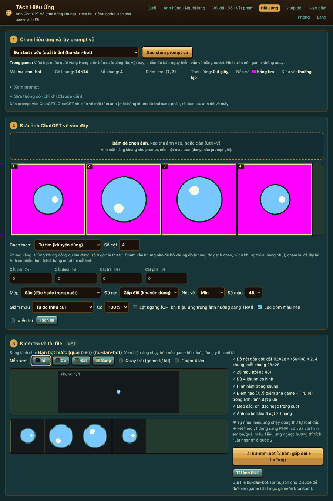
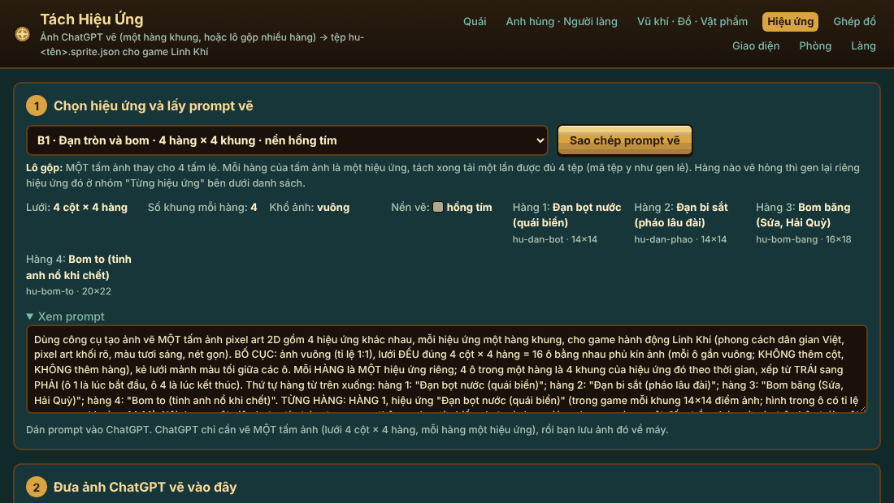
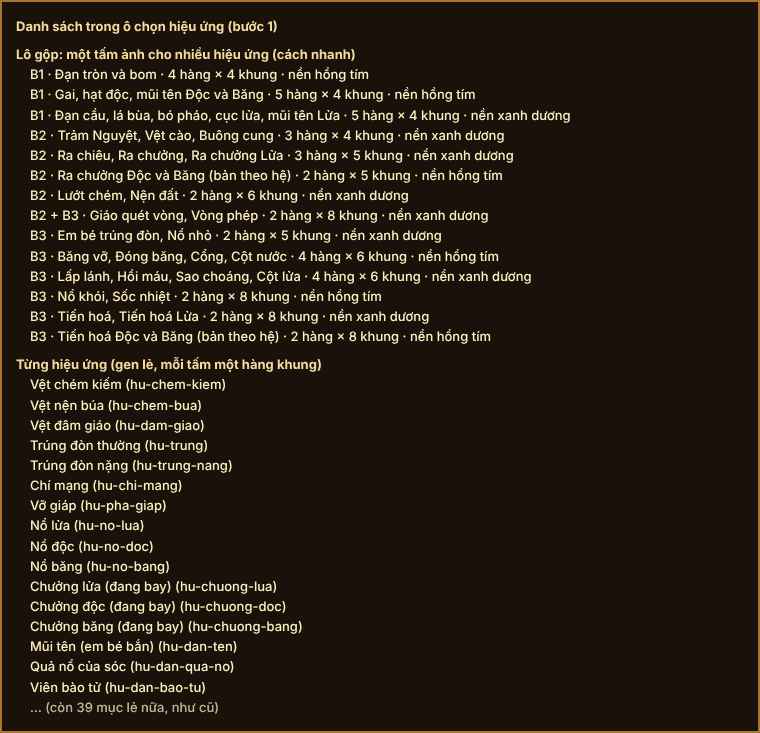
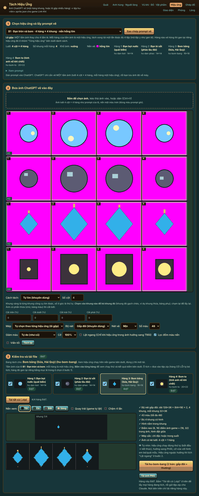
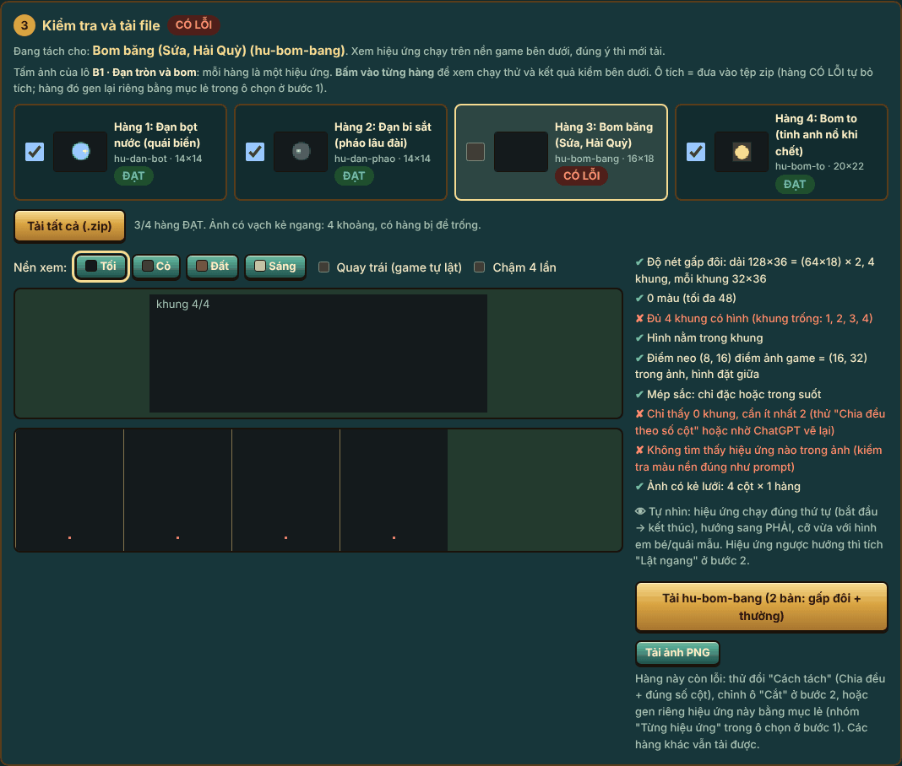

# Báo cáo Đợt 11: gộp prompt hình nhỏ thành ít tấm ảnh hơn

Ngày 11/10/2026. Brief: `docs/review/ke-hoach-cai-thien/dot-11-gop-prompt.md`.

**Kết quả chính: số tấm phải gen cho B1 + B2 + B3 + A2 + D2 giảm từ 50 xuống 20** (mục tiêu của brief: không quá 20). Nếu không vẽ hai tấm bản theo hệ (không bắt buộc) thì còn 18 tấm.

Ba điều cần biết trước khi đọc tiếp:

1. Mọi kiểm thử dùng **ảnh lưới tự dựng bằng máy**. Chưa có tấm ảnh gộp nào do ChatGPT vẽ thật, nên chưa biết ChatGPT vẽ lưới nhiều hàng đúng tới đâu.
2. **D2 (khung cửi + lửa lò) chưa gộp**, vẫn 3 tấm. Lý do ở mục 3.3, lựa chọn chờ duyệt ở mục 9.
3. Năm trong 14 lô gộp xếp chung các hình **lệch tỉ lệ nhiều hơn mức ±25 %** mà brief nêu. Tôi vẫn gộp vì hình không bị vẽ nhỏ đi tới mức mất nét (số đo ở mục 3.1), nhưng đây là chỗ tôi làm khác nguyên tắc của brief, cần duyệt (mục 9).

## 1. Danh sách tệp đổi

| Tệp | Đổi gì |
|---|---|
| `tools/tach-hieu-ung/index.html` | Thêm nhóm "Lô gộp" (14 lô) ở đầu ô chọn, prompt của lô, cắt tấm ảnh nhiều hàng, danh sách hàng, nút "Tải tất cả (.zip)". Phần gen lẻ giữ nguyên. |
| `tools/tach-phong/index.html` | Thêm 1 lô ở cuối danh sách: "Cửa · GỘP cả 3 vùng · 18 hình", và prompt của lô đó. Không đổi cách cắt. |
| `docs/review/hieu-ung-b1/PROMPT.md` | Thêm mục đầu "Cách nhanh: 3 tấm thay 14"; prompt lẻ dời xuống "Dự phòng". |
| `docs/review/hieu-ung-b2/PROMPT.md` | Thêm "Cách nhanh: 5 tấm thay 11"; prompt lẻ dời xuống "Dự phòng". |
| `docs/review/hieu-ung-b3/PROMPT.md` | Thêm "Cách nhanh: 7 tấm thay 18"; prompt lẻ dời xuống "Dự phòng". |
| `docs/review/phong-a2/PROMPT.md` | Thêm "Cách nhanh: 2 tấm thay 4"; ba lô cửa lẻ dời xuống "Dự phòng". |
| `docs/review/lang-d2/PROMPT.md` | Chỉ thêm ghi chú: đã xét gộp, chưa gộp, vẫn 3 tấm. |
| `docs/review/ke-hoach-cai-thien/TRANG-THAI.md` | Dòng Đợt 11; cột Prompt của B1, B2, B3, A2, D2 ghi số tấm mới. |
| `docs/review/ke-hoach-cai-thien/dot-11/` | Báo cáo này, ảnh (`anh/`), bài kiểm và kết quả (`kiem/`). |

Không đụng: `game/js/*`, `game/art/custom`, `tools/tach-giao-dien`, `tools/tach-lang`, định dạng `.sprite.json`, bản lưu.

## 2. Tóm tắt và lý do

Trước đây mỗi hiệu ứng là một tấm ảnh một hàng khung: gen một tấm, kéo vào trang, tải một tệp, lặp lại hơn 40 lần.

Nay trang Tách Hiệu Ứng có thêm kiểu **lô gộp**: một tấm ảnh là một lưới, **mỗi hàng là một hiệu ứng**, các cột là các khung theo thời gian.

- **Chọn lô:** ô chọn ở bước 1 có nhóm "Lô gộp" nằm đầu danh sách, bên dưới vẫn là 55 mục lẻ như cũ.
- **Prompt của lô** ghép từ chính các đoạn mô tả đang có của từng hiệu ứng (nội dung, diễn biến theo thời gian, vị trí trong ô, nét lạ, hướng, câu màu). Không viết lại nội dung. Đoạn BẢNG MÀU chỉ chèn một lần cho cả lô.
- **Đưa ảnh vào:** trang tìm các vạch kẻ ngang để cắt tấm ảnh thành từng hàng (không có vạch thì cắt theo khoảng trống giữa các hàng, không được nữa thì chia đều). Mỗi hàng sau đó chạy **đúng đường xử lý của một dải lẻ**. Vì vậy tệp tải ra giống hệt tệp gen lẻ, mã tệp không đổi.
- **Kiểm từng hàng:** mỗi hàng hiện một thẻ có hình chạy động và chữ ĐẠT hoặc CÓ LỖI. Bấm vào thẻ để xem hàng đó chạy thử trên nền game như cũ.
- **Tải:** nút "Tải tất cả (.zip)" gói mọi hàng đang tích, mỗi hàng 2 tệp như cũ (`<mã>.sprite.json` nét gấp đôi và `<mã>.thuong.sprite.json` nét thường).
- **Hàng vẽ hỏng:** trang tự bỏ tích hàng đó, các hàng khác vẫn tải được. Hiệu ứng hỏng gen lại riêng bằng mục lẻ.

Điều kiện xếp chung một lô: cùng số khung, cùng màu nền vẽ, tối đa 8 hàng (thực tế nhiều nhất 5 hàng). Trang tự kiểm hai điều kiện đầu khi nạp; lô sai thì bị bỏ khỏi danh sách.

Trang Tách Phòng: thêm một lô 6 cột × 3 hàng cho cửa của cả ba vùng, mỗi hàng một vùng.

## 3. Phân tích gộp

### 3.1. Bảng lô gộp trên trang Tách Hiệu Ứng (14 lô)

Cột "Lệch tỉ lệ" là mức chênh giữa hình bè ngang nhất và hình cao nhất trong lô (0 % là cùng dáng). Brief nêu mức ±25 %.
Cột "Vẽ to gấp" là số điểm ảnh của tấm vẽ cho một điểm ảnh trong game, tính cho hàng thiệt nhất, nếu hình chiếm hết ô. Tệp nét gấp đôi cần ít nhất 2.

| # | Lô | Các hàng (mã tệp, cỡ khung) | Lưới cột × hàng | Nền | Khổ ảnh | Lệch tỉ lệ | Vẽ to gấp (trong lô / khi gen lẻ) |
|---|---|---|---|---|---|---|---|
| 1 | B1 · Đạn tròn và bom | `hu-dan-bot` 14×14, `hu-dan-phao` 14×14, `hu-bom-bang` 16×18, `hu-bom-to` 20×22 | 4 × 4 | hồng tím | vuông | 11 % | 11,6 / 19,2 |
| 2 | B1 · Gai, hạt độc, mũi tên Độc và Băng | `hu-dan-gai-bang` 16×8, `hu-dan-hat-doc` 16×8, `hu-dan-gai` 16×8, `hu-dan-ten-poison` 28×12, `hu-dan-ten-ice` 28×12 | 4 × 5 | hồng tím | ngang | 14 % | 13,7 / 13,7 |
| 3 | B1 · Đạn cầu, lá bùa, bó pháo, cục lửa, mũi tên Lửa | `hu-dan-cau` 12×12, `hu-dan-bua` 14×14, `hu-bom-phao` 16×18, `hu-dan-lua` 16×10, `hu-dan-ten-fire` 28×12 | 4 × 5 | xanh dương | ngang | **62 %** | 11,4 / 24,0 |
| 4 | B2 · Trảm Nguyệt, Vệt cào, Buông cung | `hu-tram-nguyet` 48×48, `hu-quai-cao` 40×32, `hu-ban-cung` 32×32 | 4 × 3 | xanh dương | ngang | 20 % | 7,1 / 8,0 |
| 5 | B2 · Ra chiêu, Ra chưởng, Ra chưởng Lửa | `hu-ra-chieu`, `hu-ra-chuong`, `hu-ra-chuong-fire`, đều 48×48 | 5 × 3 | xanh dương | ngang | 0 % | 6,4 / 6,4 |
| 6 | B2 · Ra chưởng Độc và Băng (không bắt buộc) | `hu-ra-chuong-poison`, `hu-ra-chuong-ice`, đều 48×48 | 5 × 2 | hồng tím | ngang | 0 % | 6,4 / 6,4 |
| 7 | B2 · Lướt chém, Nện đất | `hu-chem-luot` 64×28, `hu-nen-dat` 80×48 | 6 × 2 | xanh dương | ngang | **27 %** | 3,2 / 3,2 |
| 8 | B2 + B3 · Giáo quét vòng, Vòng phép | `hu-quet-giao` 104×36, `hu-vong-phep` 96×64 | 8 × 2 | xanh dương | ngang | **48 %** | 1,8 / 1,8 |
| 9 | B3 · Em bé trúng đòn, Nổ nhỏ | `hu-be-trung`, `hu-no-nho`, đều 40×40 | 5 × 2 | xanh dương | ngang | 0 % | 7,7 / 7,7 |
| 10 | B3 · Băng vỡ, Đóng băng, Cổng, Cột nước | `hu-bang-vo` 56×56, `hu-dong-bang` 48×48, `hu-cong` 56×40, `hu-cot-nuoc` 32×64 | 6 × 4 | hồng tím | ngang | **64 %** | 4,0 / 8,0 |
| 11 | B3 · Lấp lánh, Hồi máu, Sao choáng, Cột lửa | `hu-lap-lanh` 40×40, `hu-hoi-mau` 40×48, `hu-choang` 20×10, `hu-cot-lua` 32×64 | 6 × 4 | xanh dương | ngang | **75 %** | 4,0 / 8,0 |
| 12 | B3 · Nổ khói, Sốc nhiệt | `hu-no-khoi`, `hu-soc-nhiet`, đều 96×80 | 8 × 2 | hồng tím | ngang | 0 % | 2,0 / 2,0 |
| 13 | B3 · Tiến hoá, Tiến hoá Lửa | `hu-tien-hoa`, `hu-tien-hoa-fire`, đều 96×180 | 8 × 2 | xanh dương | ngang | 0 % | 2,0 / 2,0 |
| 14 | B3 · Tiến hoá Độc và Băng (không bắt buộc) | `hu-tien-hoa-poison`, `hu-tien-hoa-ice`, đều 96×180 | 8 × 2 | hồng tím | ngang | 0 % | 2,0 / 2,0 |

Đọc bảng này thế nào:

- Chín lô nằm trong mức ±25 % của brief.
- Năm lô in đậm vượt mức đó. Tôi vẫn gộp vì cái bị ảnh hưởng khi xếp hình lệch dáng vào chung ô là hình bị vẽ nhỏ đi, và số đo cho thấy mức nhỏ đi này chấp nhận được: ở lô 3, 10, 11 hình thiệt nhất vẫn được vẽ to gấp 4 đến 11 lần cỡ trong game (cần 2); ở lô 7 và 8 hình không nhỏ đi chút nào so với gen lẻ, vì với 6 hoặc 8 cột thì bề ngang ô mới là thứ giới hạn, thêm hàng không lấy mất gì.
- Bốn lô 8 khung (8, 12, 13, 14) chỉ được vẽ to gấp 1,8 đến 2,0. Con số này **bằng đúng lúc gen lẻ**, không phải do gộp: tấm ảnh rộng 1536 chia 8 khung thì mỗi khung 192 điểm.
- Nếu giữ đúng mức ±25 % thì B1 + B2 + B3 cần 23 tấm thay vì 15, và tổng là 28, không đạt mục tiêu 20.

### 3.2. Chỗ tôi làm khác gợi ý của brief, và lý do

| Gợi ý của brief | Thực tế trong bảng cỡ và màu nền | Đã làm |
|---|---|---|
| B2: Ra chiêu + Ra chưởng + 3 bản hệ = 5 hàng một tấm | Bản Độc và Băng vẽ trên nền hồng tím, ba bản còn lại nền xanh dương. Một tấm chỉ có một màu nền. | Tách 2 tấm: lô 5 (3 hàng, xanh dương) và lô 6 (2 hàng, hồng tím). |
| B3: Băng vỡ, Đóng băng, Lấp lánh, Hồi máu chung một tấm | Hai hình băng nền hồng tím, hai hình kia nền xanh dương. | Xếp lại theo màu nền: lô 10 (hồng tím) và lô 11 (xanh dương). |
| B3: Sao choáng + Cổng; Cột lửa + Cột nước | Mỗi cặp một hình nền xanh dương, một hình nền hồng tím. | Như trên: Cổng và Cột nước vào lô 10, Sao choáng và Cột lửa vào lô 11. |
| B3: Nổ khói, Sốc nhiệt, Vòng phép chung một tấm | Vòng phép nền xanh dương, hai hình nổ nền hồng tím. | Lô 12 chỉ có hai hình nổ. Vòng phép xếp chung với Giáo quét của B2 (lô 8: cùng 8 khung, cùng nền). |
| Tiến hoá + 3 bản hệ = 4 hàng | Hai màu nền; và hình cao 180 nên một tấm chỉ chứa được 2 hàng mà không bị vẽ nhỏ đi. | Lô 13 (Chung + Lửa) và lô 14 (Độc + Băng). |

Màu nền của từng hiệu ứng tôi **không đổi**: các phiên B1, B2, B3 đã chọn nền theo màu hình để tách nền không ăn vào hình (lửa không nằm trên hồng tím, băng không nằm trên xanh dương).

### 3.3. Không gộp được, và lý do

| Thứ | Lý do |
|---|---|
| **Trùm nổ cuối** (`hu-trum-no`, 192×160) | Hình rất to, khi gen lẻ đã chỉ được vẽ to gấp 1,3. Để riêng một tấm như brief dặn. |
| **D2: Khung cửi + Lửa lò** | (1) Hai lô vẽ trên hai màu nền khác nhau: khung cửi hồng tím, lửa lò xanh dương. (2) Dáng lệch 37 %: khung cửi 28×22, lửa 12×15. (3) Trang Tách Làng làm mỗi lô dải khung ra đúng **một** tệp: phần ghép dải, xem thử trong cảnh làng, ảnh tham chiếu và nút tải đều đọc một mã, một cỡ của lô. Một tấm ra hai tệp thì phải sửa các phần đó, vượt phạm vi brief cho phép ở trang này ("chỉ phần định nghĩa lô"). Theo luật chung số 4 tôi dừng ở đây, không tự quyết. Lợi ích nếu làm: bớt 1 tấm. |
| **D2: 12 đạo cụ**, C1, C2, A1, D1, bản đồ | Đã là một tấm mỗi lô. Giữ. |
| **A3** (3 lô 16 ô) | Gộp sẽ thành 48 ô một tấm. Giữ như brief. |
| **A2: ổ khoá + đầu lâu** | Hai hình cực nhỏ (12×15, 11×11), kiểu xử lý khác cửa. Giữ lô riêng như brief. |
| **Bản theo hệ của 7 mục B2 còn lại và 3 mục B3** (không bắt buộc) | Chưa có prompt chép sẵn từ trước, không nằm trong số 50 tấm. Vẫn lấy bằng mục lẻ + ô "Bản màu" như cũ. |

### 3.4. Tổng số tấm phải gen

| Phiên | Trước | Sau | Ghi chú |
|---|---|---|---|
| B1 | 14 | 3 | |
| B2 | 11 (8 + 3 bản hệ) | 5 | Gồm tấm chung với B3 (Giáo quét + Vòng phép). Tấm Ra chưởng Độc và Băng không bắt buộc. |
| B3 | 18 (15 + 3 bản hệ) | 7 | 6 tấm gộp + Trùm nổ cuối gen lẻ. Tấm Tiến hoá Độc và Băng không bắt buộc. |
| A2 | 4 | 2 | |
| D2 | 3 | 3 | Chưa gộp. |
| **Tổng** | **50** | **20** | Brief ước "≈ 55"; đếm theo các tệp PROMPT.md thì là 50. |

## 4. Kiểm thử theo tiêu chí nghiệm thu

Cách kiểm: trình duyệt tự động (Playwright) mở trang mới và trang cũ (bản trước Đợt 11), đưa cùng ảnh vào, so tệp xuất ra. Ảnh thử do máy vẽ: hình đơn giản trên nền hồng tím hoặc xanh dương, có vạch kẻ. Bài kiểm ở `kiem/kiem.js` và `kiem/kiem-phong.js`, kết quả ở `kiem/ket-qua-tach-hieu-ung.json` và `kiem/ket-qua-tach-phong.json`.

| Tiêu chí của brief | Kết quả |
|---|---|
| Tổng số tấm: trước → sau, mục tiêu không quá 20 | **ĐẠT**: 50 → 20 (mục 3.4). |
| `python3 game/build.py` không đổi | **ĐẠT**: chạy xong, bản game chỉ khác đúng dòng mã bản (giờ đóng gói). Tôi không đưa bản đóng gói vào commit. |
| `node --check game/js/*.js` | **ĐẠT** (không sửa tệp nào trong đó). |
| Workflow xanh | **ĐẠT**: lượt 195 (commit a2557d7, đã gồm mọi thay đổi ở hai trang công cụ) thành công. Các commit sau đó chỉ sửa tài liệu trong `docs/`, workflow không chạy cho loại commit này. |
| Trang https://spiritblade.web.app/tach-hieu-ung.html mở được, lô gộp ở đầu danh sách, prompt đủ các hàng | **ĐẠT MỘT PHẦN**: trang trên mạng đã là bản mới (đọc được dòng chữ mới "hoặc lô gộp nhiều hàng" ở đầu trang). Máy của phiên này không mở được trang trên mạng bằng trình duyệt nên **chưa bấm thử trên bản đã đăng**; phần ô chọn và prompt kiểm trên đúng tệp đó ở máy: nhóm "Lô gộp" đứng đầu với 14 lô, nhóm lẻ đủ 55 mục; prompt cả 14 lô có đủ từng hàng, đúng số cột × hàng, một đoạn BẢNG MÀU, một câu nền, và chứa nguyên văn các đoạn mô tả của từng mục. |
| Lưới giả 4 hàng × 4 cột → 4 tệp đúng mã, đúng cỡ khung, đúng số khung | **ĐẠT**: `hu-dan-bot` 14×14, `hu-dan-phao` 14×14, `hu-bom-bang` 16×18, `hu-bom-to` 20×22, mỗi tệp 4 khung, cả 4 hàng ĐẠT. |
| So với cắt dải lẻ cùng hình = giống nhau | **ĐẠT**: tệp của từng hàng giống tệp gen lẻ **từng byte**, cả bản nét gấp đôi lẫn bản thường. Thử 2 lô: 4 hàng và 5 hàng, tổng 9 hàng. |
| Đường cắt dải lẻ cũ không đổi | **ĐẠT**: 9 dải lẻ, tệp của trang mới giống tệp của trang cũ từng byte. 91 prompt lẻ (55 mục × các bản màu) giống trang cũ từng chữ. |
| Hàng hỏng vẫn tải được hàng khác | **ĐẠT**: tấm có hàng 3 để trống → 3 hàng kia ĐẠT, hàng 3 báo lỗi và tự bỏ tích. |
| Nút "Tải tất cả (.zip)" | **ĐẠT**: ra một tệp `lo-b1-tron-hong_4-hieu-ung.zip` chứa đúng 8 tệp (4 mã × 2 độ nét), nội dung khớp. |

Kiểm thêm ngoài brief, đều đạt:

- Vạch kẻ dày 14 điểm kèm nhiễu như ảnh ChatGPT: 4/4 hàng.
- Tấm không kẻ vạch nào: 4/4 hàng (cắt theo khoảng trống).
- Lưới không phủ kín ảnh, có lề trên dưới: 4/4 hàng.
- Hình mảnh và dài như thân mũi tên không bị nhận nhầm thành vạch kẻ ngang. Lỗi này có ở bản đầu tôi viết, bài kiểm bắt được, đã sửa.
- Lô 8 cột × 2 hàng nền xanh dương: 2/2 hàng.
- Trang Tách Phòng: 14 lô cũ giữ nguyên thứ tự, tên, prompt; lô gộp tìm đủ 18/18 hình; 36 tệp của lô gộp giống tệp của ba lô lẻ từng byte; ba lô lẻ ở trang mới giống trang cũ từng byte.

Tổng: trang Tách Hiệu Ứng 22/22 mục đạt, trang Tách Phòng 10/10 mục đạt, không có lỗi JavaScript.

**Chưa kiểm:**

- Chưa có ảnh ChatGPT vẽ thật cho bất kỳ lô gộp nào.
- Chưa bấm thử trên bản đã đăng và chưa thử trên iPhone thật (chỉ chụp ở bề ngang 390 điểm trên máy).
- Bước 4 "Xem thử trong phòng" của Tách Phòng không chạy được ở máy kiểm (cần mạng để nạp game), nên chưa nhìn thấy cửa của lô gộp trong phòng mẫu. Phần này dùng chung mã với ba lô lẻ.

## 5. Ảnh trước / sau

Trước (mỗi tấm một dải, một hiệu ứng):

Sau, bước 1: chọn lô gộp, prompt của lô:

Sau, danh sách trong ô chọn (nhóm Lô gộp ở đầu):

Sau, cả trang với một tấm 4 hàng × 4 cột (ảnh thử do máy vẽ):

Sau, khi một hàng vẽ hỏng:

Sau, trên màn hình hẹp như iPhone: [anh/sau-5-lo-gop-iphone.png](anh/sau-5-lo-gop-iphone.png)

Trang Tách Phòng, lô gộp cửa 3 vùng: [anh/sau-6-tach-phong-cua-gop.png](anh/sau-6-tach-phong-cua-gop.png)

Ảnh thử đã dùng: [anh/anh-thu-luoi-4x4.png](anh/anh-thu-luoi-4x4.png), [anh/anh-thu-cua-6x3.png](anh/anh-thu-cua-6x3.png).

## 6. Số đo

- Số tấm phải gen: 50 → 20 (bớt 60 %). Riêng hiệu ứng B1 + B2 + B3: 43 → 15.
- Số lần kéo ảnh vào trang và số lần tải: cũng 50 → 20.
- Độ dài prompt: prompt lẻ dài khoảng 1 900 đến 3 300 ký tự; prompt lô dài 3 520 đến 7 015 ký tự (dài nhất: lô 10); prompt cửa gộp 8 626 ký tự.
- Độ to của hình trên tấm vẽ: bảng ở mục 3.1.
- Dung lượng game: không đổi (không thêm ảnh nào, không sửa mã game).

## 7. Rủi ro còn lại

1. **ChatGPT có thể vẽ sai lưới nhiều hàng**: thiếu hàng, lẫn hình giữa các hàng, hoặc vẽ sai dần ở các hàng cuối. Lô nhiều hàng nhất là 5. Đã có đường lui cho từng hàng (bỏ tích, gen lẻ), nhưng nếu hỏng nhiều thì số tấm tiết kiệm được sẽ ít hơn con số 20.
2. **Prompt dài hơn** (tới 7 000 ký tự). ChatGPT có thể bỏ sót chi tiết ở các hàng sau. Chưa đo được vì chưa có ảnh thật.
3. **Năm lô xếp hình lệch dáng** (mục 3.1). Hình vuông nằm trong ô ngang, hoặc hình đứng nằm trong ô vuông, có thể bị ChatGPT kéo giãn cho đầy ô. Trang vẫn cắt đúng nhưng hình có thể méo.
4. **Lô 5 và lô 13 vẽ luôn bản Lửa.** Nếu chỉ gen hai tấm này mà không gen tấm Độc + Băng thì game có màu riêng cho Lửa, còn Độc và Băng dùng bản Chung. Không lỗi, chỉ không đều.
5. **Cắt hàng dựa vào vạch kẻ ngang.** Nếu ChatGPT kẻ vạch đứt quãng và các hàng lại sát nhau thì trang rơi về chia đều và có ghi rõ trong dòng trạng thái. Người dùng chỉnh bằng ô "Cắt" hoặc "Chia đều".
6. **Tên lô "B2 + B3"** nằm ở hai phiên. Đã ghi ở cả hai tệp PROMPT.md, nhưng vẫn dễ gen trùng Vòng phép.
7. **Ô chọn mặc định** nay là lô gộp đầu tiên với người mở trang lần đầu. Người đã dùng trang thì trình duyệt vẫn nhớ mục họ chọn lần trước.

## 8. Cách quay lui

- Bỏ hết thay đổi của đợt này: `git revert a2557d7 a661baf 30eabd9` (cộng commit báo cáo nếu muốn bỏ cả báo cáo). Ba commit này chỉ đụng hai trang công cụ và các tệp PROMPT.md, không đụng game.
- Chỉ tắt nhóm lô gộp ở Tách Hiệu Ứng mà giữ mã: trong `tools/tach-hieu-ung/index.html` đổi `const LO_GOP = [ … ]` thành mảng rỗng. Nhóm "Lô gộp" biến mất, trang chạy như cũ.
- Chỉ bỏ lô gộp cửa: `git revert a661baf`.
- Prompt lẻ và các lô lẻ vẫn còn nguyên, dùng được bất cứ lúc nào mà không cần quay lui gì.

## 9. Quyết định mới cần duyệt

1. **Chấp nhận 5 lô lệch dáng quá ±25 % hay không** (lô 3, 7, 8, 10, 11 ở mục 3.1). Mặc định tôi chọn: gộp. Nếu không chấp nhận thì tách các lô đó ra, tổng số tấm thành 28. Đề xuất: gen thử một tấm lô 10 hoặc 11 (lệch nhiều nhất) rồi mới quyết.
2. **D2 khung cửi + lửa lò**, ba lựa chọn:
   - (a) Giữ 2 tấm như hiện nay. Mặc định, không rủi ro.
   - (b) Cho phép một phiên sửa phần dải khung của trang Tách Làng để một tấm ra hai tệp, và đổi nền khung cửi sang xanh dương. Bớt 1 tấm; phải kiểm lại cả hai dải và phần xem thử trong làng.
   - (c) Bỏ ý này.
3. **Tấm chung B2 + B3** (Giáo quét + Vòng phép): giữ gộp chéo hai phiên (mặc định, nhờ đó tổng là 20), hay tách thành hai tấm lẻ cho dễ theo dõi (tổng 21).
4. **Bản Lửa đi kèm bản Chung** ở lô 5 và lô 13: giữ (mặc định), hay chỉ để bản Chung trong hai lô đó và gen bản Lửa lẻ khi cần.
