# Đợt 2 — Mở rộng sân đấu phòng thường 208 → 300 (Q3) — Báo cáo

Ngày 11/10/2026 · nhánh `khoi-tao-du-an` · commit code `4aeaede1`

## Tóm tắt một dòng

Sàn phòng thường đã rộng 300 điểm ảnh game (trước 208), nút và chữ không đè sàn, nhịp đánh gần như cũ **mà không phải chỉnh quái**. Riêng tiêu chí "sàn ≥ 60% bề ngang" **chỉ đạt nếu đo trong khung game (62,5%), chưa đạt nếu đo trên cả màn hình điện thoại 844×390 (51,3%)** — xem mục 3 và mục 8.

## 1. Tệp đã đổi

| Tệp | Đổi gì |
|---|---|
| `game/js/room_art.js` | Thêm hằng `RA.RONG_PHONG = 300`. Sàn phòng thường từ x 136–344 thành x 80–380 (đúng khung phòng trùm). Chiều cao sàn (y 56–252), canvas 480×270, cỡ sprite: giữ nguyên. Thêm cờ `geo.rong` (sàn rộng) cho giao diện đọc. |
| `game/js/stage.js` | Phòng thường dùng bộ nút gọn sẵn có của phòng trùm; cột chữ bên trái xuống hai dòng; lời chỉ dẫn và dòng mẹo dời xuống đáy giữa; sửa chữ "Chạm để đổi vũ khí" bị cắt. |
| `game/js/minimap.js` | Bản đồ nhỏ ở phòng thường hẹp lại (85 thay vì 102) để vừa cột phải. Một dòng. Tệp này không có trong danh sách của brief nhưng bắt buộc phải đổi, nếu không bản đồ nhỏ đè 6 điểm ảnh lên sàn. |
| `game/js/ngon_ngu_en.js` | Thêm bản tiếng Anh cho câu "Chạm để đổi vũ khí →". |
| `game/dist/*`, `tools/xuong-sprite/index.html` | Do `python3 game/build.py` sinh lại. |
| `docs/review/ke-hoach-cai-thien/dot-2/` | Báo cáo này, ảnh (`anh/`), script đo và chụp (`kiem.py`). |

Không đụng: `engine.js`, camera, sprite, bản lưu, ảnh trong `game/art/custom`, số quái, tốc độ quái, phòng trùm.

## 2. Đã làm gì và vì sao

1. **Sàn 300, lệch trái 10 điểm ảnh (x 80–380, không phải 90–390).** Lý do: trên màn 16:9 không có lề, nút Né và nút Đặc biệt nằm từ x = 383. Sàn dừng ở 380 thì nút chỉ đè tường, không đè sàn. Đây cũng đúng là khung của phòng trùm, nên mọi bố cục đã chạy tốt ở phòng trùm được dùng lại, ít rủi ro nhất.
2. **Nút.** Phòng thường nay dùng chung bố cục nút của phòng trùm. Đo mép nút (đơn vị game, sàn kết thúc ở 380, tường tới 394):
   - 1280×720 (không lề): Né từ 383, Đặc biệt từ 384, Đánh từ 424, Chưởng từ 431; cần điều khiển tới 66 (sàn bắt đầu ở 80). → Né và Đặc biệt đè **tường phải**, không đè sàn.
   - 844×390 (có lề 41): Né từ 403, Đặc biệt từ 407, Đánh từ 443; cần điều khiển tới 61. → không đè cả tường.
3. **Lời chỉ dẫn ải 1 và dòng mẹo vũ khí** dời xuống **đáy giữa**, cỡ chữ 7 như cũ. Câu một dòng nằm gọn trên dải tường trước; câu hai dòng lấn mép dưới sàn khoảng 9 điểm ảnh (chỗ em bé gần như không đứng tới). Hai điều tôi tự chọn theo hướng ít rủi ro:
   - Khi phòng có **cửa dưới đang mở**, ô chữ ở đáy sẽ che mất lối ra và mũi tên chỉ lối, nên lúc đó ô chữ chuyển lên mặt tường phía trên.
   - Mỗi lúc chỉ hiện **một** ô (mẹo có đếm giờ hiện trước, hết giờ thì lời chỉ dẫn hiện lại) để không che trận đánh. Trước đây hai ô xếp chồng ở cột trái.
4. **Chữ "↑ Chạm để đổi vũ khí" bị cắt**: đổi thành "Chạm để đổi vũ khí →" trong một ô nền riêng, cách ô vũ khí 4 điểm ảnh. Không còn bị cắt (ảnh `sau-*-tinh-anh.png`).
5. **Cột trái** chỉ còn 66 điểm ảnh nên "Rừng già 1 · Thương nhân" tách thành hai dòng, "Sức mạnh / khuyên" hai dòng (như phòng trùm).
6. **Bản đồ nhỏ** vẫn hiện đầy đủ trong phòng thường, chỉ hẹp lại 17 điểm ảnh; bản đồ rộng nhất (5 ô ngang) vẫn vừa.
7. **Quái, vật thể, cửa** vốn đặt theo khung phòng nên tự trải theo sàn mới, không phải sửa. Rương, thương nhân, bàn thờ, bệ thử thách ở giữa sàn; hai suối cách giữa 44; rương đồ ở góc trên trái (x 120). Tất cả trong sàn (ảnh ở mục 4).

Hệ quả tự động cần biết (không phải tôi sửa số, code vốn tính theo bề ngang phòng, giống ở phòng trùm): tầm đòn Đặc biệt và tầm chưởng dài hơn (ví dụ Trảm Nguyệt 125 → 170), quái bắn xa đứng xa hơn (80 → 118).

## 3. Kiểm thử theo tiêu chí nghiệm thu

| Tiêu chí | Kết quả | Số đo / bằng chứng |
|---|---|---|
| Ảnh 844×390: sàn ≥ 60% bề ngang hiển thị | **CHƯA ĐẠT nếu tính cả màn hình; ĐẠT nếu tính trong khung game** | Sàn rộng 433 / 844 điểm = **51,3%** màn hình (trước 300 / 844 = 35,6%). Trong khung game: 300 / 480 = **62,5%** (trước 43,3%). Ở 1280×720: 780 / 1280 = 60,9% (trước 42,3%). |
| Không nút, chữ quan trọng đè sàn; không chữ bị cắt | ĐẠT, có một ngoại lệ nhỏ | Nút: xem số ở mục 2. Ngoại lệ: ô chỉ dẫn hai dòng lấn mép dưới sàn ~9 điểm ảnh. |
| Bot qua ải 1 | ĐẠT | 40/40 lượt thắng (trước cũng 40/40). Ải 3: 38/40 (trước 37/40). |
| Nhịp dọn phòng trong ±10% | ĐẠT, không chỉnh quái | Bảng dưới. |
| Cửa, va chạm tường, vùng báo đòn | ĐẠT | Trong 80 lượt bot: 0 lần quái ra ngoài sàn; bot đi qua cửa cả bốn hướng để tới trùm. Ảnh `sau-*-quai-lao.png`, `sau-*-dan.png`, `sau-*-cua-mo.png`. |
| Phòng trùm không đổi | ĐẠT | Hình học phòng trùm vẫn x 80–380, y 56–254. So ảnh trước/sau ở 844×390 với cùng hạt giống: có cặp trùng khít 0 điểm ảnh khác; các cặp còn lại chỉ khác khung hình nhấp nháy của em bé và trùm (hai lần chụp cùng một bản code cũng khác như vậy). |
| `node --check game/js/*.js`, `python3 game/build.py` | ĐẠT | Thêm: `cloud_save_regression.test.js` 7/7 PASS; mở `dist/linh-khi.html?cloud=0` không lỗi JS. |
| Workflow xanh | ĐẠT | Lượt chạy số 157 của commit `4aeaede1`: thành công (https://github.com/nguyentung19955/new-project/actions/runs/38103054842). Bản này đã tự lên https://spiritblade.web.app theo workflow sẵn có. |

**Nhịp dọn phòng (bot `tests/bot.js`, 40 lượt mỗi bản, cùng hạt giống 1–40, mỗi lượt 3 phòng thường; brief yêu cầu tối thiểu 3 lượt):**

| | Sàn 208 (cũ) | Sàn 300 (mới) | Lệch | Sàn 260 (để tham khảo) |
|---|---|---|---|---|
| Ải 1 — phòng thường (giây) | 16,39 | 17,77 | **+8,4%** | 17,08 (+4,2%) |
| Ải 3 — phòng thường (giây) | 28,77 | 29,80 | **+3,6%** | 29,04 (+0,9%) |
| Ải 1 — phòng tinh anh | 33,17 | 34,66 | +4,5% | 33,61 |
| Ải 3 — phòng tinh anh | 44,17 | 43,49 | −1,5% | 40,66 |
| Ải 1 — cả ải | 160,0 | 174,5 | +9,1% | 166,9 |
| Ải 3 — cả ải | 217,7 | 228,5 | +5,0% | 218,3 |
| Thắng ải 1 / ải 3 | 40 / 37 | 40 / 38 | | 40 / 39 |

Với 12 lượt đầu (hạt giống 1–12): ải 1 16,43 → 18,07 (+10,0%), ải 3 30,32 → 30,40 (+0,3%). Chậm hơn dưới ngưỡng 25% nên theo brief **không tăng tốc độ hay số quái**. Lưu ý: bot không phải người; người thật cần thử tay để biết "quái có thưa không".

Chạy lại: `python3 docs/review/ke-hoach-cai-thien/dot-2/kiem.py nhip 1 2 3` (thêm `--rong=208` để đo sàn cũ), `... kiem.py anh sau` để chụp ảnh.

**Chưa chạy** (chủ dự án dặn không chạy bộ test dài): các bài trong `game/tests/` khác. Một số bài còn ghi số của sàn cũ và có thể báo sai cho tới khi cập nhật: `au_onboarding.py` (vị trí ô chỉ dẫn), `ui_robust.py`, `hanh_trang.py`, `dan_linhkhi_shots.py`, `trangphuc_shots.py`. Chưa thử trên iPhone thật.

## 4. Ảnh trước / sau (`anh/`)

Tên tệp: `<truoc|sau>-<cỡ màn>-<cảnh>.png`. Cỡ màn: `dt844` = điện thoại ngang 844×390, `may1280` = 1280×720, `doc390` = điện thoại cầm dọc 390×844.

| Cảnh | Trước | Sau |
|---|---|---|
| Phòng quái thường, 844×390 | 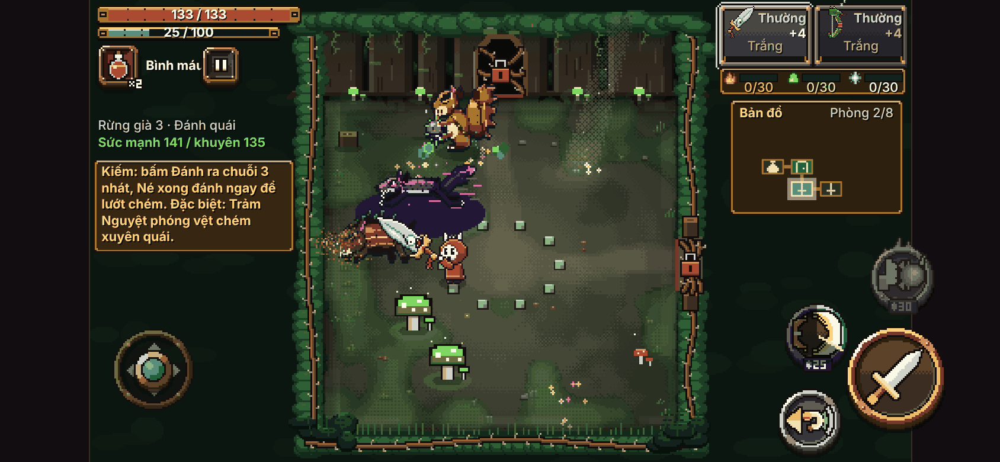 | 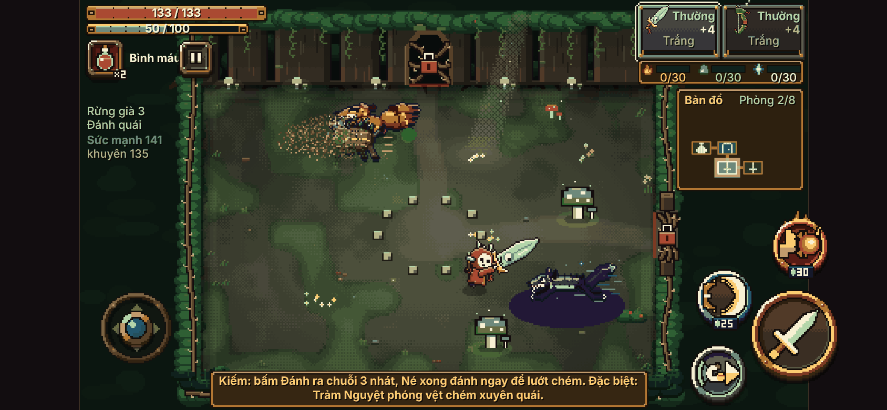 |
| Phòng đầu ải 1 (lời chỉ dẫn), 844×390 | 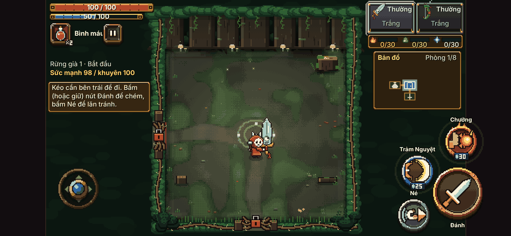 | 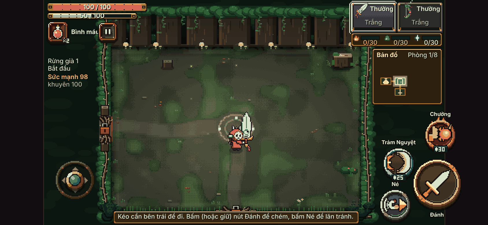 |
| Phòng quái thường, 1280×720 | 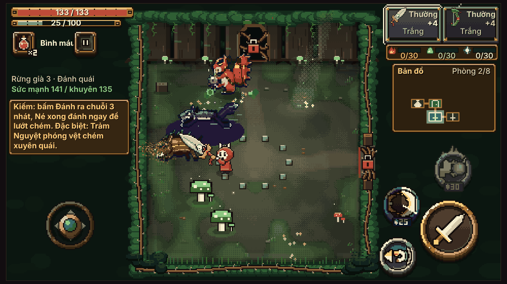 | 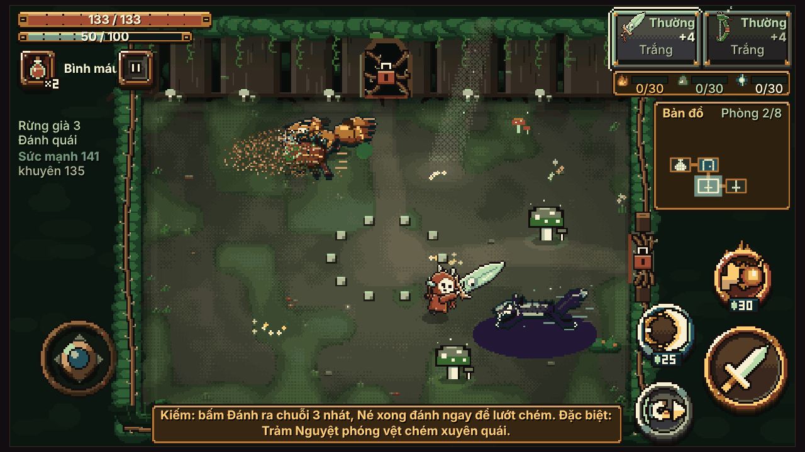 |
| Tinh anh ải 1 (chữ đổi vũ khí), 1280×720 | 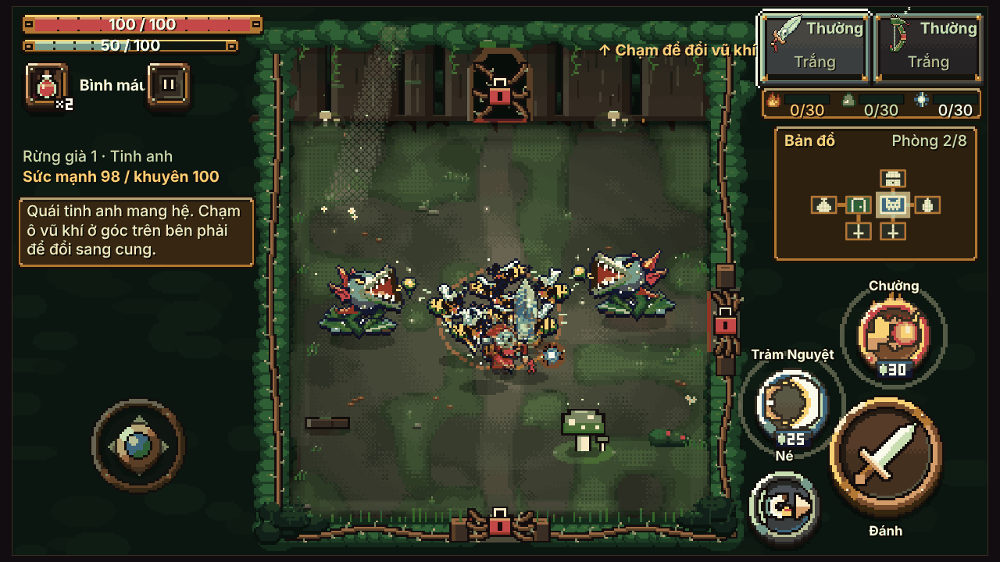 | 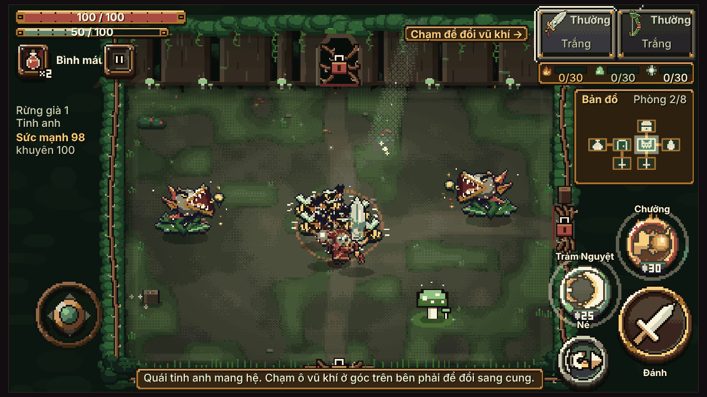 |
| Dọn xong, cửa mở, 1280×720 | 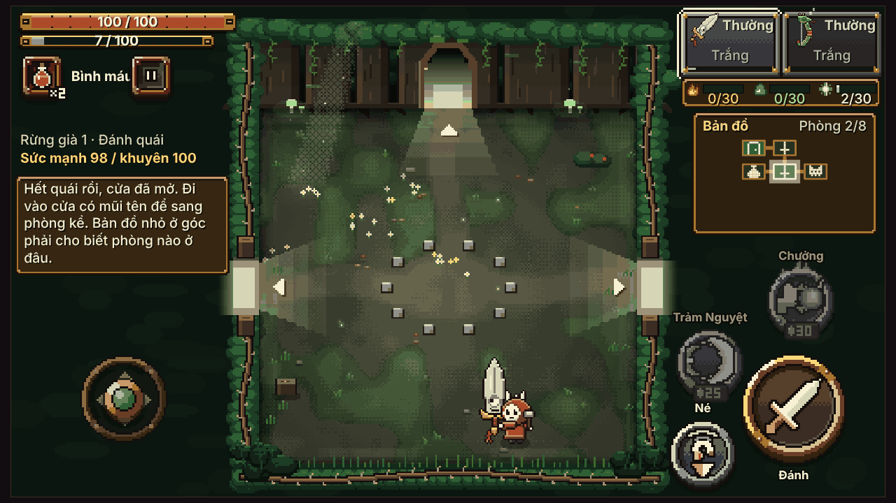 | 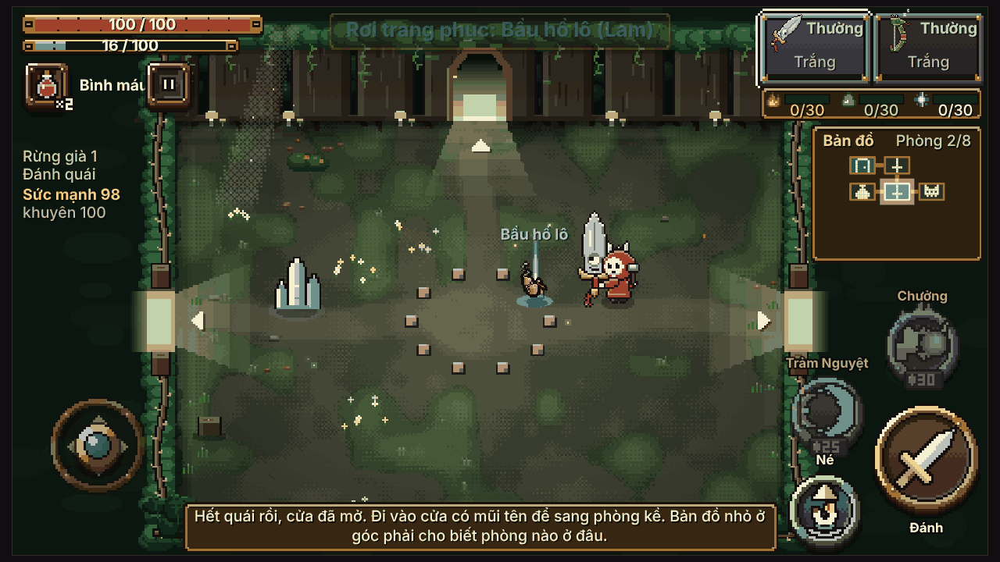 |
| Suối hồi, 844×390 | 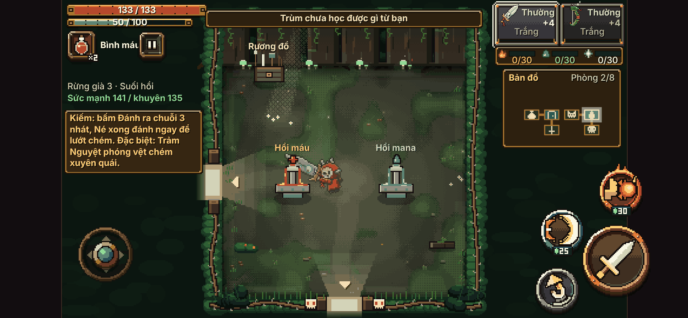 | 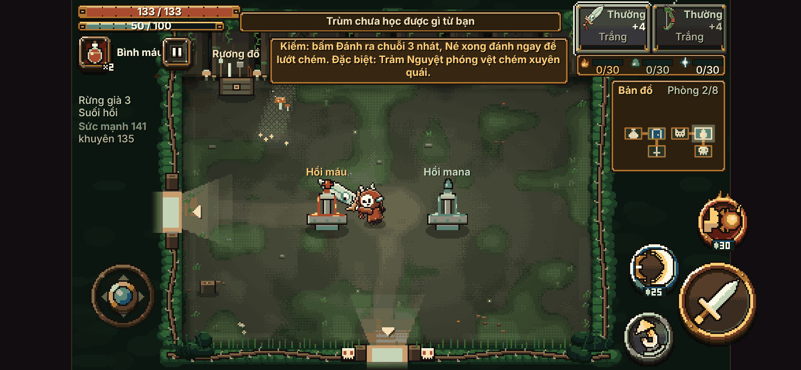 |
| Phòng trùm (không đổi), 844×390 | 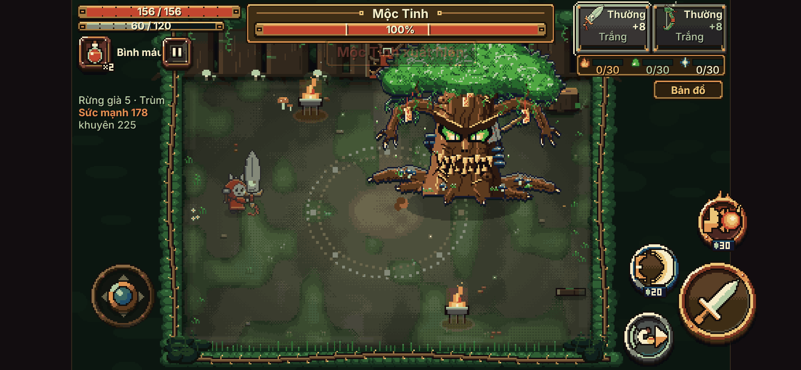 | 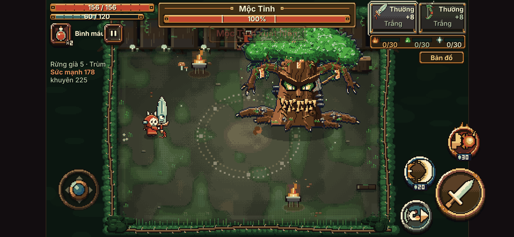 |
| Cầm dọc 390×844 | 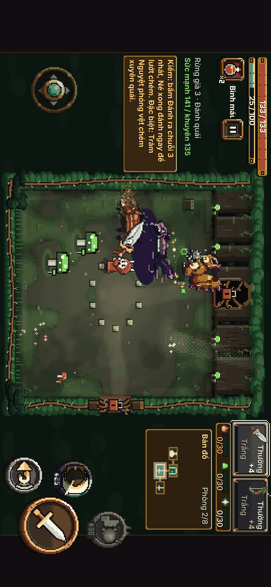 | 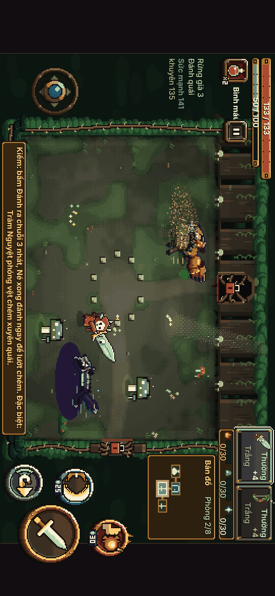 |

Chỉ có ảnh sau (cả `dt844` và `may1280`): `ruong`, `thuong-nhan`, `thu-thach`, `loi-nguyen`, `quai-lao` (quái lao), `dan` (quái bắn đạn), `huong-dan-suoi`, `huong-dan-tinh-anh`, `meo-vu-khi`.

## 5. Số đo khác

- Dung lượng: `dist/linh-khi.html` tăng khoảng 4 KB (10.435 → 10.439 KB) (chỉ thêm vài dòng code, không thêm ảnh).
- Hiệu năng: không đo riêng. Vỏ phòng vẫn dựng một lần rồi nhớ như cũ; phòng thường nay vẽ bằng đúng đường vẽ của phòng trùm.

## 6. Rủi ro còn lại

1. **Sân vẫn chỉ chiếm 51% màn hình điện thoại** vì khung game 16:9 nằm giữa màn 19,5:9, hai bên còn lề đen. Muốn hơn nữa phải đổi cách dùng lề hoặc thêm camera — ngoài phạm vi Q3.
2. Ô chỉ dẫn hai dòng lấn ~9 điểm ảnh mép dưới sàn; khi cửa dưới đóng, ô chữ che hình cánh cửa dưới (đang khoá). Khi cửa dưới mở thì ô chữ tự lên trên.
3. Ở phòng Suối hồi của ải 1, khi cửa dưới mở, ô chỉ dẫn nằm trên tường sau và sát chữ "Rương đồ".
4. Trên màn 16:9, nhãn và vòng nút Đặc biệt chạm vào khung cửa phải (cửa nằm trên tường). Nút không che lối đi trên sàn.
5. Tầm đòn Đặc biệt, tầm chưởng và khoảng cách quái bắn xa đổi theo bề ngang phòng (mục 2). Bot không thấy lệch nhịp đáng kể nhưng cần người thật cảm nhận.
6. Một số bài kiểm tự động cũ còn ghi số sàn cũ (mục 3).
7. Có phiên khác đang sửa `room_art.js`, `stage.js` song song; tôi đã rebase trước khi đẩy, không ghi đè phần vật thể phòng của làn A1 (commit `52b0b4f7`).

## 7. Cách quay lui

- **Nhanh nhất, một số:** trong `game/js/room_art.js` đổi `RA.RONG_PHONG = 300` thành `208`, chạy `python3 game/build.py`, đẩy. Sàn, nút, bản đồ nhỏ, chữ chỉ dẫn đều tự về bố cục cũ (đã kiểm: với 208 bot cho đúng số đo cũ 16,43 / 30,32). Có thể đặt số ở giữa, ví dụ 260 (số chẵn, từ 208 tới 300).
- **Bỏ hẳn:** `git revert 4aeaede1` rồi `python3 game/build.py` và add `game/dist` (tệp dist có thể xung đột nếu đã có bản build mới hơn).
- Không có dữ liệu bản lưu nào bị đổi nên quay lui không ảnh hưởng người chơi.

## 8. Quyết định mới cần chủ dự án duyệt

1. **Tiêu chí 60%.** Với sàn 300, sân chiếm 62,5% khung game nhưng chỉ 51,3% màn hình iPhone ngang. Chọn một:
   - (a) Chấp nhận mức này cho Q3 (đề xuất của tôi: đã rộng gấp 1,44 lần, nhịp đánh giữ được).
   - (b) Muốn đủ 60% màn hình điện thoại thì sàn phải khoảng 350 điểm ảnh và phải dời thanh máu, bản đồ, nút ra lề đen hai bên. Trên màn 16:9 không có lề nên sẽ phải cho nút đè lên sàn. Đây là việc mới, cần duyệt riêng.
2. **Vị trí lời chỉ dẫn**: giữ ở đáy giữa như brief (hiện tại), hay đưa hẳn lên tường phía trên (không bao giờ chạm sàn, nhưng chung chỗ với dòng báo và thanh máu tinh anh)?
3. **Có cần cho quái đông hơn một chút không?** Số đo nói không cần; nếu chơi tay thấy thưa thì chỉnh `G.ROOM_WAVES.maxAlive` (đang 4) hoặc `pts` trong `data.js`.
4. Có cập nhật các bài kiểm tự động cũ theo sàn mới không (mục 3)?
