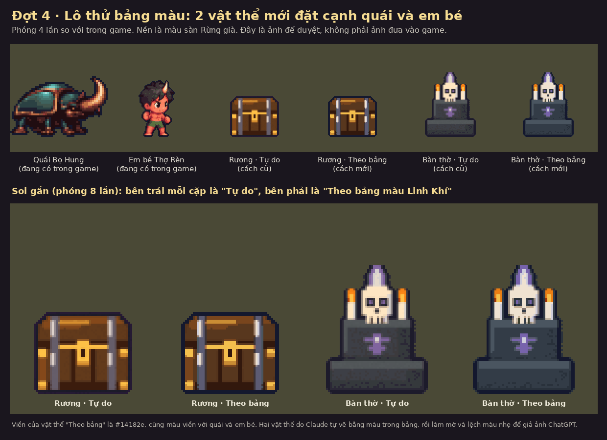
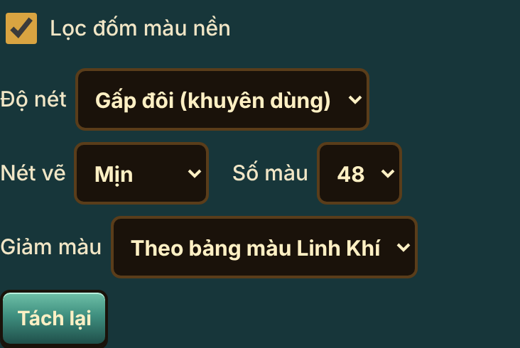
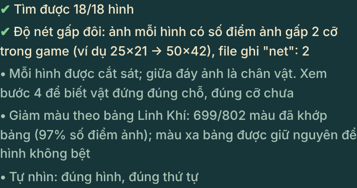

# Báo cáo Đợt 4 — Bảng màu lõi 32 màu + 12 màu hệ (Q6)

Ngày 11/10/2026. Nhánh `khoi-tao-du-an`. Làm theo `dot-4-bang-mau.md`, `CHUNG.md` và mục Q6, II, IV của `QUYET-DINH-Q1-Q6.md`.

**Tóm tắt một câu:** bảng màu, đoạn bảng màu trong prompt và ô chọn "Giảm màu theo bảng" đã xong và đã kiểm trên ảnh thử tự dựng; **chưa thử trên ảnh thật do ChatGPT vẽ**, và bảng màu **chưa áp dụng rộng** cho tới khi bạn duyệt.

**Câu hỏi cần bạn trả lời:** xem ảnh dưới đây, **bảng màu này dùng từ lô mới trở đi được không?**

Trong ảnh: con bọ và em bé là hình đang có trong game. Rương và bàn thờ là hai vật thể thử. Mỗi vật có hai bản: "Tự do" là cách công cụ làm từ trước tới nay, "Theo bảng" là cách mới. Bản "Theo bảng" có viền cùng màu với quái và em bé, màu gỗ và đá sạch hơn, không còn lốm đốm.

Bảng màu đầy đủ: [`docs/vfx/BANG-MAU-LOI.md`](../../../vfx/BANG-MAU-LOI.md) và ảnh [`bang-mau-loi.png`](../../../vfx/bang-mau-loi.png).

## 1. Danh sách tệp đã đổi

| Tệp | Đổi gì |
|---|---|
| `docs/vfx/BANG-MAU-LOI.md` | **Mới.** 44 màu, mỗi màu có mã, tên, dùng cho việc gì, lấy từ đâu. Bốn quy tắc dùng. Bảng nhóm màu của từng trang công cụ. |
| `docs/vfx/bang-mau-loi.png` | **Mới.** Ảnh 44 ô màu có mã, vẽ tự động từ `bang-mau.json`. |
| `docs/vfx/BANG-MAU.md` | Thêm một dòng trỏ sang tệp mới. Nội dung cũ giữ nguyên. |
| `tools/tach-phong/index.html` | Ba việc giống nhau ở cả 7 trang: thêm khối mã "BẢNG MÀU LINH KHÍ"; prompt tự thêm đoạn bảng màu; thêm ô chọn "Giảm màu" và dòng kết quả kiểm. |
| `tools/tach-lang/index.html` | Như trên. |
| `tools/tach-giao-dien/index.html` | Như trên. |
| `tools/tach-do/index.html` | Như trên. |
| `tools/tach-quai/index.html` | Như trên. |
| `tools/tach-anh-hung/index.html` | Như trên. |
| `tools/tach-hieu-ung/index.html` | Như trên. Thêm: bảng màu theo hệ có sẵn (`BAN_MAU`) nay lấy mã từ cùng khối, không ghi mã riêng. |
| `docs/review/ke-hoach-cai-thien/dot-4/` | Báo cáo này, ảnh (`anh/`), script và số đo (`kiem/`). |

Không đổi: mọi tệp trong `game/js`, mọi ảnh trong `game/art/custom`, `game/dist`, `tools/tach-ghep`, `tools/xuong-sprite`, `bang-mau.json` (không có mã màu nào phải sửa).

## 2. Tóm tắt thay đổi và lý do

**a. Tài liệu bảng màu.** 32 màu nền tảng chia 10 nhóm (da, tóc, gỗ, đá, kim loại, vải, cỏ cây, nước, lửa, bóng) và 12 màu hệ (Lửa, Độc, Băng, mỗi hệ 4 nấc). 38 màu lấy mẫu thẳng từ ảnh đang có trong game, 5 màu là màu đang chạy trong mã vẽ sàn và cây, 1 màu ước lượng từ ảnh chụp. Không có màu tự đặt ra. Bốn quy tắc: viền ngoài luôn `#14182e`; hiệu ứng của người chơi lõi `#fbfed0`; hiệu ứng của quái dùng nấc đậm; mỗi vật tối đa 3 sắc một chất liệu.

**b. Đoạn bảng màu trong prompt.** Khi bạn bấm "Sao chép prompt vẽ", prompt có thêm một đoạn "BẢNG MÀU (bắt buộc bám theo)". Đoạn này chỉ nêu các nhóm màu liên quan tới lô đang chọn. Ví dụ lô đồ vật trong phòng: gỗ, đá, kim loại, lửa, bóng. Lô em bé: da, tóc, vải. Quái vùng Biển: nước, đá, kim loại. Phần còn lại của prompt không đổi một chữ. Đoạn được chèn ở một chỗ duy nhất trong mỗi trang, nên lô mới thêm sau này tự có.

**c. Ô chọn "Giảm màu".** Ở bước 2 của mỗi trang, cạnh ô "Số màu":

- **Tự do (như cũ)** là mặc định. Công cụ làm y như trước.
- **Theo bảng màu Linh Khí**: sau khi giảm số màu, công cụ đưa từng màu của hình về màu gần nhất trong bảng. Màu quá xa bảng thì giữ nguyên. Hai mảng màu lớn khác hẳn nhau không bị dồn về một màu. Các màu viền gần mực viền được gộp về đúng `#14182e`.

Ô này luôn về "Tự do" mỗi lần mở trang. Phần kết quả kiểm có thêm một dòng khi chọn "Theo bảng":

**d. Lô thử 2 vật thể.** Tôi tự vẽ rương và bàn thờ bằng đúng màu trong bảng, rồi phóng to, làm mờ nhẹ, đẩy màu lệch ấm và thêm nhiễu để giả một tấm ảnh ChatGPT (`anh/tam-thu-dau-vao.png`). Tấm này chạy qua Tách Phòng ở cả hai chế độ. Kết quả đặt cạnh quái `boHung` và em bé `em-be-smith` trong `anh/so-sanh.png`. Hai vật thể này chỉ để duyệt, không đưa vào game.

**e. Ba chỗ làm khác brief, chọn cách ít rủi ro.**

- **Tách Đồ và Tách Giao Diện không ép viền `#14182e`.** Viền đồ là `#1b1118` và game dựa vào đúng màu này để đổi viền theo bậc Lam, Tím, Vàng. Giao diện có viền nâu tối riêng. Ở hai trang này đoạn bảng màu ghi "viền giữ đúng như đã ghi ở trên" và giữ các mã màu riêng của từng món.
- **Tách Hiệu Ứng, mục có phe (của người chơi hay của quái) không thêm đoạn thứ hai.** Các mục này đã có sẵn câu màu theo bảng. Tôi chỉ cho câu đó lấy mã từ cùng một nguồn. Prompt của 32 mục này giống bản cũ từng chữ.
- **Lô cửa phòng và lô nút điều khiển giữ đoạn bảng màu do hai phiên chạy song song (A2, C1) viết.** Hai phiên đó đã tự ghi bảng màu riêng cho lô của mình, dùng cùng các mã. Công cụ nhận ra và không chèn lần hai.

## 3. Kiểm thử theo tiêu chí nghiệm thu

Cách kiểm: mở trang bằng trình duyệt tự động (Chromium), bản mới và bản ngay trước Đợt 4 chạy song song, cùng một tấm ảnh đầu vào. Script và số đo nằm trong `kiem/`.

| Tiêu chí | Kết quả | Số đo |
|---|---|---|
| 7 trang mở không lỗi console | **Đạt** | Không có lỗi mới. Mỗi trang còn đúng các lỗi tải tệp đã có ở bản cũ (máy kiểm chặn tệp tải từ mạng ngoài như phông chữ; Tách Làng có thêm một tệp không tìm thấy, cũng có từ trước). |
| Prompt có đoạn bảng màu đúng nhóm | **Đạt** | 156 prompt trên 7 trang: 124 có đoạn bảng màu (119 do đợt này thêm, 5 do phiên A2 và C1 viết sẵn), 32 là mục có phe của Tách Hiệu Ứng dùng câu màu có sẵn. Không prompt nào có hai đoạn. Phần còn lại của mọi prompt giống bản cũ. |
| "Tự do" cho kết quả y hệt trước | **Đạt** | 49 tệp xuất trên 7 trang giống bản cũ từng byte và từng điểm ảnh (Phòng 18, Làng 6, Giao Diện 12, Đồ 10, Quái 1, Anh Hùng 1, Hiệu Ứng 1). Danh sách kết quả kiểm cũng giống. |
| "Theo bảng": không mất viền | **Đạt** | Hình bóng không đổi một điểm ảnh nào. Viền đúng `#14182e`: rương 328 điểm, bàn thờ 345 điểm (bản "Tự do" là 0 vì màu viền bị lệch). |
| "Theo bảng": không mất chi tiết | **Đạt** | Trong các đường nét rõ của bản "Tự do", bản "Theo bảng" giữ 94,9% (rương) và 95,6% (bàn thờ). Phần mất là vệt nhiễu trong mảng gỗ và đá. Xem phần soi gần trong ảnh so sánh. |
| "Theo bảng": số màu khớp bảng từ 70% | **Đạt** | Rương 41/45 màu (91%), bàn thờ 40/46 màu (87%). Số màu của hình giảm từ 45 xuống 16 và từ 46 xuống 19. |
| Tài liệu và ảnh bảng màu đọc được, 44 màu đủ nguồn | **Đạt** | Script đếm đủ 32 + 12, màu nào cũng có ô nguồn. |
| Chủ dự án duyệt bảng màu và ảnh thử | **Chưa** | Chờ bạn xem `anh/so-sanh.png`. |

Kiểm thêm chế độ "Theo bảng" trên 6 trang còn lại: không lỗi, hình bóng không đổi, vẫn "ĐẠT". Số màu khớp: Làng 251/271, Giao Diện 60/62, Đồ 138/148, Quái 40/47, Anh Hùng 40/46, Hiệu Ứng 38/46.

**Điều chưa kiểm được:**

- **Chưa có ảnh thật từ ChatGPT vẽ theo prompt mới.** Mọi số ở trên đo trên ảnh tôi tự dựng bằng màu trong bảng rồi làm lệch nhẹ. Ảnh thật có thể lệch bảng nhiều hơn, khi đó tỉ lệ khớp sẽ thấp hơn 87–91%.
- Chưa biết ChatGPT bám đoạn bảng màu tới đâu. Chỉ biết đoạn đó có trong prompt.
- Không chạy bộ test dài và không chạy test của game, đúng lời dặn. Đợt này không đụng mã game.

## 4. Ảnh

| Ảnh | Nội dung |
|---|---|
| `anh/so-sanh.png` | **Ảnh để duyệt.** Hai vật thể thử cạnh quái và em bé, phóng 4 lần, kèm phần soi gần 8 lần. |
| `anh/hai-vat-the-ve-goc.png` | Hai vật thể lúc mới vẽ, trước khi giả ảnh ChatGPT. |
| `anh/tam-thu-dau-vao.png` | Tấm ảnh đầu vào đưa cho Tách Phòng. |
| `anh/cong-cu-o-chon.png`, `anh/cong-cu-ket-qua-kiem.png` | Ô chọn mới và dòng kết quả kiểm trên màn hình cỡ điện thoại. |
| `docs/vfx/bang-mau-loi.png` | Bảng 44 màu. |

Đợt này không đổi gì trong game nên không có ảnh trước và sau của game.

## 5. Rủi ro còn lại

1. **Bảng màu chưa qua ảnh thật.** Nên vẽ thử một lô nhỏ bằng prompt mới rồi mới dùng đại trà.
2. **Màu có thể bị kéo sang nhóm khác.** Công cụ chọn màu gần nhất trong cả 44 màu. Một màu gỗ sáng bị lệch có thể rơi vào "da tối" vì hai màu nâu này gần nhau. Trên ảnh thử, mắt thường không thấy sai, nhưng với ảnh thật cần nhìn lại.
3. **Prompt còn vài mã màu cũ khác bảng.** Lô đồ vật của Tách Phòng ghi viền `#140d0e`, Tách Làng ghi viền `#1a1420`, Tách Anh Hùng ghi da `#f2c9a0`. Tôi không xoá vì brief chỉ cho thêm đoạn mới. Đoạn bảng màu có câu "mã ở trên mà khác bảng thì theo bảng", nhưng hai mã trái nhau trong cùng một prompt vẫn có thể làm ChatGPT lúng túng.
4. **Prompt dài thêm từ 348 đến 765 ký tự tuỳ lô (thường khoảng 550).** Đoạn mới có dặn "không vẽ ô màu mẫu vào ảnh", nhưng vẫn có khả năng ChatGPT vẽ bảng màu vào góc ảnh.
5. **Khối mã bảng màu được chép giống hệt vào 7 trang**, vì mỗi trang là một tệp chạy riêng. Sau này đổi một mã màu phải sửa cả 7 trang và 2 tệp tài liệu. Cách làm ghi ở mục 5 của `BANG-MAU-LOI.md`.
6. **Ảnh có viền dính màu nền.** Khi ảnh gốc mờ nhiều, mép viền pha màu hồng của nền và ra màu tím sẫm, quá xa bảng nên không được kéo về `#14182e`. Lỗi này có từ trước ở cả hai chế độ, đợt này không sửa.

## 6. Cách quay lui

- **Không cần làm gì để lô cũ an toàn:** ô "Giảm màu" mặc định là "Tự do", tệp xuất giống cũ từng byte.
- **Bỏ hẳn phần công cụ và tài liệu:** `git revert 3a2aa9bf` (commit "Đợt 4 (Q6): bảng màu lõi 32 + 12 màu hệ cho lô mới…"). Commit này chỉ đụng `tools/tach-*` và `docs/vfx`.
- **Chỉ bỏ đoạn bảng màu trong prompt của một trang:** xoá ghi chú "Đợt 4 (Q6): mọi prompt của trang có thêm đoạn BẢNG MÀU" và các dòng có chữ `taoPromptGoc` ngay dưới nó trong trang đó.
- Không có dữ liệu nào bị đổi: không bản lưu, không ảnh, không tệp của game.

## 7. Quyết định mới cần bạn duyệt

1. **Bảng màu này dùng từ lô mới trở đi?** Nếu được, từ lô sau hãy chọn "Theo bảng màu Linh Khí" ở bước 2 khi tách ảnh. Nếu chưa ưng màu nào, cho tôi biết màu đó để đổi trước khi dùng.
2. **Có xoá các mã màu cũ trái bảng trong prompt không?** (viền `#140d0e` ở Tách Phòng, viền `#1a1420` ở Tách Làng, da `#f2c9a0` ở Tách Anh Hùng). Đề xuất: xoá, để mỗi prompt chỉ còn một bộ mã.
3. **Vũ khí theo hệ có đổi sang 12 màu hệ không?** Prompt vũ khí hệ của Tách Đồ đang dùng bộ mã riêng (ví dụ Lửa `#8a1c12`, `#e8492a`, `#ffb347`), khác 12 màu hệ của bảng. Tôi giữ nguyên để vũ khí mới khớp với vũ khí hệ đã có. Đề xuất: giữ, cho tới khi vẽ lại cả bộ.
4. **Đồ và giao diện giữ viền riêng, không dùng `#14182e`?** Đề xuất: giữ, vì game đang dựa vào màu viền đồ để tô bậc.
5. Bản rà soát mỹ thuật có đề xuất đổi vài hằng số màu hệ trong mã game (ví dụ Băng `#7fd4ff` sang `#32b0e9`). Việc đó phải sửa `game/js` nên nằm ngoài đợt này. Nếu muốn làm, cần một đợt riêng.
