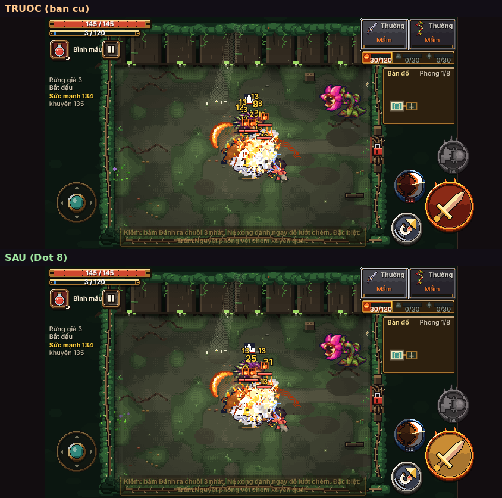
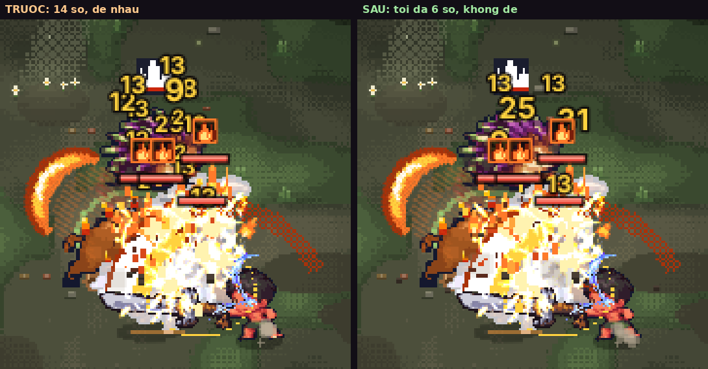
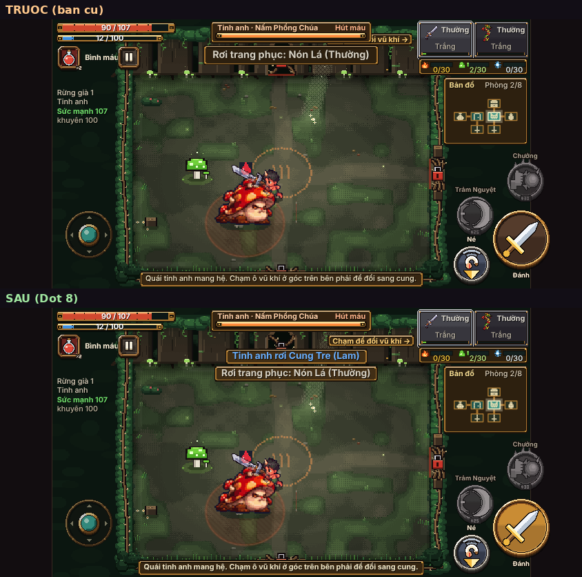
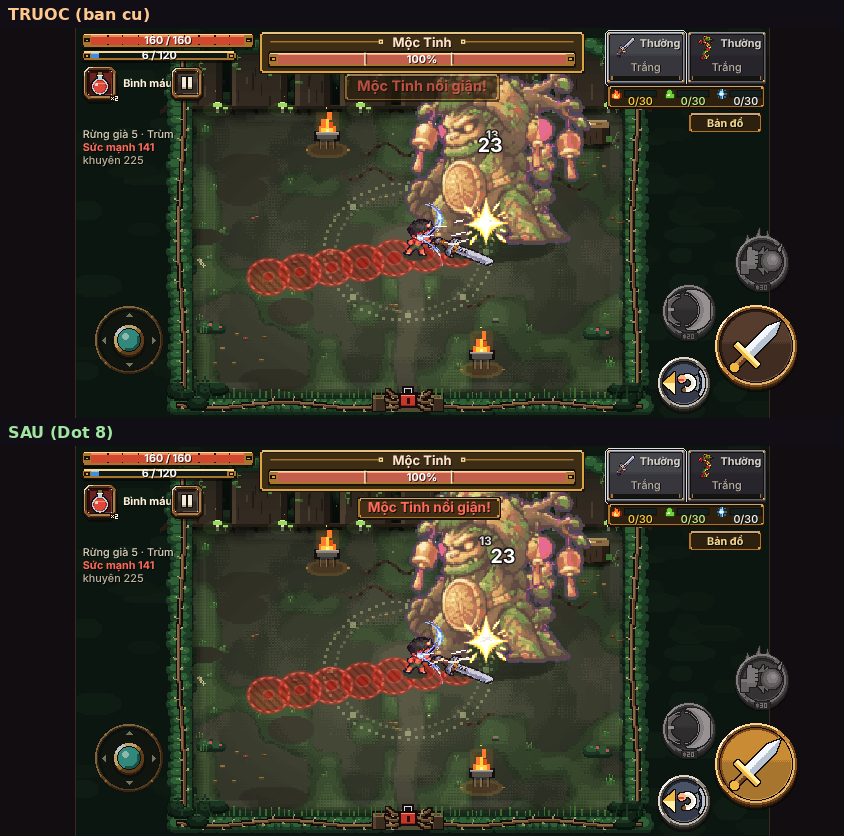
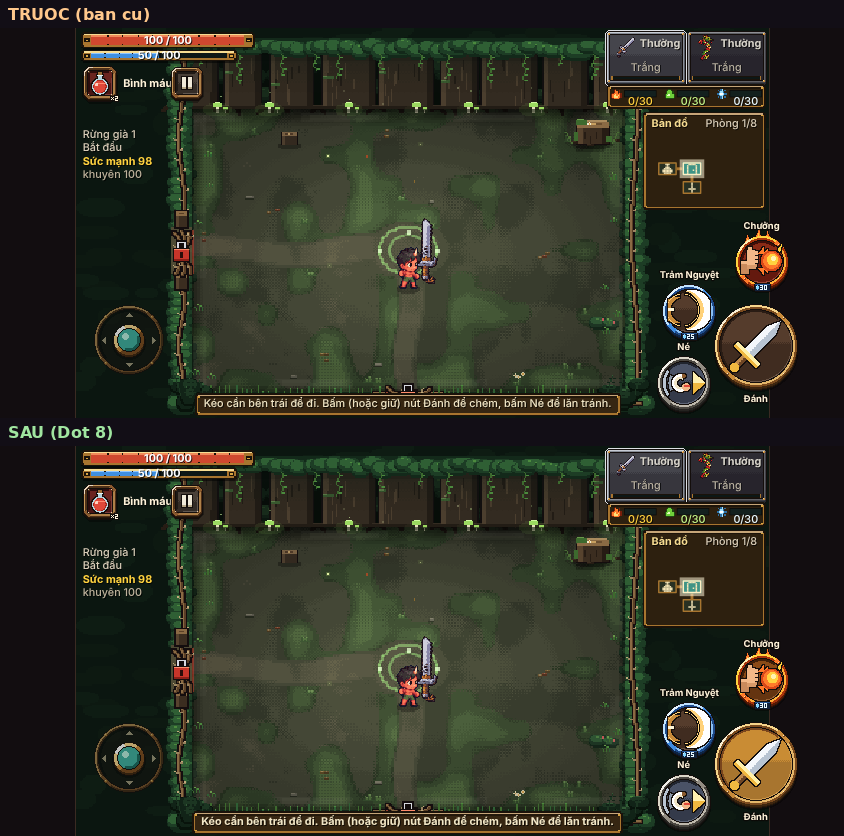
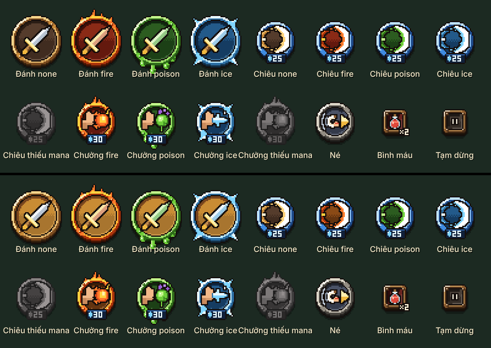

# Đợt 8 — Độ đọc trận đấu trên điện thoại — Báo cáo

Ngày 11/10/2026 · nhánh `khoi-tao-du-an` · commit mã `efa50485` · cờ tắt `G.DO_DOC_TRAN`

## Tóm tắt một dòng

Trong trận, số sát thương không còn chồng lên nhau (tối đa 6 số), thông báo có một dải riêng tối đa 2 dòng trên mặt tường sau, nút Đánh đổi sang đồng vàng để màu đỏ chỉ còn nghĩa "nguy hiểm", và các lớp hình được vẽ theo một thứ bậc cố định. Tắt cờ thì game vẽ y hệt bản cũ (so ảnh: 0 điểm ảnh khác). Luật chơi, sát thương, hình học phòng, cỡ và vị trí nút **không đổi**.

**Chưa làm: phần "Bổ sung 13:21 — Đợt 8b"** (bỏ ô dấu Linh Khí trên đầu quái). Lý do ở mục 9.

## 1. Tệp đã đổi

| Tệp | Đổi gì |
|---|---|
| `game/js/ui_theme.js` | Thêm cờ `G.DO_DOC_TRAN` và bảng `G.theme.DOC`: thứ bậc hình ảnh, các giới hạn (6 số, 2 dòng, 0,25 giây, so le 6 điểm ảnh), các màu mới. |
| `game/js/fx.js` | Số sát thương theo luật mới (cộng dồn, so le, tối đa 6, không đè); gọi lại `stage.js` để vẽ đúng thứ tự lớp; "Sạch bóng quái!" chuyển lên dải thông báo. |
| `game/js/stage.js` | Hàm vẽ bảng thông tin trong trận tách thành 3 lớp (`duoi`, `tren`, `vien`); dải thông báo chiến đấu; chữ phải đọc được tô đậm, có nền tối; nhãn "Chạm để đổi vũ khí" dời chỗ. |
| `game/js/btn_art.js` | Màu mặt nút Đánh, mặt nút Chiêu / Chưởng hệ Lửa, số mana đang thiếu. Phần móc ảnh biểu tượng của làn C1 không đụng tới. |
| `game/tests/fx_check.py` | Một phép kiểm cũ đòi "4 đòn cùng lúc ra 4 số": nay khi cờ bật thì đòi "gộp thành một số 40". Cờ tắt vẫn kiểm như cũ. |
| `game/dist/*`, `tools/xuong-sprite/index.html` | Do `python3 game/build.py` tạo lại. |
| `docs/review/ke-hoach-cai-thien/dot-8/` | Báo cáo này, `kiem.py` (script kiểm), `ket-qua.json` (số đo), `nhat-ky-sat-thuong-ai1.txt`, thư mục `anh/`. |

Không sửa `ngon_ngu*.js`: đợt này không thêm câu chữ mới.

## 2. Đã làm gì và vì sao

### 2.1. Thứ bậc hình ảnh cố định

Bảng nằm trong mã ở `G.theme.DOC.thuBac` (`ui_theme.js`). Lớp kém quan trọng vẽ trước, lớp quan trọng vẽ sau, nên lớp dưới không thể đè lên lớp trên.

| Bậc | Lớp | Vẽ thứ mấy trong một khung hình | Nơi vẽ |
|---|---|---|---|
| 1 (quan trọng nhất) | Vùng báo đòn | 7 | `bao_truoc.js`, cuối `G.drawWorld` |
| 2 | Nhân vật và quái | 1 | lớp thế giới; chữ và khung không đặt lên giữa sàn |
| 3 | Thanh máu trùm / tinh anh / quái | 6 | `stage.js` `drawHud('tren')` |
| 4 | Số sát thương | 5 | `fx.js` `drawNums` |
| 5 | Thông báo chiến đấu | 4 | `stage.js` `veThongBao` |
| 6 | Chữ phụ: tên phòng, sức mạnh, lời chỉ dẫn, mẹo, tên vật, đồ vừa nhặt | 3 | `stage.js` `drawHud('duoi')` |
| — | Viền màn hình: thanh máu em bé, ô vũ khí, bản đồ nhỏ, nút | 8 | `stage.js` `drawHud('vien')`, nằm ngoài sàn |

**Chỗ sai đã sửa:** trước đây cả bảng thông tin được vẽ một lượt *sau* số sát thương và *sau* vùng báo đòn, nên dòng thông báo và ô lời chỉ dẫn có thể che số sát thương và che cả vùng đỏ nguy hiểm. Nay chữ phụ và thông báo vẽ trước số; thanh máu vẽ sau số; vùng báo đòn vẽ sau tất cả các lớp đó. Đồ vừa nhặt (hình bay lên trên đầu em bé) cũng xuống lớp chữ phụ, nên không còn nằm đè lên số sát thương.

### 2.2. Màu đỏ chỉ dành cho nguy hiểm

- **Nút Đánh:** mặt nút thành đồng vàng ở mọi hệ. Vòng nút và hoạ tiết hệ (lửa bốc, độc nhỏ giọt, gai băng) giữ nguyên. Trước đây khi kiếm mang hệ Lửa, cả mặt nút đỏ sẫm, cùng họ màu với vùng báo đòn.
- **Nút Chiêu và Chưởng khi mang hệ Lửa:** mặt nút đỏ sẫm `#8a2a16` thành nâu than hồng `#8a4a16`. Brief ghi "nút Né, Chiêu, Chưởng giữ", nhưng tiêu chí nghiệm thu lại ghi "không nút nào còn màu đỏ cảnh báo". Hai câu vênh nhau ở đúng trường hợp hệ Lửa; tôi chọn theo tiêu chí nghiệm thu, đổi nhẹ nhất có thể (chỉ xoay sắc độ, hình và vòng nút giữ nguyên) và ghi vào mục 8 để duyệt.
- **Số mana trên thẻ giá khi chưa đủ mana:** đỏ `#ff6a5a` thành xám thép `#b8c4d2`.
- Còn màu đỏ trong trận: vùng báo đòn, số máu em bé mất, viền đỏ khi trúng đòn, thông báo trùm xuất hiện / nổi giận, đồng hồ thử thách dưới 8 giây, chữ "Sức mạnh" khi thiếu sức. Tất cả đều mang nghĩa nguy hiểm. Thanh máu và bình máu vẫn đỏ (đỏ = máu).

### 2.3. Số sát thương không chồng nhau

- Cùng một quái trúng thêm đòn trong 0,25 giây: cộng dồn vào số đang hiện, số nảy nhẹ một nhịp. Có đòn chí mạng trong lượt gộp thì cả số thành chí mạng (to, vàng, có dấu "!") như cũ.
- Số nối tiếp của cùng một quái lệch ngang so le 6 điểm ảnh. Bỏ độ lệch ngẫu nhiên cũ.
- Tối đa 6 số cùng lúc. Đủ 6 thì số cũ nhất tắt sớm; số nhỏ của nhịp độc / cháy nhường trước và chỉ hiện khi còn chỗ.
- Lúc vẽ, mỗi khung hình đều xét hộp bao của từng số: số mới đứng đúng chỗ, số cũ hơn mà chạm thì nhích lên trên vừa đủ.
- Số máu em bé mất: đỏ, có dấu trừ. Số gây ra cho quái: trắng, màu hệ hoặc vàng chí mạng, không bao giờ đỏ.
- Số mới mọc ngay trên thanh máu nhỏ của quái (cao hơn trước 5 điểm ảnh) để không bị chính thanh máu đó che.

### 2.4. Thông báo chiến đấu có vùng riêng

- Một dải trên mặt tường sau, ngay dưới thanh máu trùm / tinh anh, nằm giữa thanh máu em bé và ô vũ khí (x 126–364).
- Tối đa 2 dòng. Dòng mới đẩy dòng cũ lên; quá 2 thì dòng cũ nhất mất. Trước đây chỉ có một ô: thông báo mới xoá thông báo cũ, và câu dài tự xuống dòng không giới hạn.
- Khi trùm có thẻ kháng / yếu và đang "LỘ ĐIỂM YẾU!", khối trên cùng đã cao nên dải chỉ còn 1 dòng, để không xuống quá mép trên sàn 20 điểm ảnh.
- "Sạch bóng quái!" trước nổi giữa sàn, nay vào dải này.
- Các chỗ khác trong game vẫn đặt thông báo như cũ (`W.banner`); chỉ cách hiện thay đổi.

### 2.5. Cỡ chữ tối thiểu và chữ không bị cắt

- Game vốn đã có sàn cỡ chữ 7,5 cho chữ giao diện. Phần còn thiếu là số sát thương (nhỏ nhất 6,5): nay nhỏ nhất 7.
- Lời chỉ dẫn, thông báo, thẻ kháng / yếu của trùm: chữ đậm. Thêm nền tối 70% sau các dòng trước đây nằm trần trên cảnh: đồng hồ thử thách, "LỘ ĐIỂM YẾU!", "Bấm Đánh" / "Bấm Vào cổng", "Cần 3 mảnh chìa", "Dọn hết quái rồi quay lại".
- Nhãn "Chạm để đổi vũ khí →" ở ải hướng dẫn trước bị khung tinh anh che mất nửa chữ (ảnh 2). Nay xuống một hàng riêng ngay dưới khung.
- Ở phòng trùm, lời chỉ dẫn vẫn ở cột trái hẹp. Nếu chữ đậm làm ô quá cao thì tự về chữ thường như cũ.

### 2.6. Cờ tắt

`G.DO_DOC_TRAN = true` trong `ui_theme.js`. Đặt `false` thì cả bốn tệp về cách vẽ cũ. Muốn so trên điện thoại: mở game với `?doctran=0` ở cuối địa chỉ.

## 3. Kiểm thử theo tiêu chí nghiệm thu

Chạy bằng `python3 docs/review/ke-hoach-cai-thien/dot-8/kiem.py tat-ca <thư mục game bản trước>`; số đo đầy đủ ở `ket-qua.json`. "Bản trước" là bản ngay trước commit của đợt này. `ket-qua.json` ghi lượt đo đầy đủ trước lần rebase cuối; sau lần rebase cuối tôi đo lại ba phép chính trên đúng bản đã đẩy (rủi ro 7), kết quả y như vậy.

| Tiêu chí | Kết quả | Bằng chứng |
|---|---|---|
| Ảnh trước / sau 844×390 ở 4 tình huống | **Đạt** | mục 4 |
| Không nút nào còn màu đỏ cảnh báo | **Đạt một phần** | Đánh, Chiêu, Chưởng hệ Lửa: 2115 / 675 / 153 điểm ảnh đỏ → 0. Còn lại: bình máu 288 điểm (chất lỏng đỏ trong bình) và nút Né 27 điểm (một chấm nhỏ trên hình). Tôi không đổi hai nút này, xem mục 8. |
| Vùng báo đòn vẫn đỏ | **Đạt** | ảnh trùm: 3491 điểm ảnh đỏ trong sàn ở cả bản trước và bản sau; `bao_truoc.js` không sửa |
| 10 giây bot đánh phòng 6 quái: không lúc nào quá 6 số, không số nào đè số khác | **Đạt** | 600 khung hình: nhiều nhất 6 số, 0 cặp đè. Bản trước: nhiều nhất 14 số, 112 khung quá 6 số, 607 cặp đè trong 288 khung |
| Thông báo không quá 2 dòng, không vẽ vào giữa sàn | **Đạt** | cùng lượt đo, bơm 3 thông báo liên tiếp: nhiều nhất 2 dòng, 0 khung chạm vùng giữa sàn |
| Bot ải 1 vẫn thắng | **Đạt** | thắng sau 182,2 giây ở cả hai bản |
| Nhật ký sát thương trùng bản trước | **Đạt** | 195 dòng, trùng từng dòng (`nhat-ky-sat-thuong-ai1.txt`) |
| Cờ false → so ảnh 0 khác | **Đạt** | 8 ảnh (4 tình huống × 2 cỡ màn): 0 điểm ảnh khác |
| Thứ tự vẽ đúng bảng thứ bậc | **Đạt** | ghi lại thứ tự gọi trong một khung hình phòng trùm: chữ phụ + thông báo → số → thanh máu → vùng báo đòn → viền màn hình |
| Không chữ nào bị ô vũ khí / bản đồ cắt (844×390 và 1280×720) | **Đạt trên các ảnh đã chụp** | 8 ảnh `sau-*` và 8 tình huống phụ tôi xem bằng mắt ở 844×390 (thử thách, dọn sạch phòng, cửa khoá, suối khoá, rương, trùm đủ thẻ, trùm ải hướng dẫn, cửa dưới mở). Chưa phải mọi câu chữ của game. |
| `node --check game/js/*.js`, `python3 game/build.py` | **Đạt** | |

Cách đo "đỏ cảnh báo": điểm ảnh cùng họ màu với vùng báo đòn (sắc độ ≤ 12° hoặc ≥ 350°, độ đậm ≥ 0,55, độ sáng ≥ 0,5).

Về cách đo "0 điểm ảnh khác": lần đo đầu ra số khác 0, kể cả khi so bản cũ với chính nó. Nguyên nhân là script kiểm chứ không phải game (đồng hồ game chưa đặt lại, thanh máu tụt dần chạy theo đồng hồ máy). Sau khi sửa script, bản cũ so với chính nó ra 0, rồi mới đo cờ tắt.

Chưa chạy: các bộ test dài của `game/tests` (theo lời dặn). Riêng `fx_check.py` tôi chạy một lần vì có sửa nó: phép kiểm số sát thương đạt; tệp này báo 64 lỗi "phép biến đổi canvas" ở cả bản trước lẫn bản sau, không do đợt này.

## 4. Ảnh trước / sau (`anh/`)

Mỗi cảnh có `truoc-…`, `sau-…` ở hai cỡ màn (`dt844` = 844×390, `may1280` = 1280×720) và một ảnh ghép `so-sanh-…` để xem trên điện thoại.

**Ảnh 1 — phòng đông 6 quái đang đánh.** `so-sanh-dong.png`, phóng to: `phong-to-so-sat-thuong.png`

Chỗ đã sửa: (a) 14 số chồng nhau thành tối đa 6 số tách rời, các đòn liên tiếp lên một quái gộp thành "25"; (b) mặt nút Đánh đỏ thành đồng vàng, vòng lửa giữ; (c) mặt nút Chiêu đỏ sẫm thành nâu, số "25" trên thẻ giá hết đỏ.

**Ảnh 2 — tinh anh + thông báo.** `so-sanh-tinh-anh.png`

Chỗ đã sửa: (a) nhãn "Chạm để đổi vũ khí →" hết bị khung tinh anh che; (b) hai thông báo nối nhau cùng hiện, trước chỉ thấy cái sau; (c) lời chỉ dẫn ở đáy chữ đậm.

**Ảnh 3 — trùm: thanh máu + thông báo + vùng báo đòn.** `so-sanh-trum.png`

Chỗ đã sửa: (a) số "13" và "23" đứng so le, không đè; (b) thông báo nằm trong dải dưới thanh máu trùm; (c) vùng báo đòn đỏ giữ nguyên, nút Đánh không còn cùng màu với nó.

**Ảnh 4 — ải 1 phòng đầu.** `so-sanh-huong-dan.png`

Chỗ đã sửa: lời chỉ dẫn chữ đậm, nút Đánh mặt đồng vàng. Vị trí ô chữ giữ như Đợt 2.

**Bảng nút, hàng trên là cũ, hàng dưới là mới.** `nut-truoc-sau.png`

## 5. Số đo

| | Bản trước | Bản sau |
|---|---|---|
| Số sát thương nhiều nhất cùng lúc (10 giây, 6 quái) | 14 | 6 |
| Khung hình có hơn 6 số | 112 / 600 | 0 / 600 |
| Cặp số đè nhau (cộng mọi khung) | 607 | 0 |
| Dòng thông báo nhiều nhất cùng lúc | 1 ô (thông báo mới xoá thông báo cũ) | 2 dòng |
| Bot ải 1 | thắng, 182,2 giây | thắng, 182,2 giây |
| Điểm ảnh đỏ cảnh báo trên nút Đánh hệ Lửa | 2115 (15,1%) | 0 |

Không đo FPS: phần thêm mỗi khung hình là xét hộp của tối đa 9 số và 2 dòng thông báo.

## 6. Rủi ro còn lại

1. **Chưa thử trên iPhone thật.** Mọi ảnh là Chromium ở 844×390 và 1280×720.
2. **Biểu tượng hệ nhỏ trên đầu quái** do `linhkhi.js` vẽ, không nằm trong danh sách tệp được sửa, nên vẫn vẽ cùng viền màn hình (sau vùng báo đòn). Ô 9×9 điểm ảnh, nằm trên đầu quái. Nếu làm Đợt 8b thì chỗ này tự hết.
3. **Dải thông báo lấn mép trên sàn** tối đa 20 điểm ảnh khi có khung tinh anh, nhãn đổi vũ khí và 2 dòng cùng lúc (ảnh 2). Quái đứng sát tường trên có thể bị che đầu. Brief cho phép "mép trên sàn"; chưa bao giờ xuống giữa sàn.
4. **Số gộp che mất nhịp đòn:** 3 nhát liên tiếp trong 0,25 giây hiện một số tổng thay vì 3 số. Đây là yêu cầu của brief, nhưng cảm giác "đánh trúng nhiều nhát" có thể giảm; cần người chơi thật nhận xét.
5. **Chữ đậm dài hơn chữ thường** nên lời chỉ dẫn dài nhất có thể thêm một dòng. Các câu dài (suối, cửa mở) hiện lúc phòng không còn quái. Tiếng Anh mới xem qua 4 tình huống phụ, chưa xem từng câu.
6. **Các bộ test dài chưa chạy.** Bài nào soi vị trí dòng thông báo cũ hoặc đếm số sát thương theo cách cũ có thể cần cập nhật như `fx_check.py`.
7. Làn E2 và A3 chạy song song: hai lần rebase chỉ xung đột ở `game/dist`, đã build lại. Sau lần rebase cuối tôi đo lại cờ tắt (0 khác), 10 giây 6 quái và bot ải 1 trên đúng bản đã đẩy.

## 7. Cách quay lui

- Nhanh nhất, không cần sửa mã: mở game với `?doctran=0`.
- Tắt hẳn: trong `game/js/ui_theme.js` đổi `G.DO_DOC_TRAN = !tat` thành `G.DO_DOC_TRAN = false`, rồi `python3 game/build.py`.
- Gỡ toàn bộ: `git revert efa50485`, rồi `python3 game/build.py` nếu `game/dist` xung đột.

## 8. Quyết định mới cần chủ dự án duyệt

Đều là lựa chọn thẩm mỹ, đang bật theo mặc định dưới đây; ảnh ở mục 4.

1. **Màu mặt nút Đánh: đồng vàng `#c98c34` / `#a8752f` / `#79451d`** (sáng / vừa / tối). Brief đề xuất `#ffd23f` / `#c8a060`; tôi chọn tông tối hơn vì `#ffd23f` trùng màu chuôi kiếm và màu số chí mạng, hình thanh kiếm trên nút sẽ chìm. `#c98c34` và `#79451d` có trong bảng màu lõi (gỗ nắng, gỗ sáng). Áp cho cả 4 trạng thái (chưa hệ, Lửa, Độc, Băng) để nút Đánh luôn một màu; hệ đọc ở vòng nút. Xem `nut-truoc-sau.png`. Nếu muốn chỉ đổi khi mang hệ Lửa, hoặc muốn tông sáng hơn, đổi 3 mã màu ở `G.theme.DOC.nutDanh`.
2. **Mặt nút Chiêu / Chưởng hệ Lửa: nâu than hồng `#8a4a16`** thay đỏ sẫm. Brief ghi "giữ"; tôi đổi để đạt tiêu chí "không nút nào đỏ". Muốn giữ như cũ: xoá dòng `matLua`.
3. **Số mana đang thiếu: xám thép** thay đỏ.
4. **Bình máu và chấm đỏ trên nút Né giữ nguyên.** Bình máu đỏ là màu máu, cùng nghĩa với thanh máu. Nếu muốn tuyệt đối không nút nào có đỏ thì cần vẽ lại hình bình, việc đó thuộc làn ảnh giao diện.
5. **Cỡ chữ thông báo: 9,5**, tự thu về 8,5 rồi 7,5 khi câu dài (trước là 10 / 8,5 / 7,5). Nhỏ hơn nửa điểm để 2 dòng vừa mặt tường sau.
6. **Lời chỉ dẫn chữ đậm.**
7. **"Sạch bóng quái!"** chuyển từ giữa sàn lên dải thông báo, chữ nhỏ hơn trước (12 → 9,5).
8. **Số sát thương gộp** hiện tổng của các đòn trong 0,25 giây (rủi ro 4).

## 9. Về phần "Bổ sung 13:21 — Đợt 8b"

Trong lúc phiên này đang chạy, brief được thêm đoạn 8b: bỏ ô dấu Linh Khí trên đầu quái, chuyển thành viền hệ quanh thanh máu. **Tôi chưa làm**, vì:

- `TRANG-THAI.md` mục 4 ghi việc này đang "chờ xác nhận lại vì có thể nhầm với khung khối băng";
- phần vẽ ô dấu nằm trong `linhkhi.js`, ngoài danh sách tệp phiên này được sửa;
- 8b dùng chung cờ `G.DO_DOC_TRAN`, nên nếu làm nhầm ý thì muốn bỏ riêng 8b phải tắt cả Đợt 8.

Khi chủ dự án xác nhận, việc còn lại gọn: thanh máu nhỏ của quái vẽ ở `mobBars` trong `stage.js` (thêm viền màu hệ ở đó), ô dấu vẽ ở hàm `badges` trong `linhkhi.js` (bỏ khi cờ bật).

## 8b. Bỏ ô dấu Linh Khí trên đầu quái, chuyển thành viền hệ quanh thanh máu (phiên riêng, 11/10/2026)

**Tóm tắt một dòng:** quái thường và tinh anh không còn ô vuông 9×9 (lửa / giọt độc / bông tuyết) trên đầu; quái đang mang dấu hệ nào thì thanh máu nhỏ của nó có viền 1 điểm ảnh màu hệ đó. Luật chơi không đổi. Commit game: `0a65ce59`.

### Tệp đã đổi

| Tệp | Đổi gì |
|---|---|
| `game/js/linhkhi.js` | Thêm cờ `G.DAU_LINH_KHI_VIEN` (mặc định bật), bảng màu viền `G.lk.VIEN` (lửa `#fe7d04`, độc `#5aca02`, băng `#32b0e9`), hàm `G.lk.vienHe(e)`. Hàm `badges`: quái đã có viền hệ thì không vẽ ô dấu nữa. |
| `game/js/stage.js` | Hàm `mobBars`: quái mang dấu thì viền thanh máu tô màu hệ (thay viền tối), và thanh máu hiện suốt lúc còn mang dấu. |
| `game/dist/*` | Gói lại bằng `python3 game/build.py`. |
| `docs/.../dot-8/kiem-8b.py`, `ket-qua-8b.json`, `anh/8b-truoc-sau.png` | Bài kiểm, kết quả, ảnh. |

Không có chữ mới nên không đụng `ngon_ngu*.js`. Không đụng ô dấu ở bảng xem vũ khí, màn kết quả, ba vạch linh khí cạnh ô vũ khí.

### Đã làm gì và vì sao

1. **Viền hệ.** Thanh máu nhỏ vốn có viền tối 1 điểm ảnh. Quái mang dấu thì viền đó đổi sang màu hệ, lòng thanh vẫn tối, phần máu đỏ như cũ. Quái không mang dấu: viền y cũ.
2. **Thanh máu hiện suốt khi quái mang dấu.** Trước đây thanh máu nhỏ chỉ hiện 2,4 giây sau khi quái trúng đòn, còn ô dấu thì hiện suốt. Nếu chỉ tô viền mà giữ luật 2,4 giây thì có lúc quái còn mang dấu nhưng không thấy gì. Nên tôi cho thanh máu hiện suốt lúc quái còn mang dấu; hết dấu thì mờ dần trong nửa giây như sau một đòn đánh. Đây là lựa chọn của tôi, xem "Quyết định cần duyệt" bên dưới.
3. **Hệ nào được tô** vẫn do đúng hàm cũ `LK.markEl` quyết định (cùng luật với lúc kết liễu), nên viền luôn khớp với dấu sẽ nhận.
4. **Cờ riêng** `G.DAU_LINH_KHI_VIEN`, không dùng chung `G.DO_DOC_TRAN`: tắt 8b không ảnh hưởng Đợt 8 và ngược lại.
5. **Trùm giữ ô dấu.** Trùm không có thanh máu nhỏ trên đầu (máu trùm nằm ở thanh lớn phía trên màn hình, thuộc HUD khác mà brief cấm đụng). Bỏ ô dấu của trùm thì mất hẳn thông tin, nên tôi giữ nguyên.
6. **Dự phòng:** nếu thanh máu nhỏ không được vẽ (người chơi tắt hiệu ứng giao diện `G.VFX.giaoDien = 0`) thì ô dấu cũ vẫn hiện, không mất thông tin.
7. Danh sách `G.lk.badgeList` (bài kiểm `game/tests/linhkhi.py` đọc) vẫn ghi đủ quái mang dấu như trước.

### Kiểm thử (chạy `python3 docs/review/ke-hoach-cai-thien/dot-8/kiem-8b.py <thư mục game bản trước>`, kết quả ở `ket-qua-8b.json`)

| Tiêu chí | Kết quả |
|---|---|
| Ảnh 844×390 phòng có 3 quái mang dấu 3 hệ, trước / sau | ĐẠT. `anh/8b-truoc-sau.png`: trước có 4 ô dấu, sau không còn ô nào, 4 thanh máu có viền cam / xanh lá / xanh dương (3 heo + 1 quái giáp mang dấu Băng). Quái không mang dấu không có viền màu. Không lỗi JS. |
| Cờ `G.DAU_LINH_KHI_VIEN = false` → như cũ | ĐẠT. So ảnh bản mới (cờ tắt) với bản trước 8b ở 5 cảnh 844×390 (3 hệ, đông quái, tinh anh, trùm, hướng dẫn): **0 điểm ảnh khác** ở cả 5. |
| Bot ải 1 vẫn thắng | ĐẠT. Thắng sau 182,2 giây, máu 100/100; nhật ký 195 dòng sát thương **trùng từng dòng** với bản trước (cùng mã băm `5f5f38c467443b05`), tức luật chơi không đổi. |
| `node --check game/js/*.js`, `python3 game/build.py`, `cloud_save_regression.test.js` | ĐẠT. |

Chưa làm: chưa thử trên iPhone thật; không chạy các bộ test dài (theo lời dặn), kể cả `game/tests/linhkhi.py`.

### Ảnh

`anh/8b-truoc-sau.png`: hàng trên là toàn màn hình trước | sau; bên dưới phóng to 3 lần vùng quái (trên = trước, dưới = sau; quái từ trái sang: Lửa, Độc, Băng, không dấu; góc phải dưới là quái giáp mang dấu Băng).

### Rủi ro còn lại

1. Viền chỉ dày 1 điểm ảnh quanh thanh cao 2 điểm ảnh: trên ảnh chụp 844×390 đọc được cả ba màu, nhưng trên iPhone thật ngoài nắng có thể khó thấy hơn ô 9×9 cũ. Cần chủ dự án xem trên máy.
2. Quái mang dấu nay luôn có thanh máu, nên phòng đông quái dính hiệu ứng sẽ có nhiều thanh máu cùng lúc hơn trước (đổi lại bớt đúng chừng đó ô dấu).
3. Màu viền lửa `#fe7d04` gần màu máu tinh anh (cam `#ff8a3a`): tinh anh đang cháy có viền và phần máu cùng tông cam, vẫn phân biệt nhờ lòng thanh tối ở phần máu đã mất.
4. Phiên Đợt 10 và làn C3 chạy song song: lúc đẩy không có xung đột.

### Cách quay lui

- Nhanh nhất, không sửa mã: mở game với `?dauvien=0` ở cuối địa chỉ.
- Tắt hẳn: trong `game/js/linhkhi.js` đổi `G.DAU_LINH_KHI_VIEN = !tatVien` thành `G.DAU_LINH_KHI_VIEN = false`, rồi `python3 game/build.py`.
- Gỡ toàn bộ: `git revert 0a65ce59`, rồi `python3 game/build.py` nếu `game/dist` xung đột.

### Quyết định cần chủ dự án duyệt

1. **Thanh máu hiện suốt khi quái mang dấu** (mục 2 ở trên). Mặc định: có. Nếu muốn thanh máu vẫn chỉ hiện 2,4 giây sau đòn đánh thì xoá một dòng trong `mobBars` (dòng có chú thích "đang mang dấu thì thanh máu hiện suốt"), khi đó có lúc không thấy dấu.
2. **Trùm vẫn giữ ô dấu trên đầu** vì không có thanh máu nhỏ. Nếu muốn bỏ cả ở trùm thì cần cho phép đổi thanh máu lớn của trùm (viền hệ ở đó), việc này ngoài phạm vi 8b.

