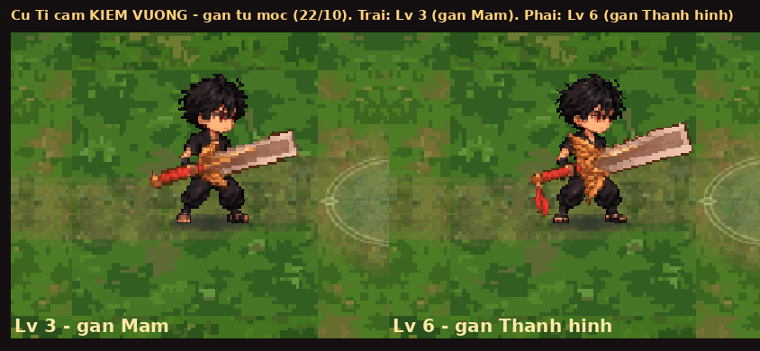

# Gân vũ khí hiện từ mốc hình thái (22/10)

Theo yêu cầu chủ game: *"đã lên 3 thì hiện gân của 3 4 5, lên 6 thì hiện 6 7 8, tương tự"*.
**Không chơi thử**: chỉ kiểm bằng máy (headless) và chụp ảnh soát. Chỉ đổi **hình** (luật hiện ảnh gân), không đổi cân bằng, không đụng
đăng nhập Google / lưu mây / `?cloud=0`. Cờ **`?gan=0`** vẫn tắt gân như cũ.

## Luật cũ → luật mới

| Hình thái | Luật cũ (16/10): chỉ cấp *giữa* hai mốc | Luật mới (22/10): từ mốc tới trước mốc kế |
|---|---|---|
| Trắng | Lv 2 | Lv 2 (giữ nguyên; Lv 1 vũ khí mới: ảnh thường) |
| Mầm | Lv 4–5 (đúng mốc 3 không gân) | **Lv 3**, 4, 5 |
| Thành hình | Lv 7–11 (đúng mốc 6 không gân) | **Lv 6**, 7–11 |
| Thức tỉnh | không (ảnh thường / ảnh hệ) | không (như cũ — bộ ảnh gân không có ô Thức tỉnh) |

Chỗ sửa: `game/js/vien_vk.js`, hàm `G.vkGan` — một điều kiện (`lv > tu` → `lv >= (cap === 0 ? 2 : tu)`) và chú thích phía trên.
Không đổi `G.vkGanAnh`, `zed_moi.js`, `vk_moi.js`. Bài soát cũ `game/tests/gan_vk_shots.py` cập nhật danh sách cấp mong đợi cho đúng luật mới.

## Cấp nào có gân — theo từng vũ khí (kiểm bằng máy, cấp 1–15)

Cách kiểm: mở `dist/linh-khi.html?cloud=0` bằng Playwright, đặt bản lưu `G.testSave({melee, luyen: 1})`, nâng từng cấp bằng
`G.luyen.nang(sv, w, 'fire', true)` tới Lv 15, mỗi cấp hỏi `G.vkGan` (luật) và `G.vkGanAnh` (có ô ảnh gân thật không).
Bài: `game/tests/gan_tu_moc_shots.py`. Kết quả **đúng luật mới, 0 lỗi JS**:

| Cấp Luyện | Kiếm (kiếm vuông) | Thương | Búa | Phi tiêu |
|---|---|---|---|---|
| Lv 1 | — | — | — | — |
| Lv 2 (Trắng) | ✓ gân | ✓ gân | ✓ gân | ✓ gân |
| Lv 3–5 (Mầm) | ✓ gân | luật bật nhưng **không có ảnh** → ảnh hệ thường | ✓ gân | ✓ gân |
| Lv 6–11 (Thành hình) | ✓ gân | luật bật nhưng **không có ảnh** → ảnh hệ thường | ✓ gân | ✓ gân |
| Lv 12–15 (Thức tỉnh) | — | — | — | — |

Kiểm thêm bằng so điểm ảnh: Cu Tí cầm kiếm vuông Lv 3 và Lv 6 có gân khác bản `?gan=0` (khoảng 2.400 / 2.900 điểm ảnh khác) — tức là gân
Mầm và Thành hình đã hiện đúng ở hai mốc mới.

### Lưu ý về bộ ảnh gân (không tự sửa ảnh)

Tấm `game/art/custom/zed-vk-gan.sprite.json` hiện có:

- **Thương**: chỉ có ô gân **Trắng**; ô Mầm và Thành hình trống. Nên với luật mới, thương vẫn **không có gân ở Lv 3–11** (hiện ảnh hệ thường
  như cũ). Nếu chủ game muốn thương cũng có gân Mầm / Thành hình thì cần **gen lại ảnh gân thương** (2 ảnh) rồi gắn vào tấm này.
- **Kiếm cũ** (`vk.kiem`): toàn ô trống, nhưng **kiếm vuông** (`vk.kiem_vuong`, đang bật mặc định) đủ 3 cấp → kiếm có gân đầy đủ.
- **Búa, phi tiêu**: đủ 3 cấp.

## Ảnh soát

`kiem-vuong-lv3-lv6.png` (844×390): Cu Tí đứng cầm kiếm vuông — trái Lv 3 (gân Mầm), phải Lv 6 (gân Thành hình).

## Dựng lại và đẩy lên

- `node --check game/js/vien_vk.js`: OK.
- `python3 game/build.py` rồi `LK_ANH_ROI=1 python3 game/build.py --hai-tep`: OK (dist dựng lại, bản một tệp 26,07 MB / trần 30 MB).
- Đã đẩy lên nhánh `khoi-tao-du-an` (tự deploy spiritblade.web.app): commit **`0eaa17f`** — *Gân vũ khí hiện từ mốc hình thái: Mầm Lv 3–5, Thành hình Lv 6–11 (trước: chỉ 4–5, 7–11) + dựng lại dist*;
  kèm một commit nhỏ sau đó chỉ ghi dòng này vào báo cáo.
