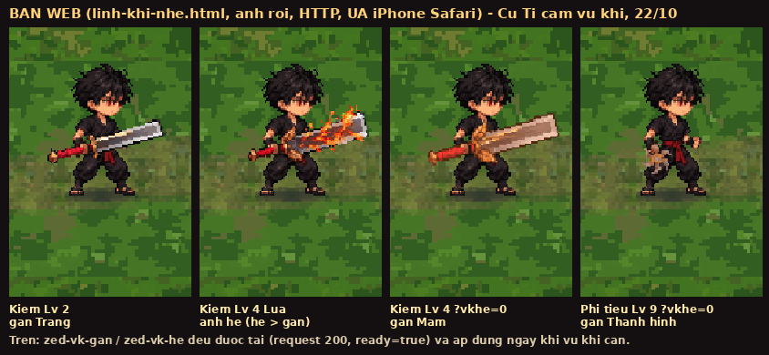

# Gân / ảnh hệ vũ khí không hiện trên bản web (iPhone) — điều tra và sửa (22/10)

Chủ game thấy trên iPhone (Safari, 4G, spiritblade.web.app): **Kiếm lá đồng Mầm · Lửa · Lv 4** và **Phi tiêu chong chóng Thành hình · Lửa · Lv 9**
đều hiện ảnh **trơn** — không có gân, kiếm trên tay cũng như chưa nhuộm hệ — trong khi bản một tệp (`dist/linh-khi.html`) hiện đúng.

**Chỉ sửa cách tải ảnh và việc đăng web**, không đổi cân bằng, không đổi luật hiện gân (gan-tu-moc, commit `0eaa17ff`), không đổi ưu tiên
ảnh hệ > gân (vk-he-3-loai, commit `84a54d9f`), không đụng đăng nhập Google / lưu mây / `?cloud=0`. **Không chơi thử** — chỉ chạy máy (headless).

## 1. Nói ngắn gọn (cho chủ game)

Có **hai chuyện** cùng lúc:

1. **Web chưa nhận được bản mới nào từ chiều 17/10.** Hai lần đẩy mã hôm nay (gân-từ-mốc lúc 09:29 và thương/búa/phi tiêu có vân hệ lúc 09:53)
   đều **đăng thất bại** (GitHub Actions run #486, #487): Google từ chối tài khoản dịch vụ dùng để đăng — lỗi `403 Permission denied to get
   service [firebasehosting.googleapis.com]`. Web hiện vẫn là bản `c2d13c94` (17/10 15:23). Vì thế mọi thứ sửa hôm nay (kể cả bản này) **chưa
   lên web** cho tới khi việc đăng chạy lại được. Tôi đã thêm một bước vào quy trình đăng để **né** đúng chỗ bị từ chối (mục 5); nếu vẫn
   hỏng, chủ game cần vào Google Cloud → IAM cấp thêm vai trò **"Service Usage Viewer"** cho tài khoản dịch vụ đang dùng để đăng (mục 5).
2. **Cách tải ảnh rời của bản web có hai chỗ yếu** làm tấm gân / tấm hệ **có thể không bao giờ về** trong cả buổi chơi khi mạng 4G chập chờn
   hoặc khoá máy / chuyển ứng dụng lúc game mới mở — đúng kiểu dùng trên iPhone. Tôi mô phỏng được cả hai trên máy (mục 3) và đã sửa (mục 4):
   nay hình nào game **đang cần** (gân, ảnh hệ trên tay / trong bảng Luyện) mà chưa về thì **được tải lại ngay**, và một lượt tải bị treo
   không còn làm kẹt cả hàng chờ. Về rồi là hình đổi ngay, không cần tải lại trang.

Lưu ý về **cái sẽ thấy** sau khi web đăng được: theo phiên vk-he-3-loai (sáng nay), **ảnh hệ đứng trước gân** — Kiếm Lv 4 Lửa và Phi tiêu
Lv 9 Lửa sẽ hiện **vân hệ Lửa** (không phải gân); gân chỉ còn ở Lv 2 (Trắng) hoặc khi tấm hệ chưa về. Muốn xem gân ở Lv 4 / Lv 9 thì mở
`?vkhe=0` (tắt ảnh hệ 3 loại) — ảnh chụp ở mục 6.

## 2. Điều tra: bản web có tải tấm `zed-vk-gan` không?

Dựng bản web như workflow (`LK_ANH_ROI=1 python3 game/build.py --hai-tep`), phục vụ `game/dist` bằng `python3 -m http.server`, mở
`linh-khi-nhe.html?cloud=0` bằng Chromium headless 844×390 (Playwright), nạp `game/tests/setup.js`, `G.testSave({melee:'sword', luyen:1})`,
`G.luyen.nang(sv, w, 'fire', true)` lên kiếm Lv 4 và phi tiêu Lv 9, rồi theo dõi 20–60 giây (`cong-cu/dieu_tra.py`, kết quả gốc:
`ket-qua-truoc-sua-dieu-tra.log`).

| Tình huống (mã TRƯỚC khi sửa) | Request `anh/zed-vk-gan.*` / `zed-vk-he.*` | `SC.zed[...]` | `SC.roi.ds.get('zed-vk-gan')` | Gân / hệ ở Lv 4 kiếm, Lv 9 phi tiêu |
|---|---|---|---|---|
| UA mặc định, ở làng | WebP, 200, lúc 1,95 s | ready = true, img có | bac 1, u 3, khoa false, can 0 → ve true | có |
| UA iPhone Safari, vào ải (`G.startStage`) | WebP, 200, lúc 2,8 s | ready = true | như trên | có |
| UA iPhone, `?taivung=0`, vào ải | WebP, 200, lúc 2,3 s | ready = true | như trên | có |
| UA iPhone, mạng ép 1,5 Mbps + 120 ms (CDP) | WebP, 200 — tải NGAY khi vũ khí cần (`roiCan` → u 0), 2 s sau là ready | ready = true | can 1, u 0 | có |
| Bản một tệp ở đúng commit đang chạy trên web (`c2d13c94`) | (ảnh nhúng) | ready = true | — | có |

Kết luận phần máy: **trong Chromium, tấm `zed-vk-gan` và `zed-vk-he` luôn được tải** (bậc 1, ngay sau ảnh lõi; hoặc ngay lập tức khi
vũ khí cần tới), `z.ready` bật, cỡ ô khớp, gân / hệ áp dụng đúng ở cả kiếm vuông và phi tiêu. Không có lỗi JS, không có request 404.
Các giả thuyết "không có trong hàng vì `_u` sai", "khoá = 1 chờ vùng", "`roiCan` gọi trước `roiNhan`", "tải xong mà `ready` không bật",
"cỡ ô lệch do ghép kiếm vuông", "ảnh hệ che" đều **loại** bằng số đo trên.

Ngoài máy: kiểm trên GitHub cho thấy **web không chạy mã mới** (mục 1), và tệp `anh/zed-vk-gan.3f43bbb55f.png` / `.webp` đang có trên
spiritblade.web.app (cùng mã nội dung với bản dựng ở đây) → bản đang chạy trên web có đủ tấm gân, nên lỗi chủ game thấy không phải do
thiếu tệp trên máy chủ.

## 3. Nguyên nhân thật (có bằng chứng): hai chỗ yếu của hàng chờ ảnh rời trên mạng chập chờn

Vì Chromium ở đây tải được còn iPhone của chủ game thì không, tôi soát `js/sprite_custom.js` (khối ẢNH RỜI) theo đúng điều kiện iPhone / 4G
và tìm ra hai chỗ mà **một lần trục trặc mạng lúc mới mở game là tấm gân / tấm hệ mất luôn cả buổi**. Cả hai mô phỏng được trên Chromium
(`cong-cu/mo_phong.py`):

**(a) Hình đang cần mà đã "hỏng 3 lượt" thì không bao giờ tải lại.** Một ảnh tải lỗi được thử lại sau 3 s và 10 s; lỗi lần 3 (tổng
chỉ **13 giây**) thì vào `hongDs` — chỉ thử lại khi có sự kiện `online` hoặc khi quay lại trang (`visibilitychange`). `roiCan(ma)` (game
báo "đang cần hình này") với ảnh nằm trong `hongDs` thì chỉ đặt `can = 1` rồi **không làm gì** (ảnh không còn trong hàng). `zed-vk-gan`,
`zed-vk-he` là bậc 1 → tải ngay sau ảnh lõi, tức trong ~10–30 giây đầu sau khi mở game — đúng lúc 4G hay đứt (đi thang máy, đổi cột
sóng) hoặc người chơi khoá máy / chuyển ứng dụng (iPhone làm hỏng mọi lượt tải đang dở, không có `online`). Sau đó mở bảng Luyện, cầm
vũ khí → gọi `SC.canAnh('zed-vk-gan')` mỗi khung hình nhưng tấm không bao giờ được tải lại.

Mô phỏng: chặn đúng 4 request đầu tới `anh/zed-vk-gan.*` (WebP → PNG → `?lan=1` → `?lan=2`), rồi thả mạng; sau 18,5 s `loi = 1`; game hỏi
gân (`roiCan`) → **30 giây sau vẫn không có request nào mới, `ready = false`** (mã cũ). Mã mới: request lại ngay (19,5 s), 5 s sau
`ready = true`, gân hiện.

**(b) Một lượt tải "treo" giữ chỗ mãi.** Mỗi lượt chỉ được tính là xong khi `img.decode()` trả lời; `onload` / `onerror` **không gắn**
khi trình duyệt có `decode`. Nếu `decode()` không bao giờ trả lời (Safari từng từ chối `decode()` với ảnh lớn — đã có vá cho trường hợp
từ chối, nhưng chưa có cho trường hợp **im lặng**), hoặc một kết nối đứng im không báo lỗi (đổi Wi‑Fi ↔ 4G, khoá máy), thì `dang` không
được trừ. Hàng chờ chỉ cho tối đa 24 lượt (16 với ảnh thường) → đủ số lượt treo là **cả hàng đứng im**, kể cả hình "đang cần" (u 0)
cũng không được phát lệnh tải.

Mô phỏng: cho `Image.prototype.decode` của 24 ảnh bất kỳ (không phải zed-vk-*) **không bao giờ trả lời** → `dang = 24`, hàng 657 ảnh đứng;
game hỏi gân → **không có request nào tới zed-vk-gan sau 30 giây** (mã cũ). Mã mới: ảnh đã nạp xong mà `decode()` không trả lời sau 2 s
thì vẫn báo xong → hàng chạy tiếp, zed-vk-gan được tải lúc 3,4 s, gân hiện.

Hai lỗi này giải thích được đúng triệu chứng chủ game thấy: **cả gân lẫn ảnh hệ** (hai tấm nhỏ cùng bậc, cùng lúc) không về, còn những
hình khác đã về trước đó (ảnh lõi) thì vẫn bình thường; kiếm trông "chưa nhuộm hệ" là vì khi cả hai tấm vắng mặt game chỉ nhuộm 30 % màu
hệ lên ảnh thường (rất nhạt). Bản một tệp không gặp vì ảnh nhúng sẵn trong trang.

Những giả thuyết khác đã xem và loại: tên tệp / `_u` / khoá vùng (bảng mục 2); giới hạn 24/16/3 kết nối (ảnh "đang cần" vẫn được
phát khi `dang < 24`, đo ở 1,5 Mbps); bộ nhớ đệm trang cũ của Firebase (`index.html` là `no-cache`, ảnh `anh/**` có mã nội dung, tệp gân
đang có trên máy chủ); thứ tự ưu tiên khiến tấm "tải sau" kẹt sau ảnh vùng (`roiCan` đưa lên u 0, trước mọi ảnh vùng — đo được).

## 4. Đã sửa gì (`game/js/sprite_custom.js`, chỉ khối ẢNH RỜI; ít đụng nhất)

1. `roiCan(ma)`: hình đang cần mà nằm trong `hongDs` → **rút ra, đặt `lan = 0`, `can = 1`, xếp lại hàng, tải ngay** (ưu tiên 0 như hình
   đang cần). Không quá một lần mỗi 15 s cho một hình (`THU_LAI_CAN`) để không dội mạng khi vẫn mất mạng.
2. `tai(it)`: **luôn gắn `onload` / `onerror`** bên cạnh `decode()` — ảnh đã nạp mà `decode()` không trả lời sau `DECODE_CHO` = 2 s thì vẫn
   báo xong (vẽ như ảnh thường; Chromium / Safari bình thường `decode()` trả lời trước nên không đổi gì). Thêm **đồng hồ canh**: quá
   `QUA_LAU_MIN` 45 s + 50 ms/KB (tệp 3 MB ≈ 3 phút) mà chưa nạp xong thì trả chỗ, xếp lại hàng với URL mới (`?lan=…t<n>`), tối đa 3 lần rồi
   mới coi là hỏng. Kết quả muộn của lượt cũ bị bỏ qua (`lanTai`), nên không đếm trùng.
3. Không đổi `game/build.py` (hai tấm vẫn là "tải sau" bậc 1), không đổi luật gân, không đổi ưu tiên hệ > gân, không đổi dung lượng.

Kiểm sau sửa (cùng kịch bản mục 2 + hai mô phỏng mục 3): request tới `zed-vk-gan` / `zed-vk-he` có, 200, `z.ready = true`, gân hiện ở
Lv 2 / Lv 4 (`?vkhe=0`) kiếm vuông và Lv 9 phi tiêu (`?vkhe=0`), ảnh hệ hiện ở Lv 4 Lửa mặc định; 0 lỗi JS; `node --check` 77 tệp OK;
`game/tests/cloud_save_regression.test.js` PASS; `python3 game/build.py` + bản web OK.

Dung lượng: bản một tệp **26,19 MB** / trần 30; người chơi tải web **19,10 MB** / trần 20 (y như trước); tải trước vùng đầu 5,16 MB.

## 5. Đăng web bị hỏng từ 22/10 (quan trọng)

| Run | Commit | Kết quả |
|---|---|---|
| #485 (17/10 15:23) | `c2d13c94` | ✅ đăng — **bản đang chạy trên web** |
| #486 (22/10 09:29) | `c6921d01` (gân từ mốc) | ❌ `firebase deploy`: `403 Permission denied to get service [firebasehosting.googleapis.com]` |
| #487 (22/10 09:53) | `84a54d9f` (vân hệ 3 loại) | ❌ cùng lỗi |

Cả hai lần `firebase-tools@latest` vẫn là **15.33.0** như 17/10 (bản mới nhất từ 08/10), nên không phải do CLI đổi bản; là **quyền của
tài khoản dịch vụ** (`FIREBASE_SERVICE_ACCOUNT_SONTINHTHUYTINH`) trên dự án Google Cloud `sontinhthuytinh`: trước khi đăng, CLI hỏi
Service Usage API "API Hosting đã bật chưa?" (`src/ensureApiEnabled.ts`, cần quyền `serviceusage.services.get`) và nay bị từ chối. Các
bước khác (`hosting:sites:get`, dọn bản cũ bằng gcloud) vẫn chạy → khoá tài khoản còn đúng.

Đã làm (`.github/workflows/linh-khi-hosting.yml`): thêm bước **"Nhớ sẵn 'API Hosting đã bật' cho firebase-tools"** ghi
`apiEnablementCache` vào `~/.config/configstore/firebase-tools.json` trước khi đăng — CLI thấy câu trả lời có sẵn thì **không hỏi Google
nữa** (cách này được dùng ở vài dự án khác gặp đúng lỗi này). API Hosting của dự án vốn đã bật (đăng được tới 17/10) nên an toàn.

Nếu lần đăng kế vẫn hỏng (lỗi khác), **cách gốc** chủ game cần làm (một lần): Google Cloud Console → dự án *sontinhthuytinh* → **IAM** →
tìm tài khoản dịch vụ đang dùng để đăng (tên dạng `…@sontinhthuytinh.iam.gserviceaccount.com`) → **Chỉnh sửa** → thêm vai trò
**Service Usage Viewer** (Người xem mức sử dụng dịch vụ) → Lưu; rồi vào GitHub → Actions → "Linh Khí lên spiritblade.web.app" → **Run
workflow**. Không cần sửa mã.

## 6. Ảnh chụp (bản web, Chromium headless, UA iPhone Safari, 844×390)

Từ trái: Kiếm vuông Lv 2 (gân Trắng) · Kiếm vuông Lv 4 Lửa (ảnh hệ Lửa — luật hệ > gân) · Kiếm vuông Lv 4 `?vkhe=0` (gân Mầm) · Phi tiêu
Lv 9 `?vkhe=0` (gân Thành hình). Cả 4 ô: `zed-vk-gan`, `zed-vk-he` ready = true, request 200.

## 7. Công cụ, tệp

- `cong-cu/dieu_tra.py <cổng> <iphone|mac> <''|'&taivung=0'> <lang|ai> [giây] [Mbps]` — theo dõi hàng chờ, request, `SC.zed`, hỏi gân.
- `cong-cu/mo_phong.py <cổng> <A|B>` — A: 24 `decode()` treo; B: chặn 4 request `zed-vk-gan` rồi thả. (Dùng với `python3 -m http.server
  <cổng>` trong `game/dist` sau `LK_ANH_ROI=1 python3 game/build.py --hai-tep`.)
- `cong-cu/chup_web.py <cổng> <ảnh ra>` — ảnh mục 6.
- `ket-qua-truoc-sua-dieu-tra.log` — kết quả `dieu_tra.py` trên mã trước khi sửa.

## 8. Commit

Đẩy lên nhánh `khoi-tao-du-an` (tên commit ghi ở cuối sau khi đẩy).
