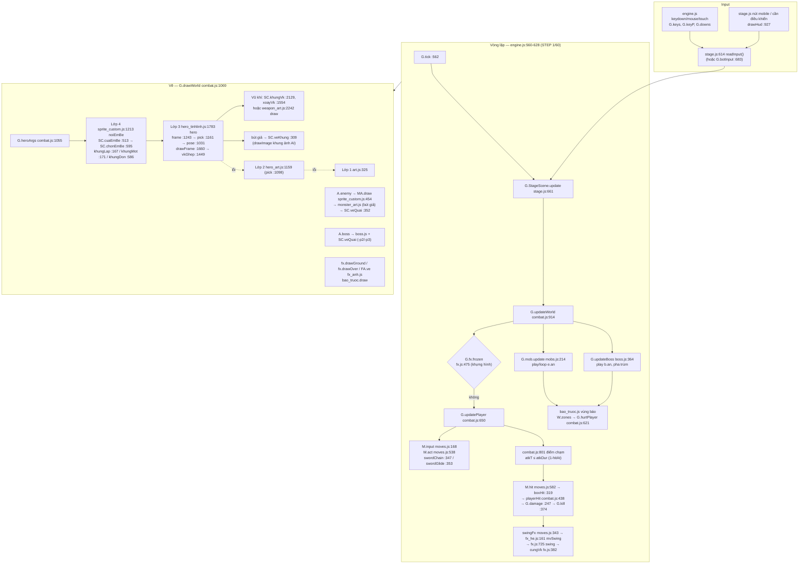

# BÁO CÁO TRÍCH XUẤT HỆ THỐNG ANIMATION NHÂN VẬT — Linh Khí

- **Commit đang đọc:** `229e263da08afaa0baa7ee6ccf63136ea3473610` (nhánh `khoi-tao-du-an`, 12/10/2026). Mọi "tệp:dòng" trong báo cáo và phụ lục tính theo commit này.
- **Phạm vi:** chỉ phân tích. Phiên này không sửa, xoá hay viết lại dòng code game nào. Ngoài thư mục báo cáo, repo không đổi gì (`git status` chỉ có tệp mới trong `he-thong-animation/`).
- **Yêu cầu gốc:** [YEU-CAU.md](YEU-CAU.md) (mục 1–14, đầu ra A–H).
- **Bản 1 trang cho chủ dự án:** [TOM-TAT.md](TOM-TAT.md).

**Cách đọc.** Báo cáo chính trả lời A–H ở mức tổng hợp. Chi tiết (cây gọi hàm đầy đủ, trích code, bảng số đo theo từng tick, bảng D sinh tự động từ JSON) nằm trong 7 phụ lục:

| Phụ lục | Mục yêu cầu | Nội dung |
|---|---|---|
| [PHU-LUC-1-NHAN-VAT-VONG-LAP-INPUT.md](PHU-LUC-1-NHAN-VAT-VONG-LAP-INPUT.md) | 1, 2, 12, C | Cấu trúc P / quái / trùm / NPC; vòng lặp; di chuyển, va chạm, camera; input bàn phím / chuột / cảm ứng; luồng C có số đo |
| [PHU-LUC-2-VE-NHAN-VAT-CHON-KHUNG.md](PHU-LUC-2-VE-NHAN-VAT-CHON-KHUNG.md) | 3, 4, 7, 8, D (em bé) | Đường vẽ em bé; sprite sheet; chọn khung; máy trạng thái; Bảng D đầy đủ 28 tệp em bé; khung đo thật |
| [PHU-LUC-3-VU-KHI.md](PHU-LUC-3-VU-KHI.md) | 9, E | Cầm vũ khí, bàn tay, điểm neo, góc xoay, lớp trước/sau, che mặt; ảnh minh hoạ trong `anh/` |
| [PHU-LUC-4-DON-DANH-HITBOX.md](PHU-LUC-4-DON-DANH-HITBOX.md) | 5, 6, 10 | Đòn từng vũ khí; né, nhận đòn, choáng, chết; hitbox, hurtbox; số đo tầm và nhịp |
| [PHU-LUC-5-HIEU-UNG.md](PHU-LUC-5-HIEU-UNG.md) | 11 | Vệt chém (`cungVk`), đạn, trúng, bụi, rung, khựng hình |
| [PHU-LUC-6-QUAI-TRUM-NGUOI-LANG.md](PHU-LUC-6-QUAI-TRUM-NGUOI-LANG.md) | 1, 4–8, D (quái / trùm / NPC) | Máy trạng thái quái và trùm, pha trùm, người làng; Bảng D mọi tệp quái / trùm / nl |
| [PHU-LUC-7-TEP-ANH-DONG-GOI.md](PHU-LUC-7-TEP-ANH-DONG-GOI.md) | 14, 7, 13 | Kiểm kê 626 tệp ảnh, schema JSON, đóng gói / tải, dữ liệu animation rải rác trong JS |

**Nhãn bằng chứng:** **[ĐO]** = đo bằng Playwright / PIL trong phiên này; **[CODE]** = đọc từ code; **[SUY LUẬN]** = suy từ code, chưa đo.

> **Lưu ý đo đạc quan trọng.** `game/index.html` (bản nguồn) **không nạp ảnh AI nào**: đo được `G.spriteCustom.ds = 0` và `G.fxAnh.ds = 0`. Chỉ `build.py` mới nhúng ảnh. Vì vậy mọi bài đo hình "như người chơi thấy" trong phiên này đều phải tự nạp `*.sprite.json` (gọi `G.spriteCustom.add(json)` hoặc `add_init_script`), hoặc chạy `dist/linh-khi.html`. Bài đo nào chạy thẳng `index.html` là đang đo hình vẽ bằng canvas.

---

## Tóm tắt điều hành (10 ý)

1. **Không có "animation state" riêng cho người chơi.** Mỗi khung hình, trạng thái hình được suy ra từ các đồng hồ gameplay: `atkT/atkDur`, `dodgeT`, `dashT`, `specT`, `castT`, `hurtT`, `deadT`, `mv.holding`, `moving`. Thứ tự ưu tiên: chết > lộn > lướt > đặc biệt > chưởng > giữ lấy đà > đánh > trúng đòn > chạy > đứng (`sprite_custom.js:603-616`). Quái và trùm thì có trạng thái thật: `e.an` / `b.an` với `play` / `loop` (`mobs.js:24-25`, `boss.js:98`).
2. **Sát thương chỉ gắn với thời gian, không gắn với khung ảnh.** Điểm chạm duy nhất của người chơi nằm ở `combat.js:801`: khi tiến độ `1 - atkT/atkDur` vượt `P.hitAt` (mặc định 0,45; búa 0,35). Lớp vẽ chỉ *đọc* tiến độ để chọn khung. Đây là điểm thuận lợi nhất cho việc thiết kế lại: thay hình mà không đụng gameplay.
3. **Vòng lặp bước cố định 1/60 giây** (`engine.js:560-566`), tối đa 5 tick mỗi khung rAF, phần vẽ tách riêng. Nhảy, rơi, tiếp đất, trọng lực, trục z: **KHÔNG TỒN TẠI** (game top-down 3/4; `boss.js:3` ghi "Người chơi không nhảy").
4. **Vẽ người chơi là 4 lớp chồng nhau**: `art.js:325` → `hero_art.js:1159` → `hero_tinhlinh.js:1896` → `sprite_custom.js:1213` (`noiEmBe`). Lớp trên cùng dùng một "bút giả": cây vẽ bằng code vẫn chạy trọn, chỉ lệnh `drawImage` vẽ thân bị thay bằng khung ảnh AI (`SC.veKhung`, `sprite_custom.js:309`). Khung xương code vẫn được dựng mỗi khung để lấy tư thế vũ khí.
5. **Có hai bộ chọn khung chạy song song** với nhịp khác nhau: `SC.chonEmBe` cho ảnh AI và `pick` (`hero_tinhlinh.js:1161`) cho khung xương code. Ngoài ra còn bộ thứ ba đã cũ là `pick` (`hero_art.js:1098`).
6. **Vũ khí luôn được ghép và xoay bằng code.** Ảnh thân AI, kể cả tệp đòn `-don`, không có vũ khí bên trong. Góc vũ khí đi qua 4 tầng `vkGhep0 → kiemKhop → kiemMuot → kiemSau` (`hero_tinhlinh.js:1359-1449`) và nhiều bảng số riêng cho từng em bé.
7. **Trường `giay` trong JSON gần như không có tác dụng** với đòn đánh. Hàng chạy một lần (atk, hit, ne, cast, tele) chọn khung theo tiến độ gameplay. Chỉ hàng idle, move (và die của em bé) dùng `giay`. Trường `lap` không được đọc; game quyết định lặp theo *tên* hàng.
8. **Lỗi lệch hình–sát thương đã đo:** búa gây sát thương ở u=0,35 trong khi hình còn giơ búa (khung nện ở 0,45); chưởng mất ¼ đầu hoạt ảnh (`castT=0.3` nhưng chia cho 0,4); trùm vùng trúng khi ảnh còn ở tele (7/15 chiêu); quái thường trúng ở khung atk 0.
9. **Dữ liệu animation nằm rải rác:** JSON (khung), `ghep-*.json` (điểm tay theo từng khung), `MOC_DON`, `VUNG`, `TAY_KIEM`, `TAY_DON`, `ATK`, `ATKN`, `HOLD` trong JS, cùng hằng số thời gian chép tay ở nhiều nơi (lộn 0,27; trúng 0,2; đặc biệt 0,35; chưởng 0,4).
10. **Nên giữ nguyên:** đồng hồ đòn và mốc chạm, `G.MOVES` / `G.WTYPES`, vòng lặp 1/60, hợp đồng `G.art.hero(c, G.heroArgs(P))`, `G.tinhLinh.tip()` (fx dùng), `G.weaponArt.draw`, quy ước `goc` / `net` / hàng–cột, chuỗi rơi về canvas khi thiếu ảnh, các cờ quay lui.

---

## A. Sơ đồ tệp và hàm điều khiển animation

### A.1 Sơ đồ tổng (Mermaid)



### A.2 Vai trò từng tệp (chỉ các tệp dính tới animation)

| Tệp | Vai trò animation | Hàm / điểm vào chính (tệp:dòng) |
|---|---|---|
| `engine.js` | Vòng lặp, input thô, nhịp vẽ | `STEP` :560, `G.tick` :562, `frame` :621, `SC.napSau` gọi ở :637 |
| `stage.js` | Đổi input thành cờ, HUD và nút mobile, chuyển phòng | `readInput` :614, `update` :661, `draw` :738, `drawHud` :927 |
| `data.js` | Thông số vũ khí, nhân vật, né | `G.WTYPES` :29-38, DODGE :300 |
| `moves.js` | Bảng đòn, combo, giữ lấy đà, hitbox | `G.MOVES` :16, `M.input` :168, `boxHit` :319, `swingFx` :343, `swordChain` :347, `swordGlide` :353, `M.act` :538, `M.hit` :582, `M.update` :901 |
| `combat.js` | Cập nhật người chơi, sát thương, chết quái, vẽ thế giới | `G.damage` :247, `G.kill` :374, `playerHit` :438, `doHit` :536, `G.hurtPlayer` :621, `G.updatePlayer` :650, điểm chạm :801, `G.updateWorld` :914, `G.heroArgs` :1055, `G.drawWorld` :1069 |
| `art.js` | Lớp 1 vẽ em bé (đời đầu), `A.enemy`, `A.boss`, `A.proj` | `A.hero` :325 |
| `hero_art.js` | Lớp 2 khung xương pixel (dự phòng) | `pick` :1098, `A.hero` :1159 |
| `hero_tinhlinh.js` | Lớp 3 em bé "Tinh Linh": tư thế, khung xương, vũ khí, lật hướng | `pose` :1031, `pick` :1161, `frame` :1243, `lechCo` :1324, `vkGhep0` :1359, `kiemSau` :1408, `vkGhep` :1449, `kiemKhop` :1478, `kiemMuot` :1593, `drawFrame` :1660, `hero` :1783, `tip` :1850, gán :1896 |
| `sprite_custom.js` | Nạp ảnh AI, cắt khung, chọn khung em bé / quái / NPC, bút giả, tải ảnh | `khungLap` :167, `khungMot` :171, `SC.veKhung` :309, `SC.veQuai` :352, `MA.draw` :454, `SC.thanBo` :508, `SC.cuaEmBe` :513, `themDon` :520, `MOC_DON` :585, `khungDon` :586, `SC.chonEmBe` :595, `SC.nhunBuoc` :620, `noiEmBe` :1208-1277, `xoayVk` :1554, `SC.khungVk` :2129, thứ tự tải :2488 |
| `outfit.js` | Chọn thân bộ theo áo | :247-251 |
| `weapon_art.js` | Vẽ vũ khí bằng canvas (dự phòng khi không có ảnh `vk-*`) | `draw` :2242 |
| `monster_art.js` | Tư thế quái vẽ bằng code, thời lượng `d` từng hàng | thân :1446, fps 12 :1107, `MA.dur` :1455 |
| `mobs.js` | AI quái, máy trạng thái `e.an` | `play` :24, `loop` :25, `G_mob.update` :214, `G.mobHeroOver` :915 |
| `boss.js` | Trùm, pha, chiêu | `play` :98, `G.updateBoss` :364, pha :386-396 |
| `bao_truoc.js` | Vùng báo trước của quái / trùm | `G.baoTruoc.draw` |
| `fx.js`, `fx_he.js`, `fx_anh.js`, `fx_dan.js`, `fx_chuong.js`, `fx_ky_nang.js`, `vfx_cfg.js` | Vệt chém, trúng, bụi, rung, khựng hình, đạn, ảnh hiệu ứng `hu-*` | `cungVk` fx.js:382, `fx.frozen` :475, `swing` :725, `mvSwing` fx_he.js:161, `FA.khung` fx_anh.js:57, cấu hình vfx_cfg.js:5-15 |
| `chuong.js` | Chưởng (cast) | `P.castT = 0.3` :244 |
| `village_scene.js`, `village.js` | Em bé và người làng ở làng | `VS.update` :735, `drawKid` :815, `VS.drawWorld` :983, NPC :1009-1013 |
| `build.py` | Nhúng / tách ảnh, WebP, lọc khoá JSON | `bat_buoc` :137-156, `anh_roi` :296, `RUNTIME_KEYS` :361 |

---

## B. Tên tệp, hàm, dòng và đoạn code thật then chốt

Danh sách đầy đủ có trích đoạn nằm trong từng phụ lục. Dưới đây là 8 đoạn quan trọng nhất cho người thiết kế lại; tất cả đều chép nguyên văn từ commit `229e263`.

**B1. Vòng lặp bước cố định**: `engine.js:560-566`
```js
const STEP = 1 / 60;
let last = 0, acc = 0, daVe = false;
G.tick = function () {
  G.time += STEP;
  if (G.scene) G.scene.update(STEP);
  G.keyP = {};
  G.downs.length = 0;
```

**B2. Điểm chạm duy nhất của đòn người chơi**: `combat.js:800-801`
```js
// V15: đòn chạm khi đi được P.hitAt phần động tác (moves.js đặt; búa nện 0,35), mặc định 0,45 (còn 55% thời gian) như cũ.
if (P.atkT > 0 && !P.hitDone && P.atkT <= P.atkDur * (1 - (P.hitAt != null ? P.hitAt : 0.45))) { if (MV) MV.hit(P); else doHit(P); }
```

**B3. Đồng hồ gameplay → tham số vẽ**: `combat.js:1059-1061` (trong `G.heroArgs`, :1055)
```js
x: P.x, y: P.y, face: P.face, key: P.key, move: P.moving, t: P.t, tc: P.chayT,
atk: P.atkT > 0 ? 1 - P.atkT / P.atkDur : -1, dodge: P.dodgeT > 0 ? 1 - P.dodgeT / 0.27 : -1,
flash: P.hurtT > 0, alpha: P.inv > 0 && P.dodgeT <= 0 && Math.floor(G.time * 20) % 2 ? 0.5 : null,
```

**B4. Máy trạng thái hình của em bé (thứ tự ưu tiên)**: `sprite_custom.js:603-616` (trong `SC.chonEmBe` :595)
```js
if (p && p.dead) { const u = (p.deadT || 0) / ((dt.die && dt.die.giay) || 0.6); return mot('die', u); }
if (o.dodge >= 0) return dt.ne ? mot('ne', o.dodge) : lap('move', t);
if (p && p.dashT > 0) return lap('move', t * 2);
if (p && p.specT > 0) { ... 1 - p.specT / 0.35 ... }
if (p && p.castT > 0) return don('cast') ? theoDon('cast', 1 - p.castT / 0.4) : mot('atk', 1 - p.castT / 0.4);
if (p && p.mv && p.mv.holding && !(o.atk >= 0)) return hv ? { ten: hv, i: doi6(dt[hv], giuDon(hv, p.mv.charge)), u: 0.99 } : mot('tele', 0.99);
if (o.atk >= 0) { ... return hv ? theoDon(hv, o.atk, p ? p.comboI : ...) : mot('atk', o.atk); }
if ((p && p.hurtT > 0) || (!p && o.flash)) return mot('hit', p ? 1 - p.hurtT / 0.2 : 0.3);
if (o.move) return lap('move', tc);
return lap('idle', t);
```

**B5. Mốc khung của tệp đòn (hằng số trong JS, không nằm trong JSON)**: `sprite_custom.js:585`
```js
const MOC_DON = { atk_bow: [0, 0.15, 0.3, 0.45, 0.62, 0.8], atk_spear: [0, 0.22, 0.45, 0.55, 0.7, 0.85], atk_hammer: [0, 0.2, 0.38, 0.45, 0.6, 0.8], cast: [0, 0.12, 0.25, 0.4, 0.6, 0.8] };
```

**B6. Thông số đòn (nguồn thời lượng thật)**: `moves.js:38-40, 63-66, 74`
```js
{ name: 'Chém ngang', dur: 0.3, mult: 1, reach: 32, depth: 20 },
{ name: 'Chém ngược', dur: 0.3, mult: 1.05, reach: 34, depth: 20 },
{ name: 'Nhát kết', dur: 0.46, mult: 1.8, reach: 40, depth: 30, push: 10, heavy: true, finish: 1 },
...
swing: { name: 'Nện', dur: 0.8, mult: 1, reach: 32, depth: 26, hitAt: 0.35 },
```

**B7. Máy trạng thái quái**: `mobs.js:24-25`
```js
function play(e, n, spd) { e.an = { n, t: 0, spd: spd || 1 }; }
function loop(e, n) { if (!e.an || e.an.n !== n) e.an = { n, t: 0, spd: 1 }; }
```

**B8. Chọn tệp thân em bé**: `sprite_custom.js:513`
```js
SC.cuaEmBe = (key, o) => (o && SC.thanBo(key, o)) || SC.get('em-be-' + (key || 'smith')) || SC.get('em-be');
```

---

## C. Luồng từ nhấn phím đến animation, vẽ và gây sát thương

Ví dụ: Cu Tí (`smith`) cầm kiếm, bấm J một lần. Tick 0 là tick nhận phím, 60 tick = 1 giây. **[ĐO]** ở PHU-LUC-1 §4 và PHU-LUC-4 §4.

| Bước | Ở đâu | Chuyện gì xảy ra | Thời điểm |
|---|---|---|---|
| 1 | `engine.js` keydown | Ghi `G.keys` / `G.keyP` (cảm ứng: `G.downs`, ngón được gán vai cần điều khiển hoặc nút) | 0,5–10 ms trước tick |
| 2 | `stage.js:614 readInput` | Đổi thành cờ `atk` (giữ), `atkP` (vừa bấm), `dodgeP`, `specialP`, `skillP`, `swapP`, `potionP`, `mx/my`. Đứng gần đồ vật thì J thành "tương tác" (`stage.js:689-699`) | tick 0 |
| 3 | `combat.js:914 G.updateWorld` | Nếu đang khựng hình (`fx.frozen`) thì dừng, nút bấm được giữ lại (latch) | tick 0 |
| 4 | `combat.js:650 G.updatePlayer` → `moves.js:168 M.input` | Đếm lùi đồng hồ; đệm nút (`pressBuf`, `buf` 0,25 s; `dodgeBuf`). Thứ tự ưu tiên: Né > Đặc biệt > Chưởng > `M.act` (`combat.js:752-779`) | tick 0 |
| 5 | `moves.js:538 M.act` → `swordChain` :347 | Đặt `P.atkT = P.atkDur = 0.3`, `P.hitAt`, `P.comboI`, `mv.kind/step`, tự ngắm `aimX/aimRel` | tick 0 (kiếm bắt đầu khi **nhấn**; giáo / búa / cung bắt đầu khi **nhả**) |
| 6 | `combat.js:1055 G.heroArgs` → `sprite_custom.js:1213` → `SC.chonEmBe` | `u = 1 - atkT/atkDur` → `theoDon('atk_sword', u, comboI)` → (hàng, khung). Khung xương `pick` dựng song song cho vũ khí | mỗi khung vẽ |
| 7 | `hero_tinhlinh.js:1660 drawFrame` | Vũ khí sau / trước thân (`vkGhep` → `SC.khungVk`, `xoayVk`), lật bằng `scale(face,1)` :1808-1809, bút giả vẽ khung AI qua `SC.veKhung` | mỗi khung vẽ |
| 8 | `combat.js:801` | `atkT ≤ 0.3·0.55 = 0.165` → `M.hit` → `boxHit` → `playerHit` → `G.damage` | **tick 9** (u=0,50, do lượng tử hoá 1/60), lúc hình đang ở khung chém atk_sword#1 |
| 9 | `moves.js:589-590` → `swingFx` → `fx.js:725 swing` → `cungVk` | Tạo vệt chém (ảnh `hu-chem-kiem` hoặc dải code), `FX('hit')`, rung, **khựng hình 45 ms** (3 tick) | tick 9 |
| 10 | `combat.js:374 G.kill` (nếu hết máu) | Quái bị xoá ngay; hình chết là bản chụp trong fx.js:1786-1801 | tick 9 |
| 11 | Hết `atkT` | Hình về `idle` theo `P.t` tuyệt đối (vào giữa vòng, không về khung 0) | tick 19 (không khựng) / 22 (có khựng) |

**Số đo theo vũ khí (từ tick nhận phím)** **[ĐO]**:

| Vũ khí | Bắt đầu đòn | Sát thương / thả tên | Về idle | Phím xuống → sát thương (bàn phím thật) |
|---|---|---|---|---|
| Kiếm (nhát 1/2/3) | khi nhấn | +9 tick (u 0,50) | 19 / 19 / 28 tick (khựng: 22 / 22 / 34) | 160 ms |
| Giáo | khi nhả (+3 tick nếu giữ 3) | +14 tick (u 0,482) | +26 / +29 | 252 ms |
| Búa | khi nhả | +20 tick (u 0,354), hình **còn ở khung 1** | +51 / +56 | 358 ms |
| Cung | khi nhả | tên tạo +14 tick (u 0,482, khung 3); trúng bia 80 px ở +25 | — | 441 ms |

---

## D. Bảng animation

**Quy ước chung cho mọi sprite sheet:** cột là chỉ số khung, hàng là `hang`. Ô khung là `khung_rong × khung_cao` điểm ảnh game; ảnh thật lớn gấp `net` lần. `goc` là điểm chân. Ảnh luôn vẽ quay phải và được lật bằng code.

### D.1 Em bé (người chơi). 4 em bé: smith = Cu Tí, hunter = Cu Tèo, healer = Cái Bống, wrestler = Cu Lì

Mọi tệp em bé có khung 48×48, `net` 2 (ô ảnh 96×96), `goc` [24,45]. Bảng đầy đủ cho từng tệp × động tác (28 tệp, sinh bằng script) nằm ở PHU-LUC-2 §4.3.

| Animation | Nguồn | Số khung | Tốc độ thật | Kích hoạt | Kết thúc | Trạng thái hiện tại | Lỗi tiềm ẩn |
|---|---|---|---|---|---|---|---|
| idle (đứng) | thân gốc / thân bộ, hàng 0 | 6 | `giay` 1 s → 10 tick/khung, theo `P.t` | không có gì khác | có trạng thái khác | Đang dùng | Về idle không từ khung 0 (theo `P.t` tuyệt đối) **[ĐO]** |
| move (chạy) | hàng 1 | thân gốc **8**, thân bộ **6** | gốc 0,65 / 0,6 s (4–5 tick/khung); bộ 0,6 s (6 tick); theo `P.chayT` | `P.moving` | dừng | Đang dùng. Thân bộ nhún −1 px ở khung `i%3==1` (`SC.nhunBuoc`, :620-628) | Số khung gốc ≠ bộ; nhịp chân cố định, không theo tốc độ đi **[SUY LUẬN]**; 1 tick "đứng" chen giữa lộn và chạy (`combat.js:683`) **[ĐO]** |
| walk (đi bộ) | — | — | — | — | — | **KHÔNG TỒN TẠI** | — |
| jump / fall / land | — | — | — | — | — | **KHÔNG TỒN TẠI** (grep `jump\|fall\|land\|gravity\|vz\|onGround`) | — |
| tele (lấy đà) | hàng 2 | 4 | khung 0,99 cố định khi giữ nút và không có tệp đòn | `mv.holding` | nhả nút | Gần như không dùng khi có tệp `-don` (dùng khung lấy đà của hàng đòn, `giuDon` :594) | — |
| atk (đòn chung) | hàng 3 | 6 (wrestler-bien: `khung` bỏ khung trùng) | theo `atkDur` (`giay` 0,4 bị bỏ qua) | đòn khi thiếu tệp `-don` | `atkT` = 0 | Chỉ dùng cho hunter-rung và healer bộ (thiếu tệp `-don`) | Mọi vũ khí và nhát dùng chung một hàng |
| atk_sword | tệp `-don` hàng 0 (dán vào tấm thân ở hàng 7) | 6; mỗi nhát combo dùng 2 khung (`0,1` · `2,3` · `4,5`) | 0,3 / 0,3 / 0,46 s → khoảng 8–16 tick mỗi khung | `M.act` kiếm | `atkT` = 0 | Đang dùng (`G.DON_VK`) | Chỉ 2 khung mỗi nhát (hình giật); khi chạy mà đánh (`G.CHAY_DANH='than'`) thân giữ hàng chạy, chỉ vũ khí vung |
| atk_spear | `-don` hàng 2 | 6 | 0,38 / 0,34 / 0,34 / 0,52 s; mốc `MOC_DON.atk_spear` | `M.act` giáo | `atkT` = 0 | Đang dùng | "Quét vòng" phát hàng đâm **[CODE]** |
| atk_hammer | `-don` hàng 3 | 6 | 0,8 s; mốc `MOC_DON.atk_hammer` (khung nện #3 ở 0,45) | `M.act` búa | `atkT` = 0 | Đang dùng | **Sát thương ở 0,35, trước khung nện ~5 tick (~83 ms)** **[ĐO]** |
| atk_bow | `-don` hàng 1 | 6 | theo `atkDur`; buông ở khung 3 (0,45) | `M.act` cung | `atkT` = 0 | Đang dùng | Đòn ra khi nhả nút |
| cast (chưởng / đặc biệt) | `-don` hàng 4 | 6 | `castT` 0,3 s chia cho 0,4; `specT` 0,35 | Chưởng / Đặc biệt | đồng hồ = 0 | Đang dùng | **Mất 2 khung đầu** (`cast:2×4 3×5 4×5 5×5`) **[ĐO]**; đánh trong lúc `specT`/`castT` > 0 thì hình vẫn là chiêu |
| hit (trúng đòn) | hàng 4 | 4 (healer gốc 3) | `hurtT` 0,2 s → 3 tick/khung | `G.hurtPlayer` | `hurtT` = 0 | Đang dùng | Bị atk / lộn / giữ nút che, nên trúng đòn khi đang vung thì không có khung hit **[CODE]** |
| ne (lộn / né) | hàng 6 | 6 | `dodgeT` 0,27 s → 17 tick; bất tử 20 tick; quãng 56 px | `dodgeP` | `dodgeT` = 0 | Đang dùng; bóng mờ gọi lại `G.art.hero` tới 5 lần | Vũ khí không bám tay khi lộn (lệch 8,5–11 px) **[ĐO]** |
| dash (lướt) | dùng hàng move ×2 | — | `dashT` | Nhát lướt (`swordGlide`) | `dashT` = 0 | Không có hàng riêng | — |
| die (chết) | hàng 5 | 8 | `deadT` / `giay` 0,6 | `P.dead` | hết | Đang dùng | Vũ khí không bám tay **[CODE]** |
| phòng thủ / chặn | — | — | — | — | — | **KHÔNG TỒN TẠI** (chỉ có khiên trang phục và Gồng, không có hình riêng) | — |
| choáng / đóng băng | — | — | `P.frozenT` 0,65 s | `mobs.js:168` | — | **Không có hình riêng** | — |

**Thân bộ** (`em-be-<key>-<rung|bien|lau>`): cùng bố cục 7 hàng, move 6 khung, `neo.than`/`neo.dau` lệch thân gốc 3–4 px. Healer có 3 thân bộ đánh dấu `cu:true` nên không bao giờ được vẽ, nhưng vẫn được nhúng (khoảng 456 KB). **Tệp đòn** có ở smith, hunter, wrestler × (gốc + bộ). Còn thiếu: `hunter-rung-don` và mọi `healer-<bộ>-don`.

### D.2 Quái thường và tinh anh (33 tệp + trùm nhỏ)

Lưới chuẩn 6 hàng: idle 6 khung lặp, move 6 lặp, tele 4, atk 6, hit 4, die 8 mờ 0,6 s. Khung từ 40×32 (Nhím Biển) tới 104×72 (Cua Tướng). Bảng đầy đủ 36 mã ở PHU-LUC-6 §4.

| Animation | Nguồn | Tốc độ thật | Kích hoạt | Kết thúc | Lỗi tiềm ẩn |
|---|---|---|---|---|---|
| idle / move | `loop` `mobs.js:239` | `giay` của JSON | không có `act` | có `act` | Nhịp chân không theo tốc độ đi |
| tele (báo trước) | `begin` `mobs.js:189` | thời lượng `d` của `monster_art.js` (không phải `giay`) | AI chọn đòn | `act.t ≥ T` | Quái gai: `play('tele')` :325 bị `loop('idle')` :239 đè **[ĐO]** |
| atk | `stepAct` `mobs.js:249` | `d` của code; lượt kết thúc ở `T + d·0,75` (lao: ·0,5) | hết tele | `act.t ≥ end` | **Sát thương ở khung atk 0**; atk chỉ phát tới khung 2–4/5 **[ĐO]**; tinh anh `chieu1` phát tele 2 lần (`mobs.js:425` + `:249`) **[ĐO]** |
| hit | `hitT` | 0,35 s | bị đánh khi idle / move | `hitT` = 0 | Chỉ hiện khi đang idle / move |
| die | `G.kill` | `d` die, mờ `mo` | chết | xoá | Quái cảm tử biến mất không có hình chết (`mobs.js:221`) **[ĐO]** |

### D.3 Trùm vùng (3 pha) và trùm nhỏ

Trùm vùng gồm Hồ Tinh, Mộc Tinh, Ngư Tinh. Pha 1 dùng tệp gốc (6 hàng); pha 2 và 3 dùng tệp `-p2` / `-p3` với **chỉ idle, tele, atk, hit** (không có move, die).

| Animation | Nguồn | Kích hoạt / kết thúc | Trạng thái | Lỗi tiềm ẩn |
|---|---|---|---|---|
| idle / move | pha 1: hàng 0/1; pha 2/3: đi bằng `idle` | `b.an` loop | Đang dùng | Pha 2/3 không có hàng đi |
| tele → atk chiêu | `sprite_custom.js:341` đổi tele→atk ở **u=0,4 cố định** | sát thương theo `moc[0]` của từng chiêu (0,22–0,42) | Đang dùng | **7/15 chiêu trúng khi ảnh còn tele**; Hồ Tinh "Vồ mồi" trễ ~0,45 s, Mộc Tinh "Rễ đâm" ~0,32 s **[ĐO]** |
| đổi pha | cảnh `phase2/3`, đổi tệp ở u=0,5 có chớp trắng | `boss.js:386-396` | Đúng thiết kế (`G.PHA_TRUM_DU`) | Cắt chiêu đang dở ngay lập tức; tệp pha tải chậm **[SUY LUẬN]**; `net` của pha 1 và pha 2/3 khác nhau (35 quái thiếu `net`) |
| hit | `t = 0.4 - hitT` với `hitT = 0.3` | — | Đang dùng | Khung hit 0 không bao giờ hiện (`boss.js:430`) **[ĐO]** |
| die | pha 1: die; pha 2/3: hàng `hit` ×1,6 rồi mờ | — | Đang dùng | — |

### D.4 Người làng và em bé ở làng

| Animation | Nguồn | Số khung | Trạng thái | Ghi chú |
|---|---|---|---|---|
| NPC idle | `nl-*` hàng idle | 6 | Chỉ vẽ **khung 0** | Chủ dự án quyết định 12/10 tắt bằng `G.NL_DONG` (`sprite_custom.js:1288-1289`). Đây là chủ ý, không phải lỗi |
| NPC `noi` (nói) | `nl-*` | 6 | Không bao giờ hiện | Cùng lý do trên |
| NPC quay mặt | `village_scene.js:1009-1013` | — | Đang dùng | Khung code `floor(t*2.4)%3` |
| Em bé ở làng | `drawKid` `village_scene.js:815` → cùng `G.art.hero` | idle / move | Đang dùng | Bé ngồi ở sân đình định kỳ phát hàng chạy tại chỗ (`:1019`) **[SUY LUẬN]** |

### D.5 Hiệu ứng ảnh `hu-*` (101 tệp)

Phát qua `fx_anh.js` (`FA.khung` :57). `fx_anh.js` không đọc trường `khung`, vì vậy `hu-trung` có khung 0 = 1 vẫn bị lặp. Chi tiết ở PHU-LUC-5 §2.3 và PHU-LUC-7 §1.5.

---

## E. Canvas, sprite sheet, ghép và xoay vũ khí bằng code

| Thành phần | Vẽ bằng canvas (code) | Sprite sheet (ảnh AI) | Ghép hoặc xoay bằng code |
|---|---|---|---|
| Thân em bé | Dự phòng 3 lớp (art.js, hero_art.js, hero_tinhlinh.js `kidSprite`). Khung xương vẫn được dựng mỗi khung để lấy tư thế vũ khí | `em-be-*` thân gốc / bộ / `-don`, qua bút giả `SC.veKhung` | Tệp `-don` dán vào tấm thân ở hàng 7+ (`themDon` :520). Lật bằng `scale(face,1)` |
| Đồ khoác (áo, mũ, cánh) | `G.tinhLinh.lopDo` | `tp-*` (ảnh tĩnh) | Gắn theo điểm `ghep-*.json` (`diem`, `diem_theo`, `diem_theo_than`); `SC.khopEmBe`, `matNa` |
| Vũ khí | `weapon_art.js:2242 draw` (có mặt đổi theo `mood`); hình tạm `weaponSprite` | `vk-*` (160 ảnh **tĩnh**: `cam`, `mui`, `day`) | **Luôn xoay bằng code**: `xoayVk` theo bước 5° (:1554), bàn tay từ `ghep` / `TAY_KIEM` / `TAY_DON` / `doTay`; góc qua `vkGhep0 → kiemKhop → kiemMuot → kiemSau` |
| Quái / trùm | `monster_art.js` (tư thế, bóng, phần rời) chạy trọn | 36 mã đều có ảnh; trùm `-p2/-p3` | Bút giả thay drawImage thân bằng `SC.veQuai` (`sprite_custom.js:454-473`). Code vẫn quyết định có vẽ thân hay không (Nấm Phồng mất thân giữa đòn nổ **[ĐO]**) |
| Người làng | khung code | `nl-*` (đang chỉ dùng khung 0) | — |
| Vệt chém | dải `trailDraw`, `cres`, `thrust` (bản nguồn) | `hu-chem-kiem`, `hu-quet-giao`… (bản đóng gói) | `cungVk` lấy 41 mẫu mũi vũ khí từ `G.tinhLinh.tip()` để đặt cung vệt |
| Đạn, tên, bụi, hạt, số | canvas (`fx.js`, `fx_dan.js`) | `hu-*` cho trúng / nổ | — |

---

## F. Phải giữ lại để không làm hỏng gameplay

| Nhóm | Thành phần | Vì sao |
|---|---|---|
| Vòng lặp | `STEP 1/60`, bộ tích luỹ, tách vẽ (`engine.js:560-628`); latch nút khi khựng hình (`fx.js:472-488`) | Mọi thời lượng đòn, cân bằng, bot, bài test đều dựa vào đây |
| Đồng hồ đòn | `atkT`, `atkDur`, `hitAt`, `hitDone`, `cdT`, `comboI`, `mv.kind/step/holding/charge`, `dodgeT`, `dashT`, `specT`, `castT`, `hurtT`, `deadT`, `inv`, `frozenT`, `chayT`, `P.t` | Là nguồn của mọi trạng thái hình; animation mới nên **đọc** chúng chứ không thay |
| Mốc chạm | `combat.js:801`, `G.MOVES` (`moves.js:16`), `G.WTYPES` (`data.js:29-38`), DODGE (`data.js:300`); né 0,27 s / bất tử 0,32 s / hồi 1 s; bất tử khi trúng 0,55 s | Đổi là đổi DPS và cảm giác chơi |
| Hitbox | `boxHit`, `inBox` (`moves.js:267`), quét giáo (:601), tròn búa (:504), dải lướt (`combat.js:695`), tên bay (:517), `G.ZK` 0,85, tự ngắm `aimX/aimRel` (`G.AIM_CONE` null) | Không phụ thuộc hình |
| Va chạm / camera | kẹp phòng `combat.js:802-803`, `separate()`, `W.cam` lerp :1047-1049, `blocked()` ở làng | Không phụ thuộc hình |
| Khựng hình và rung | `fx.frozen`, `S.latch`, `fx.chop`, trauma/kick | **Khựng hình làm chậm nhịp chơi thật** (kiếm 23 so với 27 nhát trong 10 s); đổi là đổi tốc độ đánh |
| Hợp đồng vẽ | `G.art.hero(c, G.heroArgs(P))` (hơn 10 nơi gọi: trận, bóng mờ, viền, làng, hành trang, thợ may, truyện); `G.tinhLinh.tip()` (fx dùng); `G.weaponArt.draw(c, opts, x0, y0, ang, pull)`, `fromWeapon`, `tipLen`, `icon` | Thay ruột nhưng giữ chữ ký hàm |
| Trang bị / hành trang | `outfit.js` chọn thân bộ; `tp-*`, `vk-*`; nhuộm theo hệ và bậc; `P.cur` (2 vũ khí mang theo) | Liên quan lưu game và cửa hàng |
| Quái / trùm | `T` báo trước, `act.end`, `cd`, `W.zones` (`z.t/z.t0`), `moc` của chiêu trùm, `G.bossSK`, `face/dirA/keepFace`, `e.r/e.hr`, `BODY` trùm; huỷ vùng khi quái chết (`combat.js:978`) | Là luật né đòn của người chơi |
| Trường fx trên nhân vật | `fxS/fxL/fxHop/fxK/fxD/fxHk/fxHitAt/fxDotAt` (đọc ở `mobs.js:861`, `boss.js:438`, `combat.js:1096-1127`) | Hiệu ứng nảy / bóp hình |
| Dữ liệu / tải | quy ước `goc` / `net` / hàng–cột; `ghep-*` và `TAY_KIEM` / `TAY_DON` (nguồn chuẩn nhất cho vị trí bàn tay); rơi về canvas khi thiếu ảnh; `bat_buoc` / ảnh rời WebP; `docBang` (khung / cham) | Mất là trắng hình khi tải chậm |
| Cờ quay lui | `G.DON_VK`, `G.CHAY_DANH`, `G.KIEM_KHOP`, `G.KIEM_MUOT`, `G.KIEM_SAU`, `G.VK_NE_MAT`, `G.VET_DAM`, `G.VET_CO`, `G.VET_TRON`, `G.PHA_TRUM_DU`, `G.KHUNG_TRUNG`, `G.NL_DONG`, `G.VFX` | Cho phép so trước / sau và tắt nhanh khi lỗi |

---

## G. Đề xuất cấu trúc dữ liệu và quy tắc đặt tên

Đây là **đề xuất**, chưa có trong code.

### G.1 Nguyên tắc
1. **Gameplay quyết định thời gian, ảnh chỉ quyết định hình.** Giữ cách hiện tại: tiến độ `u ∈ [0,1]` từ đồng hồ gameplay → khung. Không để `giay` của ảnh ảnh hưởng tới đòn.
2. **Một nguồn dữ liệu duy nhất cho mỗi animation**: mốc khung, khung chạm, điểm tay, góc vũ khí đều nằm trong JSON của animation đó. Bỏ các bảng rải rác `MOC_DON`, `VUNG`, `TAY_KIEM`, `TAY_DON`, `ATK`, `ATKN`, `HOLD` và `diem_theo` trong `ghep-*`.
3. **Một bộ chọn khung duy nhất** (thay ba bộ `SC.chonEmBe`, `pick` của hero_tinhlinh, `pick` của hero_art) và **một biến trạng thái tường minh** `P.anim = {ten, u, bat_dau}` do một hàm `chonDongTac(P)` ghi, để fx, vũ khí và vẽ cùng đọc một chỗ.
4. **Khung chạm phải khớp `hitAt`.** Thêm bài kiểm tự động: với mỗi đòn, `moc[khung_cham] == hitAt` (sai số ±1 tick).

### G.2 Schema đề xuất (mở rộng, tương thích ngược với `dong_tac` hiện tại)

```json
{
  "loai": "linh-khi-sprite", "phien_ban": 2,
  "ma": "em-be-smith-bien", "doi_tuong": "em-be",
  "khung_rong": 48, "khung_cao": 48, "net": 2, "goc": [24, 45], "huong": "phai",
  "dong_tac": {
    "atk_sword_1": {
      "hang": 0, "so": 6,
      "nguon_thoi_gian": "atk",
      "moc": [0, 0.15, 0.3, 0.45, 0.62, 0.8],
      "khung_cham": 3,
      "lap": false, "ket_thuc": "idle", "tron_vao": 0.05,
      "khung": [0, 1, 2, 3, 4, 5],
      "tay": [[5.5, -9.5], [6.5, -12.5], "..."],
      "vk_goc": [-120, -90, -30, 20, 35, 40],
      "vk_lop": ["sau", "sau", "truoc", "truoc", "truoc", "sau"],
      "su_kien": { "3": ["vet_chem", "rung_nhe"], "0": ["am_vung"] }
    },
    "idle": { "hang": 0, "so": 6, "nguon_thoi_gian": "dong_ho", "giay": 1, "lap": true }
  }
}
```

| Trường mới | Ý nghĩa | Thay cho |
|---|---|---|
| `nguon_thoi_gian` | `atk` / `dodge` / `hurt` / `cast` / `spec` / `dead` / `dong_ho` / `chay` | Hằng số chia tay 0,27 / 0,2 / 0,35 / 0,4 trong 3 tệp |
| `moc` | Tiến độ bắt đầu từng khung | `MOC_DON` (`sprite_custom.js:585`), `ATK`/`ATKN` |
| `khung_cham` | Khung trùng với `hitAt` | Quy ước ngầm "0,45" |
| `tay`, `vk_goc`, `vk_lop` | Bàn tay, góc và lớp vũ khí theo từng khung | `ghep-*.diem_theo`, `TAY_KIEM`, `TAY_DON`, `VUNG`, `kiemKhop` / `kiemSau` |
| `su_kien` | Sự kiện theo khung (vệt, bụi, âm) | Vệt tạo lúc sát thương (`moves.js:589`), bụi chân 0,21 s riêng |
| `ket_thuc`, `tron_vao` | Về trạng thái nào, pha trộn ngắn | Về idle theo `P.t` |
| `huong` | Ảnh vẽ quay trái thì game lật | Đã có trong JS (`sprite_custom.js:119`) nhưng **`build.py` lọc mất** (thiếu trong `RUNTIME_KEYS` :361) |

### G.3 Quy tắc đặt tên

- **Tệp:** `<doi-tuong>-<ma>[-<bo>][-<pha>][-<nhom>].sprite.json`. Ví dụ: `em-be-smith`, `em-be-smith-bien`, `em-be-smith-bien-don`, `hoTinh-p2`, `nl-ba-ban-nuoc`, `hu-chem-kiem`. Giữ tiền tố hiện có (`em-be-`, `ghep-`, `tp-`, `vk-`, `vp-`, `gd-`, `hu-`, `nl-`) vì `build.py` và `sprite_custom.js` phân loại theo tiền tố. Nên thống nhất kiểu chữ: hiện quái dùng camelCase (`boHung`), còn lại dùng gạch nối.
- **Tên động tác:** `<nhom>[_<vu_khi>][_<so_nhat>]`, chữ thường, gạch dưới. Ví dụ: `idle`, `move`, `ne`, `hit`, `die`, `tele`, `atk`, `atk_sword_1..3`, `atk_spear_1..3`, `atk_spear_sweep`, `atk_hammer`, `atk_hammer_charge`, `atk_bow`, `atk_bow_charge`, `cast`, `spec_<ma_chieu>`, `run_atk_sword` (chạy mà đánh), `stun`, `guard` (nếu sau này có).
- **Trường JSON:** giữ tiếng Việt không dấu như hiện tại (`hang`, `so`, `giay`, `khung`, `goc`, `neo`), thêm các trường ở G.2 cùng kiểu.
- **Mã nhân vật:** giữ `smith`, `hunter`, `healer`, `wrestler` (khoá lưu game) và ghi tên hiển thị trong `ten`.

### G.4 Thứ tự chuyển đổi an toàn (gợi ý)
1. Viết bài đo tự động "khung đang vẽ ↔ tiến độ ↔ tick sát thương" dựa trên các script trong phụ lục, chạy trên bản đóng gói hoặc có nạp ảnh.
2. Đưa `MOC_DON`, `VUNG`, `TAY_*`, `ATK` vào JSON (đọc song song, có cờ quay lui).
3. Gộp ba bộ chọn khung thành một, có `P.anim`.
4. Sửa các lệch đã đo: búa, chưởng, trùm tele/atk, quái atk 0.
5. Sau đó mới vẽ lại ảnh: mỗi nhát kiếm từ 4 khung trở lên, hàng chạy-đánh, hit chồng lên đòn…

---

## Danh sách lỗi tiềm ẩn hợp nhất (mục 13)

Mức: **C** = cao (hình sai với gameplay, người chơi thấy), **T** = trung bình, **N** = nhẹ hoặc nợ kỹ thuật. Chi tiết và cách đo ở phụ lục ghi trong cột cuối.

| # | Mức | Lỗi | Bằng chứng | Phụ lục |
|---|---|---|---|---|
| 1 | C | Búa gây sát thương khi hình còn giơ búa: `hitAt` 0,35 so với khung nện 0,45; trễ ~5 tick (~83 ms), khựng hình 70 ms giữ đúng tư thế sai | `moves.js:74`, `sprite_custom.js:585`; [ĐO] | 1, 2, 3, 4 |
| 2 | C | Chưởng mất 2 khung đầu: `castT=0.3` nhưng 3 nơi chia cho 0,4 | `chuong.js:244`; `sprite_custom.js:607`, `hero_tinhlinh.js:1174`, `hero_art.js:1104`; [ĐO] | 1, 2, 4 |
| 3 | C | Trùm vùng đổi tele→atk ở u=0,4 cố định, trong khi sát thương theo `moc[0]` (0,22–0,42): 7/15 chiêu trúng lúc ảnh còn tele | `sprite_custom.js:341`; [ĐO] Hồ Tinh, Mộc Tinh | 6 |
| 4 | C | Quái thường gây sát thương ở khung atk 0; khựng hình làm khung atk 0 hiện **sau** lúc trúng 5 tick; atk chỉ phát tới khung 2–4/5 | `combat.js:982-984`, `mobs.js:186/378`; [ĐO] heoCon, boHung | 6 |
| 5 | C | Tinh anh `chieu1` phát tele 2 lần, khung atk 1–5 gần như không hiện | `mobs.js:425` + `:249`; [ĐO] | 6 |
| 6 | T | Quái gai không hiện hàng tele khi dựng gai 2,2 s (bị `loop('idle')` đè) | `mobs.js:325` vs `:239`; [ĐO] | 6 |
| 7 | T | Quái cảm tử biến mất không có hình chết | `mobs.js:221`; [ĐO] | 6 |
| 8 | T | Kiếm chỉ có 2 khung ảnh mỗi nhát; chạy mà đánh thì thân giữ hàng chạy, không có khung chém | `sprite_custom.js:610-611`; [ĐO] | 2, 4 |
| 9 | T | Trúng đòn khi đang vung không có khung hit (atk ưu tiên hơn hit); trùm không bao giờ hiện khung hit 0 | `sprite_custom.js:603-616`; `boss.js:430` [ĐO] | 2, 6 |
| 10 | T | Về idle không từ khung 0 (theo `P.t`); 1 tick "đứng" chen giữa lộn và chạy | `sprite_custom.js:616`; `combat.js:683`; [ĐO] | 1, 2 |
| 11 | T | Góc búa / giáo giật khi luật né mặt `kiemKhop` đổi lời giải (búa Cu Tèo 153°/tick) | `hero_tinhlinh.js:1511-1516`; [ĐO] | 3 |
| 12 | T | Vũ khí không bám tay khi lộn (8,5–11 px), khi giáo quét vòng (12–13 px) và lúc chết | [ĐO] / [CODE] | 3 |
| 13 | T | Điểm cầm nhảy khi thân đổi khung: kiếm tới 24,6 px/tick | [ĐO] | 3 |
| 14 | T | Giáo "Quét vòng" phát hàng đâm | `sprite_custom.js:612`; [CODE] | 2, 4 |
| 15 | T | Đánh trong lúc `specT`/`castT` > 0: có sát thương nhưng hình vẫn là chiêu; với cung / giáo / búa thì lần nhấn bị mất | `sprite_custom.js:606-609`, `moves.js:177/191`; [ĐO] | 4 |
| 16 | T | Cung / giáo / búa ra đòn khi **nhả** nút, nên đòn trễ đúng bằng thời gian giữ | `moves.js:531-536, 558-559, 572-574`; [ĐO] | 1, 4 |
| 17 | T | Input bị nuốt khi chuyển phòng (0,33 s): `keyP`/`downs` bị xoá mà không được đọc; ngón chạm lúc đó không nhận vai | `stage.js:676-681`, `engine.js:565`; [ĐO] | 1 |
| 18 | T | Bộ đệm nút 0,25 s: nhấn trong 2/3 đầu nhát búa là mất | [ĐO] | 4 |
| 19 | T | Khựng hình co cửa sổ nối combo kiếm từ 27 còn 24 tick (`G.time` vẫn chạy khi khựng); số đo của bot / `G.sim` không có khựng nên DPS lệch ~15% | `moves.js:192/309`, `combat.js:917`, `fx.js:476`; [ĐO] | 1, 4, 5 |
| 20 | T | Vệt chém tạo lúc gây sát thương chứ không theo đường vung; ảnh vệt 0,2 s dài hơn phần đòn còn lại 0,15 s; nhiều vệt đặt ở chỗ cố định thay vì theo mũi vũ khí | `moves.js:589-590`, `fx_he.js:196/210`, `fx.js:734`; [ĐO] thời điểm | 5 |
| 21 | T | Tên trúng quái vẽ va chạm 2 lần; tên mạnh có 2 chớp buông | `fx.js:970` + `fx_dan.js:323`; [ĐO] | 5 |
| 22 | N | Ba công thức độ dài lưỡi khác nhau (30,4 so với 24,4 px cùng một kiếm) | `hero_tinhlinh.js:1436/1490/1563`; [CODE] | 3 |
| 23 | N | Trùng lặp: 3 bộ chọn khung em bé; 4 bộ chọn khung quái / hiệu ứng; `dur()` / `play()` viết 2 lần ở mobs / boss với giá trị dự phòng khác nhau; `G.KIEM_SAU` khai báo 2 nơi; `fx.proj` bọc 4 lớp; hai hệ rung chồng nhau | PHU-LUC-2 L14, PHU-LUC-5 §1.1, PHU-LUC-6 L15 | 2, 5, 6 |
| 24 | N | Hằng số thời gian chép tay ở nhiều nơi (lộn 0,27: `combat.js:760/1060`; trúng 0,2: `:632` và `sprite_custom.js:614`; đặc biệt 0,35) | [CODE] | 1, 4 |
| 25 | N | `build.py` lọc mất khoá `huong`/`quay` mà game có đọc (ảnh quay trái sẽ bị ngược sau khi đóng gói; hiện chưa tệp nào dùng) | `build.py:361`, `sprite_custom.js:119`; [CODE] | 7 |
| 26 | N | Trường `khung` bị bỏ qua ở tệp `-don` và `hu-*` (`hu-trung` có khung 0 = 1) | `sprite_custom.js:529`, `fx_anh.js`; [ĐO] PIL | 7 |
| 27 | N | 35 quái thiếu `net`; trùm đổi độ nét khi sang pha; lưới cứng 8 cột trong công cụ tách ảnh để lại 2 cột trong suốt thừa | [ĐO] PIL | 7 |
| 28 | N | Dữ liệu chết: `A.slash`, `W.slashes`, `W.texts`, `W.parts`, `e.state`, `G.tickDraw`, `gongT`, `fx.hitStop` (không ai gọi); `neo.tay` luôn [0,0]; vũ khí AI bỏ qua `mood` | PHU-LUC-1 §5, PHU-LUC-3, PHU-LUC-5 L6 | 1, 3, 5 |
| 29 | N | Hiệu năng: `G.art.hero` gọi 2–6 lần mỗi khung; mỗi lần `chonEmBe` chạy ~4 lần; `cungVk` gọi `tip()` 41 lần (có ghi bộ nhớ `NHO_GOC`) | [ĐO] số lần gọi; tác dụng phụ [SUY LUẬN] | 2, 3, 5 |
| 30 | N | `G.VFX.vet=0` không tắt vệt ảnh AI; `G.VFX.bui=0` không tắt bụi khi lộn / lướt / nện / Gồng; bụi chân chạy theo đồng hồ 0,21 s riêng, không theo khung chạy | PHU-LUC-5 L8–L10 | 5 |

---

## H. Tệp cần chủ dự án gửi thêm

Toàn bộ mã nguồn và ảnh đã có trong repo, nên **không thiếu tệp nào để trích xuất**. Để *thiết kế lại* tốt hơn, nên có thêm:

1. **Ảnh gốc độ phân giải cao hoặc tệp dự án vẽ** (PSD / Aseprite / bản AI gốc trước khi tách) của 4 em bé và các tệp `-don`. Repo chỉ có PNG đã tách và thu nhỏ (base64 trong JSON).
2. **Prompt / quy trình tạo ảnh AI hiện dùng** (công cụ `tools/tach-anh-hung`, `tools/tach-quai`, `tools/xuong-sprite` có trong repo, nhưng không có ảnh nguồn đưa vào) để ảnh mới giữ cùng khung 48×48, `goc` [24,45], `net` 2.
3. **Danh sách ưu tiên của chủ dự án:** nhân vật hay vũ khí nào làm lại trước; có muốn thêm hàng mới không (chạy-chém, nhiều khung hơn mỗi nhát kiếm, hit chồng lên đòn, đi bộ, phòng thủ).
4. **Quyết định cho 3 thân bộ healer `cu:true`** và 4 tệp đòn còn thiếu (`hunter-rung-don`, `healer-{rung,bien,lau}-don`): vẽ mới hay bỏ hẳn.
5. **Video quay màn hình trên điện thoại thật** của những chỗ chủ dự án thấy "giật" hoặc "lệch". Các bài đo ở đây chạy trên Chromium headless 844×390.
6. Xác nhận `dist/` trên web hiện khớp commit `229e263`. Phiên này giả định là khớp (dist dựng 11:11, sau commit 11:10, có chuỗi `VET_TRON`) nhưng chưa so từng byte.

### Phần chưa đo (để phiên sau)
- Thân bộ và healer / wrestler với giáo, búa, cung; quay trái; đánh chếch (`aimRel ≠ 0`); các dòng vũ khí 1–9.
- Đòn giữ lấy đà (Tên mạnh, Xốc tới, Nện đất), Đặc biệt, tay không (`fist`), đóng băng; `CHAY_DANH = lai/nhun/0`.
- Ngư Tinh và trùm nhỏ (mới tính từ code); ảnh pha trùm tải chậm.
- Thời gian CPU mỗi khung.

---

## Phụ: script đo và ảnh

- Script đo dùng trong phiên được để **ngoài repo** (thư mục tạm của phiên) theo luật "không đổi gì ngoài thư mục báo cáo". Cách đo được mô tả lại trong mục "Cách đo" của từng phụ lục; PHU-LUC-2 Phụ mục A chứa nguyên script sinh Bảng D.
- Ảnh minh hoạ vũ khí: thư mục [anh/](anh/) (8 ảnh `vk-*.png`).
