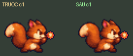
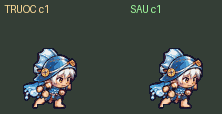
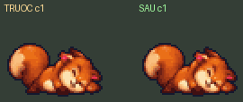
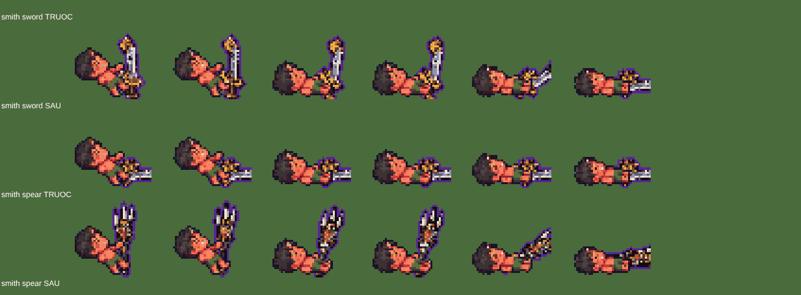
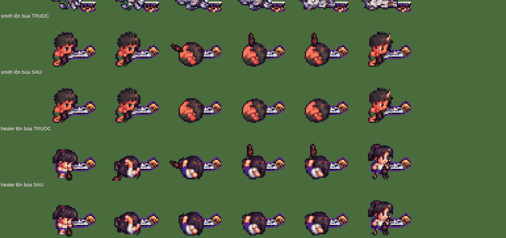

# Bỏ khung trùng bằng code (rà soát A: A10, A9, A13, A12) — 12/10/2026

Không gen ảnh mới. Không đổi gameplay, sát thương, tốc độ, vùng trúng, thời điểm đòn. Hàng/tệp không có trường mới thì game y hệt trước.

## 1. Quét toàn bộ khung trùng (A10)

Script [`kiem/quet.py`](kiem/quet.py) quét **mọi** `game/art/custom/*.sprite.json` (mọi hàng, mọi khung), so điểm ảnh từng khung với khung liền trước
(điểm khác = lệch màu/độ trong > 24; tính trên vùng có hình của hai khung). Ngưỡng nới tới 5 % vẫn chỉ ra đúng 5 chỗ, đều **trùng 100 %**:

| Tệp | Hàng | Khung trùng (đếm từ 1) | Ghi chú |
|---|---|---|---|
| `em-be-wrestler-bien` (Cu Lì thân Biển) | atk (đánh), 6 khung, 0,4 s | 2 = khung 1 | |
| `socNo` (Sóc Nổ) | atk (đánh), 6 khung, 0,5 s | 2 = khung 1 | |
| `socNo` | die (chết), 8 khung, 1,2 s | 2 = khung 1, 6 = khung 5 | |
| `hoTinh-p2` (Hồ Tinh pha 2) | atk (đánh), 6 khung, 0,6 s | 6 = khung 5 | khung cuối |

Không tìm thêm khung trùng nào khác (618 tệp).

## 2. Cách sửa

`js/sprite_custom.js` thêm 2 trường **tuỳ chọn** cho một hàng trong `dong_tac`:

- `"khung": [0, 2, 3, 4, 5]` — danh sách cột được phát (bỏ cột trùng). Tổng thời lượng `giay` giữ nguyên.
- `"cham": 4` — cột **giữ nguyên mốc bắt đầu cũ** (cột / số khung): khung chạm đòn rơi đúng lúc như trước. Các cột trước nó chia đều quãng
  trước mốc, các cột sau chia đều quãng sau. Không ghi `cham`: chia đều cả hàng.

Chỉ chọn khung (`khungMot`/`khungLap`) đổi; mọi chỗ khác (vẽ, nhuộm, đo thân, đồ khoác) vẫn dùng đúng cột ảnh. Hàng không có `khung` → như cũ.

| Tệp / hàng | Ghi | Trước (mốc từng khung) | Sau |
|---|---|---|---|
| Sóc Nổ đánh | `khung [0,2,3,4,5]`, `cham 4` | k1 giữ 2 nhịp (0–33 %), k3 33 %, k4 50 %, **k5 (buông quả) 67 %** | k1 0 %, k3 22 %, k4 44 %, **k5 67 %** (không đổi) |
| Cu Lì Biển đánh | `khung [0,2,3,4,5]`, `cham 4` | k1 giữ 2 nhịp, **k5 (đấm thẳng tay) 67 %** | lấy đà 3 khung đều 22 %, **k5 67 %** (không đổi) |
| Sóc Nổ chết | `khung [0,2,3,4,6,7]` | 2 chỗ đứng hình | 6 khung đều nhau (hàng chết không có mốc đòn) |
| Hồ Tinh pha 2 đánh | `khung [0,1,2,3,4]`, `cham 4` | k5 (vung lửa) giữ 2 nhịp ở cuối | **như cũ** (xem dưới) |

Mốc đòn trong code: Sóc Nổ ném bom ngay đầu hàng atk (mobs.js `lob`), đòn Cu Lì chạm ở 0,45 — cả hai không đọc khung ảnh, nên chỉ cần
giữ khung "chạm" (buông quả / đấm) đúng mốc cũ là hình không lệch thêm so với trước.

**Hồ Tinh pha 2**: khung trùng là khung **cuối** (giữ dáng vung lửa). Bỏ nó mà chia đều thì khung vung lửa đến trễ 0,08 × thời lượng
(xem `hoTinh-p2-danh-deu.gif`) — trái luật "khung chạm như cũ". Giữ `cham 4` thì hình y như cũ: dáng kết đòn giữ lâu hơn là tự nhiên
(không phải khựng giữa động tác). Đã ghi `khung` để đánh dấu đã xử lý; mắt không thấy khác.

GIF trước (trái) / sau (phải), chậm 2 lần:
  
Hồ Tinh pha 2: [giữ mốc (đã chọn)](anh/hoTinh-p2-danh.gif) · [chia đều (không chọn)](anh/hoTinh-p2-danh-deu.gif)

Cờ tắt: `G.KHUNG_TRUNG = false` hoặc `?khungtrung=0`.

## 3. A9 — lúc chết vũ khí còn dựng đứng

Thực tế nặng hơn ghi chép: thân AI **nằm sẵn từ khung chết đầu**, còn vũ khí theo khung xương code ngã dần, dựng đứng tới ~0,25 s.
Sửa: khi vẽ thân AI (`sprite_custom.js` truyền `o.vkNga`), khung xương `die` (hero_tinhlinh.js) đặt vũ khí ở góc nằm cuối ngay từ đầu.
Thân vẽ code (không có ảnh) vẫn ngã dần như cũ. Cờ tắt: `G.VK_NGA = false` hoặc `?vknga=0`.

 (từng cặp hàng: TRUOC rồi SAU; cột: 0,02 / 0,08 / 0,15 / 0,22 / 0,35 / 0,6 s sau khi chết)

## 4. A13 — bùa đeo hông chĩa ra lúc lộn

Các khung cuộn tròn (xoay 60°–300°, cùng luật đang ẩn mũ, cánh, đồ lưng) nay ẩn luôn bùa (ô `hand` mã `bua_*`). Khung đầu/cuối lộn
(đứng dậy) vẫn thấy bùa. Cờ tắt: `G.BUA_LON = false` hoặc `?bualon=0`.

## 5. A12 — chóp hình chạm mép trên ô

Script [`kiem/tren.py`](kiem/tren.py): hàng điểm ảnh đầu ô có hình ở `hoTinh` (move/tele/atk/hit), `nguTinh-p2` (tele/atk), `heoCon` move khung 3.
Đã kiểm ô phía trên: trống (không phải hình tràn sang ô bên). Tức là ảnh AI **đã cắt sẵn** — phần bị cụt không có trong tệp, nới ô hay dời
1 điểm ảnh không lấy lại được (game vẽ trọn ô, không cắt thêm). Với trùm (nét ×2) phần cụt ≤ 0,5 điểm ảnh game → **không sửa**, ghi lại ở đây;
muốn hết hẳn thì gen lại các khung đó có chừa đầu.

## 6. Kiểm

- Bản hai tệp như web (`LK_HAI_TEP=1 python3 game/build.py --hai-tep`, `srv2.py`, `linh-khi-nhe.html?cloud=0`): trường mới đi qua bản đóng gói
  và ảnh rời; bảng khung đúng như mục 2; tắt cả 3 cờ → chọn khung y như cũ. 0 pageerror (cả bot chơi ải 1-1 với 4 em bé × 4 vũ khí).
- `node --check` mọi game/js, bài kiểm lưu mây PASS, `python3 game/build.py` chạy được.
- Script: [`kiem/`](kiem/) (`quet.py` quét trùng, `gif.py` làm GIF, `kiem.py` kiểm trong trình duyệt, `tren.py` quét mép trên).
