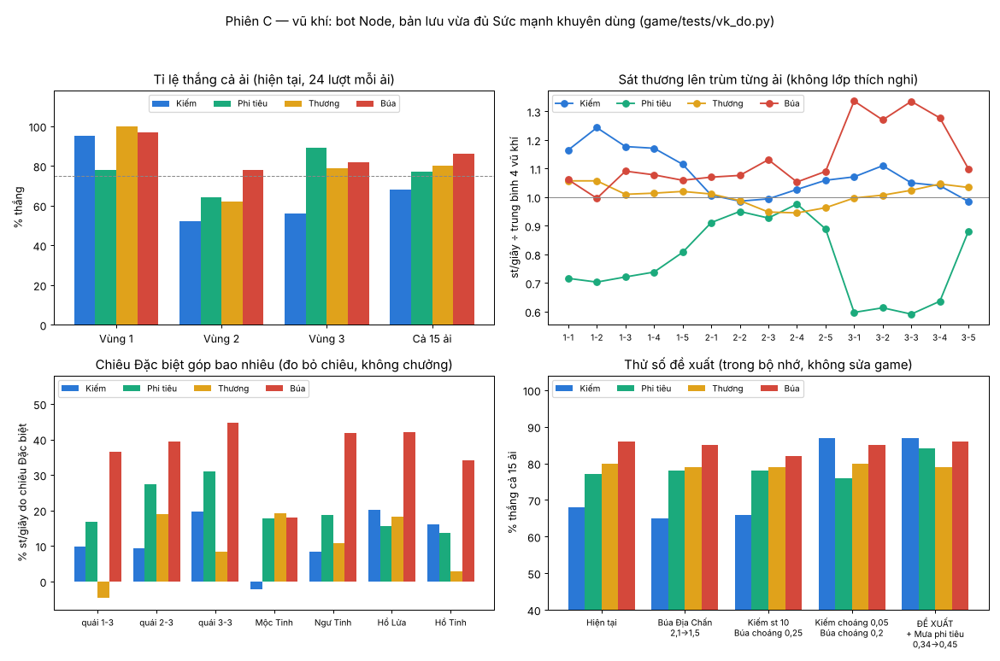

# Báo cáo C — Vũ khí & phong cách chơi (15/10, bot Node)

Phiên này **chỉ đo và đề xuất**, không sửa số cân bằng nào trong game. Số đề xuất được thử **trong bộ nhớ** của lượt đo (cờ `--pre=`), không ghi vào tệp game.

## Tóm tắt

1. **Chỗ ổn.**
   - Vùng 1: cả bốn vũ khí thắng 78–100%.
   - Thương ổn định (thắng 80% cả 15 ải).
   - Ba hệ Lửa / Độc / Băng lệch nhau ≤ 15%. Độc nhỉnh nhất, Băng thấp nhất.
   - Hồ Tinh (3-5), khi vào thẳng phòng trùm và chưa có lớp thích nghi, không phạt vũ khí nào: cả bốn thắng 100%.
2. **Lệch nặng nhất: Kiếm yếu, Búa mạnh.** Bản lưu vừa đủ Sức mạnh khuyên dùng, 24 lượt mỗi ải: **Kiếm 68%**, Phi tiêu 77%, Thương 80%, **Búa 86%**.
   - Nguyên nhân **không phải sát thương** mà là **khống chế**. Mỗi nhát Búa trúng làm quái choáng 0,4 giây, nên tinh anh bị choáng 46–49% thời gian. Kiếm không làm choáng, nên chết ở phòng quái vùng 2: ở 2-3 chỉ 13/24 lượt tới được trùm, ở 2-4 chỉ 6/24.
   - Tăng sát thương Kiếm 9 → 10 không đổi gì (66%). Giảm chiêu Địa Chấn của Búa cũng không đổi gì (85%).
   - **Đề xuất (tự tin vừa – cao):**
     - `G.WTYPES.hammer.stagger` **0,4 → 0,2**.
     - Thêm **`stagger: 0.05`** vào `G.WTYPES.sword` (cùng tệp `game/js/data.js`; `combat.js` đã đọc khoá này cho mọi loại vũ khí, không cần sửa mã).
3. **Phi tiêu lên trùm yếu**: sát thương mỗi giây chỉ bằng 0,6–0,75 lần trung bình (vùng 1 và Hổ Lửa). Nhờ an toàn nên vẫn thắng 77%, nhưng vùng 2 chỉ 63%.
   - **Đề xuất:** `G.MOVES.bow.rain.mult` (Mưa phi tiêu, `game/js/moves.js`) **0,34 → 0,45**.
   - Cả gói (mục 2 + 3): **Kiếm 87%, Phi tiêu 84%, Thương 79%, Búa 86%**. Trung bình 84%, lệch nhiều nhất −6%, **đạt yêu cầu ± 10%**.
   - Chiến dịch (`cay.py`, 5 lượt mỗi vũ khí): số lần chơi để qua 15 ải đổi từ 39–49 thành 34–39 (±6%).
   - **Lưu ý cho phiên A:** cả gói làm game dễ hơn: số lần chơi để qua 15 ải giảm khoảng 14%. Khuyên dùng nên đo lại sau khi gộp.
4. **Lớp thích nghi "Kháng Lửa, yếu Băng" là con dao hai lưỡi.**
   - Nếu đổi sang món phụ hệ Băng, trận trùm **dễ hơn** cả khi không có lớp nào (sát thương ×1,5). Ví dụ Ngư Tinh với Kiếm: 30% → 90%.
   - Nếu không đổi, gần như chắc thua. Ngư Tinh: Kiếm 3%, Búa 0%.
   - **Đề xuất (tự tin thấp – vừa):**
     - Mức kháng 0,3 → **0,2** (`game/js/stage.js` bossSetup). Không đổi món: Ngư Tinh Kiếm 3 → 17%, Phi tiêu 27 → 53%.
     - Điểm yếu ×1,5 → **×1,3** (`game/js/combat.js` dòng `m *= 1.5`). Có đổi món thì vẫn thắng 80–100%.
     - Hai số này làm khoảng cách giữa "có đổi" và "không đổi" nhỏ lại.
5. **Chống đánh xa gần như không phạt Phi tiêu**: 87% → 87% ở Ngư Tinh, 100% → 100% ở Hồ Tinh. **Chống áp sát** thì phạt Kiếm nặng ở Hồ Tinh: 100% → 40%.
   - Không đề xuất số ngay. Hai lớp này lệch nhau là thật, nhưng ở lượt chơi thật trùm vùng luôn có Kháng + Chống …, và bot đổi sang món phụ nên chỉ còn 87–90%.
   - Nếu muốn sửa: Hồ Tinh bật lùi `hopCd` 3,5 → 5 (`game/js/boss.js`). Số này chưa đo.
6. **Ngư Tinh có quá khó với Kiếm không?** Có, ở hai chỗ.
   - **(a) Phòng quái 2-x trước trùm:** đã gỡ bằng mục 2. Ải 2-5 Kiếm thắng 4/24 → 10/24, bằng Búa 12/24 và Phi tiêu 11/24.
   - **(b) Chiêu "Bổ rìu san hô":** khi vào thẳng phòng trùm không có lớp, chiêu này gây 91% máu cho Kiếm, so với 22% cho Phi tiêu. **Đề xuất:** `G.chieuTrum.SO.nguBoRiu.manhSat` (mảnh san hô, `game/js/chieu_trum.js`) **1,4 → 1,0**. Kiếm 30% → 57%, Thương 47% → 67%, Búa 40% → 63%. Tự tin vừa.
   - Ải 2-5 vẫn khó với **mọi** vũ khí: 5–12/24 ở Sức mạnh 293/305. Đây là việc của phiên A (độ khó).
7. **Kỹ năng Đặc biệt và choáng.**
   - Địa Chấn của Búa góp **35–45%** sát thương của Búa. Ba vũ khí kia: Kiếm 0–20%, Phi tiêu 14–31%, Thương 0–19%.
   - Nhưng giảm Địa Chấn (2,1 → 1,5) không đổi tỉ lệ thắng, nên **không cần sửa**.
   - "Búa làm tinh anh choáng liên tục": tinh anh bị choáng 46–49% thời gian. Với đề xuất mục 2 còn 24–27%, Kiếm 15%, Thương 13–29%.
   - Đo được rất ít "Ngắt chiêu" (≤ 2,6 lần mỗi phút): đa số chiêu tinh anh chỉ một lượt.

Mức tự tin chung: tỉ lệ thắng mỗi vũ khí đo 360 lượt, khoảng tin cậy 95% khoảng ±4 điểm. Đây là **bot**: nó phản xạ 0,3 giây, bỏ sót 33% đạn và luôn đổi món phụ khi trùm kháng, khác người thật. Cần người chơi thử Kiếm / Búa sau khi gộp.



---

## 1. Cách đo

Công cụ mới **`game/tests/vk_do.py`** (Node là chính, không trình duyệt, chạy với `?cloud=0` giả).

- Mỗi ải dùng **bản lưu thật** của bot lúc vừa đủ Sức mạnh khuyên dùng (`tests/cay_luu.json`, như `balance.py`).
- "Đổi vũ khí chính sang X": món chính đã nâng (hệ Lửa, mài, ép) đổi **loại** thành X. Món phụ là Phi tiêu hệ Băng. Khi X là Phi tiêu thì món phụ là Kiếm hệ Băng (`G.botDatVk`).
- Sức mạnh gần như không đổi theo loại vũ khí (lệch ≤ 4%), nên các vũ khí được so ở **cùng Sức mạnh**.
- Bot "người mới" giống bot đo khuyên dùng (`cd_lib.BOT`: phản xạ 0,3 giây, bỏ sót 33% đạn).
- Mặc định giữ "sở trường" +10% của Cu Tí (Kiếm, Búa; Zed học thêm Phi tiêu sau Mộc Tinh và Thương sau Ngư Tinh), vì game thật có. Cờ `--thuan` bỏ sở trường để so thuần vũ khí.
- Đo trên commit `5c2dd0e7` (gồm `62d2304b`).
- Phần bỏ chiêu, đổi số Ngư Tinh và một số đề xuất thử đo trên `853ebf8e`. Hai commit cho cùng số ở các bài đo lại (thắng cả ải, trùm, bia), lệch ≤ 1 lượt.

Lệnh chạy lại (từ thư mục `game/`):

```
python3 tests/vk_do.py giay                                   # bảng trên giấy
python3 tests/vk_do.py thang 24 [--thuan] [--json=t.json]     # thắng cả ải × 4 vũ khí × 15 ải
python3 tests/vk_do.py btrum 8                                # st/giây lên trùm từng ải (em bé không chết)
python3 tests/vk_do.py trum 30 [--lop=khong,khang,ap,ca] [--khongdoi]   # vào thẳng phòng trùm 1-5, 2-5, 3-5
python3 tests/vk_do.py bia 8 [--nodac] [--nochuong]           # quái thường + tinh anh (choáng, ngắt chiêu)
python3 tests/vk_do.py thang 24 '--pre=G.WTYPES.sword.stagger=0.05;G.WTYPES.hammer.stagger=0.2;G.MOVES.bow.rain.mult=0.45'   # gói đề xuất
python3 tests/cay.py 5 khuyen --node --vk=kiem|phitieu|thuong|bua [--pre=...]   # chiến dịch theo vũ khí
python3 tests/campaign.py hoa khuyen --node --vk=bua          # một lượt chiến dịch, cố định vũ khí
python3 tests/dps.py 60 8 quaimoi --node                      # bài cũ, nay chạy được trong Node
python3 docs/review/ke-hoach-cai-thien/kiem-can-bang/ve_xem_c.py   # vẽ xem-C.png từ xem-C.json
```

Thêm vào công cụ (chỉ trong `game/tests/`):

- `dps.py --node`
- `campaign.py --vk=… --pre=…`
- `cay.py --pre=…`

## 2. Trên giấy (`vk_do.py giay`)

| Vũ khí | Sát thương gốc | Tầm | Chuỗi đòn | Giây/chuỗi | St/đòn | St/giây trên giấy | Đặc biệt (st gốc 1 lần) |
|---|---|---|---|---|---|---|---|
| Kiếm | 9 | 32-40 | 3 | 1,06 | 11,6 | 32,7 | Trảm Nguyệt 18,0 (xuyên, con sau ×0,7) |
| Phi tiêu | 11,4 | 180 | 1 | 0,38 | 11,4 | 30,0 | Mưa phi tiêu 23,3 (6 đợt × 0,34 mỗi quái trong vùng) |
| Thương | 10,7 | 60-62 | 4 | 1,58 | 13,8 | 34,9 | Phi Thương 17,1 (ghim choáng 1 giây, về tay ×0,9) |
| Búa | 21,3 | 32 | 1 | 0,80 | 21,3 | 26,6 | **Địa Chấn 66,0** (vệt nứt choáng 0,9 giây + vòng) |

- Búa trên giấy có st/giây thấp nhất, nhưng có hai thứ mạnh: **choáng 0,4 giây mỗi nhát** (`G.WTYPES.hammer.stagger`, không lên trùm) và Địa Chấn gấp 3–4 lần chiêu Đặc biệt của vũ khí khác.
- Mana nạp theo số nhát trúng (`P.manaHit` mỗi nhát). Vì vậy Búa ra Đặc biệt ít nhất (5–11 lần mỗi phút), Kiếm nhiều nhất (9–20 lần mỗi phút).

## 3. Tỉ lệ thắng cả ải theo vũ khí (`vk_do.py thang 24`)

Bảng ghi số lượt thắng trên 24. Trong ngoặc là số lượt tới được phòng trùm, khi chưa đủ 24.

| Ải | Sức mạnh bản lưu / khuyên dùng | Kiếm | Phi tiêu | Thương | Búa | Đề xuất → Kiếm | Phi tiêu | Thương | Búa |
|---|---|---|---|---|---|---|---|---|---|
| 1-1 | 100 / 95 | 24 | 24 | 24 | 24 | 24 | 24 | 24 | 24 |
| 1-2 | 107 / 105 | 23 | 22 (22) | 24 | 23 | 24 | 23 | 24 | 24 |
| 1-3 | 126 / 125 | 24 | 21 (21) | 24 | 24 | 24 | 23 | 24 | 24 |
| 1-4 | 141 / 140 | 24 | 12 (12) | 24 | 24 | 24 | 16 | 24 | 24 |
| 1-5 | 174 / 175 | 19 (23) | 14 (15) | 24 | 21 | 23 | 12 | 21 | 23 |
| 2-1 | 181 / 180 | 24 | 21 (22) | 24 | 24 | 24 | 23 | 24 | 23 |
| 2-2 | 207 / 215 | 16 (18) | 17 (17) | 19 (20) | 24 | 23 | 20 | 18 | 18 |
| 2-3 | 250 / 260 | 13 (13) | 20 (20) | 14 (14) | 20 (20) | 22 | 23 | 14 | 21 |
| 2-4 | 265 / 275 | **6 (6)** | 16 (16) | 12 (12) | 16 (17) | 18 | 17 | 12 | 14 |
| 2-5 | 293 / 305 | 4 (5) | 3 (12) | 5 (7) | 10 (15) | 10 | 11 | 5 | 12 |
| 3-1 | 312 / 310 | 20 (20) | 24 | 24 | 24 | 24 | 24 | 24 | 24 |
| 3-2 | 346 / 330 | 17 (19) | 22 (22) | 23 (23) | 24 | 23 | 23 | 23 | 21 |
| 3-3 | 392 / 410 | 16 (16) | 23 (23) | 20 (20) | 21 (21) | 22 | 24 | 18 | 23 |
| 3-4 | 411 / 420 | **8 (8)** | 17 (17) | 16 (17) | 20 (21) | 15 | 18 | 16 | 20 |
| 3-5 | 455 / 520 | 6 (12) | 21 (23) | 12 (20) | 10 (21) | 14 | 23 | 13 | 15 |

| Vũ khí | Thắng 15 ải (hiện tại) | Khoảng 95% | Vùng 1 / 2 / 3 | Bỏ sở trường (`--thuan`, 16 lượt) | **Gói đề xuất** | Vùng 1 / 2 / 3 |
|---|---|---|---|---|---|---|
| Kiếm | 244/360 (**68%**) | 63–72% | 95 / 52 / 56% | 57% | **314/360 (87%)** | 99 / 81 / 82% |
| Phi tiêu | 277/360 (77%) | 72–81% | 78 / 64 / 89% | 76% | **304/360 (84%)** | 82 / 78 / 93% |
| Thương | 289/360 (80%) | 76–84% | 100 / 62 / 79% | 76% | **284/360 (79%)** | 98 / 61 / 78% |
| Búa | 309/360 (**86%**) | 82–89% | 97 / 78 / 82% | 83% | **310/360 (86%)** | 99 / 73 / 86% |

Đọc bảng:

- Kiếm thua chủ yếu **trước khi tới trùm** (2-3, 2-4, 3-3, 3-4), tức là ở phòng quái.
- Phi tiêu thua ở vùng 1 (1-4, 1-5), vì sát thương lên trùm nhỏ và Mộc Tinh thấp (mục 4).
- Bỏ sở trường thì Kiếm còn 57%: sở trường +10% đang che bớt chỗ yếu của Kiếm.
- 3-5: bản lưu thiếu Sức mạnh (455/520) nên mọi vũ khí thấp. Không tính vào lệch vũ khí.
- 2 trên khoảng 2.000 lượt hết giờ 900 giây (bot kẹt), tính là thua.

Các số đã thử (tất cả qua `--pre`, 16–24 lượt mỗi ải):

| Thử | Kiếm | Phi tiêu | Thương | Búa | Ghi chú |
|---|---|---|---|---|---|
| Hiện tại | 68 | 77 | 80 | 86 | |
| A. Địa Chấn `special.hammer.mult` 2,1 → 1,5 | 65 | 78 | 79 | 85 | sát thương chiêu Búa không phải lý do Búa thắng nhiều |
| B. A + Kiếm `dmg` 9 → 10 | 66 | 78 | 79 | 85 | thêm sát thương Kiếm gần như vô ích |
| C. B + Búa choáng 0,4 → 0,25 | 66 | 78 | 79 | 82 | |
| D. Kiếm 10, Trảm Nguyệt 2,0 → 2,4, Địa Chấn 1,4 / vòng 0,8 | 70 | 78 | 79 | 88 | |
| F. Tầm Kiếm +6 | 65 | – | – | – | tầm không phải lý do |
| E. Kiếm choáng 0,15, Búa 0,25, Địa Chấn 1,5 | 86 | – | – | 81 | **choáng là đòn bẩy chính** |
| G. Kiếm choáng 0,25, Búa 0,2 | 89 | – | – | 79 | |
| I. Kiếm choáng 0,1, Búa 0,25 | 84 | 77 | 80 | 86 | |
| H. Kiếm choáng 0,08, Búa 0,25 | 88 | 77 | 80 | 86 | |
| J. Kiếm choáng 0,05, Búa 0,2 | 87 | 76 | 80 | 85 | choáng rất ngắn cũng đủ; có lẽ vì mỗi lần choáng ngắt nhịp ra đòn của quái (chưa đo riêng) |
| K. J + Phi tiêu `dmg` 11,4 → 12,2 | – | 81 | – | – | |
| **J + L. J + Mưa phi tiêu 0,34 → 0,45 (đề xuất)** | **87** | **84** | **79** | **86** | lệch ≤ 8 điểm, ±6% quanh trung bình |
| M. J + L + Thương choáng 0,05 | – | – | 89 | – | tuỳ chọn: bốn vũ khí 84–89, nhưng game dễ hơn nữa |

## 4. Sát thương mỗi giây lên quái, tinh anh, từng trùm

### Quái thường và tinh anh (`vk_do.py bia 8`)

Phòng đầu của ải, mỗi lượt 40 giây, 8 hạt giống. Sức mạnh ghi trong ngoặc.

| Ải (Sức mạnh) | Vũ khí | Quái st/giây | Mất máu %/giây | Tinh anh st/giây | Giây hạ 1 tinh anh | Tinh anh bị choáng/đông | Ngắt chiêu/phút | Đặc biệt/phút |
|---|---|---|---|---|---|---|---|---|
| 1-3 (126) | Kiếm | 39,0 | 1,44 | 31,8 | 16,8 | 0% | 0 | 10,2 |
| 1-3 (121) | Phi tiêu | 28,8 | 1,14 | 21,0 | 19,4 | 0% | 0 | 9,0 |
| 1-3 (121) | Thương | 37,9 | 1,23 | 32,5 | 16,4 | 16% | 0,4 | 10,1 |
| 1-3 (126) | Búa | **49,7** | 1,27 | **42,1** | **12,8** | **46%** | 0,8 | 7,4 |
| 2-3 (250) | Kiếm | 94,5 | 1,81 | 91,2 | 16,5 | 0% | 0 | 9,0 |
| 2-3 (250) | Phi tiêu | 83,4 | 2,31 | 76,4 | 19,2 | 0% | 0 | 9,2 |
| 2-3 (241) | Thương | 86,5 | 2,38 | 78,2 | 19,0 | 14% | 0,2 | 8,2 |
| 2-3 (250) | Búa | **119,3** | 1,99 | **123,0** | **11,9** | **49%** | 0 | 6,3 |
| 3-3 (392) | Kiếm | 155,8 | 1,30 | 135,7 | 18,5 | 0% | 0 | 13,7 |
| 3-3 (392) | Phi tiêu | 147,6 | 0,75 | 124,0 | 19,1 | 0% | 0 | 15,1 |
| 3-3 (392) | Thương | 178,0 | 0,90 | 156,7 | 16,2 | 29% | 0 | 15,8 |
| 3-3 (392) | Búa | **219,2** | 1,63 | **211,4** | **12,0** | **47%** | 0 | 10,1 |

Gói đề xuất (Kiếm choáng 0,05, Búa 0,2, Mưa phi tiêu 0,45), tinh anh:

| Ải | Kiếm | Phi tiêu | Thương | Búa |
|---|---|---|---|---|
| 1-3 | 15% choáng, 49,1 st/giây | 0%, 20,3 | 16%, 32,5 | 25%, 39,2 |
| 2-3 | 15%, 124,2 | 0%, 80,6 | 13%, 77,6 | 24%, 105,9 |
| 3-3 | 16%, 222,8 | 0%, 127,1 | 29%, 156,7 | 27%, 189,5 |

Sau đề xuất, Kiếm hạ tinh anh nhanh nhất (11–12 giây) nhưng vẫn thắng cả ải ngang Búa (87% và 86%).

**Bài cũ `dps.py` (cấp 10, vũ khí Trắng, bia tập)** nay chạy được với `--node`. Bài này **đã không đạt từ trước đề xuất**:

- `quaimoi`: Kiếm 39, Phi tiêu 30, Thương 23, Búa 28. Cận chiến lệch 30%, thấp nhất chỉ bằng 59% cao nhất.
- Thứ tự ở bài này ngược với bản lưu thật: Thương Trắng yếu nhất, Búa thấp.
- Ngưỡng của `dps.py` nên viết lại theo bản lưu thật (`vk_do.py`), không theo bia Trắng cấp 10.
- Ba hệ ở Thức tỉnh (trung bình bốn vũ khí, `dps.py 60 8 quaimoi --node`): Lửa 62,8, **Độc 76,8**, Băng 60,9, lệch 15% (đúng ngưỡng). Trên bia tập kiểu cũ: lệch 9%.

### Từng trùm (`vk_do.py btrum 8`)

Không lớp thích nghi; em bé không chết (máu ≥ 60%). Bảng ghi st/giây, trong ngoặc là phần trăm thời gian trùm bị choáng.

| Ải | Trùm | Kiếm | Phi tiêu | Thương | Búa | Cách trùm TB (Kiếm / Phi tiêu) |
|---|---|---|---|---|---|---|
| 1-1 | Nấm Chúa | 31,4 (7%) | 19,3 (9%) | 28,5 (13%) | 28,6 (12%) | 64 / 81 |
| 1-2 | Nấm Chúa | 37,5 | 21,2 | 31,8 | 30,0 | 57 / 73 |
| 1-3 | Nấm Chúa | 47,5 | 29,1 | 40,8 | 44,1 | 59 / 78 |
| 1-4 | Nấm Chúa | 52,0 | 32,7 | 45,0 | 47,8 | 59 / 75 |
| 1-5 | **Mộc Tinh** | 50,0 (0%) | 36,2 (0%) | 45,8 (5%) | 47,5 (4%) | 64 / 112 |
| 2-1 | Cua Đá | 61,1 | 55,3 | 61,3 | 64,9 | 59 / 68 |
| 2-2 | Cua Đá | 78,8 | 75,9 | 79,0 | 86,0 | 60 / 68 |
| 2-3 | Cua Đá | 100,1 | 93,4 | 95,5 | 114,0 | 60 / 69 |
| 2-4 | Cua Đá | 106,7 | 101,3 | 98,2 | 109,4 | 60 / 72 |
| 2-5 | **Ngư Tinh** | 111,6 (1%) | 93,6 (0%) | 101,4 (9%) | 114,8 (7%) | 62 / 101 |
| 3-1 | Hổ Lửa | 135,8 | **75,7** | 126,4 | **169,4** | 47 / 67 |
| 3-2 | Hổ Lửa | 179,5 | **99,1** | 162,9 | **205,4** | 44 / 64 |
| 3-3 | Hổ Lửa | 198,0 | **111,4** | 193,1 | **251,9** | 46 / 65 |
| 3-4 | Hổ Lửa | 173,3 | **105,9** | 174,3 | **212,8** | 47 / 67 |
| 3-5 | **Hồ Tinh** | 193,7 (1%) | 173,3 (0%) | 203,3 (12%) | 216,1 (9%) | 58 / 86 |

- Phi tiêu lên trùm nhỏ vùng 1 và Hổ Lửa chỉ bằng **0,6–0,74 lần** trung bình. Hổ Lửa: bot bắn từ xa, Hổ Lửa vồ / chạy nên nhiều phát trượt.
- Búa lên Hổ Lửa gấp 1,3 lần.
- Mất máu khi đánh trùm (%/giây): Ngư Tinh nặng nhất cho cận chiến (Kiếm 3,2, Búa 3,8, Thương 2,7, Phi tiêu 1,5).

## 5. Kỹ năng Đặc biệt (đo bằng cách bỏ chiêu)

Bot không dùng chiêu Đặc biệt (`--nodac`), so với có dùng. Cả hai đều **tắt Chưởng** (`--nochuong`), vì khi bỏ Đặc biệt thì mana dư sang Chưởng làm số đo lệch.

| Mục tiêu | Kiếm | Phi tiêu | Thương | Búa |
|---|---|---|---|---|
| Quái 1-3 | 10% | 17% | −5% | **37%** |
| Quái 2-3 | 9% | 27% | 19% | **39%** |
| Quái 3-3 | 20% | 31% | 8% | **45%** |
| Mộc Tinh | −2% | 18% | 19% | 18% |
| Ngư Tinh | 8% | 19% | 11% | **42%** |
| Hổ Lửa (3-2) | 20% | 15% | 18% | **42%** |
| Hồ Tinh | 16% | 14% | 3% | **34%** |

- Bỏ Địa Chấn thì Búa xuống ngang hoặc dưới ba vũ khí kia.
- Nhưng giảm Địa Chấn 2,1 → 1,5 (thử A ở mục 3) **không đổi tỉ lệ thắng**: Búa thắng nhờ choáng, không nhờ sát thương.
- Vì thế không đề xuất sửa Địa Chấn. Nếu thấy chiêu "quá tay" khi chơi thì 2,1 → 1,6 là an toàn.
- Choáng lên trùm: Búa và Thương làm trùm choáng 4–24% thời gian (Địa Chấn và Phi Thương ghim, ×0,4 lên trùm). Trùm vùng chỉ choáng 0–12%. Không thấy lệch đáng sửa.
- Tinh anh: xem mục 4. Búa khoá tinh anh 46–49% thời gian, chiêu tinh anh ít khi kịp tung (`chieuTrum.soNgat` đếm được ≤ 2,6 lần ngắt chiêu mỗi phút).

## 6. Khắc hệ và lớp thích nghi trùm (`vk_do.py trum 30`)

Vào thẳng phòng trùm, đủ máu, 30 lượt. Các biến thể lớp thích nghi:

- `khong`: không lớp.
- `khang`: Kháng hệ món chính (Lửa) 30%, yếu Băng.
- `ap`: Chống áp sát (cận chiến) hoặc Chống đánh xa (Phi tiêu).
- `ca`: cả hai, giống lượt thật ở trùm vùng.

Lớp mà trùm thật học được trong lượt chơi (bảng mục 3):

- Trùm nhỏ: hầu hết **Kháng Lửa**. Riêng ải 1-2 là Chống áp sát / Chống đánh xa.
- Trùm vùng: **Kháng Lửa + Chống áp sát** với cận chiến, **Kháng Lửa + Chống đánh xa** với Phi tiêu.

| Trùm | Lớp | Kiếm | Phi tiêu | Thương | Búa |
|---|---|---|---|---|---|
| Mộc Tinh | không | 100% | 80% | 87% | 90% |
| | Kháng Lửa (bot đổi món phụ) | 97% | 100% | 97% | 97% |
| | Kháng Lửa (**không đổi**) | 77% | 63% | **50%** | 53% |
| | Chống áp sát / đánh xa | 97% | 87% | 93% | 100% |
| | cả hai (đổi món) | 97% | 100% | 97% | 97% |
| Ngư Tinh | không | **30%** | 87% | 47% | 40% |
| | Kháng Lửa (đổi món) | 90% | 83% | 90% | 90% |
| | Kháng Lửa (**không đổi**) | **3%** | 27% | 20% | **0%** |
| | Chống áp sát / đánh xa | 63% | 87% | 67% | 53% |
| | cả hai (đổi món) | 87% | 83% | 87% | 87% |
| Hồ Tinh | không | 100% | 100% | 100% | 100% |
| | Kháng Lửa (không đổi) | 100% | 97% | 100% | 100% |
| | Chống áp sát / đánh xa | **40%** | 100% | 77% | 80% |
| | cả hai (đổi món) | 90% | 100% | 90% | 90% |

- **Kháng:** ×0,7 cho hệ bị kháng, ×1,5 cho hệ khắc. Có đổi món thì trận dễ hơn cả không lớp; không đổi thì trận Ngư Tinh gần như không thắng nổi.
  - Hệ bị phạt nặng nhất là **món chính hệ Lửa ở vùng 2**. Bot chọn Lửa theo vùng 1. Ngư Tinh hệ nước học Kháng Lửa.
  - Thử (`--pre`):
    - **mức kháng 0,2, không đổi món:** Ngư Tinh Kiếm 17%, Phi tiêu 53%, Thương 23%, Búa 10%. Mộc Tinh Kiếm 83%, Thương 77%, Búa 60%.
    - **điểm yếu ×1,3, có đổi món:** Mộc Tinh 93–97%, Ngư Tinh 80–100%, Hồ Tinh 100%. Không giảm.
  - Đề xuất mức kháng 0,3 → 0,2 (trùm vùng lần đầu Mộc Tinh đang 0,2 nên giữ 0,2) và yếu ×1,5 → ×1,3. Tự tin thấp – vừa: chỉ đo vào thẳng phòng trùm, chưa đo cả chiến dịch.
- **Chống đánh xa** (`combat.js` ×0,6 khi xa > 120) gần như không ảnh hưởng Phi tiêu, vì bot Phi tiêu đứng cách trùm trung bình 64–112, phần lớn trong 120. **Chống áp sát** (Hồ Tinh bật lùi, để lại vũng lửa) phạt Kiếm 100 → 40%.
  - Hai lớp lệch nhau, nhưng khi trùm vùng có cả Kháng Lửa thì bot đổi sang món phụ và chỉ còn 87–100%. Chưa đề xuất số. Ứng viên là Hồ Tinh `hopCd` 3,5 → 5 (`boss.js`), chưa đo.

## 7. Ngư Tinh với Kiếm

Nguồn mất máu ở trận Ngư Tinh không lớp, theo % máu tối đa mỗi trận (`vk_do.py trum`, trường `src`):

| Vũ khí | Bổ rìu san hô | Sóng thần | Cột nước đuổi |
|---|---|---|---|
| Kiếm | **91%** | 30% | 9% |
| Phi tiêu | 22% | 65% | 11% |
| Thương | 55% | 56% | 27% |
| Búa | **90%** | 29% | 7% |

- Thử `G.chieuTrum.SO.nguBoRiu.manhSat` 1,4 → 1,0 (mảnh san hô văng hai bên vết nứt): không lớp, Kiếm 30 → **57%**, Thương 47 → 67%, Búa 40 → 63%, Phi tiêu 87 → 90%. Có lớp (đổi món): 87–97%.
- Giảm thêm nhát bổ chính `sat` 1,4 → 1,1 không đổi gì thêm.
- Ở cả ải 2-5, Kiếm còn chết trước trùm: chỉ 5/24 lượt tới được trùm. Gói choáng (mục 3) đưa Kiếm lên 10/24, ngang Búa và Phi tiêu.
- **Trả lời câu hỏi trên trang việc:** có, nên làm dễ hơn cho Kiếm. Cách làm bằng **gói choáng** (phòng quái) + **`manhSat` 1,0** (trùm). Không cần hạ máu hay sát thương chung của Ngư Tinh.

## 8. Chiến dịch theo vũ khí (`cay.py 5 khuyen --node --vk=…`)

Mỗi vũ khí 5 lượt chiến dịch 15 ải (bot cày tới khuyên dùng rồi mới thử, có ải ngày). Món phụ: Phi tiêu; khi Phi tiêu là món chính thì món phụ là Kiếm.

| Món chính | Lần chơi qua 15 ải | Phút | Thắng lần thử ải mới | 2-5 Ngư Tinh (lần chơi) | → Gói đề xuất: lần chơi | Phút | Thắng lần thử | 2-5 |
|---|---|---|---|---|---|---|---|---|
| Kiếm | 43,6 | 206 | 71% | 7,8 | **34,4** | 155 | 99% | 4,6 |
| Phi tiêu | **49,4** | 243 | **56%** | **11,0** | **38,4** | 182 | 81% | 6,0 |
| Thương | 39,6 | 182 | 80% | 6,2 | **38,6** | 170 | 82% | 5,4 |
| Búa | 39,2 | 187 | 72% | 7,0 | **37,2** | 172 | 82% | 4,2 |

- Hiện tại Phi tiêu làm món chính tệ nhất ở chiến dịch: 2-5 cần 11 lần chơi.
- Sau gói đề xuất: 34–39 lần chơi (±6%), không vũ khí nào quá 6 lần ở một ải.
- Kiếm thành dễ nhất ở chiến dịch: thắng 99% lần thử.
- Mẫu nhỏ (5 lượt, khoảng 20 lần thử mỗi vũ khí), khoảng tin cậy khoảng ±15 điểm.
- Gói đề xuất làm cả chiến dịch nhanh hơn khoảng 14% (trung bình 43 → 37 lần chơi). Phiên A cần đo lại khuyên dùng sau khi gộp.

## 9. Đề xuất số (chủ dự án chọn, phiên sau sửa gộp)

| # | Tệp / khoá | Cũ → mới | Đo được | Tự tin |
|---|---|---|---|---|
| 1 | `game/js/data.js` `G.WTYPES.hammer.stagger` | 0,4 → **0,2** | Búa 86 → 85–86%. Tinh anh bị choáng 47% → 25% (bớt "khoá chiêu tinh anh") | vừa – cao |
| 2 | `game/js/data.js` `G.WTYPES.sword` thêm `stagger` | (không có) → **0,05** | Kiếm 68 → 87%. Phòng quái vùng 2 52 → 81% | vừa – cao. Mọi giá trị 0,05–0,25 đều cho 84–89%, chọn mức nhỏ nhất |
| 3 | `game/js/moves.js` `G.MOVES.bow.rain.mult` | 0,34 → **0,45** | Phi tiêu 77 → 84%. Chiến dịch 49 → 38 lần chơi | vừa |
| 4 | `game/js/chieu_trum.js` `SO.nguBoRiu.manhSat` | 1,4 → **1,0** | Ngư Tinh không lớp: Kiếm 30 → 57%, Búa 40 → 63% | vừa |
| 5 | `game/js/stage.js` bossSetup mức kháng (`first ? 0.2 : 0.3`) | 0,3 → **0,2** | Không đổi món: Ngư Tinh Kiếm 3 → 17%, Phi tiêu 27 → 53% | thấp – vừa |
| 6 | `game/js/combat.js` `m *= 1.5` (điểm yếu trùm) | 1,5 → **1,3** | Có đổi món: vẫn 80–100% | thấp – vừa (đi cùng #5) |
| (tuỳ chọn) | `G.WTYPES.spear` thêm `stagger` | → 0,05 | Thương 79 → 89% (bốn vũ khí 84–89%) | vừa, nhưng game dễ thêm |
| (không sửa) | Địa Chấn `G.MOVES.special.hammer.mult` | giữ 2,1 | giảm 1,5 không đổi tỉ lệ thắng | – |

Sau khi gộp: chạy lại `python3 tests/vk_do.py thang 24` (mong đợi bốn vũ khí 79–87%) và `cay.py 5 khuyen --node --vk=…` cho từng vũ khí.

Bài `dps.py` sẽ vẫn "không đạt" như hiện nay (bia Trắng cấp 10, xem mục 4). Nên đổi ngưỡng của bài theo `vk_do.py`.

## 10. Giới hạn

- Đây là **bot**, chạy luật game trong Node, không phải người chơi thật.
  - Bot luôn đổi sang món phụ khi trùm kháng hệ món chính. Người chơi mới có thể không đổi, xem dòng "không đổi" ở mục 6.
  - Bot cận chiến đứng sát; người thật có thể né Bổ rìu tốt hơn.
- Bản lưu đo là bản lưu của bot dùng Kiếm, đổi loại vũ khí. Người chơi Búa thật có thể nâng khác (ép bậc Búa choáng lâu hơn: `G.epDo.choang`).
- Kết quả ở hai commit (`853ebf8e`, `5c2dd0e7`) khớp nhau; khác nhau chỉ trong mức ngẫu nhiên. Phiên `cua-tuong-kho` đang sửa Cua Đá nên số trùm 2-1..2-4 có thể đổi.
- Số thô: `xem-C.json` (số vẽ biểu đồ). Muốn có bảng đầy đủ thì chạy lại các lệnh ở mục 1, thêm `--json=…`.
