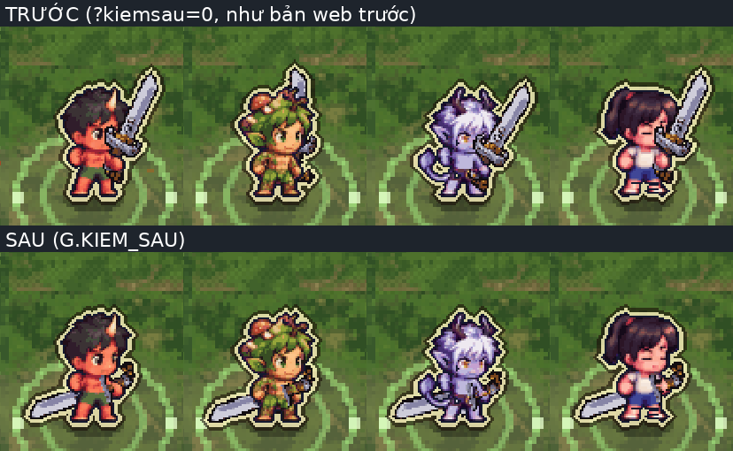
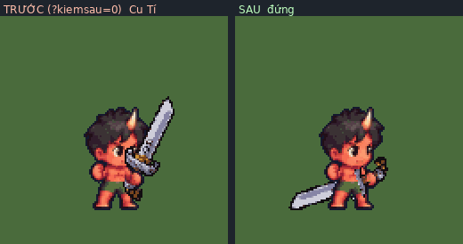
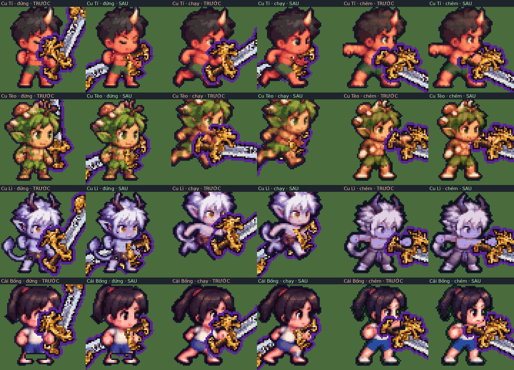

# Kiếm không che mặt — báo cáo (12/10)

Chủ dự án (xem bản web): *"Cho kiếm ra đằng sau được không, ở tay thêm sao cho như đang cầm kiếm thật, ý tôi là cách kiếm hiển thị giờ
lưỡi đang che mặt nhân vật"*. Làm trên nhánh `khoi-tao-du-an`, xây tiếp trên G.KIEM_MUOT (8cac41b9), G.KIEM_KHOP (tay-kiem-mat),
G.VK_NE_MAT (rà soát A), đòn thân bộ (6f71aa94, d70c5c6, đợt 2–3 tới 36dcd37). Mọi số dưới đây đo trên code đã gộp với 36dcd37. Cờ mới **`G.KIEM_SAU`** — tắt: mở game với **`?kiemsau=0`** → vẽ **y hệt**
bản trước (so từng điểm ảnh, mục 5).

## 1. Đo trước khi sửa: còn che ở đâu

Công cụ: [`kiem/do_mat.py`](kiem/do_mat.py) + [`kiem/do_mat.js`](kiem/do_mat.js). Chạy bản **hai tệp như web** (`linh-khi-nhe.html?cloud=0`),
iPhone ngang 844×390 dpr 3, luật game thật từng khung 1/60 giây (tests/au_lib.js). Mỗi khung lấy đúng đối tượng vẽ của người chơi
(`G.heroArgs`), vẽ lại gấp đôi (như màn trận: canvas 960 cho 480 điểm ảnh) hai lần — có / không vẽ vũ khí — hiệu hai ảnh là điểm ảnh
vũ khí **còn nhìn thấy**; đếm số điểm đó nằm trong **vùng mắt-mũi-miệng** (`SC.matKhung`; khung nào máy không dò được mặt — mũ to của
thân bộ — thì mượn khung gần nhất, như game làm sau khi sửa).

Kịch bản (mỗi em bé × thân gốc + bộ Rừng/Biển/Lâu × quay phải/trái = 32 lượt, 14 848 khung mỗi loại vũ khí): đứng → đi → chạy →
dừng (chạy→đứng) → giữ nút chém (3 nhát) → ngay sau đòn → đứng→chạy → chạy mà chém → lộn → lướt chém → chiêu → trúng đòn → đứng →
giữ lấy đà. (Ở làng em bé **không cầm** vũ khí — vũ khí bay theo sau lưng 17 điểm ảnh, `village_scene.js` — nên không có chỗ che.)

**Kiếm, trước khi sửa** (`?kiemsau=0`, = bản web hiện tại; số đầy đủ [`so/tong-truoc.txt`](so/tong-truoc.txt)):

| Trạng thái | Khung | Khung có lưỡi/chuôi đè mặt | Đè nhiều nhất |
|---|---|---|---|
| **đứng** | 1 856 | **1 052** (thân gốc: 4/4 em bé, **mọi** khung) | 77% mặt (thân gốc 18–23%) |
| đi | 928 | 400 | 23% |
| chạy | 1 248 | 574 | 25% |
| chạy→đứng | 736 | 384 | 77% |
| ngay sau đòn | 1 664 | 568 | 70% |
| đứng→chạy | 480 | 268 | 25% |
| lộn / trúng đòn | 1 024 | 0 | 0 |
| chém 3 nhát | 2 528 | 710 | 38% |
| chạy mà chém | 2 016 | 438 | 35% |
| lướt chém | 992 | 456 | 71% |
| chiêu | 1 248 | 614 | 67% |
| giữ lấy đà (vẽ giả: kiếm không có giữ thật) | 128 | 10 | 43% |
| **Tổng không đánh / đánh** | 7 936 / 6 912 | **3 246 / 2 228** | |

Đúng cái chủ dự án thấy: **đứng cầm kiếm là lưỡi dựng chéo ngay trước mặt** (góc −60°, vẽ trước thân) ở cả 4 em bé (ảnh trên, hàng
TRƯỚC). Luật né mặt cũ (`kiemKhop`, `kiemMuot`) đoán bằng hình học (đĩa mặt + độ dài lưỡi) nên lọt: ảnh kiếm thật to hơn ước lượng.

Giáo và búa cũng che (đo cùng cách — [`so/tong-giao-truoc.txt`](so/tong-giao-truoc.txt), [`so/tong-bua-truoc.txt`](so/tong-bua-truoc.txt)):
giáo không đánh 3 776/7 936 khung (đứng tới 49% mặt, chạy 57%), đánh 3 988/6 912; búa không đánh 2 466/7 936 (chạy 24%), đánh 3 440/6 912 (tới 62%). → **áp cùng luật** cho giáo,
búa (yêu cầu mục 4). Cung không đổi.

## 2. Đã sửa gì

Tệp: `game/js/hero_tinhlinh.js` (hàm mới `kiemSau`, `oDau`, `oChuoi`, `catO`; `vkGhep` bọc thêm `kiemSau`; `drawFrame` vẽ cắt lớp),
`game/js/sprite_custom.js` (`SC.veNam` nắm tay thật, `SC.matKhungGan`, cờ), gói lại `game/dist/*`. Không đổi ảnh, dữ liệu, thư viện.

**a) Không đánh (đứng, đi, chạy, dừng, lộn, trúng đòn): "kéo kiếm sau lưng".** Bàn tay AI nắm chuôi ngang hông (điểm `tay_truoc`
của từng khung), lưỡi chĩa **xuống-ra-sau**, góc tính theo độ cao bàn tay để mũi kiếm vừa sát đất sau gót (140–170°). Cả cây kiếm vẽ
**sau thân**; riêng khúc chuôi (núm chuôi → nắm tay → chắn kiếm, dài 11,5 điểm ảnh) vẽ lại trước thân rồi bàn tay đè lên → nhìn thấy rõ
tay nắm chuôi, lưỡi lòi ra sau lưng. Khúc chuôi cũng không bao giờ vẽ trong đĩa đầu. Lộn (thân cuộn tròn, mặt khuất): kiếm giữ hướng
về trước sau quả bóng như cũ, để lộn rồi lướt chém (đòn chỉ ~4 khung) không phải xoay 155°.

**b) Đang đánh (chém, chạy chém, lướt chém, chiêu, chưởng, giữ lấy đà):** đường vung G.KIEM_MUOT **giữ nguyên** (góc, lớp trước/sau,
thời điểm). Mới: phần lưỡi rơi vào **đĩa đầu** của khung vẽ **sau đầu** — cắt theo từng điểm ảnh 0,5 (khớp nét ảnh AI), không xoay
giật, phần còn lại vẫn trước thân như cũ.

**c) Chuyển mượt (không nhảy góc):** đứng/chạy/lộn ↔ kéo kiếm: góc tiến dần từ góc vừa vẽ (hằng số 0,05 giây, nhanh nhất 1 500°/giây
≈ 25°/khung). Kéo kiếm → đòn: độ lệch so với góc đòn tính một lần ở khung đầu rồi nhỏ dần đều qua 6 khung vẽ (khựng hình không tính),
nên góc liền mạch cả khi góc đòn tự quay qua phía đối diện. Sau đòn → kéo kiếm: như (a).

**d) Tay nắm chuôi như thật (`SC.veNam`, thay "vẽ lại đĩa tròn r = 2,5 của thân AI"):** cách cũ chép cả mảng ngực/hông sau bàn tay
đè lên kiếm → che mất núm chuôi, có khi thành một chấm tròn giữa chuôi (ảnh cận, cột TRƯỚC). Nay chọn đúng **điểm ảnh bàn tay** của
khung (cùng màu da với giữa nắm tay trong 2,6 điểm ảnh + viền tối sát nó), chỉ vẽ lại những điểm đó (giữ nhuộm, nháy trúng đòn), rồi
thêm **ngón tay**: 3 ô 0,5 điểm ảnh màu da của chính ảnh vắt ngang chuôi ngay trước nắm, 2 ô bóng (da × 0,7) sát chắn kiếm. Chuôi
xuyên qua nắm tay: núm chuôi lòi một đầu, chắn kiếm + lưỡi đầu kia. Áp cho cả lúc đánh. Cỡ kiếm G.CO_VK, xoay điểm ảnh 5° như cũ.

**e) Giáo, búa:** cùng (a)–(d): kéo giáo / kéo búa sau lưng (đầu búa sát đất, cao 3 điểm ảnh), phần đi qua đầu lúc đánh vẽ sau đầu.

Không đổi gameplay: sát thương, tầm, vùng trúng, tốc độ, thời điểm đòn, chuỗi đòn đều nằm ngoài phần sửa (chỉ là HÌNH; vệt chém
`tip()` bám theo hình mới). Không đụng đăng nhập Google, lưu mây, `?cloud=0`, `firebase-config.js`.

## 3. Số đo sau khi sửa

| Vũ khí | Không đánh: khung lưỡi đè mặt | Đánh: khung lưỡi đè mặt | Trước (không đánh / đánh) |
|---|---|---|---|
| **Kiếm** | **0 / 7 936** | **0 / 6 912** | 3 246 / 2 228 |
| Giáo | 0 / 7 936 | 0 / 6 912 | 3 776 / 3 988 |
| Búa | 0 / 7 936 | 0 / 6 912 | 2 466 / 3 440 |

Mọi trạng thái, 4 em bé × thân gốc + 3 thân bộ × hai hướng: **0 điểm ảnh vũ khí trong vùng mắt-mũi-miệng** (lúc đánh không cần mức
"tối thiểu không tránh được": cắt sau đầu đưa về 0). Số đầy đủ: [`so/tong-sau.txt`](so/tong-sau.txt), [`so/tong-giao-sau.txt`](so/tong-giao-sau.txt),
[`so/tong-bua-sau.txt`](so/tong-bua-sau.txt); số từng khung: `so/*.json.gz`. (Cột "đè đầu" còn vài khung: chuôi/ngón tay sát tóc ở mép
đĩa đầu khi chạy, không phải mặt.)

Bước nhảy góc giữa hai khung liền ([`so/goc.txt`](so/goc.txt), kiếm, lớn nhất / số lần ≥ 50°):

| Chuyển | Trước | Sau |
|---|---|---|
| đứng → đi, chạy → đứng, sau đòn → chạy | 62° / 18–20 lần | **≤ 11° / 0** |
| đứng, đi, chạy, trúng đòn | 10–50° | **≤ 4°** |
| đứng → vào chém | 52° / 2 | **16° / 0** |
| sau đòn → lộn | 88° / 30 | 50°\* / 32 |
| lộn → lướt chém; lướt chém → chiêu | 0°; 40° | 0°; 19° |
| trong chém 3 nhát, chạy chém, lướt chém | 120°, 118°, 81° / 4 | 120°, 118°, 82° / 2 (đường vung G.KIEM_MUOT giữ nguyên) |
| trong chiêu Trảm Nguyệt | 107° / 98 | 126° / 72 † |

\* 50° là bước 1/30 giây của bộ đo (= 25°/khung ở 60 khung/giây, đúng giới hạn tốc độ). † Chiêu tự quay rất nhanh (góc gốc nhảy 107°
giữa hai khung, có khựng hình); độ lệch vào thế cộng thêm ~18°/khung trong 6 khung đầu — ít lần ≥ 50° hơn trước nhưng bước lớn nhất
nhích lên. Giáo: đứng→đi 102° → 5°, vào chém 88° → 29°; búa: đứng→đi 120° → 9°, vào chém 155° → 29°, chiêu→trúng đòn 143° → 37°, lộn→lướt chém 140° → ≤ 23°.

## 4. Hình

- Trận thật iPhone (ảnh đầu báo cáo) — [`anh/tran-iphone-truoc-sau.png`](anh/tran-iphone-truoc-sau.png), `kiem/chup_tran.py`.
- GIF trước | sau, phóng ×4, đứng → đi → chạy → dừng → chém 3 nhát → đứng (`kiem/gif_truoc_sau.py`):
  [Cu Tí](anh/truoc-sau-smith.gif) · [Cu Tèo](anh/truoc-sau-hunter.gif) · [Cu Lì](anh/truoc-sau-wrestler.gif) · [Cái Bống](anh/truoc-sau-healer.gif)
- Ảnh cận nắm tay ×10 (đứng, chạy, chém; trước / sau): [`anh/can-nam-tay.png`](anh/can-nam-tay.png) (`kiem/can_nam.py`).

## 5. Cờ tắt và kiểm tra

- **`?kiemsau=0`** (hoặc `G.KIEM_SAU = false`): so dấu vân điểm ảnh từng khung với bản gốc gói hai tệp riêng — kiếm 14 848 khung
  **khác 0** (so với 36dcd37, sau khi gộp); giáo, búa mỗi loại 14 848 khung **khác 0**, và cung (cờ bật) 14 848 khung khác 0 (so với d70c5c6,
  trước khi gộp; `kiem/so_van.py`).
- 0 pageerror trong mọi lượt đo (10 lượt × 32 kịch bản), chụp trận, ảnh cận.
- `node --check` mọi `game/js/*.js`, `node game/tests/cloud_save_regression.test.js` (đạt), `python3 game/build.py` và
  `LK_HAI_TEP=1 python3 game/build.py --hai-tep` chạy được.

Chạy lại đo: `LK_HAI_TEP=1 python3 game/build.py --hai-tep`, phục vụ `game/dist` bằng `full-audit/A-nhan-vat/kiem/srv2.py game/dist 8790`, rồi
`python3 kiem/do_mat.py "http://localhost:8790/linh-khi-nhe.html?cloud=0[&kiemsau=0]" ra.json [thư mục dải ảnh] [sword|spear|hammer|bow]`,
`python3 kiem/tong.py ra.json`, `python3 kiem/goc.py ra.json …`.
