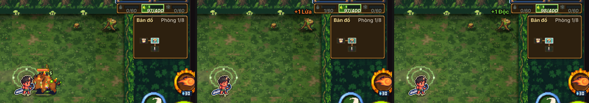
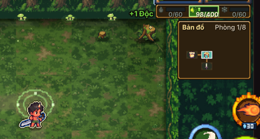

# Linh khí theo hiệu ứng đang thấy trên quái

Chủ dự án báo: vũ khí Độc + bùa Lửa, giết quái lúc nó đang cháy mà lại được **+ Độc**. Chủ dự án chọn luật:
**linh khí cộng theo hiệu ứng ĐANG THẤY trên quái lúc chết** (đang cháy thì cộng Lửa, kể cả lửa do bùa gây).

## Vì sao trước ra Độc

Luật cũ (`G.kill`, js/combat.js) lấy **hệ gây sau cùng** (`e.st.last`). Vũ khí Độc chém quái đang cháy thì độc vừa được gây
sau cùng → Độc, dù trên đầu quái là ngọn lửa to.

## Luật mới (`G.lkHeThay`, js/combat.js)

- Chỉ tính hiệu ứng của **vũ khí và bùa/trang phục**. Hiệu ứng do **chưởng** gây (`e.st.ch`) vẫn **không tính** như cũ;
  quái thường bị chưởng kết liễu vẫn không cho dấu ấn.
- Quái dính nhiều hệ cùng lúc → lấy hệ **nổi nhất**:
  - Ngọn lửa đang cháy, khối băng (đóng băng): hiệu ứng to, điểm 1–2 (theo phần thời gian còn lại).
  - Bọt độc, hạt băng làm chậm: hiệu ứng nhỏ, điểm 0–1 (theo số tầng, 5 tầng = 1).
  - Vì vậy **quái đang bốc lửa → Lửa**; đang đóng băng → Băng; chỉ có độc + băng chậm → hệ nhiều tầng hơn.
  - Hoà điểm → hệ gây sau cùng (như cũ).
- Giữ nguyên: số dấu ấn, cân bằng, mốc tiến hoá; vũ khí thứ hai nhận 1/2 vào hệ chính của nó; ải hướng dẫn 1-1 (Lửa x2, Độc x0,2);
  tinh anh/trùm không dính hệ → hệ của vùng; hạt `markOrbs`.
- Dấu hệ trên đầu quái / viền thanh máu (`LK.markEl`, js/linhkhi.js) dùng **cùng luật**, nên dấu báo trước khớp với cái nhận được
  (trước dấu này còn tính cả hiệu ứng của chưởng).
- Chữ bay "+N Lửa / +N Độc / +N Băng" đúng màu hệ, hạt linh khí đúng màu hệ (đã có sẵn). Sửa thêm: phần 1/2 của **vũ khí thứ hai**
  trước ghi đè hạt và chữ bay của vũ khí đang cầm (nên có lúc hiện sai hệ); nay vũ khí thứ hai cộng lặng lẽ (vẫn cộng đủ).

## Cờ tắt

`?lkthay=0` ở cuối địa chỉ, hoặc `G.LK_THEO_THAY = false` → luật cũ (hệ gây sau cùng, dấu trên đầu như cũ, vũ khí thứ hai hiện hạt như cũ).

## Đã kiểm (tests/au_lk_thay.py — vũ khí chính Độc, bùa Lửa; chạy cả bản nhiều tệp và bản HAI TỆP như web qua srv2.py, `linh-khi-nhe.html?cloud=0`)

| Ca | Luật mới | Luật cũ |
|---|---|---|
| A. Quái đang cháy (lửa của bùa) + độc vũ khí, vũ khí kết liễu | **+1 Lửa** | +1 Độc |
| B. Chỉ dính độc | +1 Độc | +1 Độc |
| C. Dính cả hai, cháy còn lâu hơn | **+1 Lửa** | +1 Độc |
| C2. Dính cả hai, lửa sắp tắt (vẫn đang cháy) | **+1 Lửa** | +1 Độc |
| D. Lửa do **chưởng** + độc vũ khí, vũ khí kết liễu | +1 Độc (lửa chưởng không tính) | +1 Độc |
| E. Chưởng Lửa kết liễu quái thường | không dấu ấn | không dấu ấn |
| F. Chưởng Lửa kết liễu tinh anh (độc vũ khí) | +5 Độc | +5 Độc |
| G. Đóng băng + độc | **+1 Băng** | +1 Độc |
| H. Băng chậm 2 tầng + độc 5 tầng | +1 Độc | +1 Độc |

Mọi ca: vũ khí thứ hai nhận 1/2 vào hệ chính (lặng lẽ); dấu hệ trên đầu quái trùng hệ nhận được; 0 pageerror.

Bài kiểm có sẵn: `tests/linhkhi.py` 36/36; `tests/au_he.py 10 1`, `tests/au_vu_khi.py 10 1`, `tests/au_tien_trien.py linhkhi` chạy hết,
0 lỗi; `tests/chuong.py` 48/50 — 2 mục hỏng (Mây dày, Băng vỡ) **hỏng y hệt trên mã trước phiên này**, không liên quan.

Một ca biên giữ như cũ: bùa Lửa gây Nổ khói kết liễu quái đang dính độc mà **chưa** cháy → +Độc (lúc chết quái chỉ có độc).

## Ảnh

Trái → phải: quái đang cháy + bọt độc; luật mới sau khi chém: **+1 Lửa**; luật cũ: +1 Độc.

Chỉ dính độc → +1 Độc:

Chụp lại: `python3 game/tests/lk_thay_shots.py <url bản hai tệp> <thư mục>`.
