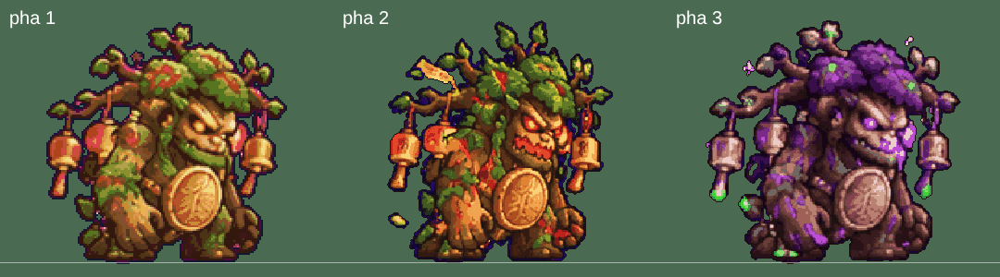
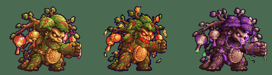

# Nhập ảnh Mộc Tinh pha 2, pha 3 (12/10)

Ảnh gốc ChatGPT (`docs/anh-goc/2026-10-12/`) → tệp game, thay hẳn bản cũ. Chỉ thay tệp ảnh, không đổi logic đổi pha, máu, sát thương.

| Ảnh gốc | Nền | Tệp game (thay) | Số khung mỗi hàng |
|---|---|---|---|
| mocTinh-pha2.png (1774×887) | hồng tím | `game/art/custom/mocTinh-p2.sprite.json` — "Mộc Tinh · pha 2 (nổi giận)" | đứng 6, lấy đà 4, tấn công 6, trúng đòn 4 |
| mocTinh-pha3.png (1944×809) | xanh dương | `game/art/custom/mocTinh-p3.sprite.json` — "Mộc Tinh · pha 3 (hoá độc)" | đứng 6, lấy đà 4, tấn công 6, trúng đòn 4 |

Giữ đúng định dạng tệp -p2/-p3 cũ: khung 168×140, `net: 2` (tấm 2688×1120), điểm chân `goc [84, 136]`, `dong_tac` idle 0/6 (1,4 s, lặp), tele 1/4 (0,7 s), atk 2/6 (0,6 s), hit 3/4 (0,3 s). Hàng đi và chết vẫn mượn pha 1 như trước.

## Cách cắt (`kiem/moctinh_pha.py`, cùng cách `nhap-anh-12-10/kiem/hotinh.py`)
- Tìm vạch lưới thật (8 cột × 4 hàng), bỏ 3–4 điểm sát vạch. Dùng đủ cả 20 khung, không bỏ khung nào.
- Xoá nền (hồng tím / xanh dương), loang qua các điểm ám màu nền ở mép; điểm mép còn ám màu nền đổi sang màu viền tối. Lấp lỗ nhỏ kín trong thân (pha 2: 941 điểm, pha 3: 1 663 điểm). Thêm viền tối 1 điểm quanh thân.
- Cỡ thân: một tỉ lệ cho cả tấm, lấy theo chiều cao khung đứng đầu = chiều cao thân pha 1 (131 điểm). Giữa thân khung đứng đặt đúng x = 84, đáy mỗi hàng đặt đúng điểm chân → đổi pha không nhảy chỗ, không đổi cỡ. Cùng quay phải như pha 1. Không điểm nào bị cắt ra ngoài khung.
- Thu ảnh bằng nearest (không nhoè), giảm còn **24 màu**, không hoà trộn. Pha 3 giữ riêng 3 màu xanh lá cho giọt độc (nếu không sẽ bị nuốt mất); bảng màu tinh chỉnh để gỗ vẫn nâu.
- Ghi chú: vệt độc xanh dương cạnh nắm đấm ở hàng tấn công pha 3 trùng màu nền nên mất khi tách nền.

## Dung lượng
- mocTinh-p2: 1,15 MB → 0,39 MB; mocTinh-p3: 1,24 MB → 0,38 MB (nhẹ đi ~1,6 MB).
- Gói hai tệp sau khi nhập và gộp với các phiên song song: 24,35 MB / trần 26 MB. Cảnh báo "tệp đầu nên dưới 5 MB" (5,05 MB) có từ trước, không do phiên này (ảnh pha nằm ở tệp tải sau).

## Kiểm
- Dựng phòng trùm Mộc Tinh (ải Rừng già 5), ép máu 100% → 60% → 30%: `b.phase` 0 → 1 → 2, game nạp đúng `mocTinh-p2`, `mocTinh-p3` (khung 168×140, net 2). Ảnh: `pha1-trong-phong.png`, `pha2-trong-phong.png`, `pha3-trong-phong.png` (`kiem/kiem_game.py`).
- 3 pha cạnh nhau, vẽ bằng chính hàm vẽ quái của game, cùng đường chân: `3-pha-canh-nhau.png`.
- Đòn tấn công 3 pha chạy cùng lúc: `tan-cong-3-pha.gif`.
- 0 pageerror ở `linh-khi.html?cloud=0` và `linh-khi-nhe.html?cloud=0`. `node --check` mọi tệp js, bài kiểm lưu mây PASS. `python3 game/build.py` và `LK_HAI_TEP=1 python3 game/build.py --hai-tep` chạy được.

