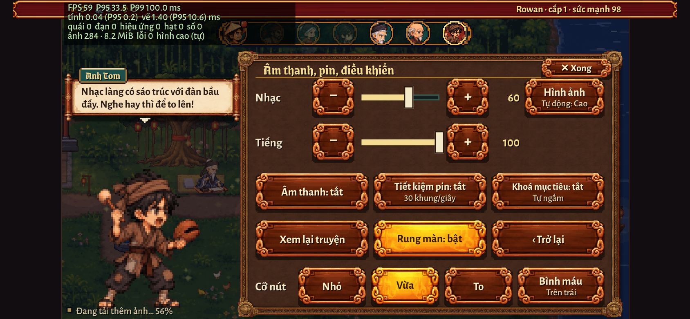
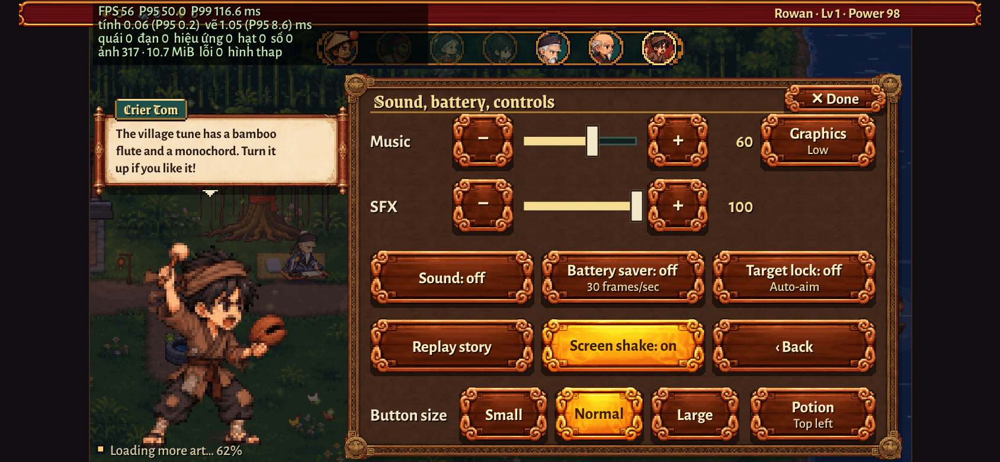

# F3 ổn định (05/11): ảnh, bộ nhớ, vòng lặp — báo cáo

Phiên F3 của kế hoạch ổn định (tư vấn ChatGPT `docs/tu-van-toan-cau/chatgpt-05-11/on-dinh-chatgpt.txt`, mục R3, R4, R6, 3 và 5).
Chỉ sửa: khối ẢNH RỜI của `game/js/sprite_custom.js`, vòng lặp trong `game/js/engine.js`, tệp mới `game/js/hieu_nang.js`
(+ một dòng nạp trong `game/index.html`, một nút trong Cài đặt ở `game/js/village.js`). **Không** đổi luật chơi, cân bằng, số quái,
hitbox, khựng hình; **không** đụng bản lưu / lưu mây / đăng nhập Google / `?cloud=0`; không đụng `.github/`, `firebase.json`, `build.py`.
Không chơi thử bằng tay — mọi số đo dưới đây là **Chromium headless** trên bản web `game/dist` (phục vụ bằng `python3 -m http.server`),
**không phải iPhone thật**.

## 1. Nói ngắn gọn (cho chủ game)

1. **Kiểm kê ảnh:** bản web có **696 tấm ảnh rời**, tải về chỉ ~17 MB nhưng khi mở ra (giải mã) chiếm tới **~589 MiB** bộ nhớ nếu giữ
   hết. Thủ phạm lớn nhất là 5 tấm thân nhân vật (Rowan / trang phục) cao **12.192 và 7.776 điểm ảnh** — mỗi tấm 34–54 MiB. Trên iPhone
   đây là rủi ro "tự đóng tab" thật sự.
2. **Trước đây** chơi lần lượt làng → vùng 1 → 2 → 3 → 4, bộ nhớ ảnh tăng mãi: 289 → 451 → 542 → **589 MiB** và không bao giờ giảm.
   **Nay** đứng quanh **187 MiB ở làng, 267–323 MiB khi chơi**, và **chuyển vùng 24 lần vẫn không tăng** (đo được, mục 4).
   Cách làm: (a) ba bộ trang phục chỉ tải khi đang mặc / đang thử (−103 MiB), (b) rời vùng thì giải phóng ảnh riêng của vùng cũ
   (quái, trùm, sàn, cửa, hiệu ứng riêng); quay lại vùng đó thì tải lại như lần đầu (thẻ ải hiện "Đang tải…" 1–2 giây).
3. **Bộ tải ảnh mới** không còn kẹt khi mạng chập chờn: tải ít tệp cùng lúc hơn (4 hoặc 8 thay vì 24), mỗi lượt có hạn giờ, ảnh hỏng
   thử lại 3 lần rồi nghỉ, cần là tải lại. Giả lập kết nối treo: **bộ cũ đứng im hơn 1 phút**, bộ mới vẫn về đủ ảnh.
4. **Ẩn tab / chuyển ứng dụng:** game dừng hẳn; mở lại không chạy bù bước nào (trước: chạy bù 5 bước, quái nhích ~83 ms).
5. **Bộ đếm hiệu năng** (mở `?perf=1` để xem) và **tự giảm hình** khi máy chậm liên tục 12 giây: bớt hạt trang trí, bớt số sát thương
   bay, tắt rung màn. Quái / đòn / luật không đổi. Người chơi chọn tay ở **Cài đặt › Âm thanh, pin, điều khiển › nút "Hình ảnh"**
   (Tự động → Cao → Thấp).
6. Mọi thay đổi có **cờ quay lui** (mục 6). Bản một tệp không đổi gì về ảnh (ảnh nhúng sẵn).

Còn lại cần làm sau (mục 7): **phần ảnh dùng chung vẫn ~187 MiB**, vượt ngân sách iPhone đề xuất (64–96 MiB) — phải chia nhỏ tấm thân
Rowan (việc của `build.py`, ghi đề xuất cho F1 / phiên sau) và cho tấm `zed-moi` (bộ ninja cũ) thôi tải khi đang dùng Rowan.

## 2. Kiểm kê ảnh (bản web, đo trên `game/dist` dựng hôm nay)

Bộ nhớ giải mã ước tính = rộng × cao × 4 byte (RGBA). "Tải" = tệp thật người chơi nhận (WebP khi có, không thì PNG). Danh sách đủ
696 tấm: [`kiem-ke-anh.csv`](kiem-ke-anh.csv) (sắp theo bộ nhớ, lớn trước). Công cụ: `cong-cu/kiem_ke.py`.
(Con số "~720" của tư vấn gồm cả 37 tấm cũ chỉ tải khi bật cờ quay lui `?anhmuotcu=1`… — không tính ở đây; ảnh truyện / bìa tải riêng.)

| Nhóm | Loại | Số tấm | Tải (MB) | Giải mã (MiB) | Cạnh dài nhất | > 2048 |
|---|---|---:|---:|---:|---:|---:|
| chung | đồ (do) | 14 | 0.00 | 0.1 | 36 | 0 |
| chung | thân em bé | 3 | 0.04 | 0.5 | 360 | 0 |
| chung | giao diện | 279 | 0.83 | 10.5 | 1472 | 0 |
| chung | hiệu ứng | 195 | 2.12 | 62.6 | 2752 | 7 |
| chung | người làng | 8 | 0.15 | 2.0 | 444 | 0 |
| chung | zed (Rowan, trang phục, vũ khí) | 8 | 1.12 | **213.6** | **12192** | 5 |
| V1 Rừng già | giao diện (sàn, cửa, trang trí) | 31 | 0.03 | 0.6 | 128 | 0 |
| V1 Rừng già | hiệu ứng riêng | 7 | 0.02 | 0.3 | 416 | 0 |
| V1 Rừng già | quái + trùm + dáng pha | 15 | 3.43 | 80.5 | 2410 | 2 |
| V2 Hang biển | giao diện | 31 | 0.06 | 0.6 | 128 | 0 |
| V2 Hang biển | hiệu ứng riêng | 7 | 0.08 | 1.0 | 1024 | 0 |
| V2 Hang biển | quái + trùm + dáng pha | 15 | 3.25 | 78.5 | 2272 | 3 |
| V3 Lâu đài cổ | giao diện | 31 | 0.07 | 0.7 | 136 | 0 |
| V3 Lâu đài cổ | hiệu ứng riêng | 3 | 0.03 | 0.6 | 876 | 0 |
| V3 Lâu đài cổ | quái + trùm + dáng pha | 15 | 3.73 | 89.9 | 2988 | 3 |
| V4 Sông sâu | giao diện | 20 | 0.08 | 0.9 | 330 | 0 |
| V4 Sông sâu | hiệu ứng riêng | 7 | 0.04 | 0.5 | 564 | 0 |
| V4 Sông sâu | quái + trùm + dáng pha | 7 | 2.03 | 45.5 | 3438 | 3 |
| **Tổng** | | **696** | **17.10** | **588.8** | | **23** |

Ảnh vượt 2048 điểm ở một cạnh (rủi ro iPhone; 5 tấm đầu **≥ 4096**):

| Mã | Loại | Vùng | Rộng × cao | Giải mã (MiB) | Mức |
|---|---|---|---|---:|---|
| `zed-moi` (ninja cũ) | zed | chung | 1152 × 12192 | 53.6 | **≥ 4096** |
| `zed-rowan` | zed | chung | 1152 × 12192 | 53.6 | **≥ 4096** |
| `zed-bien` (trang phục) | zed | chung | 1152 × 7776 | 34.2 | **≥ 4096** |
| `zed-lau` (trang phục) | zed | chung | 1152 × 7776 | 34.2 | **≥ 4096** |
| `zed-rung` (trang phục) | zed | chung | 1152 × 7776 | 34.2 | **≥ 4096** |
| `hoTinh` | trùm | V3 | 2988 × 2520 | 28.7 | > 2048 |
| `mocTinh-p3` | dáng pha trùm | V1 | 2288 × 2410 | 21.0 | > 2048 |
| `hoTinh-p2` | dáng pha trùm | V3 | 2848 × 1710 | 18.6 | > 2048 |
| `hoTinh-p3` | dáng pha trùm | V3 | 2976 × 1630 | 18.5 | > 2048 |
| `thuongLuong` | trùm | V4 | 3438 × 1260 | 16.5 | > 2048 |
| `nguTinh` | trùm | V2 | 2272 × 1752 | 15.2 | > 2048 |
| `mocTinh-p2` | dáng pha trùm | V1 | 2336 × 1470 | 13.1 | > 2048 |
| `nguTinh-p2`, `nguTinh-p3` | dáng pha trùm | V2 | 2272 × 1460 | 12.7 mỗi tấm | > 2048 |
| `thuongLuong-p3` | dáng pha trùm | V4 | 3056 × 1008 | 11.8 | > 2048 |
| `thuongLuong-p2` | dáng pha trùm | V4 | 2674 × 1008 | 10.3 | > 2048 |
| `hu-doi-pha`, `hu-ngu-tinh-mo-man`, `hu-trum-no` (+ `-fire`, `-ice`, `-poison`), `hu-xoay-nuoc` | hiệu ứng | chung | 2208–2752 × 204–328 | 1.7–3.4 mỗi tấm | > 2048 |

Nhận xét: một vùng (quái + trùm + nền) ≈ 46–91 MiB; phần chung ≈ 289 MiB, trong đó **5 tấm thân nhân vật = 210 MiB** (36 % tổng).

## 3. Đã làm gì

### 3.1 Bộ tải ảnh rời (`sprite_custom.js`, khối ẢNH RỜI) — theo mục 3.4

- **Số tải cùng lúc thích nghi**: máy yếu (`navigator.deviceMemory ≤ 3`, `hardwareConcurrency ≤ 3`, Tiết kiệm dữ liệu hoặc mạng 2G)
  4 tệp; máy thường 8 (hình màn chào / làng / đang cần) và 6 (phần còn lại); trùm / vùng khác 1 hoặc 2. Trước: 24 / 16 / 3.
  Giải mã cùng lúc: 1 (yếu) / 2. Máy yếu **không tải trước** vùng kế. (Máy kiểm tra ở đây có 2 lõi nên tự nhận là "máy yếu".)
- **Tải bằng `fetch` + `AbortController`**: 12 s chưa có trả lời, hoặc 12 s không thêm byte nào, thì huỷ và thử lại. Sau 4 s chưa có
  trả lời thì **trả chỗ sớm** cho ảnh khác (tối đa 8 lượt như vậy) — một kết nối treo không chặn cả hàng.
- **Hàng giải mã riêng** (tải xong mới giải mã), **hình game đang cần được giải mã trước**. Đồng hồ canh 8 s: trả chỗ giải mã nhưng
  **không tạo lượt `decode()` mới** cho cùng ảnh (chờ tiếp lượt đó thêm 30 s rồi mới coi là hỏng). `decode()` không trả lời mà ảnh đã
  nạp: 250 ms trả chỗ, 2 s coi như xong (như sửa lỗi 22/10).
- **Thử lại tăng dần** 1 s → 3 s → 9 s (có độ lệch ngẫu nhiên), **tối đa 3 lần mỗi đợt** rồi nghỉ; đợt mới khi game cần hình đó
  (`roiCan`), có mạng lại, quay lại app, hoặc bấm "Thử lại" ở màn chờ vùng. WebP hỏng → PNG như cũ.
- **Thế hệ (generation)**: đổi vùng (chọn vùng khác / vào ải vùng khác) thì huỷ lượt tải dở của ảnh riêng vùng không còn cần, vùng đã
  chọn trước đó thôi tải; kết quả muộn của lượt cũ bị bỏ.
- **Trạng thái từng ảnh** `it.tt`: idle / queued / fetching / decoding / ready / failed / evicted; mọi lỗi ghi theo mã ảnh + lý do
  (`http-404`, `fetch-qua-gio`, `fetch-dung-im`, `giai-ma-loi`, `giai-ma-cham`, `giai-ma-treo`, …): `G.spriteCustom.roi.thongKe()`.
- Giữ hai sửa lỗi 22/10: hình đang cần mà hỏng thì tải lại ngay (tối đa mỗi 15 s); lượt treo không kẹt hàng.
- **Người chơi đang đứng ở màn chờ vùng** ("Đang tải…" khi vào ải): ảnh vùng đó lên ưu tiên cao nhất, trước cả ảnh làng còn lại
  (thêm sau khi cổng kiểm của F1 bắt được: với 4 tệp cùng lúc, vào ải 1-1 ngay sau khi mở game phải chờ ảnh làng xong trước → smoke test
  "Vào ải 1-1" hỏng; sửa xong thì đạt).

### 3.2 Quản lý bộ nhớ (chỉ bản web)

- Cộng **pixel đã giải mã đang giữ** của mọi ảnh rời (`G.spriteCustom.roi.boNho()`).
- **Ngân sách** (ước tính rộng × cao × 4): máy yếu 64 MiB, iPhone / iPad 96 MiB, máy khác 128 MiB.
- **Rời vùng** (hoặc ảnh vùng mới về mà vượt ngân sách) → **giải phóng ảnh riêng của vùng không còn chơi** (quái, trùm + dáng pha, sàn,
  tường, cửa, trang trí, hiệu ứng riêng vùng), cũ nhất trước, tới khi dưới 85 % ngân sách. **Giữ**: Rowan, giao diện, làng, ảnh chung,
  vùng đang chơi + vùng đang chọn (+ vùng mà vùng 4 mượn hình), trùm vùng đang chơi, hình vừa được game hỏi trong 20 s.
  Ảnh bị bỏ: tháo ảnh khỏi bộ nhớ, đánh dấu chưa có; quay lại vùng đó thì thẻ ải "Đang tải…" và tải lại như lần đầu
  (trình duyệt thường còn tệp trong bộ nhớ đệm nên chỉ giải mã lại, ~1–2 s đo ở đây).
- **Ba bộ trang phục** (`zed-rung`, `zed-bien`, `zed-lau`, 34 MiB mỗi tấm) chỉ tải khi **đang mặc** hoặc game cần vẽ (thử đồ); chưa về
  thì game vẽ tạm bộ mặc định như trước nay vẫn làm. Lúc đổi vùng mà quá ngân sách thì bỏ tấm không mặc.
- Bản một tệp (`dist/linh-khi.html`): ảnh nhúng sẵn, **không đổi**.

### 3.3 Vòng lặp (`engine.js`)

Vòng lặp vốn đã có bước cố định 1/60 s, kẹp thời gian trôi 100 ms, tối đa 5 bước / khung và bỏ phần dư → chỉ bổ sung phần thiếu:
**ẩn tab / chuyển app** (`visibilitychange`, `pagehide`, trang về từ bfcache) thì **dừng hẳn** (không tính, không vẽ); quay lại thì đặt
lại mốc thời gian, **bỏ phần tồn** (không chạy bù bước nào). Đo thêm thời gian tính / vẽ mỗi khung cho bộ đếm hiệu năng.

### 3.4 Bộ đếm hiệu năng + tự giảm hình (`hieu_nang.js`)

- Luôn ghi vào bộ nhớ (không gửi đi đâu): FPS, P95 / P99 khoảng cách khung, thời gian tính / vẽ (trung bình + P95), số quái / đạn /
  hiệu ứng / hạt / số bay, MiB ảnh đang giữ, số lỗi tải ảnh, nhật ký các lần tự đổi bậc. Đọc: `G.hieuNang.lay()`. `?perf=1`: bảng số nhỏ
  góc trên trái.
- **Bậc hình**: Cao (như cũ) / Vừa (hạt × 0,6, bụi × 0,6, số bay tối đa 5) / Thấp (hạt × 0,35, bụi × 0,3, chuyển động môi trường × 0,5,
  **rung màn tắt**, số bay tối đa 4). Chỉ qua `G.VFX` và `G.theme.DOC.soToiDa` — khựng hình (`G.VFX.khung`), quái, hitbox, luật không đụng.
- **Tự động** (mặc định): chỉ khi đang đánh trong ải (không tạm dừng / mở bảng), bỏ 10 s đầu sau khi vào ải / quay lại app; một giây "chậm"
  khi P95 > 25 ms; **chậm 12 giây liền** → hạ một bậc; **mượt 60 giây liền** (P95 < 18,5 ms) → nâng lại một bậc.
- **Cài đặt › Âm thanh, pin, điều khiển**: nút **"Hình ảnh"** cuối hàng Nhạc (hai thanh âm lượng ngắn lại cho vừa), bấm Tự động → Cao →
  Thấp; lưu theo máy (`localStorage` khoá `tw-chat-luong`, **không vào bản lưu**). Chữ EN + VI qua từ điển sẵn có. Ảnh chụp:

  
  

## 4. Số đo trước / sau (Chromium headless, 844×390, máy chủ cục bộ)

"Trước" = cùng bản dựng với cờ `?taicu=1&bonhocu=1` (bộ tải cũ, không giải phóng, tải cả 3 trang phục — đúng hành vi trước phiên này).
Ải trùm (i = 4) để tính cả trùm + dáng pha. Công cụ: `cong-cu/hanh_trinh.py`; kết quả gốc: `ket-qua/ht_*.log`.

| Mốc | Trước: MiB ảnh đang giữ | Sau (máy yếu): MiB | Sau (giả máy thường): MiB | Sau: chờ vào ải |
|---|---:|---:|---:|---:|
| Làng (mở game xong) | 289.4 (6,5 s) | 186.9 (10,0 s) | 186.9 | — |
| Vùng 1 | 450.7 | 268.2 | 268.2 | 1,0–1,5 s |
| Vùng 2 | 542.0 | 266.9 | 266.9 | 0,7–1,4 s |
| Vùng 3 | 588.8 | 278.1 | 278.1 | 0,7–1,3 s |
| Vùng 4 | 588.8 | 322.0 | 323.3 | 1,3–2,2 s |
| Làng (cuối) | 588.8 | 313.8 (sau 24 lần đổi) | 313.8 | — |
| **Chuyển vùng 24 lần** (1→2→3→4 × 6) | — | **dao động 268–323, không tăng** (1.347 lượt giải phóng) | như bên trái | 0,8–2,0 s |

Vùng 4 cao hơn vì còn mượn hình của một vùng khác (giữ cả hai). Lỗi JS: 0 ở mọi lượt.

Thời gian tải (mạng giả 1,5 Mbps + 150 ms, `ket-qua/mp_cham*.log`):

| | Ảnh làng + ảnh lõi xong | Hình đang cần (`zed-vk-gan`) về sau khi game hỏi |
|---|---:|---:|
| Trước (24 tệp cùng lúc) | 27,9 s | 0,9 s |
| Sau, máy yếu (4 tệp) | 35,4 s | 0,3 s |
| Sau, giả máy thường (8 / 6 tệp) | 28,4 s | 0,4 s |

Máy yếu tải xong chậm hơn ~25 % (đổi lấy ít việc cùng lúc, đỡ RAM); máy thường như cũ; hình đang cần về nhanh hơn ở cả hai.

## 5. Kết quả giả lập lỗi (`cong-cu/mo_phong_f3.py`, `cong-cu/vong_lap.py`; log ở `ket-qua/`)

| Bài | Bộ mới | Bộ cũ (`?taicu=1`) |
|---|---|---|
| **404**: 1/7 số ảnh + `zed-vk-gan` trả 404 trong 26 s | Hàng không kẹt (430 về, 74 "failed", 0 đang tải); hết lỗi → game hỏi gân → về **ngay**; "Thử lại" → đủ 506 / 506; vào vùng 1 bình thường. 0 lỗi JS | Cũng về đủ (sửa lỗi 22/10 giữ nguyên). 0 lỗi JS |
| **Mạng chậm** 1,5 Mbps | Không lỗi nào; số ở mục 4 | Không lỗi nào |
| **Kết nối treo** (16 ảnh: 2 lượt đầu máy chủ im lặng) | Mỗi lượt treo bị huỷ sau 12 s, ảnh khác vẫn chạy; 45 s: 499 / 506; **75 s: 506 / 506, cả 16 ảnh treo đều về** | **Đứng im**: 331 ảnh từ giây 20 tới giây 75, 9 lượt giữ chỗ, 166 ảnh chờ (kể cả gân) |
| **`decode()` treo** (30 ảnh không bao giờ trả lời) | 25 s: đủ 506 / 506, gân về ngay khi hỏi | Đủ 506 (sửa lỗi 22/10) |
| **Ảnh hỏng** (WebP rác → phải về bằng PNG; 13 ảnh cả WebP lẫn PNG rác) | WebP rác về bằng PNG; ảnh rác cả hai: 3 lần thử rồi "failed" (vẽ bằng code), **hàng không kẹt** (493 về + 10 failed + 3 đang chờ thử lại ở 40 s), gân về | — |
| **Gân 22/10** (chặn 4 lượt đầu `zed-vk-gan`) | Tự về trong lượt thử thứ 3 (9 s), không cần hỏi | — |
| **Chuyển vùng 20+ lần** | MiB không tăng (mục 4) | Tăng tới 589 MiB và giữ |
| **Ẩn / hiện tab** (giả `document.hidden` + `requestAnimationFrame` ngừng như trình duyệt thật, ẩn 5 s) | Khung đầu sau khi hiện: **G.time nhảy 0 s** (0 bước) | `?vonglapcu=1`: nhảy 0,083 s (5 bước) |
| **Stress 5 phút**: 30 quái không chết + bot tự đánh | **0 lỗi JS**; vẫn trong ải; 30 quái, 13–52 hiệu ứng, 170–350 hạt, ≤ 8 số bay; ảnh giữ 268 MiB không đổi. Máy kiểm tra không có GPU (P95 33–67 ms) nên **tự hạ** Cao → Vừa (giây 27) → Thấp (giây 68); `G.VFX.khung` giữ 1 | — |
| `?chatluong=cao` | Ép bậc Thấp vẫn ra Cao, nút "Hình ảnh" khoá | — |

**Cổng kiểm của F1** (`LK_BO_DUNG=1 bash tools/phat-hanh/cong_kiem.sh`, sau khi gộp mã F1 + F2 mới nhất): **ĐẠT** cả 7 bước — node --check,
bài lưu mây, kiểm ảnh, gói site, trần dung lượng, smoke test 14 / 14 bước (vào ải 1-1, di chuyển, đánh, né, đổi vũ khí, lưu → tải lại,
EN / VI). Lần chạy đầu smoke test hỏng ở "Vào ải 1-1" (xem 3.1, ưu tiên màn chờ vùng) — đã sửa và chạy lại hành trình vùng + kết nối treo:
số như trên.

Kiểm khác: `node --check` 83 tệp `game/js` OK; `tests/cloud_save_regression.test.js` PASS; `tests/vung4.test.js` PASS
(`tests/luyen.test.js` hỏng sẵn từ trước phiên này — cùng lỗi chữ "Lão Cây Gai… Rừng Gai 5" khi chạy trên mã chưa sửa, không liên quan);
bài 22/10 `gan-web-khong-tai/cong-cu/mo_phong.py A` vẫn qua.
Dung lượng: **bản một tệp 27,04 MB / 30**; **người chơi tải web 19,54 MB / 20** (như trước; thực tế còn ít hơn vì ba trang phục không
mặc không tải); tải trước vùng đầu ~5,4 MB.

## 6. Cờ quay lui

| Cờ | Tác dụng |
|---|---|
| `?taicu=1` | Bộ tải cũ (img.src, 24 / 16 / 3 tệp, thử lại 3 s và 10 s, sửa lỗi 22/10) |
| `?bonhocu=1` | Không giải phóng ảnh vùng cũ, tải cả ba trang phục như trước |
| `?chatluong=cao` | Luôn hình Cao, không tự giảm, bỏ qua lựa chọn đã lưu |
| `?vonglapcu=1` | Vòng lặp như trước (không dừng khi ẩn tab) |
| `?perf=1` | Chỉ để xem bảng số hiệu năng (không đổi gì khác) |
| `?mayyeu=1` | Cho kiểm thử: ép coi là máy yếu |

## 7. Đề xuất (không tự làm — thuộc tệp của phiên khác hoặc ngoài phạm vi)

**Cho `game/build.py` (F1 hoặc phiên sau):**
1. **Chia nhỏ 5 tấm thân nhân vật** `zed-moi`, `zed-rowan` (1152 × 12192) và `zed-rung/bien/lau` (1152 × 7776) thành các trang
   ≤ 2048 điểm (theo nhóm động tác: đứng / chạy / đánh từng vũ khí / lộn …), để (a) không có ảnh ≥ 4096 trên iPhone, (b) chỉ giải mã
   trang đang dùng. Đây là chỗ lớn nhất còn lại: 210 MiB.
2. Trùm và dáng pha > 2048 (11 tấm, 10–29 MiB): cắt thành trang ≤ 2048 hoặc xếp kín khung (cách `tam_n3/n4` đã làm cho nét cao).
3. Ghi kích thước (rộng, cao) của mỗi ảnh vào `_u` (thông số ảnh rời) để bộ tải biết bộ nhớ **trước khi** tải (nay chỉ biết sau khi giải mã);
   khi có, có thể chặn tải trước vùng kế theo ngân sách chính xác hơn.
4. Bảng ảnh "critical theo vùng" trong manifest (cùng việc buildId / manifest của F1) để bài kiểm trước khi đăng (smoke test) đối chiếu
   "100 % ảnh bắt buộc vùng đầu ready".

**Cho mã ngoài phạm vi F3:**
5. `js/vien_vk.js` (dựng mặt nạ vũ khí) đòi `zed-moi` **đã tải ảnh** dù chỉ dùng số liệu (`T.tep`) → nếu đổi sang `zed-rowan` / chỉ cần
   `tep`, bộ tải có thể không tải `zed-moi` khi đang dùng Rowan (−53,6 MiB).
6. 195 tấm hiệu ứng dùng chung (62,6 MiB) đang tải hết sau màn chào; có thể gom theo vũ khí / hệ và chỉ tải bộ của vũ khí đang mang.
7. Đo trên **iPhone thật** (Safari): ngân sách 96 MiB cho iOS là theo tư vấn, chưa kiểm trên máy. `hardwareConcurrency` trên Safari có thể
   khác nên máy được nhận "yếu / thường" cần xem lại bằng `?perf=1` + `G.spriteCustom.roi.thongKe().may`.

## 8. Công cụ, tệp

- `cong-cu/kiem_ke.py <cổng> <json ra>` — kiểm kê (dùng cho bảng mục 2 và `kiem-ke-anh.csv`).
- `cong-cu/hanh_trinh.py <cổng> '<cờ>' [số lần chuyển thêm] [Mbps] [thuong|iphone]` — MiB ảnh đang giữ theo hành trình vùng.
- `cong-cu/mo_phong_f3.py <cổng> <404|cham|treo-mang|treo-giai-ma|anh-hong|gan> ['<cờ>'] [thuong]` — giả lập lỗi.
- `cong-cu/vong_lap.py <cổng> <an-hien|stress> ['<cờ>'] [giây] [cpu x]` — ẩn / hiện tab, stress.
- `cong-cu/chup_cai_dat.py <cổng> <thư mục ra>` — ảnh chụp Cài đặt.
- Dựng trước khi chạy: `LK_ANH_ROI=1 python3 game/build.py --hai-tep`, rồi `cd game/dist && python3 -m http.server <cổng>`.

## 9. Commit

Nhánh `khoi-tao-du-an`: *"F3 ổn định: bộ tải ảnh rời mới (fetch có hạn giờ, giải mã riêng, thử lại tăng dần, trạng thái từng ảnh), giải
phóng ảnh vùng cũ theo ngân sách bộ nhớ, trang phục chỉ tải khi mặc, dừng vòng lặp khi ẩn tab, bộ đếm hiệu năng + tự giảm hình (?taicu=1,
?bonhocu=1, ?chatluong=cao, ?vonglapcu=1) + dựng lại dist"* — mã commit ghi ở dòng dưới sau khi đẩy.
