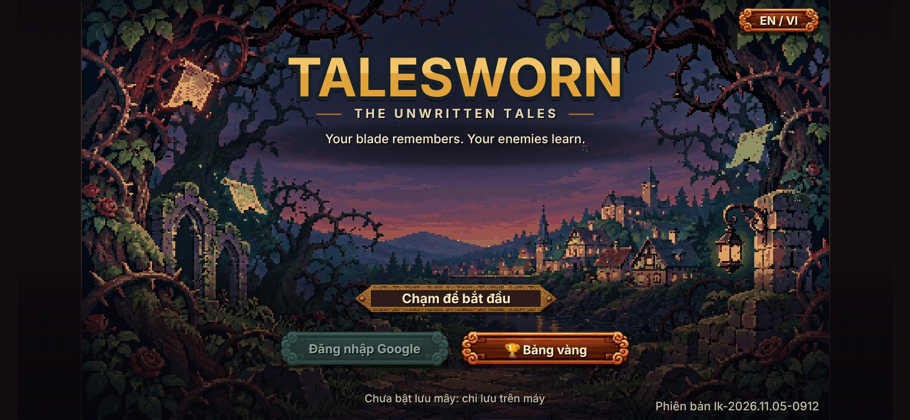
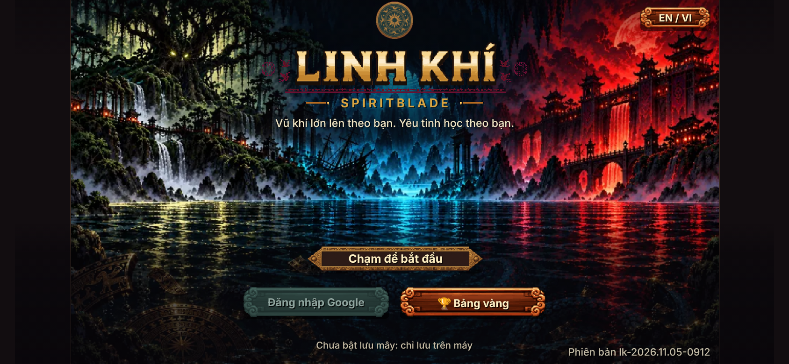
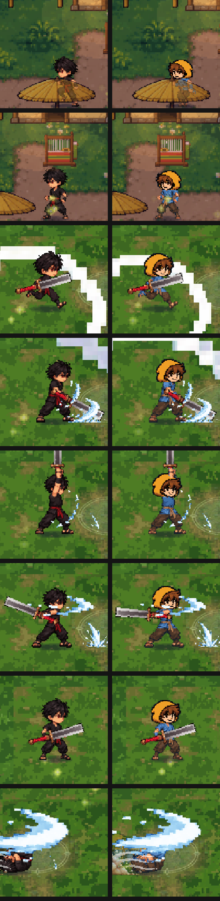
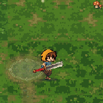

# Talesworn — phiên C: hình Rowan + màn đầu (05/11/2026)

## Tóm tắt cho chủ game

- **Rowan đã thay Cu Tí trên màn hình** (đặt làm mặc định). Áo lam, quần nâu sẫm, đai da, **mũ trùm vàng nghệ** — đầu cắt từ ảnh ChatGPT, thân là bộ ninja cũ đổi màu. **Mọi động tác giữ nguyên** (đứng, đi, chạy, 3 nhát kiếm, kiếm nặng, thương, búa, phi tiêu, né, trúng đòn, chết), vũ khí vẫn nằm đúng tay.
- **Màn đầu mới**: tranh rừng gai nhìn ra làng xa (ảnh ChatGPT, thu nét kiểu điểm ảnh), chữ **TALESWORN**, dòng **THE UNWRITTEN TALES** và câu **"Your blade remembers. Your enemies learn."** Đã bỏ trống đồng và chữ LINH KHÍ khắc gỗ ở màn đầu.
- Đăng nhập Google, lưu mây, `?cloud=0`, bản lưu cũ: **không đụng**. Rowan chỉ là HÌNH — bộ đồ, kỹ năng bộ, giá, bản lưu vẫn như cũ.
- Dung lượng: web tải đầu **19,41 MB / 20 MB** (Rowan thêm khoảng 0,3 MB). Bản một tệp **26,79 MB / 30 MB**.

## Ảnh trước / sau

| | |
|---|---|
| Màn đầu MỚI |  |
| Màn đầu CŨ (`?mandau=cu`) |  |
| Ninja (trái) / Rowan (phải), phóng ×3: làng chạy, làng đứng, rừng chạy, chém 1, chém 2, chém 3, đứng, né |  |
| Rowan chạy rồi chém 3 nhát (GIF) |  |

Ảnh chụp 844×390 (như iPhone xoay ngang): `anh/rung-dung.png`, `rung-chay.png`, `rung-chem1..3.png`, `rung-ne.png`, `lang-dung.png`, `lang-chay.png`.
Bảng soát từng khung (trên: ninja, dưới: Rowan): `xem-truoc-dung-chay-kiem.png`, `xem-truoc-thuong-bua.png`, `xem-truoc-lon-trung-chet.png`.

Soát bằng mắt trên ảnh headless:
- Đầu không lệch, không giật giữa các khung đứng / chạy / chém (đầu dán theo cằm và tâm mặt cũ từng khung).
- Mũ vàng + áo lam nổi rõ trên nền rừng xanh và trên đường đất ở làng.

## Làm thế nào (không vẽ tay)

1. **Thân**: công cụ đổi màu theo bảng. Vải đen trên đai → áo lam (#3E6FA8, 4 cấp sáng tối theo độ sáng gốc); vải đen dưới đai → quần nâu sẫm; đai đỏ → da thuộc (#986342); cổ tay áo sát bàn tay → lam; nét viền tối nhất → #18202A.
2. **Đầu**: cắt đầu + mũ trùm góc 3/4 trước-phải trong `rowan-4-goc-nguon-chatgpt.png`, thu nét về rộng 32 điểm ảnh (mỗi điểm lấy màu có thật xuất hiện nhiều nhất trong ô, không trung bình nên không nhoè). Mỗi khung tự tìm mặt cũ, xoá tóc + mặt cũ, dán đầu mới. Khung quay lưng / tay che mặt → dán đầu nhìn từ sau (góc thứ 3 của ảnh ChatGPT), dán sau tay. Khung nằm sấp (chết) → đầu xoay ngang.
3. Neo vũ khí, nắm tay, số khung, nhịp: dùng chung với bộ ninja (cùng ô, cùng chỗ).

Công cụ: `docs/anh-goc/zed/trang-phuc/bo-5-rowan/dung-rowan.py` (chạy lại được; ghi `game/art/custom/zed-rowan.sprite.json`, bảng khung `bao-cao-khung.json`). Màn đầu: `tools/anh-truyen/dung.py bia-3-talesworn` → `game/art/bia/bia-3-talesworn.webp|jpg`. Ảnh gốc giữ ở `docs/tu-van-toan-cau/chatgpt-05-11/`. Chụp soát: `cong-cu/chup.py`.

## Cờ quay lui

| Cờ | Tác dụng |
|---|---|
| `?zedbo=ninja` | Về hình ninja cũ (Rowan tắt) |
| `?zedbo=rowan` | Như mặc định |
| `?mandau=cu` | Màn đầu cũ (2 tranh cây đa / dòng sông ngẫu nhiên, chữ LINH KHÍ, trống đồng) |
| `?bia=1` / `?bia=2` / `?bia=3` | Ép một tranh màn đầu |

## Chỗ còn yếu (đã chấp nhận, không ảnh hưởng chơi)

- **Lộn tròn (né), 3 khung giữa (0,27 giây)**: chưa có đầu cuộn tròn, đang đổi tóc đen thành màu mũ → nhìn thoáng như tóc vàng dựng.
- **Trúng đòn** ngửa đầu: đầu mới vẫn thẳng (không ngửa theo), lẫn vài sợi tóc cũ màu lam ở mép trái.
- **Búa nện khung 2 / kiếm 3 cũ khung 1–2** (tay giơ qua đầu): đầu nhìn từ sau, hơi to so với tay. Kiếm 3 cũ chỉ hiện khi tắt kiếm nặng (`?kiemnang=0`).
- Quai dép ở bàn chân lúc chạy có chỗ bị đổi sang lam.
- Ba bộ Rừng / Biển / Lâu đài vẫn đầu tóc đen cũ (chưa ghép đầu Rowan).
- Tên bộ mặc định trong Hành trang vẫn là "Ninja Bóng Đêm" (đổi tên thuộc phiên B).
- Chữ TALESWORN tạm bằng phông đang dùng (Be Vietnam Pro, repo chưa có Pixelify Sans / Silkscreen); logo vẽ tay làm sau.
- Làng Hollin (`lang-hollin-nguon-chatgpt.png`) chưa làm (để đợt sau như yêu cầu).

## Danh sách "cần ảnh"

Prompt ChatGPT ngắn (tiếng Anh, nền magenta #FF00FF) ở `docs/yeu-cau-anh/talesworn-rowan/README.md`:
1. `rowan-dau-lon.png` — đầu mũ trùm lúc cuộn tròn (4 góc xoay).
2. `rowan-dau-8-huong.png` — đầu 8 hướng cùng cỡ (cho trúng đòn / vặn người).
3. `rowan-ao-choang-vai.png` — áo choàng vai vàng nghệ (tuỳ chọn, cho mảng vàng to hơn).

## Tệp đã sửa

- Mới: `game/art/custom/zed-rowan.sprite.json`, `game/art/bia/bia-3-talesworn.{webp,jpg,mo.jpg}`, `docs/anh-goc/zed/trang-phuc/bo-5-rowan/`.
- `game/js/zed_moi.js` (chọn tấm Rowan, dùng chung bảng số zed-moi), `game/js/data.js` (cờ `G.ROWAN_HINH`), `game/js/bia.js` (tranh 3, không phóng mờ), `game/js/village.js` (logo chữ TALESWORN ở màn đầu), `game/index.html` (màn tải chọn tranh 3), `game/build.py` (danh sách tranh), `tools/anh-truyen/dung.py` (thu nét tranh 3), `game/dist/*` dựng lại.
- KHÔNG đụng: `stage.js`, `slice_chu.js` (phiên A), bảng dịch / `truyen.js` / tiêu đề trang (phiên B).

## Kiểm tra đã chạy

`node --check` các tệp JS đã sửa; `python3 game/build.py`; `LK_ANH_ROI=1 python3 game/build.py --hai-tep`; chụp headless 844×390. Không chạy bộ test (chủ game chưa yêu cầu).

## Commit

Xem dòng cuối mục này sau khi đẩy.
