# Talesworn — phiên D: gắn ảnh ChatGPT 05/11 vào game (05/11/2026)

## Tóm tắt cho chủ game

- **Bản thử 5 phút đầu thôi mượn ảnh tạm.** Trang Mực Lửa bay, khiên Fire Guard quanh Toadstool King (4 khung phập phồng, khi Băng phá thì **vỡ thành mảnh băng**), biểu tượng Fire Guard trên đầu trùm, Thương Băng nằm đất có vòng sáng, mặt nút **ĐỔI** (gỗ, góc đồng, 2 mũi tên vòng), **Page Scrap** rơi ra khi hạ trùm và hiện hình ở màn kết quả — tất cả là ảnh ChatGPT vẽ, code chỉ cắt, tách nền, thu nét.
- Khiên Fire Guard **trong mờ**: nhìn xuyên thấy trùm bên trong, không có viền hồng.
- **Rowan sửa 3 chỗ yếu** (dùng 16 đầu mới cùng nét): lộn tròn có đầu mũ trùm cuộn tròn (hết "tóc vàng dựng"), trúng đòn **ngửa đầu, nhăn mặt**, khung quay lưng dùng đầu sau-phải 3/4 đúng tỉ lệ. Đã xoá mấy sợi tóc cũ màu lam, quai dép không còn bị nhuộm lam.
- **HUD bản 2**: đã cắt sẵn 7 khung (thanh máu, thanh linh lực, 2 ô vũ khí vuông, 2 khung nút tròn, bảng giấy da). **Mặc định TẮT.** Thử bằng `?hudmoi=1` — xem ảnh so sánh bên dưới rồi quyết.
- Luật chơi, cân bằng, đăng nhập Google, lưu mây, `?cloud=0`, bản lưu cũ: **không đụng**. Chỉ là HÌNH.
- Dung lượng: web tải đầu **19,47 MB / 20 MB** (trước 19,42; thêm ~0,05 MB). Bản một tệp **26,93 MB / 30 MB**.

## Ảnh trước / sau (chụp 844×390 như iPhone xoay ngang)

Trên là MỚI, cùng cảnh bản cũ (`?slicecu=1`) có tên `-cu`.

| Cảnh | Mới | Cũ (ảnh mượn) |
|---|---|---|
| Trang Mực Lửa bay vào (phòng 3) | 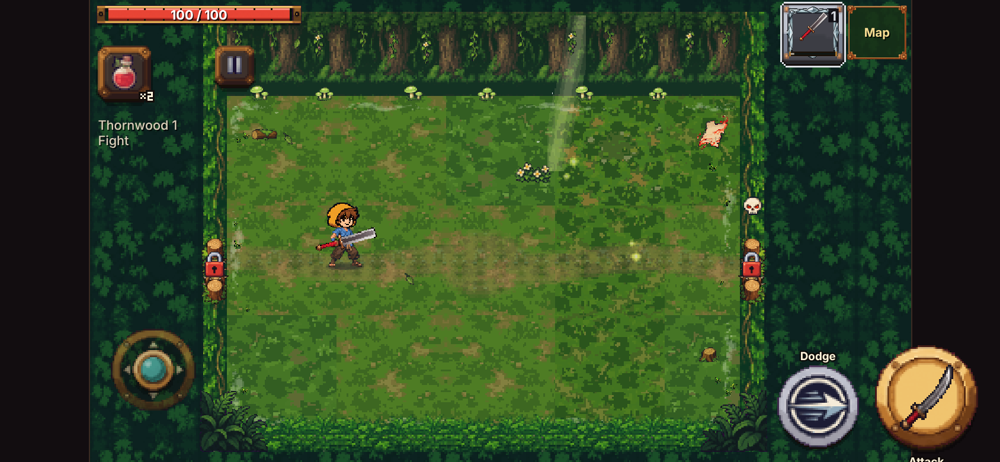 |  |
| Thương Băng nằm đất | 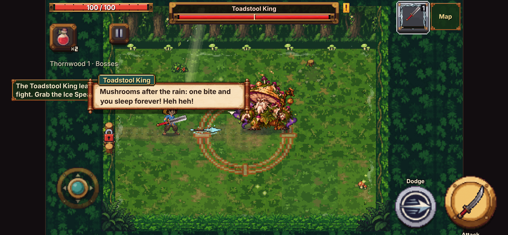 | 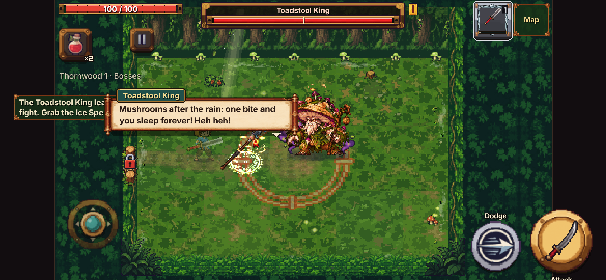 |
| Nhặt Thương Băng → nút ĐỔI | 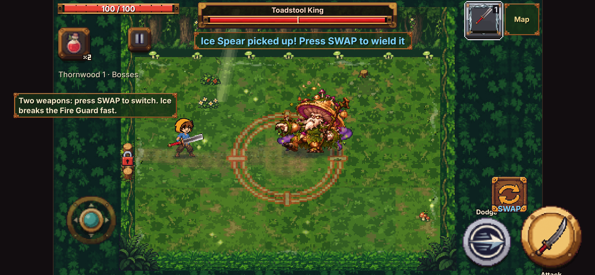 |  |
| Fire Guard đứng | 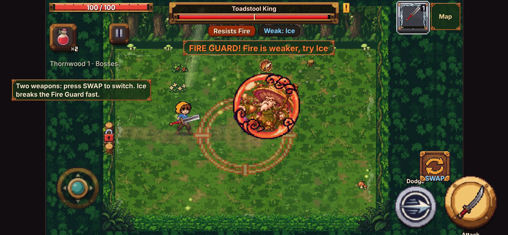 | 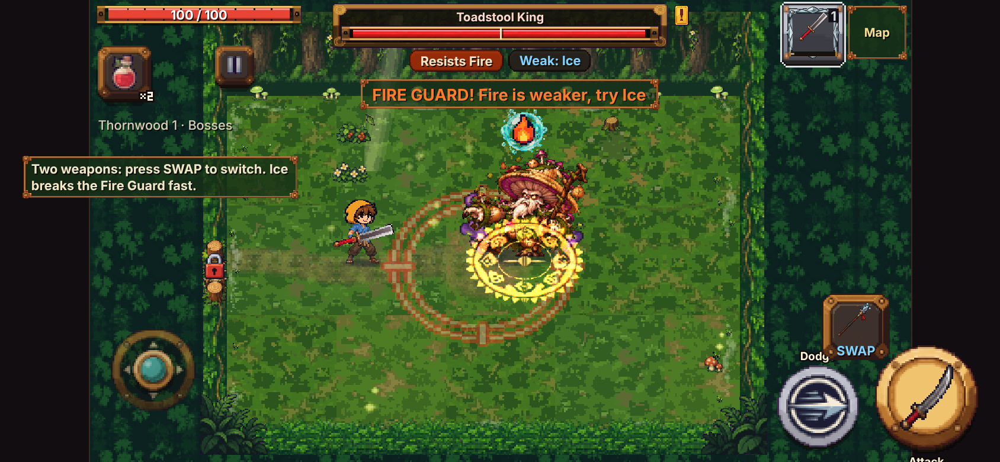 |
| Fire Guard vỡ (khung 5) | 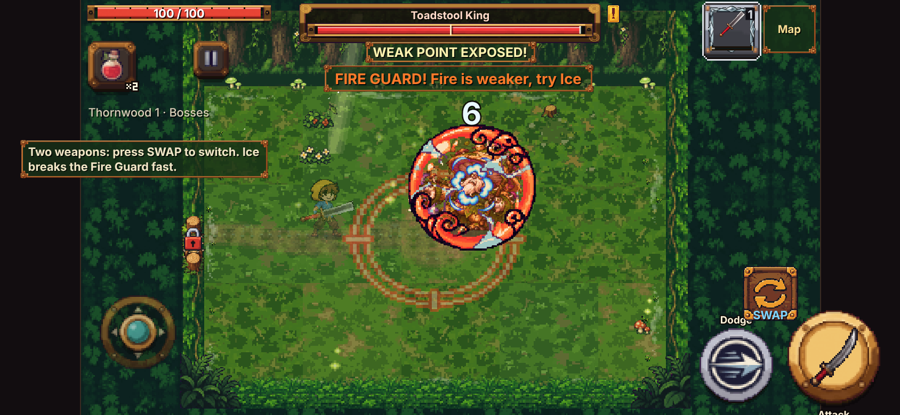 | 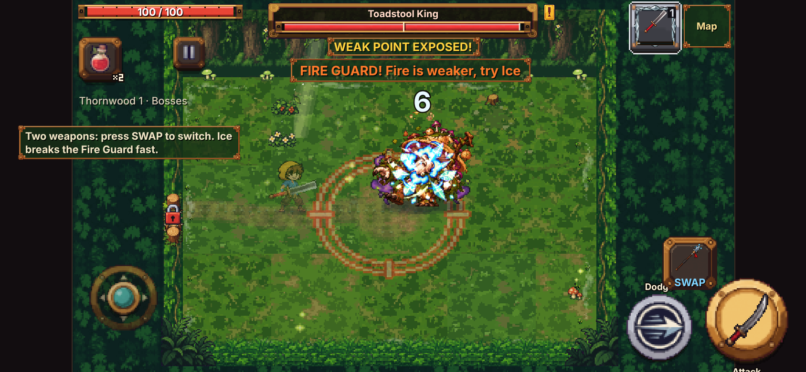 |
| Fire Guard vỡ (khung 6, mảnh băng) |  | 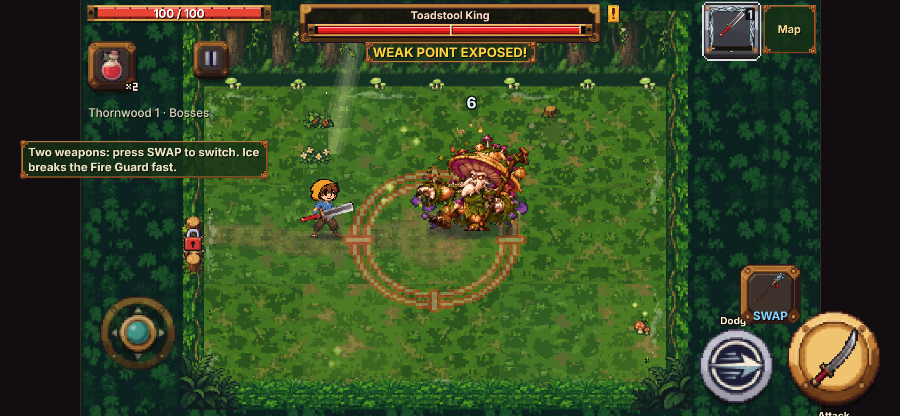 |
| Hạ trùm: Page Scrap rơi ra | 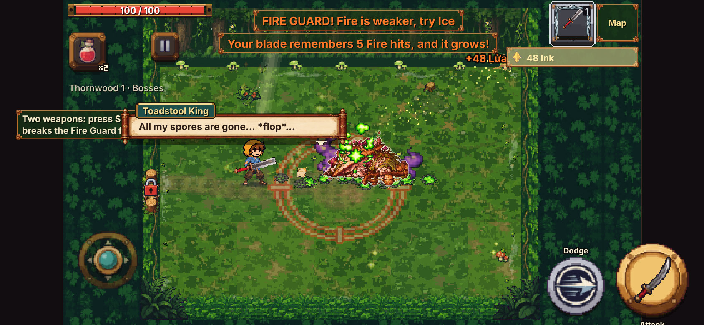 |  |
| Màn kết quả: biểu tượng Page Scrap | 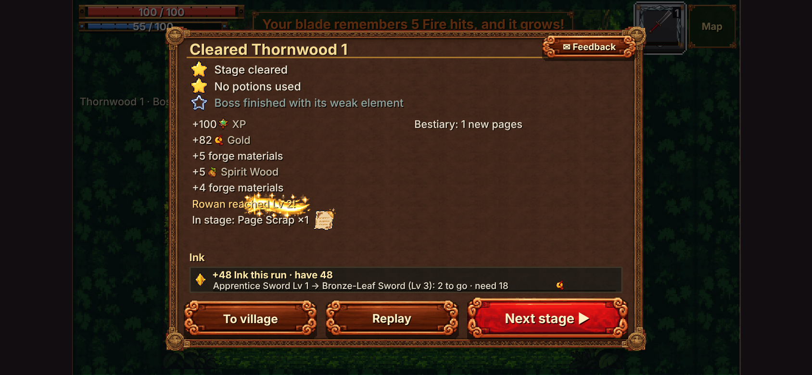 | 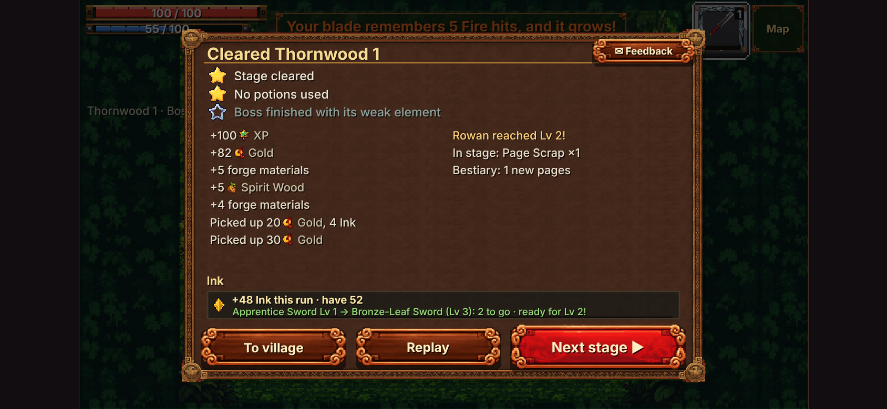 |

Bảng ảnh đã cắt (phóng ×3): `anh/cat-slice-x3.png` (trang 6 khung, khiên 6 khung, biểu tượng, Page Scrap, nút ĐỔI, Thương Băng 4 khung).

### Rowan (GIF phóng ×3, chậm ×2 để soát; TRÁI = phiên C, PHẢI = phiên D)

| Động tác | GIF |
|---|---|
| Lộn tròn (né) | 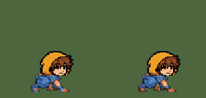 |
| Trúng đòn | 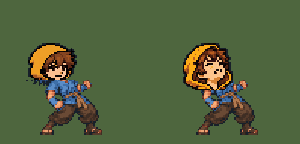 |
| Đứng | 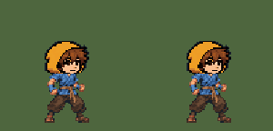 |
| Chạy | 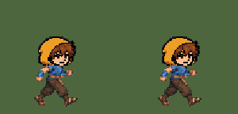 |
| Chém 3 nhát | 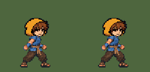 |

Bảng soát từng khung (trên: phiên C, dưới: phiên D): `anh/xem-truoc-lon-trung-chet.png`, `anh/xem-truoc-quay-lung.png`, `anh/xem-truoc-dung-chay-kiem.png`.
Trong trận: `anh/rowan-trong-tran-dung.png`, `-chay.png`, `-ne.png`, `-chem.png`.

Soát bằng mắt từng khung phóng to:
- Lộn tròn (3 khung giữa): đầu mũ trùm cúi gập, xoay theo vòng lộn (trên-phải → dưới-trái → phải), cỡ bằng mảng tóc cũ, không còn chỏm tóc vàng dựng, không lòi tóc cũ.
- Trúng đòn khung 1–2: đầu ngửa đau; khung 3–4 đầu thường; cằm nối cổ đúng chỗ, không giật.
- Đứng / chạy / chém: không đổi so với phiên C (đầu vẫn dán theo cằm và tâm mặt từng khung), vũ khí vẫn đúng tay (neo vũ khí giữ nguyên).

### HUD bản 2 (`?hudmoi=1`, MẶC ĐỊNH TẮT)

| | |
|---|---|
| So sánh góc HUD phóng to (trên: hiện tại, dưới: `?hudmoi=1`) | 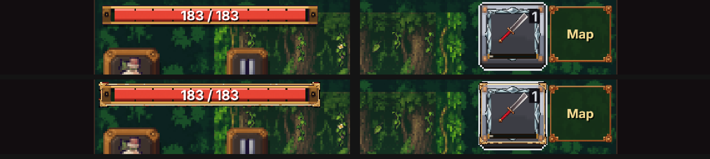 |
| Toàn màn hiện tại | 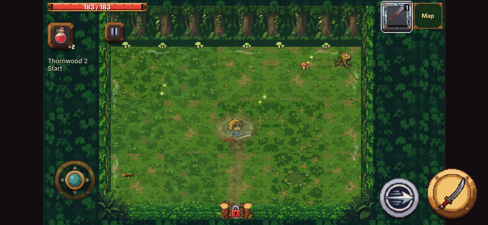 |
| Toàn màn `?hudmoi=1` |  |
| 7 khung đã cắt (phóng ×2) | 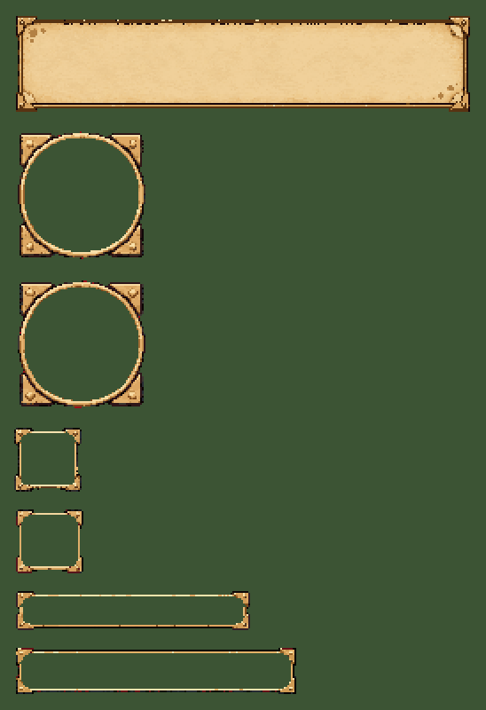 |

Nhận xét: khung mới mảnh, góc đồng kiểu bìa sách hợp hướng Talesworn; nhưng đang **phủ lên** khung cũ (ô vũ khí vẫn thấy viền bạc bậc ép đồ bên trong). Nếu chủ game chọn bản 2, phiên sau sẽ thay hẳn khung cũ (không phủ chồng) và dùng tiếp khung nút tròn + bảng giấy da.

## Cờ quay lui

| Cờ | Tác dụng |
|---|---|
| `?slicecu=1` | Bản thử 5 phút đầu dùng lại ảnh mượn cũ (phiên A) |
| `?rowancu=1` | Rowan phiên C (đầu cũ) — chỉ bản web (bản một tệp không mang tấm cũ cho nhẹ) |
| `?hudmoi=1` | BẬT thử khung HUD bản 2 (thanh máu + ô vũ khí). Mặc định tắt |
| `?slice=0`, `?zedbo=ninja` | Như trước (tắt bản thử / về ninja cũ) |

## Làm thế nào (không vẽ tay)

1. **Tách nền magenta** theo công thức sổ tay mục 2.7 + bỏ hẳn điểm "ám hồng" (pha lẫn nền) → không viền hồng.
2. **Thu nét**: mỗi ô lấy màu có thật xuất hiện nhiều nhất (ưu tiên viền tối) — không trung bình nên không nhoè. Cỡ theo bảng 001-trang-muc.md: trang 24×24, khiên 64×64, biểu tượng 16×16, Page Scrap 18×18 (vẽ 10×10 khi rơi, 17×18 ở màn kết quả), nút 40×40, Thương Băng 40×24.
3. **Khiên trong mờ**: ảnh gốc để lòng khiên trong suốt (nền hồng lộ qua) → lòng khiên phủ lại một lớp màu cam của chính vành khiên, độ trong ~18%.
4. **Thương Băng 4 khung**: cùng một hình, đổi độ trong của vòng sáng dưới thương (1 → 0,8 → 0,6 → 0,8).
5. **Rowan**: mở rộng `dung-rowan.py` — đọc thêm tấm 16 đầu, thu nét cùng tỉ lệ với đầu đang dùng; khung lộn tròn xoá tóc cũ quanh chỗ đầu (cả tóc dựng chĩa ra ngoài) rồi dán đầu cúi gập xoay; trúng đòn dán đầu ngửa đau, xoá tóc cũ rộng hơn + dọn vụn lẻ; khung quay lưng dán đầu sau-phải 3/4; mảng da ở 30% dưới hình là bàn chân (không phải bàn tay) nên vải đen sát chân thành quần nâu.
6. **HUD**: cắt 7 khung cùng một tỉ lệ, bỏ lòng tối (như các khung 9 mảnh sẵn có: game tự tô lòng), ghi "vien" để co giãn 9 mảnh.

Công cụ (chạy lại được):
- `docs/anh-goc/talesworn-d/cat-anh-slice.py [--xem]` → `game/art/custom/hu-trang-muc-lua`, `hu-fire-guard`, `hu-thuong-bang-dat`, `gd-bt-fire-guard`, `gd-page-scrap`, `gd-nut-doi` (.sprite.json)
- `docs/anh-goc/talesworn-d/cat-hud-v2.py [--xem]` → `gd-hud2-thanh-mau`, `gd-hud2-thanh-linh-luc`, `gd-hud2-o-vk`, `gd-hud2-o-vk-2`, `gd-hud2-nut-tron`, `gd-hud2-nut-tron-2`, `gd-hud2-bang-giay`
- `docs/anh-goc/zed/trang-phuc/bo-5-rowan/dung-rowan.py [--xem]` → `zed-rowan.sprite.json` (bản cũ giữ ở `zed-rowan-daucu.sprite.json`; `--phien-c` dựng lại kiểu phiên C để so)
- Chụp soát: `cong-cu/chup.py <html> <thư mục ra>`

## Dung lượng

| | Trước (phiên C) | Sau |
|---|---|---|
| Web tải đầu (người chơi tải) | 19,42 MB | **19,47 MB** / 20 MB |
| Bản một tệp | 26,79 MB | **26,93 MB** / 30 MB |
| Ảnh mới | — | 6 ảnh bản thử ~84 KB, 7 khung HUD ~33 KB (tệp .sprite.json) |
| Tấm Rowan cũ `zed-rowan-daucu` | — | chỉ nằm trên máy chủ, chỉ tải khi `?rowancu=1`, không tính tải đầu |

## Tệp đã sửa

- Mới: 13 tệp `game/art/custom/*.sprite.json` ở trên + `zed-rowan-daucu.sprite.json`; `docs/anh-goc/talesworn-d/`; báo cáo + ảnh + `cong-cu/chup.py`.
- `game/js/slice.js`: vẽ ảnh thật (trang, Thương Băng, khiên + khung vỡ, biểu tượng, nút ĐỔI, Page Scrap rơi), `SL.veKetQua` (biểu tượng ở màn kết quả), cờ `?slicecu=1`. Ảnh chưa tải xong thì vẽ ảnh mượn như cũ.
- `game/js/stage.js`: gọi `G.slice.veKetQua` sau dòng chữ màn kết quả; khung HUD bản 2 sau cờ `?hudmoi=1`.
- `game/js/sprite_custom.js` + `game/build.py`: mục "dau_cua"/"dau_moi" cho tấm Rowan cũ (như cách tấm sàn cũ "san_cua"), cờ `?rowancu=1`.
- `game/art/custom/zed-rowan.sprite.json`, `dung-rowan.py`, `bao-cao-khung.json` (khung lộn: `L`).
- Ghi "đã gắn" vào `docs/yeu-cau-anh/talesworn-slice/001-trang-muc.md`, `docs/yeu-cau-anh/talesworn-rowan/README.md`.
- `game/dist/*` dựng lại.

## Còn yếu / để sau

- Biểu tượng Fire Guard 16×16 trên đầu trùm hơi nhỏ trên điện thoại (đúng cỡ yêu cầu; có thể phóng 20 nếu chủ game muốn).
- Chữ ĐỔI/SWAP vẫn nằm đè mép dưới mặt nút (như phiên A).
- Lộn tròn hàng cũ (`lon`, chỉ dùng khi tắt hàng mới ~16) giữ như phiên C.
- HUD bản 2 mới chỉ phủ chồng để xem thử (xem trên).
- Áo choàng vai Rowan (tuỳ chọn) chưa có ảnh.

## Kiểm tra đã chạy

`node --check` các tệp JS đã sửa; `python3 game/build.py`; `LK_ANH_ROI=1 python3 game/build.py --hai-tep`; chụp headless 844×390 (kịch bản cố định, không chơi tay). Không chạy bộ test.

## Commit

`c543884c` — "Talesworn (D): gắn ảnh ChatGPT 05/11 — bản thử 5 phút đầu thôi mượn ảnh (…), Rowan 16 đầu (…), cắt sẵn khung HUD bản 2 (?hudmoi=1, mặc định tắt) + dựng lại dist" (đã đẩy lên khoi-tao-du-an, nằm sau `318cf22b`).
