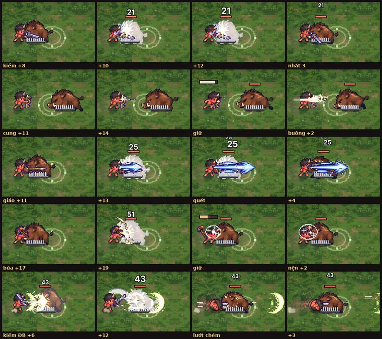
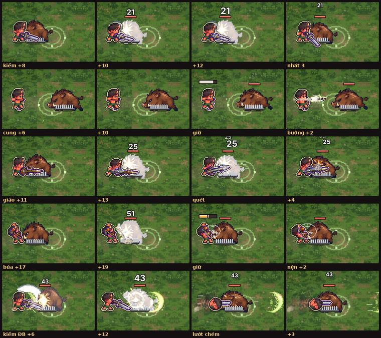
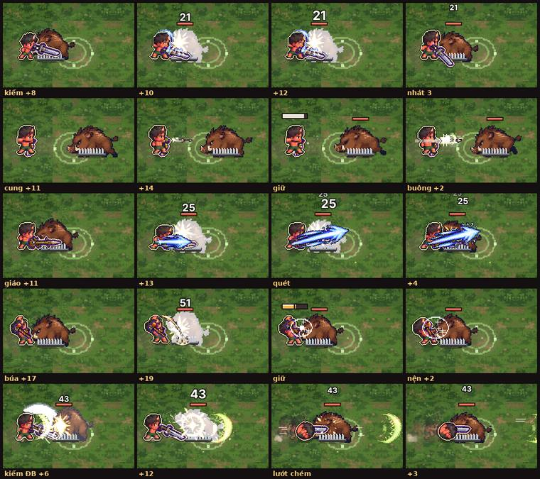
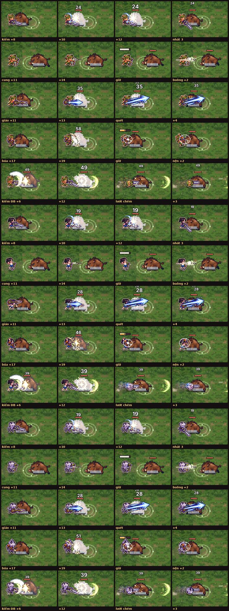

# Sửa vệt chém (12/10)

Chủ dự án báo: "hiệu ứng slash của cung, giáo, búa, kiếm sao lại mất rồi". Chỉ bản HAI TỆP (web) bị: vệt đòn ở đó vẽ bằng ảnh AI (`hu-chem-kiem`, `hu-dam-giao`, `hu-chem-bua`, `hu-quet-giao`, `hu-ban-cung`…).

## Nguyên nhân (đã thử bật/tắt từng cờ, chụp cùng cảnh)

1. **Độ đọc trận (2f4971a8, 79dad15b)** — làm nhạt MỌI hình của em bé xuống 62% (`G.theme.DOC.fxBe`), kể cả vệt đòn. Thêm nữa, **viền + bóng mờ quanh bé** (`fx.vienBe`, bóng 32%, viền 80%) được vẽ SAU mọi hiệu ứng, nên phủ lên vệt kiếm / búa vung sát đầu → vệt kiếm gần như mất hẳn.
2. **Vệt bám mũi vũ khí khi vũ khí ảnh AI co nhỏ (`G.CO_VK`, a1261e5c)** — cỡ vệt tính theo độ dài vũ khí đã co: giáo còn 0,59 lần cỡ cũ (1,06 thay vì 1,80), búa 0,75 lần → vệt giáo / búa bé và mảnh.
3. **Ảnh chưa tải xong** — đã kiểm: `G.fxAnh.co()` chỉ đúng khi ảnh đã `onload`, mọi chỗ gọi (`anhHe`, `K.anh`, `anhVkDat`) đều trả false lúc chưa có ảnh nên vệt code vẫn vẽ. Không phải lỗi, không sửa.
4. Ảnh dáng đòn theo vũ khí (`G.DON_VK`) không đổi vị trí vệt (bật/tắt không khác).

## Đã sửa (chỉ hình, không đổi luật chơi / sát thương) — `game/js/fx.js`

- Mỗi hình hiệu ứng nhớ `o.vd` = **vệt đòn của em bé**: `cut, cres, slash, thrust, dashline, crack, stuck, ring, flash`, ảnh `hu-chem*, hu-dam*, hu-quet*, hu-ban-cung*, hu-ra-chieu*, hu-ra-chuong*, hu-tram-nguyet*, hu-nen-dat*, hu-trung*, hu-chi-mang, hu-pha-giap`, và hình hệ ngắn (`he` < 0,5 giây).
  Vệt đòn **không bị làm nhạt**; chỉ hạt bụi, khói, nổ hệ, vùng hệ lâu, cột, gai… vẫn nhạt như Độ đọc trận (`o.mo`).
- Vệt đòn của bé vẽ **SAU viền quanh bé**: `drawOver` bỏ chúng, `fx.vienBe` vẽ lại ngay sau viền. Viền + số gọn của Độ đọc trận giữ nguyên. Tắt viền (`?doctran2=0`) thì vẽ như cũ.
- Vệt bám mũi vũ khí **không nhỏ hơn cỡ cũ**: giáo bắt đầu từ sau chỗ cầm và phóng dài quá mũi giáo (cỡ như bản cũ); kiếm, búa: tâm cung vẫn ở chỗ cầm, bán kính ≥ cỡ cũ.
- Cờ quay lui: `G.VET_DAM = false` (nhạt + dưới viền như phiên Độ đọc trận), `G.VET_CO = false` (cỡ theo mũi như a1261e5c).

## Ảnh (bản hai tệp, cùng cảnh: 1 quái máu dày cạnh bé)

Hàng: kiếm (3 khung + nhát 3) · cung (bắn, giữ, buông) · giáo (đâm, quét/đâm lấy đà) · búa (vung, giữ, nện) · kiếm đặc biệt + lướt chém.

| Bản cũ ff4a440 | Trước khi sửa | Sau khi sửa |
|---|---|---|
|  |  |  |

Ba em bé còn lại sau khi sửa (hunter, healer, wrestler): 

## Kiểm

- `node --check` mọi tệp js, `cloud_save_regression.test.js` PASS, `python3 game/build.py` và `LK_HAI_TEP=1 python3 game/build.py --hai-tep` chạy được.
- Chụp 4 em bé × 4 vũ khí, thêm `?doctran2=0` và `DOC.lopPhu = true`: 0 pageerror. `tests/smoke.py`: errors []. `tests/fx_check.py`: 64 cảnh báo "phép biến đổi canvas" có sẵn từ trước (giống hệt khi bỏ phần sửa).
- Chụp lại: `LK_HAI_TEP=1 python3 game/build.py --hai-tep; python3 docs/review/ke-hoach-cai-thien/vet-chem/chup-vet-chem.py game/dist 8811 ra.png smith` (đường dẫn trong script viết cho máy thử).
