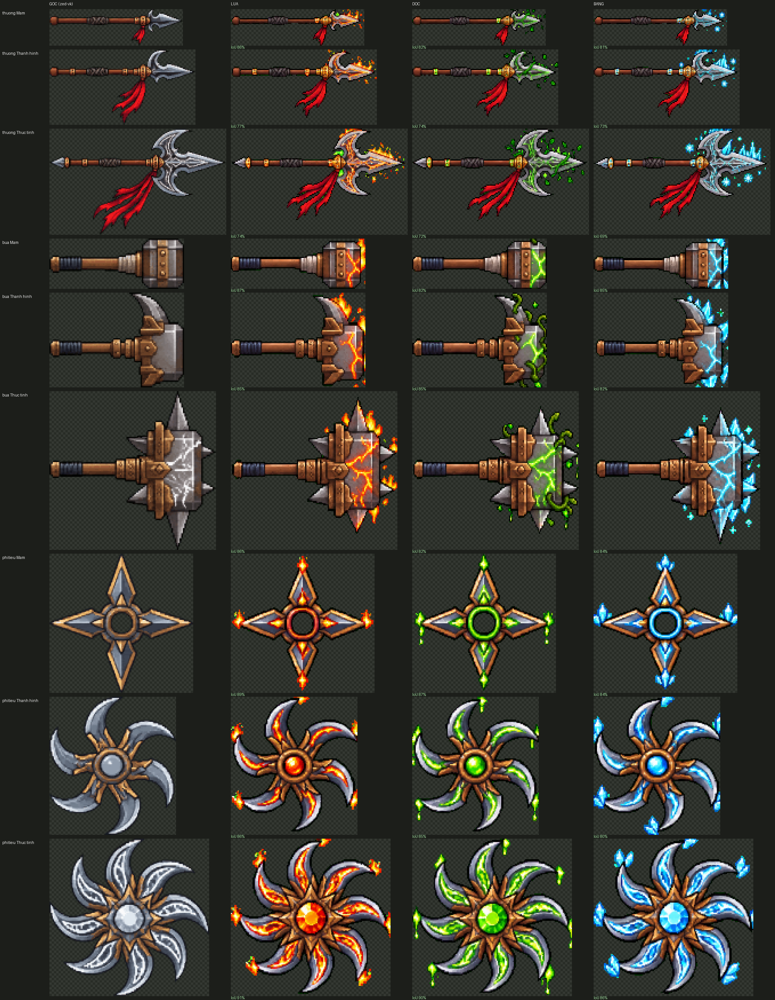

# Thương / búa / phi tiêu có vân hệ (22/10)

Chủ game hỏi *"thương tôi gửi rồi mà"* — 3 tấm ảnh hệ (thương, búa, phi tiêu; commit `4a600f6c`) đã có trong repo nhưng **chưa được gắn
vào game**: trước giờ chỉ **kiếm vuông** có ảnh theo hệ, thương / búa / phi tiêu vẫn lấy ảnh thường rồi nhuộm 30 % màu hệ. Lần này gắn
cả 3 tấm vào, và đổi luật ưu tiên để ảnh hệ không bị ảnh "gân" che.

**Chỉ hình**, không đổi cân bằng (không đụng `moves.js` / `combat.js` / `luyen.js`), không đụng đăng nhập Google / lưu mây / `?cloud=0`.
**Không chơi thử** (theo dặn): chỉ dựng ảnh, soát bằng số và ảnh ghép, `node --check`, dựng dist rồi đẩy lên để chủ game tự xem.

## 1. Đã gắn gì

Tấm `game/art/custom/zed-vk-he.sprite.json` (tải sau ở bản web) nay có thêm **27 ô**: `vk.thuong` / `vk.bua` / `vk.phitieu` × 3 hệ
(Lửa / Độc / Băng) × 3 cấp (Mầm / Thành hình / Thức tỉnh; cấp Trắng = `null`, dùng ảnh thường). Các ô kiếm vuông **giữ nguyên từng điểm
ảnh** (kiểm bằng máy: 0 điểm đổi), chỉ dán thêm phía dưới. Tấm từ 469×247 → 469×1375 điểm ảnh, tệp 43 KB → 173 KB.

Script dựng: `docs/anh-goc/zed/dung-vk-he-3-loai.py` (chạy từ gốc repo), làm theo cách `dung-kiem-vuong-he.py` đã làm cho kiếm vuông:

1. Bỏ nền xanh. Hệ **Độc** vẽ vân / nhuỵ bằng xanh lá rất gần màu nền nên luật cũ của kiếm vuông xoá mất → vân Độc thủng lỗ (phi tiêu Độc
   chỉ khớp 80 % gốc). Luật mới: chỉ coi là nền khi xanh *thuần*; xanh gần thuần chỉ bị bỏ khi nằm sát nền (≤ 2 điểm) → vân Độc trong
   thân vũ khí được giữ (phi tiêu Độc lên 87–90 %).
2. Tách 9 ô. Ba tấm này không có dải trống ngang giữa các hàng (tua đỏ / lửa của cột Thức tỉnh thò sát hàng dưới) nên gom theo tâm từng
   mảnh thay vì cắt theo dải trống; giữ mọi mảnh rời (tàn lửa, giọt độc, mảnh băng).
3. **Căn với ảnh thường cùng cấp** (khung gốc đã dựng tấm zed-vk): tìm tỉ lệ + dời sao cho mặt nạ hai hình chồng khít nhất (IoU), rồi đặt
   vào ô **đúng rộng × cao** của ô thường (game so cỡ ô, lệch là bỏ) bằng cùng phép co → thân vũ khí trùng chỗ thân gốc, **điểm cầm /
   nắm tay / hướng mũi giữ nguyên**. Thu nhỏ kiểu nét như kiếm vuông. Phần lửa / băng tràn ra ngoài ô bị cắt (ghi %).

## 2. % khớp từng ô

IoU = phần chung / phần hợp của hai mặt nạ (thấp chủ yếu vì tua đỏ vẽ khác và phần trang trí thò ra ngoài, không phải vì lệch thân);
"phủ gốc" = bao nhiêu % hình ảnh thường được ảnh hệ phủ (đo trong ô game); "lệch cầm" = lệch đầu cán (phi tiêu: lệch tâm) tính bằng
điểm ảnh ô game — tất cả ≤ 2 điểm ảnh ô (= 1 điểm ảnh game).

| Vũ khí | Cấp | Ô | Lửa IoU / phủ gốc / cắt tràn | Độc IoU / phủ gốc / cắt tràn | Băng IoU / phủ gốc / cắt tràn | Lệch cầm lớn nhất |
|---|---|---|---|---|---|---|
| Thương | Mầm | 117×32 | 86 % / 85 % / 0,6 % | 82 % / 86 % / 0,4 % | 81 % / 84 % / 2,4 % | 0,5 |
| Thương | Thành hình | 128×66 | 77 % / 85 % / 1,4 % | 74 % / 84 % / 1,9 % | 73 % / 84 % / 4,0 % | 1,0 |
| Thương | Thức tỉnh | 155×93 | 74 % / 81 % / 1,3 % | 72 % / 83 % / 1,0 % | 69 % / 82 % / 2,0 % | 1,0 |
| Búa | Mầm | 118×44 | 87 % / 89 % / 5,5 % | 82 % / 89 % / 15 % | 85 % / 89 % / 5,5 % | 0,5 |
| Búa | Thành hình | 118×83 | 85 % / 94 % / 5,3 % | 85 % / 93 % / 5,3 % | 82 % / 91 % / 4,2 % | 2,0 |
| Búa | Thức tỉnh | 146×139 | 86 % / 90 % / 0,9 % | 82 % / 89 % / 0,3 % | 84 % / 90 % / 0,9 % | 2,0 |
| Phi tiêu | Mầm | 126×122 | 89 % / 90 % / 0,8 % | 87 % / 92 % / 0,6 % | 84 % / 91 % / 1,1 % | 0,6 |
| Phi tiêu | Thành hình | 111×121 | 86 % / 94 % / 2,9 % | 85 % / 94 % / 2,5 % | 80 % / 95 % / 6,2 % | 1,6 |
| Phi tiêu | Thức tỉnh | 140×138 | 91 % / 94 % / 1,2 % | 90 % / 94 % / 0,5 % | 86 % / 94 % / 1,8 % | 1,4 |

Ghi chú: thương IoU thấp hơn hai loại kia vì thân mảnh (lệch 1 điểm là mất nhiều %) và tua đỏ gen khác dáng; thân cán và mũi thương
chồng khít (xem `can-thuong.png`). Búa Độc Mầm "cắt tràn 15 %" là giọt độc rơi dưới đầu búa nằm ngoài ô (ô Mầm thấp 44 điểm) — phần thân
không mất. Số chi tiết: `so-lieu.json`.

Ảnh soát:

- `vk-he-3-loai-x3.png` — ảnh ghép đúng cỡ ô game ×3: mỗi vũ khí × cấp một hàng: ảnh thường | Lửa | Độc | Băng.
- `can-thuong.png`, `can-bua.png`, `can-phitieu.png` — căn ở cỡ ảnh gốc: gốc | hệ đã căn | chồng (xám = trùng, đỏ = chỉ gốc, lam = chỉ hệ).

## 3. Luật ưu tiên: ảnh hệ > ảnh gân

Trước: trong `anhVk` (`js/zed_moi.js` trên tay, `js/vk_moi.js` ô đồ / nút / Phi Thương) ảnh **gân** tiến độ đứng trước ảnh hệ, nên hễ
có gân (nay là Lv 2, 3–5, 6–11 theo phiên gan-tu-moc) thì ảnh hệ bị che.

Nay: **có ảnh hệ (cấp ≥ 1 và đã chọn hệ, tấm đã tải về) thì dùng ảnh hệ**; ảnh gân chỉ dùng khi **không** có ảnh hệ (Trắng Lv 2; hoặc
tấm hệ chưa tải về; hoặc kiếm cũ khi tắt kiếm vuông). Kết quả theo ý chủ game:

| Cấp Luyện | Hình thái | Thấy gì trên vũ khí (cả 4 loại) |
|---|---|---|
| Lv 1 | Trắng | ảnh thường |
| Lv 2 | Trắng | ảnh gân (như cũ) |
| Lv 3–5 | Mầm | **vân hệ Mầm** |
| Lv 6–11 | Thành hình | **vân hệ Thành hình** |
| Lv 12+ | Thức tỉnh | **vân hệ Thức tỉnh** |

`js/vien_vk.js G.vkHeAnh` vốn đã đọc `vk[loại]` cho mọi loại (chỉ kiếm vuông đổi khoá sang `kiem_vuong`), nên chỉ thêm cờ tắt và chú
thích; `G.vkGan` (phiên gan-tu-moc, đã pull về trước khi sửa) không đổi. Tấm `zed-vk-he` vẫn **tải sau** ở bản web (`build.py` ~dòng 513);
`G.vkHeAnh` tự gọi `SC.canAnh('zed-vk-he')` khi cần → ảnh về là hiện, chưa về thì tạm ảnh gân / ảnh nhuộm như cũ.

## 4. Cờ tắt (quay lui)

- `?hevk=0` — tắt ảnh hệ của **riêng thương / búa / phi tiêu** → 3 loại này về y như trước 22/10 (ảnh thường nhuộm 30 % màu hệ, gân như cũ).
- `?kiemvuonghe=0` — vẫn tắt riêng ảnh hệ kiếm vuông (giữ nguyên).
- `?vkhe=0` — tắt toàn bộ ảnh hệ; `?gan=0` — tắt gân (giữ nguyên).

## 5. Kiểm và dung lượng

- `node --check` `vien_vk.js`, `zed_moi.js`, `vk_moi.js`: OK.
- `python3 game/build.py`: bản một tệp **26,19 MB** / trần 30 MB (trước 26,07 MB; +0,12 MB là tấm hệ to thêm).
- `LK_ANH_ROI=1 python3 game/build.py --hai-tep`: OK — người chơi tải (web) **19,10 MB** / trần 20 MB (trước 19,02 MB): trang 0,90 MB nén + ảnh 18,06 MB + bìa 0,15 MB; tải trước khi vào vùng đầu 5,16 MB. (Dòng "tổng ảnh trên máy chủ 132 MB > 60 MB" chỉ là cảnh báo đã có từ trước, không phải do lần này.)

## 6. Commit

Đẩy lên nhánh `khoi-tao-du-an` (tự deploy spiritblade.web.app), commit *"Thương / búa / phi tiêu có vân hệ (Lửa/Độc/Băng × Mầm/Thành hình/Thức tỉnh), ảnh hệ ưu tiên hơn gân; ?hevk=0 quay lui + dựng lại dist"*: mã **`84a54d9f`** (đã đẩy); kèm một commit nhỏ sau đó chỉ ghi dòng này vào báo cáo.
