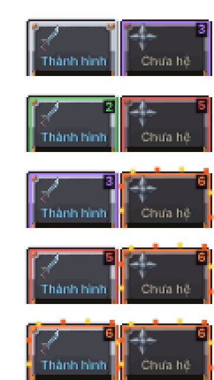
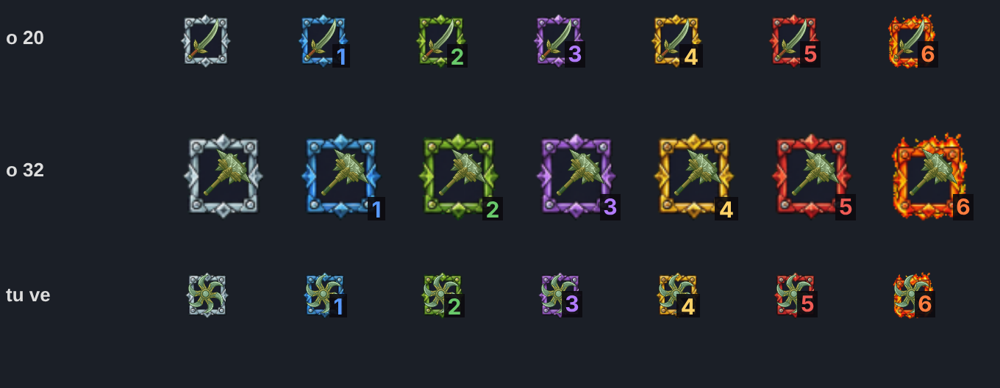
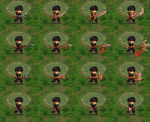
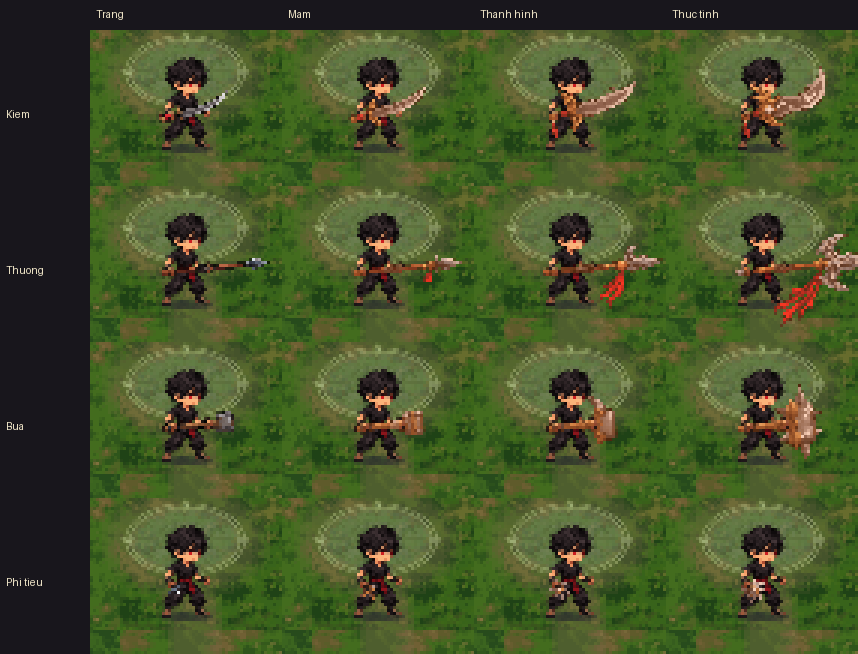

# Báo cáo A (16/10) — bậc ép đồ chỉ ở khung ô, soát vũ khí cỡ thật, quy tắc hình theo hệ

Theo [GOP-Y-CHATGPT.md](GOP-Y-CHATGPT.md) mục 3–4 và [QUYET-DINH.md](QUYET-DINH.md). Không đổi sát thương, nhịp, tầm. Không thêm hình vẽ code trong trận.

## 1. Bậc ép đồ chỉ hiện ở khung ô đồ

- **Trên vũ khí trong trận: bỏ hết** viền, hào quang, đốm sáng, lửa chạy dọc (js/vien_vk.js, js/zed_moi.js `veVk`). Mặc định `G.VIEN_VK = false`.
- **Ánh lướt theo cấp mài: bỏ luôn**, để không lẫn với màu hệ. Cấp mài vẫn ghi bằng chữ `+N` ở ô như cũ.
- **Bật lại bản cũ:** `?vienvk=1` (viền trên vũ khí như 15/10, ô không có số bậc).
- **Khung ô theo bậc ở mọi ô vũ khí** (`VM.icon`): ô trong trận, Hành trang, bảng ép đồ, Ông Thợ Rèn, bảng Linh khí, màn Xem vũ khí, dòng kết quả.
  - Khung dùng **ảnh khung có sẵn** `gd-o-ep-0..6`. Đây là ô vũ khí đã vẽ sẵn màu từng bậc, nên không phải nhuộm và không vẽ khung bằng code.
  - Bậc Trắng nay cũng dùng `gd-o-ep-0`, trước đây là ô thường.
  - **Số bậc nhỏ** (1–6 = Xanh lam…Rực lửa) nằm ở góc dưới phải ô, vẽ sau hình vũ khí nên không bị che. Bậc Trắng không ghi số.
  - Ô trong trận: viền ô 54×35 vẫn mang màu bậc như cũ, số bậc ghi ở góc trên phải.
  - Chỗ nào nơi gọi chưa vẽ ô (dòng kết quả, dòng nhỏ) thì `VM.icon` tự đặt ô `gd-o-ep-<bậc>` quanh hình.
- Thang màu bậc `G.EP_DO.mau` đổi theo góp ý: Trắng #D9DDE4 · Lam #5798FF · Lục #69C96B · Tím #B27BFF · Vàng #FFD166 · Đỏ #F05B55 · Rực lửa #FF7C3E. Màu này dùng cho cả chữ tên bậc.
- Lợi thêm: vũ khí đã ép không còn tắt bộ nhớ hình Cu Tí (`khoaVe`) mỗi khung nữa.

| Ô trong trận (bậc 0, 2, 3, 5, 6; cột phải là món kế) | Ô 7 bậc ở cỡ 20 / 32 / tự đặt ô (cỡ 13) |
|---|---|
|  |  |

## 2. Soát 4 vũ khí × 4 cấp ở cỡ thật

Ảnh dựng tĩnh (không chơi) bằng [chup_soat.py](chup_soat.py): khung thật của game ở 480×270 (1 điểm ảnh game = 1 điểm ảnh), Cu Tí đứng cầm vũ khí, nền phòng Rừng già, hệ Lửa (cấp Trắng chưa có hệ).

Cỡ thật: 

Phóng ×3: 

Nhận xét thẳng:

- **Phi tiêu: khó nhận ra nhất, gần như không thấy.** Cầm trên tay ở cấp Trắng/Mầm chỉ còn 1–2 chấm. Ở Thành hình/Thức tỉnh thành một cục nâu trước bụng, không ra hình ngôi sao. Nên làm ngôi sao 4–6 cánh mảng to, tâm sáng (đúng ý ChatGPT). Trên tay có thể cần to hơn nữa (hiện đã ×1,3).
- **Búa Trắng: khó nhận.** Đầu búa xám sẫm nhỏ, đọc như cái gậy. Từ Mầm thì rõ.
  - Búa Thành hình/Thức tỉnh có dáng rõ, nhưng màu nâu gỗ + nhuộm cam lẫn vào nền đất và quần áo.
  - Đầu Thức tỉnh vừa chạm cỡ ~20 điểm ảnh, không che Tí.
- **Kiếm: rõ ở mọi cấp.** Lưỡi cong to dần, Thức tỉnh rõ nhất. Riêng Trắng hơi mảnh, chỉ là một nét bạc.
- **Thương: dáng rõ (vạch dài ngang).** Ở Thành hình/Thức tỉnh, tua đỏ thõng xuống trông như vệt máu/lửa, dễ nhầm với dấu hệ Lửa. Nên rút ngắn tua (5–7 điểm ảnh nguồn như ChatGPT gợi ý) hoặc đổi tua sang màu vải trung tính.
- **Màu hệ hiện tại = nhuộm 30% cả thân.** Kim loại bạc thành nâu gỉ, nên hệ không đọc ra như một "dấu hiệu". Đây là lý do cần ảnh theo hệ ở mục 3.

## 3. Quy tắc hình theo hệ + ảnh cần gen

- **Quy tắc:**
  - Cấp hệ (Trắng/Mầm/Thành hình/Thức tỉnh) đổi DÁNG. Dáng hiện có 16 ảnh trong `zed-vk`, giữ nguyên.
  - Hệ đổi dấu hiệu màu ở ĐẦU/MŨI, chiếm 15–25% diện tích (Thức tỉnh tới 30%). Thân giữ bạc + cán gỗ.
  - Lửa #F26A28 / #FFD166 / #C43B2B · Độc #72C943 / #C8F169 / #315B35 · Băng #62DDF5 / #D9FAFF / #276A9A.
- **Hiện game KHÔNG có ảnh vũ khí theo hệ.** Bộ `zed-vk` chỉ có 4 loại × 4 cấp. Hệ đang làm bằng cách phủ 30% màu `G.EL[hệ].col` lên cả ảnh (`anhVk` ở js/zed_moi.js và js/vk_moi.js). Các ảnh `gd-bua-*`, `gd-he-*` là ảnh giao diện, không phải vũ khí.
- **Code nạp sẵn:** `G.vkHeAnh` (cuối js/vien_vk.js) đọc bộ `zed-vk-he` (tải sau, không làm nặng trang đầu).
  - Có ảnh đúng cỡ ô thì dùng thẳng, không nhuộm, trên tay và ở mọi ô.
  - Chưa có ảnh, chưa tải xong hoặc ảnh lệch cỡ thì dùng ảnh cấp nhuộm như cũ.
  - Tắt: `?vkhe=0`.
  - Đã thử bằng một bộ ảnh giả (36/36 ô nhận, không lỗi). Bộ giả đã xoá, không có trong repo.
- **Khi có ảnh:**
  1. Bỏ 12 tấm vào `docs/review/ke-hoach-cai-thien/vu-khi-chatgpt/anh-gen/` với tên `kiem-1.png … phitieu-3.png` (1 Mầm, 2 Thành hình, 3 Thức tỉnh). Ba hệ nằm cạnh nhau, trái→phải Lửa | Độc | Băng.
  2. Chạy `python3 docs/review/ke-hoach-cai-thien/vu-khi-chatgpt/dung_zed_vk_he.py`. Công cụ tách nền, tách 3 món, co về đúng cỡ ô `zed-vk` và dóng theo cán, ghi `game/art/custom/zed-vk-he.sprite.json` + ảnh soát `anh-soat/xem-vk-he.png`.
  3. Build.
- Nền tách là xanh gần thuần (g>190, r<95, b<95), nên xanh Độc #72C943 không bị mất. Vẫn cần gen nền đúng #00FF00 phẳng.

**Ảnh tham chiếu gửi kèm mỗi prompt:**

1. Ảnh dáng của vũ khí đó: `docs/anh-goc/zed/moi/vk-kiem-moi.png` (kiếm), `vk-thuong.png`, `vk-bua.png`, `vk-phi-tieu.png`. Mỗi ảnh là 4 cấp trái→phải.
2. Ảnh mẫu nét: `docs/anh-goc/zed/moi/00-anh-mau.png`.

Phần chung (đã có trong từng prompt): giữ ĐÚNG dáng, góc, cỡ, vị trí chuôi của khung cấp đó trong ảnh tham chiếu, không dài/rộng thêm.

### Kiếm

```text
KIẾM CẤP MẦM (khung thứ 2 trong ảnh vk-kiem-moi gửi kèm) vẽ lại 3 lần cạnh nhau, không chạm nhau, trái→phải: LỬA | ĐỘC | BĂNG.
Giữ ĐÚNG dáng, góc nằm ngang mũi sang phải, cỡ và vị trí chuôi như khung Mầm; lưỡi bạc, chuôi vải đỏ giữ nguyên. Chỉ thêm một gân màu chạy 1/3 lưỡi từ gốc:
LỬA gân cam #F26A28 sáng #FFD166, 1–2 đốm than #C43B2B. ĐỘC gân #72C943 sáng #C8F169, một giọt độc bóng #315B35. BĂNG gân #62DDF5 sáng #D9FAFF, một gai băng nhỏ trên sống, bóng #276A9A.
Màu hệ chiếm 15–25% diện tích. Pixel art như ảnh mẫu, viền đen 1 nét, mỗi vật liệu 3–4 sắc độ, không phản sáng li ti. Không tay, không người, không chữ. Nền #00FF00 phẳng.
```

```text
KIẾM CẤP THÀNH HÌNH (khung thứ 3 trong ảnh vk-kiem-moi gửi kèm) vẽ lại 3 lần cạnh nhau, không chạm nhau, trái→phải: LỬA | ĐỘC | BĂNG.
Giữ ĐÚNG dáng, góc nằm ngang mũi sang phải, cỡ và vị trí chuôi như khung Thành hình; thân bạc giữ nguyên. Dấu hệ ở MŨI và chắn tay:
LỬA mũi có lưỡi lửa nhỏ cam #F26A28/#FFD166, chắn tay đốm than #C43B2B. ĐỘC dây leo #72C943/#315B35 ôm chuôi, mũi nhỏ một giọt #C8F169. BĂNG 2 gai băng #62DDF5/#D9FAFF trên sống gần mũi, bóng #276A9A.
Màu hệ chiếm 15–25% diện tích. Pixel art như ảnh mẫu, viền đen 1 nét, mỗi vật liệu 3–4 sắc độ, mảng to, không họa tiết li ti. Không tay, không người, không chữ. Nền #00FF00 phẳng.
```

```text
KIẾM CẤP THỨC TỈNH (khung thứ 4 trong ảnh vk-kiem-moi gửi kèm) vẽ lại 3 lần cạnh nhau, không chạm nhau, trái→phải: LỬA | ĐỘC | BĂNG.
Giữ ĐÚNG dáng, góc nằm ngang mũi sang phải, cỡ và vị trí chuôi như khung Thức tỉnh. Mũi kiếm cong trăng khuyết mang màu hệ:
LỬA trăng cam-vàng #F26A28/#FFD166, mép than #C43B2B. ĐỘC trăng xanh #72C943/#C8F169, một giọt độc lớn #315B35 giữa lưỡi. BĂNG trăng xanh-trắng #62DDF5/#D9FAFF, 2–3 tinh thể lớn, bóng #276A9A.
Màu hệ tối đa 30% diện tích, phần còn lại bạc. Pixel art như ảnh mẫu, viền đen 1 nét, mỗi vật liệu 3–4 sắc độ. Không tay, không người, không chữ. Nền #00FF00 phẳng.
```

### Thương

```text
THƯƠNG CẤP MẦM (khung thứ 2 trong ảnh vk-thuong gửi kèm) vẽ lại 3 lần cạnh nhau, không chạm nhau, trái→phải: LỬA | ĐỘC | BĂNG.
Giữ ĐÚNG dáng, góc nằm ngang mũi sang phải, cỡ và vị trí đuôi cán như khung Mầm; cán gỗ, mũi bạc. Dấu hệ ở ĐẦU thương, tua ngắn 5–7 điểm ảnh:
LỬA tua cam-đỏ #F26A28/#C43B2B, mép mũi #FFD166. ĐỘC tua #72C943, một gai dây leo #315B35 ở cổ thương, điểm sáng #C8F169. BĂNG hai cạnh mũi băng #62DDF5/#D9FAFF, bóng #276A9A, tua trắng xám.
Màu hệ 15–25% diện tích. Pixel art như ảnh mẫu, viền đen 1 nét, mỗi vật liệu 3–4 sắc độ. Không tay, không người, không chữ. Nền #00FF00 phẳng.
```

```text
THƯƠNG CẤP THÀNH HÌNH (khung thứ 3 trong ảnh vk-thuong gửi kèm) vẽ lại 3 lần cạnh nhau, không chạm nhau, trái→phải: LỬA | ĐỘC | BĂNG.
Giữ ĐÚNG dáng, góc nằm ngang mũi sang phải, cỡ và vị trí đuôi cán như khung Thành hình; mũi chính vẫn dài nhất; tua ngắn, không thõng dài.
LỬA hai cánh đầu như ngọn lửa hướng ra ngoài #F26A28/#FFD166, chân cánh #C43B2B. ĐỘC dây leo #72C943/#315B35 quấn cổ thương, mũi có giọt #C8F169. BĂNG hai gai băng hai bên hình chữ V #62DDF5/#D9FAFF, bóng #276A9A.
Màu hệ 15–25% diện tích. Pixel art như ảnh mẫu, viền đen 1 nét, mỗi vật liệu 3–4 sắc độ. Không tay, không người, không chữ. Nền #00FF00 phẳng.
```

```text
THƯƠNG CẤP THỨC TỈNH (khung thứ 4 trong ảnh vk-thuong gửi kèm) vẽ lại 3 lần cạnh nhau, không chạm nhau, trái→phải: LỬA | ĐỘC | BĂNG.
Giữ ĐÚNG dáng, góc nằm ngang mũi sang phải, cỡ và vị trí đuôi cán như khung Thức tỉnh; một đầu duy nhất, mũi chính dài nhất; tua ngắn.
LỬA đầu thành ngọn lửa tam diện #F26A28/#FFD166, lõi #C43B2B. ĐỘC mũi răng cưa #72C943, tua dây leo #315B35, điểm sáng #C8F169. BĂNG mũi dài như tinh thể #62DDF5/#D9FAFF, một vòng băng ở cổ, bóng #276A9A.
Màu hệ tối đa 30% diện tích. Pixel art như ảnh mẫu, viền đen 1 nét, mỗi vật liệu 3–4 sắc độ. Không tay, không người, không chữ. Nền #00FF00 phẳng.
```

### Búa

```text
BÚA CẤP MẦM (khung thứ 2 trong ảnh vk-bua gửi kèm) vẽ lại 3 lần cạnh nhau, không chạm nhau, trái→phải: LỬA | ĐỘC | BĂNG.
Giữ ĐÚNG dáng, góc nằm ngang đầu búa bên phải, cỡ và vị trí đuôi cán như khung Mầm; cán gỗ, đầu kim loại. Dấu hệ là một vết nứt lớn trên mặt búa:
LỬA nứt cam #F26A28 lõi #FFD166, mép #C43B2B. ĐỘC nứt #72C943, một giọt #C8F169 ở góc, bóng #315B35. BĂNG nứt xanh-trắng #62DDF5/#D9FAFF, bóng #276A9A.
Màu hệ 15–25% diện tích; đầu búa sáng hơn cán để không lẫn vào nền đất. Pixel art như ảnh mẫu, viền đen 1 nét, mỗi vật liệu 3–4 sắc độ. Không tay, không người, không chữ. Nền #00FF00 phẳng.
```

```text
BÚA CẤP THÀNH HÌNH (khung thứ 3 trong ảnh vk-bua gửi kèm) vẽ lại 3 lần cạnh nhau, không chạm nhau, trái→phải: LỬA | ĐỘC | BĂNG.
Giữ ĐÚNG dáng, góc, cỡ và vị trí đuôi cán như khung Thành hình. Dấu hệ ở mấu đầu búa:
LỬA mấu có cạnh đỏ cam #F26A28/#C43B2B, điểm nóng #FFD166. ĐỘC mấu thành gai dây leo ngắn #72C943/#315B35, điểm #C8F169. BĂNG mấu thành gai tinh thể #62DDF5/#D9FAFF, bóng #276A9A.
Màu hệ 15–25% diện tích; kim loại đầu búa bạc sáng, không nâu. Pixel art như ảnh mẫu, viền đen 1 nét, mỗi vật liệu 3–4 sắc độ. Không tay, không người, không chữ. Nền #00FF00 phẳng.
```

```text
BÚA CẤP THỨC TỈNH (khung thứ 4 trong ảnh vk-bua gửi kèm) vẽ lại 3 lần cạnh nhau, không chạm nhau, trái→phải: LỬA | ĐỘC | BĂNG.
Giữ ĐÚNG dáng, góc, cỡ và vị trí đuôi cán như khung Thức tỉnh; không to thêm. Dấu hệ trên MẶT búa:
LỬA khe nóng vàng-cam #FFD166/#F26A28 trên mặt, viền #C43B2B. ĐỘC mặt búa có một giọt độc lớn #72C943/#C8F169, bóng #315B35. BĂNG mặt búa kết khối tinh thể #62DDF5/#D9FAFF có vết nứt sáng, bóng #276A9A.
Màu hệ tối đa 30% diện tích. Pixel art như ảnh mẫu, viền đen 1 nét, mỗi vật liệu 3–4 sắc độ. Không tay, không người, không chữ. Nền #00FF00 phẳng.
```

### Phi tiêu

```text
PHI TIÊU CẤP MẦM (khung thứ 2 trong ảnh vk-phi-tieu gửi kèm) vẽ lại 3 lần cạnh nhau, không chạm nhau, trái→phải: LỬA | ĐỘC | BĂNG.
Giữ ĐÚNG dáng ngôi sao, góc, cỡ như khung Mầm; cánh thép bạc mảng to, bỏ hoa văn mảnh. Dấu hệ ở TÂM và đầu cánh:
LỬA viền tâm cam #F26A28, chấm #FFD166, bóng #C43B2B. ĐỘC một giọt độc ở tâm #72C943/#C8F169, bóng #315B35. BĂNG đầu cánh thành tinh thể #62DDF5/#D9FAFF, bóng #276A9A.
Màu hệ 15–25% diện tích. Pixel art như ảnh mẫu, viền đen 1 nét, mỗi vật liệu 3–4 sắc độ. Không tay, không người, không chữ. Nền #00FF00 phẳng.
```

```text
PHI TIÊU CẤP THÀNH HÌNH (khung thứ 3 trong ảnh vk-phi-tieu gửi kèm) vẽ lại 3 lần cạnh nhau, không chạm nhau, trái→phải: LỬA | ĐỘC | BĂNG.
Giữ ĐÚNG dáng, góc, cỡ như khung Thành hình; giữ khe trống giữa các cánh để không thành cục tròn. Dấu hệ trên một nửa số cánh, xen kẽ cánh thép:
LỬA cánh cam #F26A28/#FFD166, chân cánh #C43B2B. ĐỘC cánh xanh có răng nhỏ #72C943/#C8F169, bóng #315B35. BĂNG cánh kết tinh #62DDF5/#D9FAFF, bóng #276A9A.
Màu hệ 15–25% diện tích. Pixel art như ảnh mẫu, viền đen 1 nét, mỗi vật liệu 3–4 sắc độ. Không tay, không người, không chữ. Nền #00FF00 phẳng.
```

```text
PHI TIÊU CẤP THỨC TỈNH (khung thứ 4 trong ảnh vk-phi-tieu gửi kèm) vẽ lại 3 lần cạnh nhau, không chạm nhau, trái→phải: LỬA | ĐỘC | BĂNG.
Giữ ĐÚNG dáng, góc, cỡ như khung Thức tỉnh; cánh lớn rõ, không thêm cánh nhỏ. Tâm phát sáng màu hệ:
LỬA tâm vàng #FFD166, viền lửa cam #F26A28 quanh tâm, bóng #C43B2B. ĐỘC tâm xanh #72C943/#C8F169, bóng #315B35. BĂNG tâm cyan-trắng #62DDF5/#D9FAFF, bóng #276A9A.
Màu hệ tối đa 30% diện tích. Pixel art như ảnh mẫu, viền đen 1 nét, mỗi vật liệu 3–4 sắc độ. Không tay, không người, không chữ. Nền #00FF00 phẳng.
```

## 4. Kiểm

- `node --check` toàn bộ js/: đạt.
- `build.py` và `build.py --hai-tep`: đạt (một tệp 28,49/30 MB; trang chính nén 1,13/1,50 MB).
- `tests/smoke.py`: 0 lỗi.
- Mở `?vienvk=1` và mặc định: không lỗi JS. `G.VIEN_VK` / `G.KHUNG_BAC` đúng theo cờ.

**Tệp sửa:**

- js/data.js: cờ, thang màu.
- js/ep_do.js: `E.o`, `E.ghiO`, `E.oChua`, `E.soBac`, `G.oBacVk`.
- js/vk_moi.js: `VM.icon`, `anhVk`, ô bảng Linh khí.
- js/stage.js: ô trong trận.
- js/vien_vk.js: tắt mặc định, `G.vkHeAnh`.
- js/zed_moi.js: `anhVk`.
- build.py: `zed-vk-he` tải sau.
