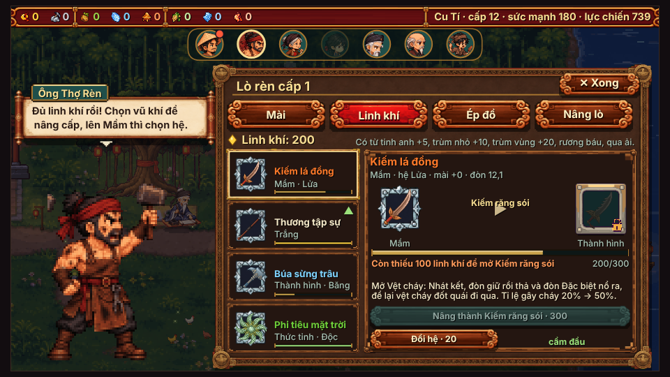
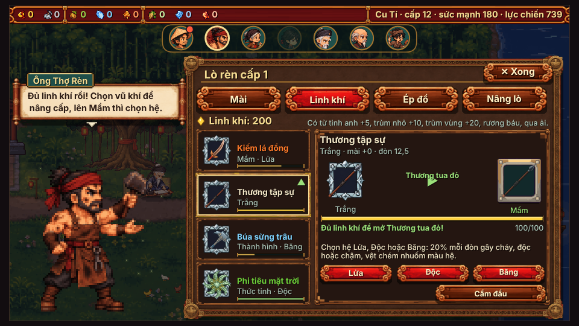
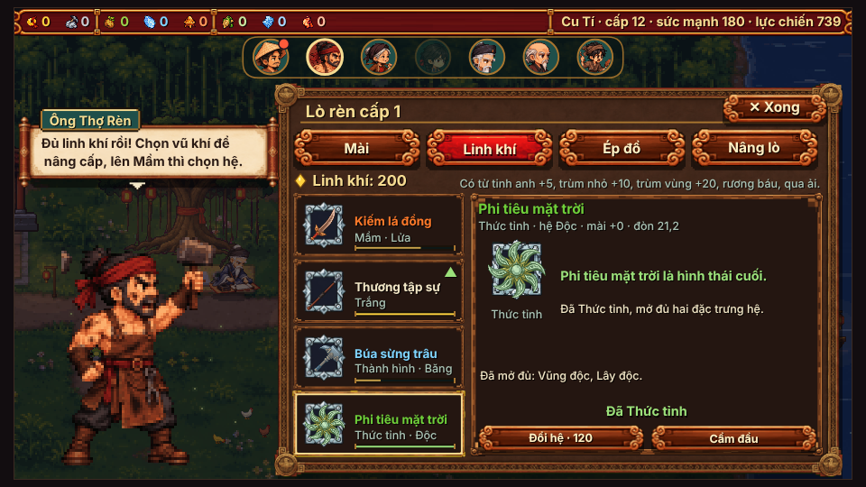
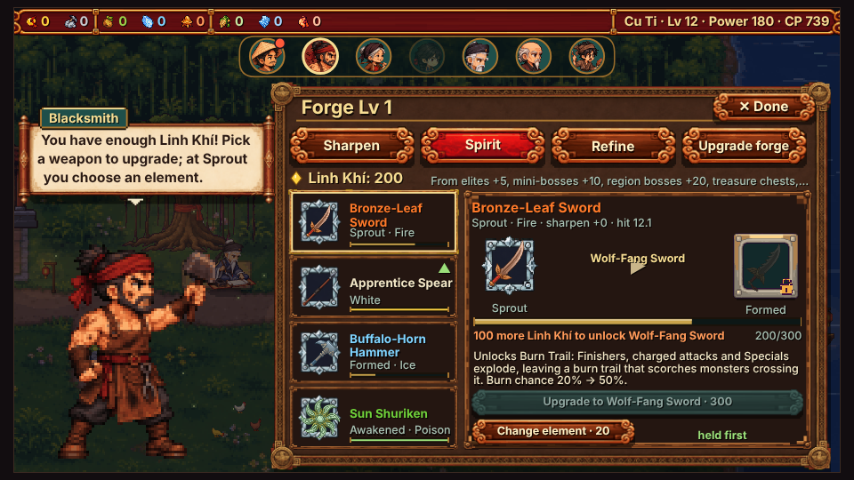
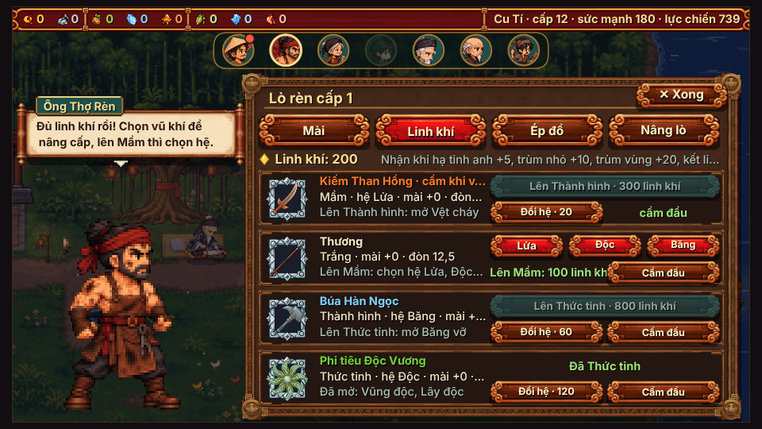
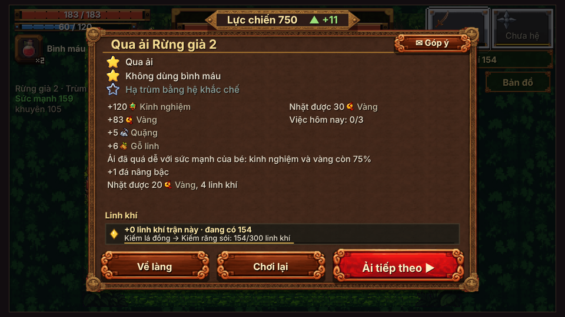
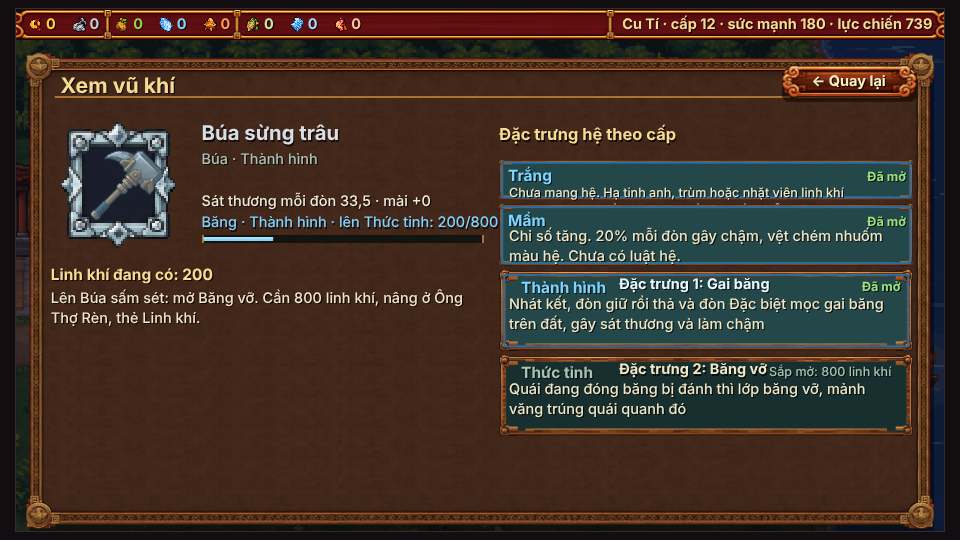
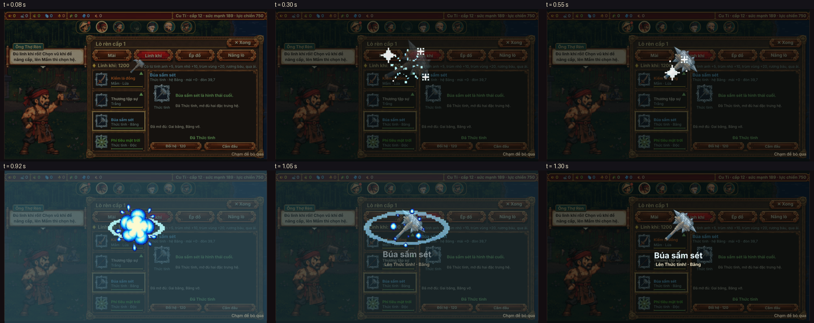

# Báo cáo C (16/10): hình thái vũ khí (xem trước, tiến độ, ăn mừng nâng cấp)

Làm theo [GOP-Y-CHATGPT-2-NANG-CAP.md](GOP-Y-CHATGPT-2-NANG-CAP.md), làm tiếp trên bản của [bao-cao-A.md](bao-cao-A.md).

Mục tiêu: nhìn vũ khí là trả lời được 3 câu: "đang ở cấp nào", "sắp thành gì", "nâng xong đánh khác ra sao".

Phạm vi:

- Chỉ sửa lớp giao diện.
- Không đổi giá, sát thương, nhịp đánh hay cân bằng.
- Không thêm hình vẽ code trong trận.
- Không chơi thử. Ảnh soát dựng tĩnh bằng trình duyệt chạy ngầm (headless).

**Cờ tắt toàn bộ:** `?hinhthai=0`. Khi tắt, tên cũ (Kiếm Than Hồng…), bảng lò rèn cũ, không có ăn mừng, dòng kết quả cũ.

## 1. Bảng tên hình thái (chủ game duyệt)

Tên đặt theo đúng hình đang có trong bộ ảnh `zed-vk` (4 loại × 4 cấp).

- Cấp Trắng dùng chung chữ "tập sự", để nhìn tên là biết đang ở cấp đầu.
- Tên không đổi theo hệ. Hệ vẫn hiện bằng màu chữ và dòng "hệ Lửa/Độc/Băng".

| Vũ khí | Trắng | Mầm | Thành hình | Thức tỉnh |
|---|---|---|---|---|
| Kiếm | **Kiếm tập sự**: lưỡi cong trơn | **Kiếm lá đồng**: chắn tay hình lá đồng | **Kiếm răng sói**: sống răng cưa, chắn cánh | **Kiếm trăng khuyết**: lưỡi và chắn trăng khuyết, ngọc giữa |
| Thương | **Thương tập sự**: mũi đơn | **Thương tua đỏ**: thêm tua đỏ | **Thương lưỡi móc**: mũi có móc cong | **Thương cánh én**: mũi giữa + hai cánh cong |
| Búa | **Búa tập sự**: đầu vuông | **Búa đai đồng**: đai đồng, đinh tán | **Búa sừng trâu**: mấu cong như sừng | **Búa sấm sét**: gai, mặt đá nứt sáng |
| Phi tiêu | **Phi tiêu tập sự**: sao 4 cánh | **Phi tiêu vòng đồng**: sao 4 cánh, vòng đồng ở tâm | **Phi tiêu chong chóng**: 6 cánh cong | **Phi tiêu mặt trời**: 8 cánh cong, tâm ngọc sáng |

Bản tiếng Anh (`js/ngon_ngu_en.js`):

| Vũ khí | Trắng | Mầm | Thành hình | Thức tỉnh |
|---|---|---|---|---|
| Kiếm | Apprentice Sword | Bronze-Leaf Sword | Wolf-Fang Sword | Crescent Sword |
| Thương | Apprentice Spear | Red-Tassel Spear | Hook-Blade Spear | Swallow-Wing Spear |
| Búa | Apprentice Hammer | Bronze-Band Hammer | Buffalo-Horn Hammer | Thunder Hammer |
| Phi tiêu | Apprentice Shuriken | Bronze-Ring Shuriken | Pinwheel Shuriken | Sun Shuriken |

**Phương án khác cho kiếm** (theo ví dụ của ChatGPT): Kiếm tập sự → Kiếm nảy linh → Kiếm nguyệt → Kiếm linh thú.

Ở đây không dùng phương án này, vì "Kiếm nguyệt" hợp với hình Thức tỉnh hơn hình Thành hình (hình Thành hình là lưỡi răng cưa).

**Muốn đổi tên:** sửa bảng `G.HINH_THAI.ten` đầu tệp `js/hinh_thai.js`, rồi sửa khoá tương ứng trong `js/ngon_ngu_en.js`.

**Tên hiện ở đâu:** `G.wName` trả tên hình thái, kèm danh hiệu và +mài như cũ. Vì vậy tên hiện ở:

- ô đồ, dòng vũ khí;
- Ông Thợ Rèn (cả thẻ Mài, Ép đồ);
- Hành trang › Vũ khí (bảng Linh khí);
- màn Xem vũ khí;
- thẻ vũ khí ở màn kết quả;
- băng "đạt mốc" trong trận.

Dòng "cấp kế mở gì" (`VM.moTiep`) nay ghi tên hình thái kế, ví dụ "Lên Búa sấm sét: mở Băng vỡ".

## 2. Ông Thợ Rèn › Linh khí: xem trước hình thái kế

Bảng mới thay danh sách 4 dòng cũ (`VM.vkPanel` khi `js/village.js` gọi kèm `lo: true`). Hành trang vẫn dùng bảng cũ, chỉ đổi tên.

**Cột trái:** 4 ô vũ khí. Mỗi ô có:

- hình;
- tên hình thái (màu hệ);
- cấp · hệ;
- thanh linh khí nhỏ;
- dấu ▲ khi đủ linh khí nâng.

Chạm một ô để chọn. Mở bảng thì tự chọn món nâng được, không có thì chọn món cầm đầu.

**Thẻ phải (món đang chọn):**

- Tên, cấp, hệ, mài, sát thương mỗi đòn.
- **Hình hiện tại ▶ hình thái kế**:
  - Chưa đủ linh khí: hình kế là bóng sẫm, kèm ổ khoá (ảnh `gd-phong-lock`).
  - Đủ linh khí: hình kế hiện mờ và nhấp nháy nhẹ.
  - Tên hình thái kế nằm trên mũi tên.
- **Một thanh tiến độ** linh khí tới cấp kế, kèm số `n/giá`.
- Dòng **"Còn thiếu N linh khí để mở <tên>"**, hoặc "Đủ linh khí để mở <tên>!".
- **Một câu "nâng xong đánh khác ra sao"**. Câu này lấy đúng luật có sẵn, không bịa:
  - Trắng → Mầm: "Chọn hệ Lửa, Độc hoặc Băng: 20% mỗi đòn gây cháy, độc hoặc chậm, vệt chém nhuốm màu hệ." Số lấy từ `G.PROC[1]`.
  - Mầm → Thành hình: "Mở <đặc trưng 1>: <mô tả>. Tỉ lệ gây cháy 20% → 50%." Lấy từ `G.HE_FEATURES[hệ][0]` và `G.PROC`.
  - Thành hình → Thức tỉnh: như trên, với đặc trưng 2. Tỉ lệ 50% → 100%.
  - Thức tỉnh: "<tên> là hình thái cuối", kèm danh sách đặc trưng đã mở.
- **Nút** như bảng cũ, gọi đúng các hàm cũ (`VM.nang`, `VM.doiHe`, `VM.camDau`):
  - 3 nút hệ khi lên Mầm;
  - "Nâng thành <tên> · giá";
  - Đổi hệ;
  - Cầm đầu.

**Màn kết quả sau mỗi ải:** dòng 2 của khối Linh khí nay là tiến độ của **món đang cầm**, kèm một thanh mảnh:

- "Kiếm lá đồng → Kiếm răng sói: 154/300 linh khí"
- "…: đủ linh khí mở …! Ghé Ông Thợ Rèn."
- "…: hình thái cuối (Thức tỉnh)."

| Chưa đủ (bóng + khoá) | Đủ, lên Mầm chọn hệ | Thức tỉnh |
|---|---|---|
|  |  |  |

| Tiếng Anh | `?hinhthai=0` (bảng cũ) | Màn kết quả |
|---|---|---|
|  |  |  |

Màn Xem vũ khí (tên hình thái, dòng cấp kế): 

Tất cả ảnh chụp ở điện thoại ngang 960×540.

## 3. Ăn mừng nâng cấp

Khi nâng thành công ở làng (Ông Thợ Rèn hoặc Hành trang), lớp giao diện phủ tối và chạy hoạt cảnh tổng **1,45 giây**. Chạm bất kỳ đâu để bỏ qua. Lần chạm đó không lọt xuống bảng bên dưới.

| Giai đoạn | Thời gian | Hình |
|---|---|---|
| Tan | 0–0,2 s | Hình cũ co lại và mờ đi; hạt nổ `hu-hat-no` nhuộm màu hệ |
| Ráp | 0,2–0,85 s | Hình mới từ to + mờ, xoay nhẹ về đúng cỡ; 4 sao chớp `hu-sao-chop` chụm vào |
| Loé màu hệ | 0,85–1,15 s | Lớp màu hệ mờ dần; vòng sóng `hu-vong-song` nhuộm màu hệ; nổ nhỏ `hu-no-nho-<hệ>` |
| Tên hình thái | 0,95–1,45 s | Tên to (ví dụ "Búa sấm sét") và dòng "Lên Thức tỉnh! · Băng" |

Ghi chú:

- Hình vũ khí dùng ảnh có sẵn (`zed-vk`, qua `VM.anhO`).
- Dải "Lực chiến ▲" (js/luc_chien.js) chờ ăn mừng xong mới chạy, để không đè lên hình.
- Chỉ chạy ở làng, khi nâng thật. Không chạy khi tính thử sức mạnh (`upgrade.js`) hoặc khi nâng trên bản sao.



## 4. Đề xuất "mảnh tiến độ 25% / 50%" (CHƯA làm, cần thêm ảnh)

Ý của ChatGPT:

- Đủ 25% linh khí của cấp kế: vũ khí hiện thêm một đường gân hoặc viền.
- Đủ 50%: thấy rõ bóng hình thái kế.

Muốn làm cho đúng thì cần ảnh. Nhuộm hoặc vẽ code thì không ra.

**Đề xuất:**

- Mỗi món ở mỗi cấp chưa tối đa có 1 ảnh "gân 25%". Tổng 4 loại × 3 cấp = 12 ảnh.
- Ảnh này giữ nguyên dáng cấp hiện tại, chỉ thêm 1 đường gân sáng.
- Nấc 50% không cần ảnh mới: bảng lò rèn đã có bóng hình thái kế. Có thể cho bóng ấy hiện rõ hơn khi ≥ 50%. Việc này chỉ là chỉnh code giao diện.
- Ảnh đặt cạnh `zed-vk`, ví dụ bộ `zed-vk-gan`, cùng ô và cỡ.

**Prompt mẫu** (ảnh tham chiếu giống bao-cao-A: `docs/anh-goc/zed/moi/vk-*.png` và `00-anh-mau.png`):

```text
<VŨ KHÍ> CẤP <CẤP> (khung thứ <n> trong ảnh tham chiếu gửi kèm) vẽ lại 1 lần, GIỮ ĐÚNG dáng, góc nằm ngang mũi sang phải, cỡ và vị trí chuôi.
Chỉ thêm MỘT đường gân sáng mảnh (2 điểm ảnh) màu vàng nhạt #FFE9A8 chạy dọc 1/3 thân (kiếm: sống lưỡi; thương: cổ mũi; búa: mặt búa; phi tiêu: một vòng quanh tâm),
như dấu hiệu vũ khí đang tích linh khí. Không đổi màu thân, không thêm chi tiết khác.
Pixel art như ảnh mẫu, viền đen 1 nét, mỗi vật liệu 3–4 sắc độ. Không tay, không người, không chữ. Nền #00FF00 phẳng.
```

## 5. Ảnh vũ khí giữa các cấp: có khác nhau đủ không?

**Ở cỡ ô đồ / lò rèn / ăn mừng (26–92 điểm ảnh): đủ khác.** Dáng đổi rõ ở từng mốc:

- Kiếm: lưỡi trơn → chắn lá → răng cưa → trăng khuyết.
- Thương: mũi đơn → tua → móc → hai cánh.
- Búa: vuông → đai → sừng → gai.
- Phi tiêu: 4 cánh → vòng đồng → 6 cánh cong → 8 cánh.

Vì vậy bảng xem trước và hoạt cảnh không cần ảnh mới.

**Ở cỡ cầm trên tay trong trận: khó nhận.** Theo nhận xét ở [bao-cao-A.md](bao-cao-A.md) mục 2:

- Phi tiêu gần như không thấy hình.
- Búa Trắng trông như cái gậy.
- Kiếm Trắng mảnh.
- Tua đỏ của thương lẫn với dấu hệ Lửa.

Đây là việc của ảnh, không sửa bằng code. Nếu gen lại thì **dùng chung 12 prompt ở bao-cao-A mục 3**. Báo cáo này không viết thêm prompt dáng.

## 6. Kiểm

- `node --check` mọi tệp js/: đạt.
- `build.py` và `build.py --hai-tep`: đạt.
  - Bản một tệp 28,52/30 MB.
  - Trang nhẹ nén 1169 KB.
- `tests/smoke.py`: 0 lỗi.
- [chup_soat_c.py](chup_soat_c.py):
  - Không lỗi JS ở bản mặc định, `?hinhthai=0` và tiếng Anh.
  - Tiếng Anh: không còn chuỗi thiếu bản dịch trên bảng lò rèn.
- Đăng nhập Google, lưu mây, `?cloud=0`: không đụng tới.
- Bản lưu: không thêm trường mới. Ô đang chọn ở lò rèn chỉ nằm trong bộ nhớ.

**Tệp sửa:**

- `game/js/hinh_thai.js` (mới, nạp sau js/vk_moi_lang.js):
  - bảng tên;
  - bọc `G.wName`, `VM.moTiep`, `VM.vkPanel` (khi `lo`), `VM.nang` (bật ăn mừng), `VM.ketQua`, `G.Village.draw`, `G.lucChienUI.ve`.
- `game/index.html`: thẻ script.
- `game/js/village.js`: lò rèn gọi `vkPanel` kèm `lo: true`.
- `game/js/ngon_ngu_en.js`:
  - 16 tên;
  - chữ mới;
  - vài chữ cũ của bảng Linh khí còn thiếu bản Anh.
- `dist/` dựng lại.
