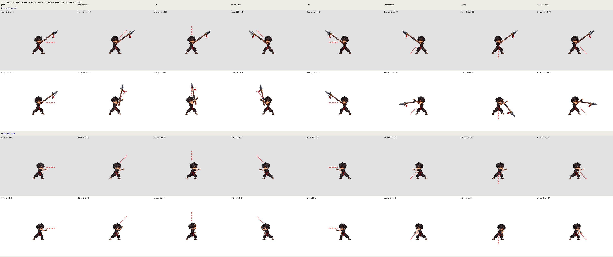

# Báo cáo: đòn của Zed mới quay theo hướng nhắm (8 hướng / mọi góc)

**Commit:** `4a064f38` trên nhánh `khoi-tao-du-an`. Đã push, không động vào master, không tạo PR.
**Cách tắt:** thêm `?huongvk=0` vào địa chỉ thì hình đòn trở lại như trước (vũ khí vẽ nằm ngang theo neo).

## Lỗi được báo
Đòn đánh vẫn trúng theo hướng nhắm thật, nhưng hình Zed mới chỉ vẽ nhìn ngang. Quái đứng chéo phía trên hoặc phía dưới thì mũi thương vẫn chọc ngang, lệch khỏi chỗ trúng thật.

## Đã làm (chỉ đổi HÌNH)
Không đổi sát thương, tầm đánh, thời lượng đòn, vùng trúng hay đạn bay.

1. **Đâm / ném** (thương 1–3, thương xốc, Phi Thương, phi tiêu ném thường / ném chùm / đang ngắm, đấm):
   - Góc nhắm thật (`P.aimRel`, tính so với hướng mặt, đã chốt lúc ra đòn) được cộng vào góc vũ khí. Vũ khí xoay quanh nắm tay nên vẫn nằm trong tay.
   - Góc lệch bị kẹp trong khoảng ±75°. Góc cuối của vũ khí không quá ±90° so với mặt, nên mũi thương không bao giờ chĩa ra sau lưng (ảnh gốc của thương 2 vốn đã chếch lên -35°).
   - Khi nhắm gần thẳng lên hoặc thẳng xuống (quá ±75°), thân trên nghiêng thêm quanh eo, tối đa 12°. Nửa dưới đứng yên, chỗ nối ở eo được lót đai nên không bị hở. Người không bao giờ bị lật ngược.
   - Phi tiêu và đấm là đòn tay không, không có vũ khí để xoay. Với các đòn này, cánh tay đang duỗi được khoét ra và vẽ lại, xoay quanh gốc tay cùng một góc với vũ khí. Vùng cánh tay được đo tự động cho cả 4 bộ trang phục bằng `docs/anh-goc/zed/gan-vk/do-tay-nem.py`.
2. **Vệt chém / hiệu ứng:**
   - Mũi vũ khí dùng để vẽ vệt chém (`G.tinhLinh.tip`) đã xoay theo góc mới, nên vệt vẽ bằng code và ảnh vệt AI (hu-dam-giao, hu-chem-kiem…) khớp với mũi vũ khí.
   - `fx.js aimed()` xoay các hình trên không (vệt đâm, vệt ném, hu-quet-giao…) theo đúng góc vũ khí đang vẽ. Hình sát đất (vết nứt, vòng bụi) vẫn đặt ở chỗ trúng thật.
   - Ảnh hu-phi-tieu-chum ở tay xoay theo góc tay ném.
   - Phi tiêu bay và thương ném đang bay vẫn đi theo góc thật như cũ.
3. **Chém / quét / nện** (kiếm 1–3, quét thương, búa nện, nện đất, Trảm Nguyệt): đường vung giữ nguyên như trong ảnh, cả đường vung chỉ nghiêng theo hướng nhắm, tối đa ±35°.
   - Mưa Phi Tiêu và nện đất đặc biệt không xoay, vì hai đòn này không đánh theo một hướng.
4. **Góc nhắm và độ êm:**
   - Góc nhắm được chốt theo từng nhát (`p.lastAtk`) và không đổi giữa nhát. Riêng lúc đang giữ ngắm phi tiêu thì góc bám theo góc ngắm hiện tại, có làm mượt.
   - Khi vào thế, góc được làm mượt theo thời gian (khoảng 0,15 giây) rồi nối tiếp góc vừa vẽ như `gocMuot`, đi theo đường ngắn nhất nên không bị lật 360°.
   - Độ nghiêng thân giảm dần ở 25% cuối nhát. Hết đòn thì vũ khí trở về tư thế cầm êm như bản trước.
5. **Chạy + chém** (ghép ở eo): thân trên và vũ khí cũng theo góc nhắm như trên, chân vẫn theo hướng chạy.
6. **Các cờ khác vẫn như cũ:** `?zedmoi=0`, `?chaydanh=0`, `?camvk=0`, `?zedbo=...`. Cầm vũ khí lúc đứng/đi/chạy không đổi. Đăng nhập Google, lưu mây và `?cloud=0` không bị đụng tới.

## Tệp đã sửa
- `game/js/zed_moi.js`: chứa toàn bộ phần xoay (HV_DAM / HV_CHEM, `huongCua`, làm mượt, nghiêng thân quanh eo, bảng TAY cho cánh tay, `lechHinh` để fx gọi).
- `game/js/fx.js`, `game/js/fx_he.js`: hiệu ứng trên không xoay theo góc vũ khí.
- `game/js/data.js`: thêm `G.HUONG_VK` và cờ `?huongvk=0`.
- `game/dist/*`: đã dựng lại bằng `python3 game/build.py`. Lúc rebase bị xung đột ở dist, đã lấy bản trên nhánh rồi dựng lại.
- `docs/anh-goc/zed/gan-vk/do-tay-nem.py`: đo vùng cánh tay. `docs/anh-goc/zed/gan-vk/xem-8-huong.py`: vẽ ảnh soát.

## Đã kiểm tra những gì
Theo đúng luật: **không chạy game, không chạy Playwright, không test.** Chỉ làm hai việc:
- Chạy `node --check` cho 4 tệp JS đã sửa: đều qua.
- Vẽ ảnh soát tĩnh `xem-8-huong.png` (rộng 3808 điểm ảnh). Ảnh dựng lại bằng Python đúng phép vẽ trong game, cho thương đâm và phi tiêu ném ở 8 hướng, bộ ninja. Hàng nền xám là bản cũ (`?huongvk=0`), hàng nền trắng là bản mới, chấm đỏ là hướng nhắm thật.

Vì chưa chạy game nên vẫn cần xem trực tiếp trong game: độ mượt khi vào thế, chỗ nối ở eo, và hình cánh tay ném lúc nhắm thẳng lên (tay đi sát mặt).

