# Chơi thử "Linh Khí" — nhận xét của một người chơi roguelite lâu năm

Ngày chơi: 10/10/2026 · Bản: `lk-2026.10.09`, nhánh `khoi-tao-du-an` (commit `1d398ad`) · Không sửa gì trong game.

## Tóm tắt một phút

Điểm chung: **6,5/10**. Game đã có khung rất đầy đủ so với một bản thử: 8 loại quái có cách đánh riêng, vùng báo trước rõ, bản đồ ải ngẫu nhiên, làng có hồn, bảng thua biết chỉ đường cày. Chưa thấy lỗi làm hỏng game trong khoảng 40 phút chơi.

Ba chuyện làm tôi khó chịu nhất, theo thứ tự:

1. **Sân đấu quá nhỏ trên điện thoại.** Phòng thường chỉ chiếm khoảng 38% bề ngang màn hình, em bé cao chừng 6% màn hình. Hai bên là khoảng đen chứa chữ. Đây là lý do chính khiến trận đánh khó đọc.
2. **Bản web bắt đăng nhập Google mới cho vào.** Người lạ mở link sẽ bỏ đi trước khi thấy game.
3. **Tải 10 MB mà màn hình đen, không có chữ "đang tải".** Mạng 4G yếu chờ gần 40 giây.

| Mục | Điểm |
|---|---|
| Ấn tượng 5 phút đầu | 6,5 |
| Cảm giác đánh | 6,5 |
| Hình ảnh | 6,5 |
| Dễ đọc trận đánh | 5,5 |
| Nhịp và độ khó | 6 |
| Tiến trình và đồ | 7 |
| Làng | 5,5 |
| Kỹ thuật | 6 |

## Tôi đã chơi thế nào (và chỗ nào chưa thử được)

- Chơi bằng trình duyệt Chromium tự động, cỡ điện thoại ngang 844×390 (mật độ 3) và máy tính 1280×720. Game chạy theo thời gian thật; phần đánh do bot có sẵn của dự án (`tests/bot.js`) cầm tay, tôi xem ảnh chụp từng phòng. Các bảng ở làng tôi tự bấm bằng chạm giả lập.
- Đã đi: màn chào → làng → ải Rừng già 1 đến 5 (thua trùm Mộc Tinh một lần, nâng cấp rồi thắng) → Hang biển 1 (thua trùm Cua Đá). Đã qua đủ phòng thường, tinh anh, rương, thương nhân, suối, thử thách, lời nguyền, trùm nhỏ, trùm vùng.
- Đã thử: mặc đồ, may đồ, mua và bán ở Bà Hàng Xén, mài vũ khí, xem nâng bậc và tôi lại, đổi vũ khí, cây kỹ năng, cây chưởng, hướng dẫn, bảng vàng, hành trang, bản đồ to, tạm dừng, cài đặt, góp ý, đăng nhập mây (bằng mây giả của dự án).
- 4 em bé × 4 loại vũ khí: mỗi cặp chơi 75 giây ở Rừng già 3 (dùng bản lưu thử để mở khoá sẵn).

Chỗ **chưa thử được**, xin nói thẳng:

- **Không vào được https://spiritblade.web.app** từ máy thử (bị chặn mạng). Tôi chơi bản trong repo, cùng mã nguồn. Thời gian tải đo bằng tệp `dist/linh-khi.html` qua máy chủ giả lập tốc độ mạng.
- **Không nghe được tiếng.** Theo mã thì game có tiếng động tổng hợp, không có nhạc nền.
- **Không có điện thoại thật.** Cảm giác ngón tay, rung, độ trễ chạm tôi chỉ suy ra từ kích thước nút và ảnh. Phần "cảm giác đánh" vì vậy kém chắc chắn nhất.
- Máy thử không có card đồ hoạ, số FPS thấp hơn điện thoại thật.

---

## 1. Ấn tượng 5 phút đầu — 6,5/10

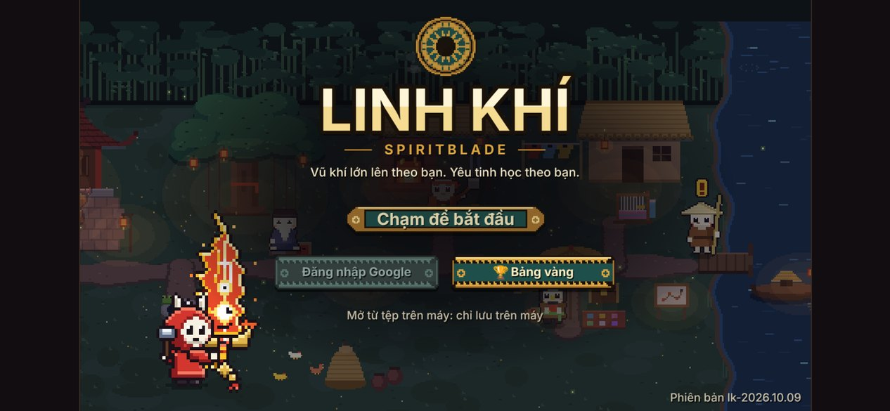

**Được:**

- Màn chào đẹp, một nút "Chạm để bắt đầu", vào làng ngay. Dòng chữ dưới đáy chỉ đúng việc cần làm: "Tới bến đò bên phải, gặp Chú Lái Đò để vào ải". Từ lúc mở game đến lúc đánh con quái đầu tiên chỉ khoảng 20 giây.
- Ải 1 dạy từng thứ một, mỗi phòng một ý (đi và đánh → chậu than → mana → đổi vũ khí → thương nhân → rương → suối → trùm). Phòng đầu cho 3,5 giây đọc chữ rồi quái mới ra. Bot qua ải 1 hết khoảng 3 phút, gần như không mất máu trước trùm. Vừa sức người mới.
- Bản đồ chọn ải rõ, có sức mạnh khuyên dùng và phần thưởng.

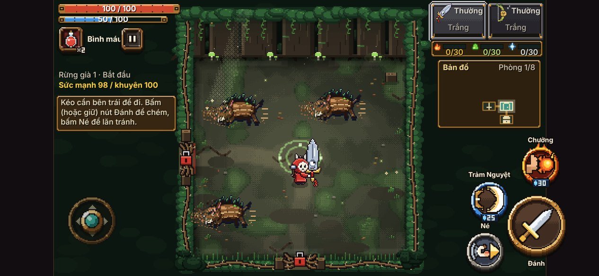

**Chưa được:**

- **Bản web chặn cửa bằng đăng nhập Google.** Khi game chạy trên web có mây, màn chào chỉ có nút "Đăng nhập Google để vào"; nút "Chơi tạm" chỉ hiện khi mây lỗi hoặc đăng nhập hỏng. Với game điện thoại, bắt đăng nhập trước khi chơi thử là mất phần lớn người mới.

  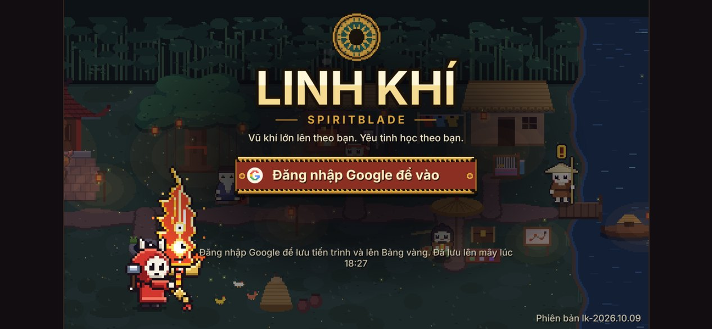

- **Chữ chỉ dẫn nhỏ và nằm ngoài chỗ mắt đang nhìn.** Lời chỉ dẫn nằm trong ô nhỏ bên trái, cỡ chữ chừng 9 điểm trên điện thoại, trong khi mắt người chơi dán vào em bé ở giữa. Lúc đang bị ba con heo rừng lao tới thì không ai liếc sang trái đọc ba dòng.
- **Chữ bị cắt ngay trong ải dạy chơi:** dòng "↑ Chạm để đổi vũ khí" bị ô vũ khí đè mất chữ cuối.

  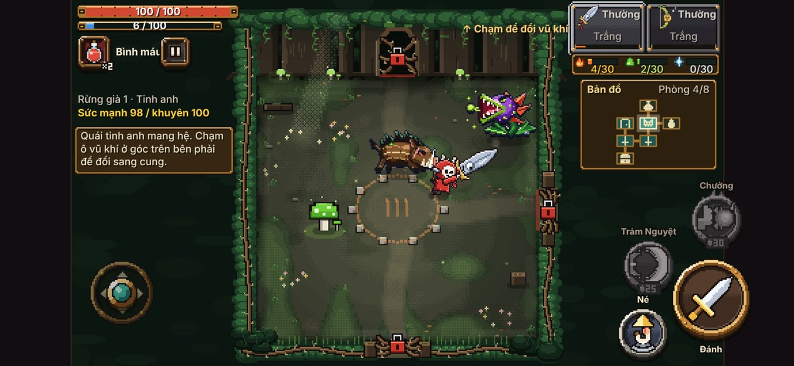

- **Thương nhân trong ải 1 là phòng chết.** Người mới có 0 vàng (vàng chỉ cộng khi xong ải), cả ba món đều xám. Game dạy "đây là thương nhân" rồi không cho mua gì.

  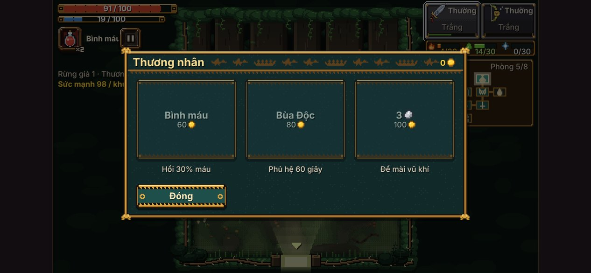

- **Lời dạy đầu tiên chỉ đúng với kiếm.** "Bấm (hoặc giữ) nút Đánh để chém" — sang búa thì giữ là lấy đà, không thả thì không đánh. Tôi cho ngón tay giả giữ nút Đánh với búa: em bé đứng gồng và chết ở phòng đầu.

  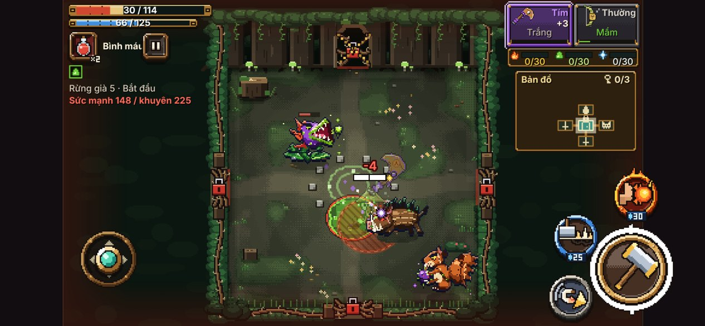

- **Hướng dẫn ở Cụ Đồ dài 12 trang chữ.** Không ai đọc. Nên giữ làm sổ tra, đừng trông vào nó để dạy.

**Nút bấm với ngón tay:** nút Đánh to (khoảng 80 điểm), Né, Đặc biệt, Chưởng vừa (47–50 điểm), đặt theo hình quạt, hợp ngón cái. Chỗ nhỏ: nút Tạm dừng (khoảng 30 điểm) nằm sát nút Bình máu, dễ bấm nhầm lúc cần hồi máu gấp; bảy khuôn mặt lối tắt ở làng (30 điểm, sát nhau); các thẻ "Vũ khí / Mua trang phục / Bán trang phục" cao chỉ khoảng 20 điểm; ổ khoá bên phải mỗi món đồ rất bé.

---

## 2. Cảm giác đánh — 6,5/10

*(Tôi không cầm được máy thật nên mục này dựa trên ảnh từng khung, số đo và mã nguồn.)*

**Được:**

- Đòn có đủ đồ nghề phản hồi: vệt chém to và rõ, số sát thương, số chí mạng to màu vàng ("86!"), quái chớp trắng, có rung màn hình và khựng hình (chỉnh được ở một chỗ, `vfx_cfg.js`).
- **Bốn loại vũ khí khác nhau thật**, không chỉ đổi hình: kiếm chém vòng cung, giáo đâm thẳng dài, búa nện có sóng, cung bắn xa tự ngắm. Nút Đánh đổi hình theo vũ khí, và đổi cả màu khi vũ khí mang hệ (nút nhỏ giọt xanh khi mang Độc). Chi tiết này rất hay.

  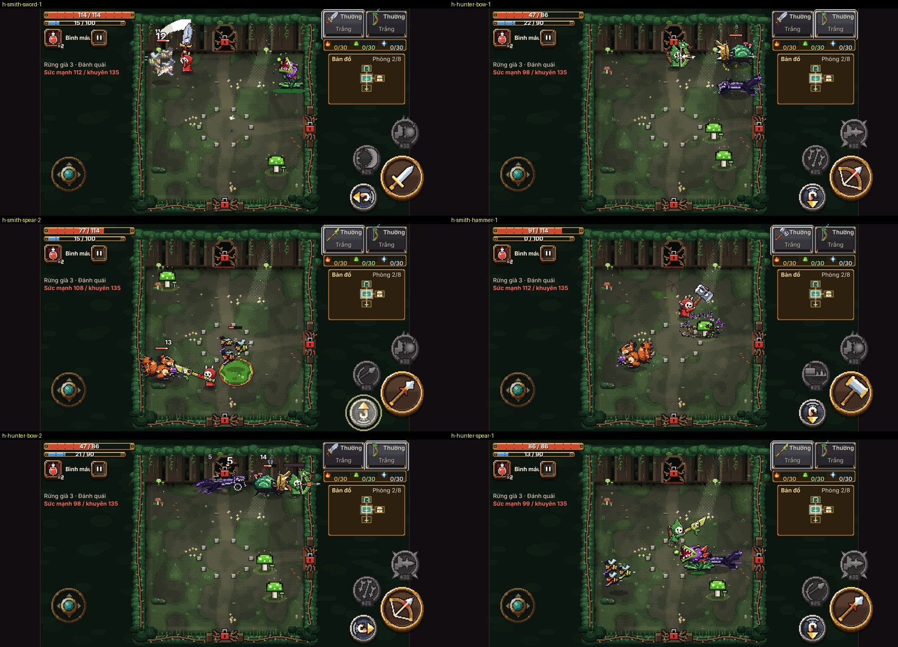

- Nút Né có mũi tên chỉ sẵn hướng sẽ lăn. Nhỏ mà đáng tiền.
- Khi giữ búa lấy đà, nút Đánh phình to có vòng trắng, trên đầu em bé có vạch đà.

**Chưa được:**

- **Không có rung điện thoại.** Mã không gọi rung máy lần nào. Với game hành động trên điện thoại, một cú rung ngắn khi trúng đòn nặng hoặc khi bị đánh là thứ rẻ nhất để tăng "độ nặng".
- **Đặc biệt và Chưởng hầu như lúc nào cũng xám.** Mana đầy là 100, Đặc biệt tốn 25, Chưởng 30, mỗi đòn trúng hồi khoảng 2. Vào phòng trùm với 100 mana, sau 6 giây còn 2–7, rồi suốt trận hai nút xám. Trong khoảng 60 ảnh giữa trận tôi chụp, hai nút này sáng ở rất ít ảnh. Hai chiêu đẹp nhất của game lại là hai thứ ít được bấm nhất.
- **Cung yếu hẳn khi quái áp sát.** Trong lượt thử 16 cặp, cặp Thợ Rèn + cung là cặp duy nhất chết ngay phòng đầu; Thầy Lang cầm cung cũng mất máu nhiều nhất trong bốn vũ khí của bé. Mỗi cặp chỉ chơi một lượt và bot đánh cung không khéo, nên chỉ coi đây là dấu hiệu; nên có người thật thử lại.
- **Hai nút kỹ năng khi xám trông giống hệt nhau** (hai hình tròn tối). Lúc gấp không biết nút nào là nút nào.

---

## 3. Hình ảnh — 6,5/10

**Được:**

- Làng ban đêm có đèn lồng, đom đóm, bến đò: đẹp và có không khí riêng, rất "Việt". Bản đồ vùng kiểu tranh giấy cũ cũng đẹp.

  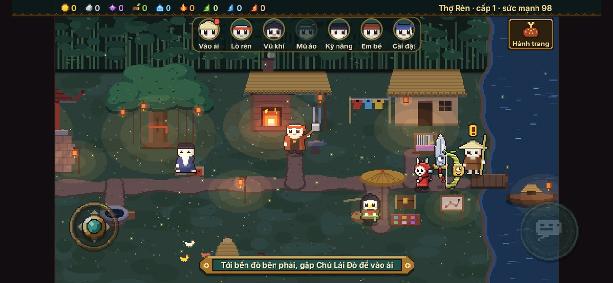
  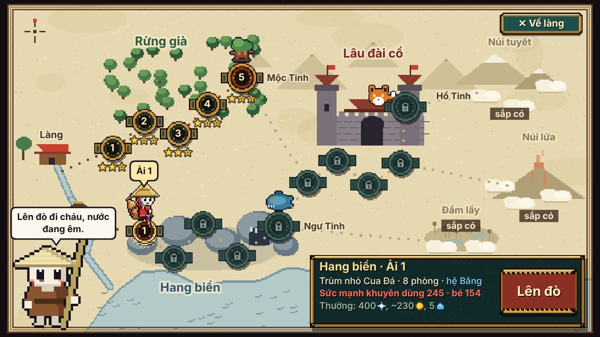

- Khung giao diện kiểu trống đồng nhất quán từ làng tới ải.
- Quái hình AI nhìn là nhận ra: heo rừng, hoa ăn thịt, sóc, nhím, sứa, ốc. Trùm Mộc Tinh và Cua Đá to, có dáng, đáng nhớ.

  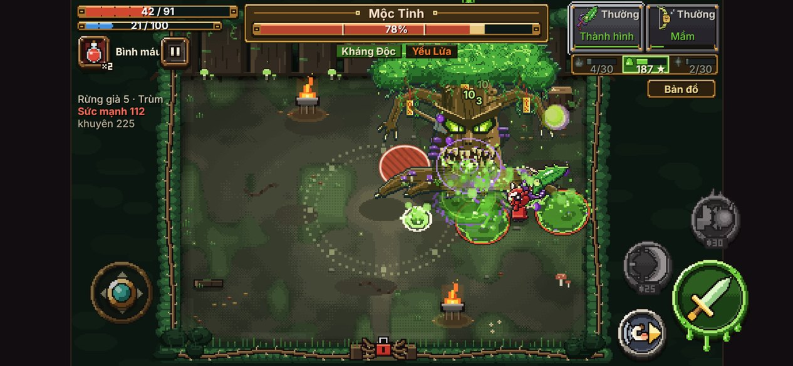

**Chỗ lệch:**

- **Em bé và quái như của hai game khác nhau.** Quái (hình AI) nhiều chi tiết, có đổ bóng, nét mảnh. Em bé là hình phẳng, ít màu, mặt đầu lâu đơn giản. Đặt cạnh nhau thì em bé trông như hình tạm. Heo rừng to gấp đôi em bé, kỹ gấp mấy lần.
- **Ba cỡ điểm ảnh trên cùng một màn hình.** Người làng ở bảng thoại vẽ điểm ảnh rất to (mỗi ô vuông cỡ 12 điểm màn hình); hình trong ải điểm ảnh nhỏ; còn chữ thì là phông mịn nét cao. Mắt thấy ngay là không cùng một "lưới".
- **Vũ khí bay to hơn em bé.** Thanh kiếm hay cây rìu cao bằng hoặc hơn cả em bé và hay che mất em bé, nhất là ở làng và khi đứng yên.
- **Quái tối trên nền tối.** Chồn Bóng (đen tím) trên sàn rừng xanh đen gần như chìm. Rừng già nói chung tối: nền xanh đen, quái xanh, độc xanh.
- **Sân đấu nhỏ so với màn hình** (nói kỹ ở mục 4): hình AI đẹp nhưng bị thu nhỏ quá nên chi tiết mất.

**Màu đỏ:**

- Dùng **đúng** ở vùng nguy hiểm (vòng tròn đỏ gạch chéo), thanh máu, số máu bị mất.
- Dùng **sai chỗ 1:** nút chính của cả game là màu đỏ (Lên đò, Mặc, May, Mài, Học, Ải tiếp theo). Nút "Xoá tiến trình" và "Bỏ ải, về làng" cũng đỏ y hệt. Vậy đỏ vừa là "bấm đi" vừa là "cẩn thận". Nên đổi nút chính sang vàng đồng hoặc xanh ngọc (màu đã có sẵn trong khung), để đỏ chỉ còn là cảnh báo.
- Dùng **sai chỗ 2:** em bé Thợ Rèn mặc áo đỏ, cùng tông với vùng nguy hiểm. Khi đứng cạnh vòng đỏ, em bé nhỏ xíu lẫn vào.

  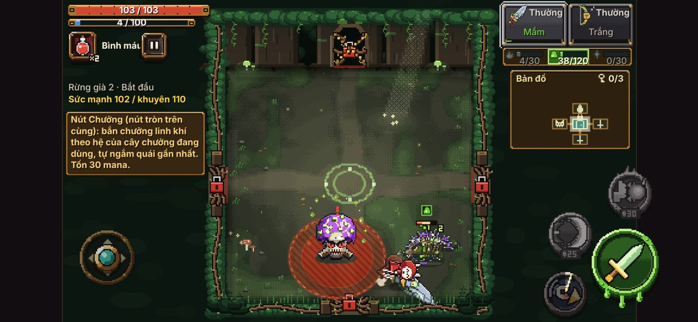

- Nhẹ hơn: ổ khoá cửa phòng màu đỏ sáng (không nguy hiểm nhưng hút mắt), chữ "Sức mạnh … / khuyên …" đỏ nằm suốt trận khi còn thiếu sức mạnh.

---

## 4. Dễ đọc trận đánh — 5,5/10

**Được:**

- Vùng báo trước làm tốt: vòng đỏ gạch chéo cho vùng nổ, vòng chấm cho chỗ quái sắp mọc, có đếm ngược. Đòn nào cũng có báo trước, đúng luật "né được hết".
- Thanh máu trùm có vạch chia pha, có nhãn "Kháng Độc / Yếu Lửa" ngay dưới.
- Bản đồ nhỏ góc phải rõ, có biểu tượng từng loại phòng, đếm mảnh chìa.
- Chỉ tối đa 4 quái cùng lúc, nên về số lượng thì không loạn.

**Chưa được:**

- **Sân đấu chỉ chiếm 38% bề ngang màn hình.** Phòng thường là hình gần vuông nằm giữa, hai bên là hai dải đen chứa thanh máu, chữ, bản đồ, nút. Em bé cao chừng 35–40 điểm ảnh trên ảnh chụp cao 585. Trên điện thoại 6 inch, em bé cao khoảng 4 mm. Phòng trùm rộng hơn (khoảng 57%) và dễ nhìn hơn hẳn. Những game cùng loại (Brotato, Archero, Soul Knight) đều cho sân đấu phủ kín màn hình và đặt nút đè lên trên.

- **Khi vũ khí mang hệ Độc, cả màn hình thành một màu xanh.** Vệt chém xanh, vũng độc của mình xanh, mây độc của quái xanh, số sát thương xanh, biểu tượng trạng thái xanh, nền rừng cũng xanh. Trong ảnh dưới gần như không thấy em bé đâu.

  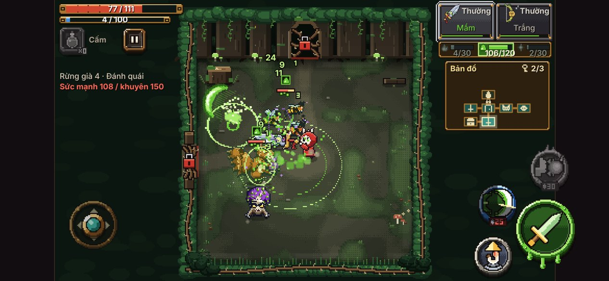

- **Vũng độc của mình và của quái gần giống nhau.** Cùng là vũng xanh lá, chỉ khác viền (tím hay đỏ). Lúc đánh trùm Mộc Tinh, dưới chân toàn vũng xanh, không biết vũng nào đứng được.
- **Chữ thông báo đè lên thứ cần nhìn.** Dòng "Thắng rồi! Nhặt đồ rơi…" che ô vũ khí và một phần thanh máu. Lúc trùm ra mắt, dòng tên trùm đè lên nhãn kháng hệ.
- **Mất máu vì thứ khó thấy.** Nguồn mất máu đều nhất của cả 5 ải là "Trúng độc" (40–70 lần mỗi ải) và "Gai phản đòn". Cả hai đều là kiểu mất máu rỉ rả, không có khoảnh khắc "à, mình sai ở đây".

---

## 5. Nhịp và độ khó — 6/10

Số đo (bot chơi, thời gian thật):

| Ải | Thời gian | Kết quả | Phòng thường | Tinh anh | Trùm |
|---|---|---|---|---|---|
| Rừng già 1 | 2 phút 52 | thắng, 2 sao | 16–22 giây | 35 giây | 45 giây |
| Rừng già 2 | 3 phút 33 | thắng, 1 sao | 26–28 giây | 63 giây | 58 giây |
| Rừng già 3 | 5 phút 07 | thắng, 2 sao | 41–49 giây | 55 giây | 69 giây |
| Rừng già 4 | 6 phút 38 | thắng, còn 10 máu | 59–64 giây | 129 giây | 78 giây |
| Rừng già 5 | 6 phút 04 | **thua** trùm (trùm còn 78% máu) | 51–61 giây | 70 giây | — |
| Rừng già 5, lần 2 | khoảng 6 phút | thắng, trùm không chạm được | | | |

**Được:**

- Một ải 3–6 phút là rất hợp điện thoại.
- Đường cong ải 1 → 4 lên đều, ải 4 thắng sát nút (còn 10 máu) là đúng cảm giác roguelite.
- Phòng phụ (thử thách tính giờ, bàn thờ lời nguyền, rương ba lựa chọn, suối chọn máu hay mana) tạo quyết định nhỏ giữa các trận. Lời nguyền "đổi bình máu lấy gấp đôi dấu ấn" là kiểu đánh đổi hay.
- Trùm vùng Mộc Tinh có màn ra mắt, ba pha, phòng rộng: đáng nhớ.

**Chưa được:**

- **Bức tường ở ải 5.** Sức mạnh khuyên dùng đi 100 → 110 → 135 → 150 rồi nhảy lên **225**. Chơi liền 4 ải thì em bé mới 112. Người chơi chắc chắn chết ở Mộc Tinh lần đầu.
- **Nhưng con số "khuyên dùng" lại không đáng tin.** Sau khi thua, tôi làm theo gợi ý: cầm cây rìu Tím nhặt từ tinh anh ở ải 2, mài +3, mặc ba món đồ, học điểm. Sức mạnh lên 148, vẫn đỏ, vẫn "thiếu 77". Kết quả: thắng Mộc Tinh mà không mất giọt máu nào. Một món Tím rơi sớm làm lệch cả độ khó, còn con số thì doạ sai.
- **Trùm "học theo bạn" đang phạt thứ người chơi không chọn.** Ở Rừng già, vật nổ trong phòng là nấm độc, nên vũ khí tự nhận dấu ấn Độc và tự khoá vào nhánh Độc (ải 1 dạy chậu than để lấy Lửa, nhưng cuối ải tôi có 38 Độc, 5 Lửa). Rồi trùm nào của Rừng già cũng "Kháng Độc". Muốn đổi hệ cần đá tôi, mà người mới có 0 viên. Cảm giác là bị phạt vì đi đúng đường game bày ra.
- **Bốn ải liền gặp cùng một trùm nhỏ** (Nấm Chúa ở ải 1, 2, 3, 4). Lần thứ ba đã thấy nhàm.
- **Phòng tinh anh kéo dài.** Có phòng 129 giây, gấp đôi phòng thường, chủ yếu vì con Bọ Hung có giáp phải vòng ra sau.
- **Chết có công bằng không?** Phần lớn là có: thua Mộc Tinh vì đứng trong vùng đỏ (54% máu mất), bảng thua nói đúng điều đó. Phần chưa công bằng là mất máu rỉ rả vì độc và gai như đã nói ở mục 4.

**Có muốn chơi lại không?** Có, trong một vùng. Bản đồ đổi mỗi lần, phòng phụ đổi, đồ rơi đổi. Nhưng chưa có thứ gì làm *lối chơi* của lượt này khác lượt trước (kiểu chọn phúc lành trong Hades, chọn đồ trong Brotato). Hiện giờ đây là game "cày chỉ số" nhiều hơn là roguelite.

---

## 6. Tiến trình và đồ — 7/10

Đây là phần tốt nhất của game.

**Được:**

- **Bảng thua rất hay.** Nói rõ mất máu vì đâu, còn thiếu bao nhiêu sức mạnh, đưa 2–3 việc cụ thể kèm "+bao nhiêu sức mạnh", bấm vào là tới đúng người làng. Nhiều game thương mại không làm được thế.

  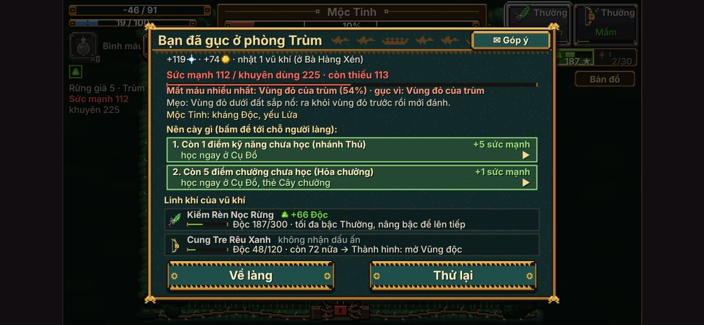

- **Bảng kết quả** có ba ngôi sao với điều kiện rõ, có khối "Linh khí của vũ khí" cho thấy vũ khí lớn lên bao nhiêu.

  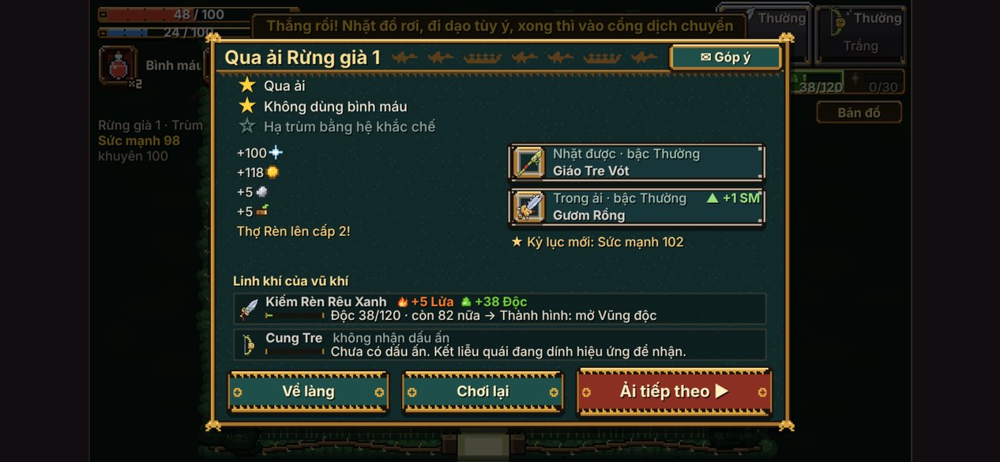

- **Vũ khí lớn theo cách đánh** là ý tưởng riêng của game và được trình bày tốt: ba vạch hệ dưới ô vũ khí, màn "Xem vũ khí" có mốc 30 · 120 · 300 và từng đặc trưng sẽ mở.

  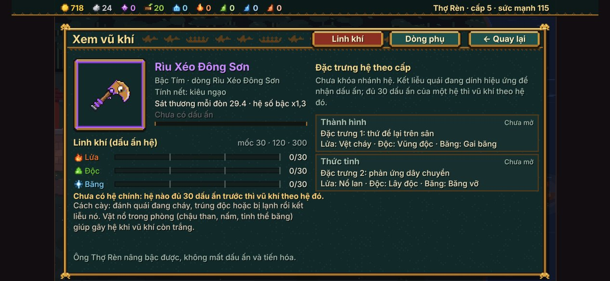

- **Lò rèn dễ hiểu:** chọn món, thấy ngay "29,4 → 31,7 sau khi mài", giá, và "+4 Sức mạnh" trên nút.

  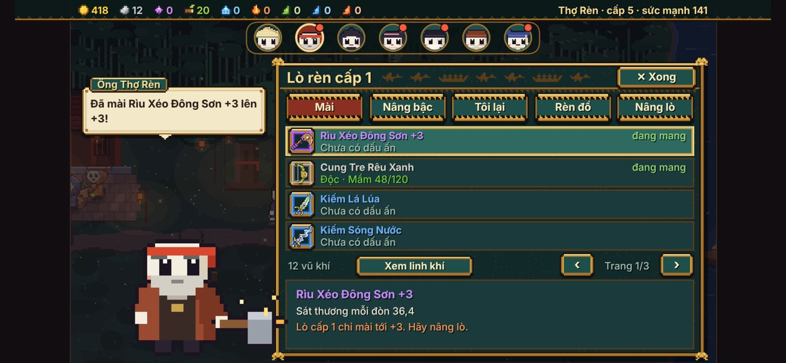

- **Cô Thợ May:** em bé mặc thử ngay bên trái, có nút Đứng / Chạy / Lộn để xem đồ đung đưa, mặc xong em bé xoay một vòng. Đáng yêu, đúng chất.

  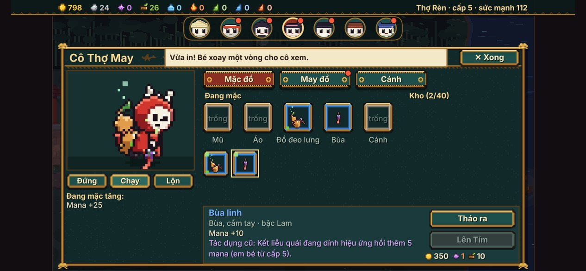

- Nhịp có đồ mới tốt: sau 5 ải tôi có 12 vũ khí kể cả 2 món ban đầu (1 Tím, 2 Lam), 2 món trang phục Lam, lên cấp 5. Hạ Mộc Tinh rơi búa Vàng: phần thưởng xứng đáng.
- Màu bậc Thường / Lam / Tím / Vàng dùng nhất quán ở viền ô, tên món, cột sáng đồ rơi.

**Chưa được:**

- **Rương vũ khí đầy sau đúng 5 ải** (tối đa 12 món kể cả 2 món đang mang), và từ đó vũ khí nhặt được lặng lẽ thành vàng. Thẻ rương báu vẫn ghi "Vũ khí mới, cất vào rương đồ" dù rương đã đầy. Người chơi chọn vũ khí rồi không nhận được gì.
- **Giá may và giá nâng bậc cao so với thu nhập đầu game.** Sau 5 ải tôi có 798 vàng và 26 gỗ linh, 0 mảnh trùm. Đồ bộ Rừng Già (trang đầu tiên của thẻ May đồ) cần mảnh trùm nên cả trang xám; món may được nằm tận trang 4.
- **Hệ Lửa / Độc / Băng chưa tạo lựa chọn.** Ở Rừng già chỉ lên được Độc, và Độc lại bị trùm kháng. Chưa có lúc nào tôi được *chọn* hệ.
- **Mốc tiến hoá bị chặn bởi bậc mà không nói trước:** kiếm Thường dừng ở "Thành hình (tối đa bậc Thường)" tại 187/300 dấu ấn. Số dấu ấn nhặt thêm coi như bỏ. Nên báo ngay trên thanh ở trong ải khi vũ khí đã kịch mốc.
- **Ba em bé còn lại khoá sau trùm vùng.** Trong 30–40 phút đầu người chơi chỉ có Thợ Rèn. Thợ Săn nên mở sớm hơn (ví dụ sau ải 3) để người chơi sớm thấy game có nhiều em bé.
- **Túi đồ / shop:** nhìn chung dễ hiểu. Vài chỗ rối: ba người cùng dính tới trang phục (Bà Hàng Xén bán và mua lại, Cô Thợ May may và nâng, lò rèn có thẻ "Rèn đồ" chỉ để chỉ đường); đổi vũ khí phải "chạm món trong rương trước, rồi chạm món đang mang" — ngược thói quen, tôi bấm sai lần đầu và lạc sang màn Xem vũ khí.

---

## 7. Làng — 5,5/10

**Được:**

- Đẹp, ấm, có bản sắc. Mỗi chức năng là một người chứ không phải một nút: ý tưởng tốt.
- Dải khuôn mặt lối tắt giúp không phải chạy bộ; chạm lần hai là tới ngay.
- Có chi tiết sống: ba em bé chưa chọn ngồi chơi ở sân đình, gà đi lại, đom đóm, lò rèn cháy, người làng ngẩng lên khi lại gần, mỗi người có giọng riêng ("Cốc cốc cốc! Làng nước nghe đây!").

**Chưa được:**

- **Không có việc gì để làm ngoài mở bảng.** Làng là một cái menu đẹp. Người làng đứng yên một chỗ, mỗi lần chỉ nói một câu liên quan tới bảng đang mở. Không có nhiệm vụ, không có chuyện để nghe, không có gì đổi sau khi hạ trùm.
- **Dấu chấm than mất nghĩa.** Sau ải 5, cả bảy người đều có chấm than vàng và chấm đỏ. Khi ai cũng "có việc mới" thì không còn biết việc nào quan trọng.

  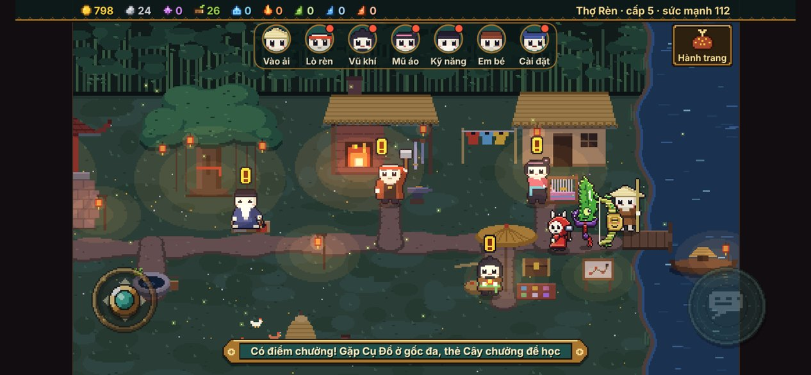

- Trên máy tính chơi bằng bàn phím vẫn hiện cần điều khiển và nút chạm.

---

## 8. Kỹ thuật — 6/10

**Số đo:**

| Phép đo | Kết quả |
|---|---|
| Kích thước tệp game | 10,3 MB (nén gzip còn 6,7 MB). 78% là hình nhúng dạng chữ |
| Tải trên máy nhanh, mạng nhanh | 1,6 giây |
| Tải với 4G tốt (9 Mbps), máy chậm 4 lần | khoảng 10 giây |
| Tải với 4G yếu (1,6 Mbps), máy chậm 4 lần | khoảng 38 giây |
| FPS phòng thường (2–4 quái), máy nhanh | 60 |
| FPS phòng thường, máy chậm 4 lần | 30 (khung chậm nhất khoảng 83 ms) |
| FPS phòng nhồi 14 quái, máy nhanh | 50–58 |
| FPS phòng nhồi 14 quái, máy chậm 4 lần | 6,5 |
| Rác bộ nhớ tạo ra | khoảng 10 MB mỗi giây, dọn rác 1 lần/giây; không thấy rò rỉ sau 60 giây |
| Lỗi JavaScript trong mọi lượt chơi | **0** |

*(Máy thử không có card đồ hoạ; "máy chậm 4 lần" là giả lập, chỉ để ước lượng điện thoại tầm trung. Phòng 14 quái là bài thử sức, game thật chỉ cho 4 quái cùng lúc.)*

**Được:** không lỗi, không treo, lưu và nạp lại ổn. Cầm dọc thì game tự xoay ngang. Biểu mẫu Góp ý gọn, có lưu ngoại tuyến. Có nút "Độ nét: Cao / Thường" cho máy yếu.

**Chưa được:**

- **Tải xong mới thấy gì đó.** Cả game là một tệp 10 MB, không có màn "đang tải". 10 đến 38 giây màn hình đen.
- **Máy tầm trung có thể chỉ được khoảng 30 khung/giây** ở phòng thường. Nên đo trên một máy Android giá rẻ thật.
- Có cảnh báo của trình duyệt lặp lại nhiều lần về việc đọc điểm ảnh từ canvas (`getImageData` … `willReadFrequently`): dấu hiệu có chỗ đọc ảnh lặp lại, tốn máy.

**Chữ tràn, chữ sai, nút đè (đã thấy tận mắt):**

1. "↑ Chạm để đổi vũ khí" bị ô vũ khí cắt (ải 1, phòng tinh anh).
2. Bảng kết quả: câu "Món cũ … đổi sang món mới thì linh khí không theo" bị cắt cụt, thiếu phần cuối và dấu ngoặc đóng.

   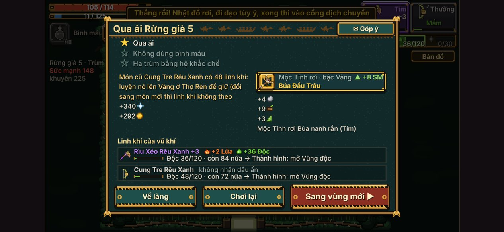

3. Bảng thua ở phòng **Bắt đầu** (không có trùm) ghi "Mất máu nhiều nhất: Vùng đỏ của trùm". Thật ra là bom của Sóc.

   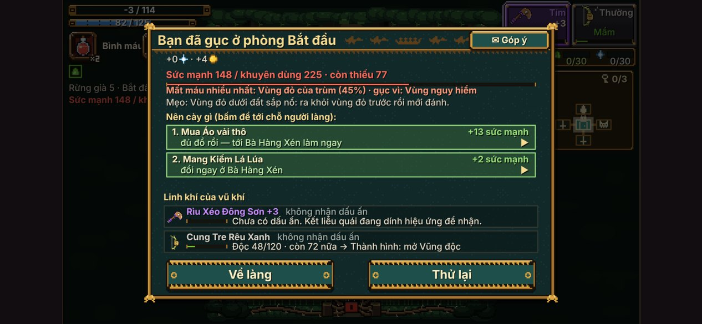

4. Thẻ Bán trang phục: "Giá bà trả: Thường 10, Lam 30, Tím 80, ● 200 ●" — chữ "Vàng" (tên bậc) bị tự đổi thành hình đồng xu.
5. Dòng "Thắng rồi! …" đè lên ô vũ khí và thanh máu.
6. Dòng tên trùm lúc ra mắt đè lên nhãn kháng hệ.
7. Thẻ rương báu ghi "cất vào rương đồ" khi rương đã đầy.

---

## 9. Tổng kết

### 5 việc nên sửa NGAY (nhỏ, nhanh)

1. **Cho chơi ngay không cần đăng nhập.** Làm gì: ở màn chào bản web, luôn hiện nút "Chơi ngay" (tài khoản khách) to ở giữa; nút "Đăng nhập Google" nhỏ hơn bên dưới, kèm dòng "để giữ tiến trình khi đổi máy".
2. **Thêm màn "Đang tải…".** Làm gì: đặt vài dòng HTML và CSS thuần ở ngay đầu tệp (tên game, thanh chạy hoặc dòng "Đang tải, khoảng 10 MB") để hiện tức thì, ẩn đi khi game sẵn sàng.
3. **Sửa 7 chỗ chữ ở mục 8.** Làm gì: dời dòng "Chạm để đổi vũ khí" xuống dưới ô vũ khí; cho câu ở bảng kết quả xuống đủ dòng; đổi nhãn thành "Vùng nổ / bom" khi phòng không có trùm; không đổi chữ "Vàng" thành đồng xu khi nó là tên bậc; hạ dòng "Thắng rồi!" xuống dưới thanh trên cùng; thẻ rương ghi "Rương đầy: đổi thành vàng" khi đầy.
4. **Cho người mới 100 vàng trước phòng thương nhân của ải 1** (hoặc để thương nhân tặng một bình máu). Làm gì: cộng vàng khi dọn xong phòng tinh anh ở ải dạy chơi, để phòng thương nhân có việc để làm.
5. **Đổi màu nút chính khỏi màu đỏ.** Làm gì: nút Lên đò, Mặc, May, Mài, Học, Ải tiếp theo dùng vàng đồng hoặc xanh ngọc; chỉ còn "Xoá tiến trình" và "Bỏ ải" là đỏ.

### 5 việc lớn đáng làm

1. **Cho sân đấu phủ kín màn hình điện thoại.** Làm gì: phòng thường rộng ít nhất 70% bề ngang (phóng to hình, hoặc làm phòng hình chữ nhật ngang như phòng trùm); thanh máu, bản đồ nhỏ và nút nổi đè lên mép sân thay vì nằm trong hai dải đen. Đây là thay đổi đáng giá nhất cho cảm giác chơi.
2. **Làm cho trận đánh dễ đọc khi có hệ.** Làm gì: vũng và mây của quái luôn có viền đỏ dày và hoạ tiết gạch chéo; vũng của mình mờ hơn hẳn, không viền; vệt chém mang hệ chỉ nhuốm màu ở mép, giữ lõi trắng; thêm viền sáng quanh em bé; làm sáng nền Rừng già lên một bậc.
3. **Sửa đường độ khó quanh ải 5 và con số Sức mạnh.** Làm gì: hạ khuyên dùng của ải 5 xuống gần 170–180, hoặc thêm chỉ dẫn "nên cày" từ ải 3; tính lại công thức để bậc vũ khí được cộng đúng mức (hiện 148 "thiếu" mà thắng dễ); cân lại xác suất rơi đồ Tím ở ải 2. Kèm theo: đừng để trùm Rừng già kháng đúng hệ Độc mà chính Rừng già ép người chơi nhận — hoặc cho ải 1 khoá chắc nhánh Lửa, hoặc tặng 1 đá tôi sau ải 2.
4. **Thêm lựa chọn trong lượt chơi.** Làm gì: sau mỗi phòng tinh anh cho chọn 1 trong 3 phúc lành chỉ có tác dụng trong ải đó (ví dụ "lăn để lại vệt lửa", "đòn thứ ba bắn thêm tên", "hồi 5 mana mỗi lần né sát"). Kèm theo: giảm giá Đặc biệt và Chưởng hoặc tăng mana hồi mỗi đòn, để hai nút đó sáng thường xuyên hơn.
5. **Cho làng có việc và có thay đổi.** Làm gì: mỗi ngày mỗi người làng nhờ một việc nhỏ ("hạ 20 Nhím", "qua ải không dùng bình") đổi lấy nguyên liệu; người làng đổi câu nói sau mỗi trùm bị hạ; dấu chấm than chỉ dành cho việc *làm được ngay và đáng làm nhất*, mỗi lúc tối đa hai người. Kèm theo: vẽ lại bốn em bé cho ngang độ chi tiết với quái.

### 3 điểm mạnh nên giữ

1. **Bảng thua chỉ đường cày và bảng kết quả có "linh khí của vũ khí".** Đây là thứ giữ người chơi sau khi thua. Đừng đơn giản hoá.
2. **Bản sắc dân gian Việt xuyên suốt:** làng đêm đèn lồng, Chú Lái Đò, Bà Hàng Xén, Anh Mõ, khung trống đồng, bản đồ tranh giấy, giọng nói từng người. Không lẫn với game nào khác.
3. **Bộ quái tám vai với vùng báo trước rõ ràng và bốn loại vũ khí khác nhau thật.** Nền chiến đấu đúng hướng; việc cần làm là cho người chơi *nhìn thấy* nó rõ hơn, không phải làm lại.

---

*Ảnh dẫn chứng nằm ở `docs/review/trai-nghiem/anh/` (33 ảnh, đánh số theo thứ tự chơi). Một số ảnh không nhắc trong bài nhưng để tham khảo: 04 bản đồ chọn ải trên điện thoại, 08 rương báu, 09 suối hồi, 10 trùm Nấm Chúa, 14 bàn thờ lời nguyền, 21 may đồ, 22 hàng xén, 25 cây chưởng, 26 hướng dẫn 12 trang, 27 hành trang, 28 bản đồ to, 32 Hang biển trên máy tính, 33 cài đặt sau khi đăng nhập mây.*
