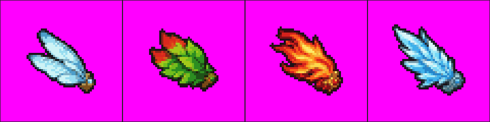

# Prompt lô "Cánh theo cấp" (làn E1)

Một tấm ảnh duy nhất, 8 chiếc cánh: hàng trên là cánh **cấp 1**, hàng dưới là cánh **cấp 3** của 4 loại (chuồn chuồn, lá, lửa, băng). Cánh cấp 2 giữ 4 ảnh đang có trong game, không vẽ lại.

## Cách làm (4 bước)

1. Mở trang **Tách Đồ**: https://spiritblade.web.app/tach-do.html, ở bước 1 chọn lô cuối cùng trong danh sách: **"Trang phục · Cánh theo cấp (8 món: cấp 1 và cấp 3)"**.
2. Bấm **"Lấy ảnh 4 cánh cấp 2 (ảnh tham chiếu)"**, chạm giữ ảnh hiện ra để lưu về máy. (Ảnh này cũng có sẵn ở `anh-tham-chieu-canh-cap-2.png` cùng thư mục.)
3. Bấm **"Sao chép prompt vẽ"**, dán vào ChatGPT và **GỬI KÈM ảnh tham chiếu** ở bước 2. ChatGPT trả về một tấm ảnh lưới 4 cột × 2 hàng, nền hồng tím.
4. Đưa tấm ảnh đó vào bước 2 của trang Tách Đồ. Khi thẻ hiện **ĐẠT**, bấm **"Tải tất cả (.zip, 8 món)"** rồi gửi tệp .zip cho Claude để đưa vào game.

Lưu ý khi xem kết quả ở bước 3 của trang: chạm từng món để xem em bé mang cánh đúng cấp. Chấm đỏ "Gốc cánh" phải nằm ở chỗ cánh mọc ra từ lưng (góc dưới bên phải); lệch thì chạm vào hình để đặt lại.

## Ảnh gửi kèm



## Prompt (chép nguyên từ trang Tách Đồ, ngày 11/10/2026)

```
TÔI GỬI KÈM MỘT TẤM ẢNH: lưới 4 cột × 1 hàng gồm 4 chiếc cánh CẤP 2 đang dùng trong game Linh Khí (pixel art 2D, cảm hứng dân gian Việt Nam), theo thứ tự từ trái sang phải: cánh chuồn chuồn, cánh lá, cánh lửa, cánh băng. Hãy dùng công cụ tạo ảnh vẽ MỘT tấm ảnh pixel art mới gồm ĐÚNG 8 chiếc cánh: bản CẤP 1 và bản CẤP 3 của 4 loại cánh đó. Mỗi loại phải nhìn ra ngay là CÙNG MỘT LOẠI với cánh cấp 2 gửi kèm: cùng dáng, cùng hướng, cùng bảng màu, cùng kiểu viền, cùng nét lạ; chỉ khác độ lớn và độ lộng lẫy. BỐ CỤC: lưới ĐỀU đúng 4 cột × 2 hàng = 8 ô (KHÔNG thêm cột, KHÔNG thêm hàng), các ô bằng nhau, kẻ lưới mảnh màu tối; cột 1 chuồn chuồn, cột 2 lá, cột 3 lửa, cột 4 băng, đúng thứ tự như ảnh gửi kèm. HÀNG TRÊN là CẤP 1 (cánh mới nhú: NHỎ hơn, ÍT lá cánh hơn, mộc mạc, ít chi tiết hơn cấp 2), vẽ chỉ chiếm khoảng 45% ô: ô 1: Cánh chuồn chuồn cấp 1: chỉ MỘT lá cánh ngắn, tròn đầu, kèm một lá con bé xíu phía dưới; mỏng, màu xanh nhạt, chỉ 2 đến 3 nan quạt giấy (màu chính #a8dcf0 #5a8fb8 #f0fcff; trong game chỉ 13×12 điểm ảnh); ô 2: Cánh lá cấp 1: chỉ MỘT chiếc lá non nhỏ màu xanh, một đường gân giữa, chưa có lá đỏ (màu chính #255a2c #479544 #8fd070; trong game chỉ 13×11 điểm ảnh); ô 3: Cánh lửa cấp 1: chỉ MỘT ngọn lửa nhỏ như đốm lửa que diêm, lõi vàng bé, chưa có sao pháo bông (màu chính #f2622a #a32418 #ffc64c; trong game chỉ 13×13 điểm ảnh); ô 4: Cánh băng cấp 1: chỉ HAI mảnh băng ngắn như hai que kem cây nhỏ, mặt băng trơn (màu chính #7fc4f2 #2f62ad #ffffff; trong game chỉ 14×12 điểm ảnh). HÀNG DƯỚI là CẤP 3 (cánh trưởng thành: TO hơn, NHIỀU lá cánh hơn, rực rỡ hơn cấp 2, thêm điểm sáng), vẽ chiếm khoảng 80% ô: ô 5: Cánh chuồn chuồn cấp 3: BA lá cánh dài xoè như quạt giấy mở (hai lá to chĩa lên, một lá nhỏ chĩa ngang ra sau), nan quạt rõ, đầu mỗi lá có chấm trắng sáng như giọt sương (màu chính #a8dcf0 #5a8fb8 #f0fcff; trong game chỉ 23×26 điểm ảnh); ô 6: Cánh lá cấp 3: BA chiếc lá bàng to xếp lớp (lá trên cùng to nhất), xen một lá bàng đỏ mùa thu, gân lá vàng nhạt rõ, mép lá có răng cưa nhỏ (màu chính #255a2c #479544 #8fd070; trong game chỉ 24×26 điểm ảnh); ô 7: Cánh lửa cấp 3: BỐN ngọn lửa dài xoè như đuôi phượng (ngọn giữa cao nhất), lõi vàng sáng chạy dọc từng ngọn, đầu ngọn nở sao pháo bông vàng dính liền vào lửa (màu chính #f2622a #a32418 #ffc64c; trong game chỉ 23×28 điểm ảnh); ô 8: Cánh băng cấp 3: NĂM mảnh băng dài nhọn xoè như nan quạt (mảnh giữa dài nhất), mỗi mảnh vẫn là que kem cây, mặt băng có vệt trắng sáng, đầu mảnh nhọn lấp lánh (màu chính #7fc4f2 #2f62ad #ffffff; trong game chỉ 25×24 điểm ảnh). HƯỚNG (như ảnh gửi kèm): chỉ MỘT bên cánh cho mỗi ô, GỐC CÁNH (chỗ cánh mọc ra từ lưng em bé) nằm ở góc DƯỚI BÊN PHẢI của hình, cánh xoè lên trên và sang trái (game tự vẽ cánh thứ hai và cho cánh vỗ). Mọi lá cánh của một chiếc đều chụm về đúng MỘT điểm gốc đó; ở cấp 3 lá thấp nhất chỉ được chĩa ngang sang trái, không rủ xuống thấp hơn gốc cánh quá một chút. Không vẽ em bé, không vẽ lưng, không dây đeo. CỠ TRONG Ô: mỗi chiếc nằm giữa ô, nằm TRỌN trong ô, cách đường lưới ít nhất 1/10 ô, tuyệt đối không lấn sang ô bên cạnh. KIỂU VẼ: mỗi chiếc cánh là MỘT khối liền (các lá cánh dính nhau ở gốc, không mảnh nào bay rời); khối to đơn giản, ít chi tiết nhỏ vì trong game cánh rất nhỏ; viền tối một nét màu tím than #1b1118 quanh mép; màu phẳng, đổ bóng 3 sắc (tối, vừa, sáng), sáng từ trên. Độ rực của cấp 3 thể hiện bằng màu sáng hơn và các chấm sáng ĐẶC dính liền vào cánh; không chuyển màu, không quầng sáng mờ, không nhoè. KHÔNG vẽ: chữ, số, nhãn, tên món, chú thích, bảng phụ, bảng màu, ô mẫu, khung trang trí, mặt đất, bóng dưới vật, tia lửa hay khói hay hạt sáng bay rời, ô chỉ có hiệu ứng. Không vẽ lại cánh cấp 2, không vẽ thêm chiếc nào ngoài 8 chiếc trên. BẢNG MÀU (bắt buộc bám theo; chỉ để chọn màu, KHÔNG vẽ ô màu mẫu vào ảnh): cỏ cây: đất rừng #3d402e, lá vừa #2f5f34, lá sáng #557521, ngọn lá nắng #d0cf64 | hệ Lửa: nhạt #ffc90e, chính #fe7d04, đậm #c9270c, lõi sáng #feec86 | hệ Băng: nhạt #9cfefa, chính #32b0e9, đậm #217bc3, lõi sáng #eefffc. Mỗi chất liệu trên một vật dùng tối đa 3 sắc lấy trong bảng này; viền (nếu có) giữ đúng như đã ghi ở trên; mã màu đã ghi ở trên (của từng ô, của hệ) thì giữ nguyên, bảng này dùng cho các phần còn lại. Nền trơn MỘT MÀU HỒNG TÍM #FF00FF phủ kín mọi ô (không ô cờ, không nền trắng, không chuyển màu), không dùng màu hồng tím trong cánh. Chỉ cần gửi tấm ảnh, không cần code, không cần file json.
```

## Dung lượng ước thêm

4 ảnh cánh cấp 2 đang có nặng 1,9 đến 2,3 KB mỗi tệp (tổng 8 KB). Với ảnh mẫu máy dựng: cánh cấp 1 nặng 1,3 đến 1,6 KB, cánh cấp 3 nặng 3,2 đến 3,4 KB mỗi tệp. Ước 8 tệp mới thêm khoảng **19 đến 25 KB** vào bản gói 10,12 MB (trần 15 MB), tức dưới 0,3%.
