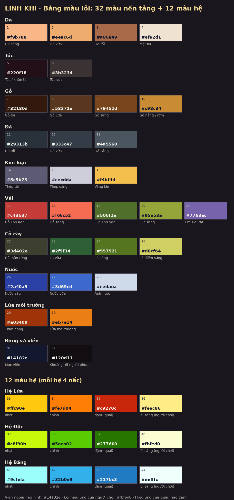

# Bảng màu lõi Linh Khí: 32 màu nền tảng + 12 màu hệ

Ngày 11/10/2026 · Đợt 4 của kế hoạch cải thiện (quyết định Q6). Trạng thái: **chờ chủ dự án duyệt**.

Tệp này nói bảng màu gồm những màu nào, mỗi màu dùng vào việc gì và lấy từ đâu. Bảng **chỉ dùng cho các lô ảnh vẽ mới**. Ảnh đã duyệt trong game giữ nguyên, không ai sửa lại.

- Ảnh bảng màu (44 ô có mã): [`bang-mau-loi.png`](bang-mau-loi.png)
- Bản cho máy đọc: `docs/review/ra-soat-my-thuat/bang-mau.json` (nguồn gốc của mọi mã màu ở đây)
- Tài liệu cũ `BANG-MAU.md` nói về độ sáng của sàn, tường, giao diện và vẫn còn hiệu lực. Tệp này bổ sung phần màu của **vật thể, nhân vật và hiệu ứng**.

## 1. Bốn quy tắc dùng

1. **Viền ngoài của mọi hình luôn là `#14182e`** (xanh đen), dày một nét. Mọi quái và em bé đang có trong game đều dùng đúng màu viền này.
2. **Hiệu ứng của người chơi có lõi sáng `#fbfed0`** (trắng ngà), màu hệ chỉ nhuốm ở mép. Nhờ vậy em bé luôn nổi trên sân.
3. **Hiệu ứng của quái dùng nấc đậm của hệ** (Lửa `#c9270c`, Độc `#277600`, Băng `#217bc3`), không có lõi trắng to. Nhìn màu là biết đòn của ai.
4. **Mỗi vật dùng tối đa 3 sắc cho một chất liệu** (tối, vừa, sáng). Ví dụ gỗ của một cái rương chỉ lấy 3 trong 4 màu gỗ.

## 2. Bảng 32 màu nền tảng

Số thứ tự khớp với số trên ảnh.

| # | Nhóm | Mã màu | Tên | Dùng cho | Nguồn |
|---|---|---|---|---|---|
| 1 | Da | `#f9b788` | Da sáng | mép sáng tay/chân em bé | lấy mẫu từ ảnh trong game: `em-be-smith` |
| 2 | Da | `#eeac6d` | Da vừa | da em bé, dân làng | lấy mẫu từ ảnh trong game: `em-be-hunter` |
| 3 | Da | `#a86a49` | Da tối | bóng da, cổ | lấy mẫu từ ảnh trong game: `em-be-smith` |
| 4 | Da | `#efe2d1` | Mặt nạ | mặt nạ em bé, vành sáng viền em bé | lấy mẫu từ ảnh trong game: `em-be-smith` |
| 5 | Tóc | `#220f18` | Tóc / khăn tối | khăn trùm, tóc, lòng mũ | lấy mẫu từ ảnh trong game: `em-be-smith` |
| 6 | Tóc | `#3b3234` | Tóc vừa | mảng tóc, lông thú tối | lấy mẫu từ ảnh trong game: `em-be-smith` |
| 7 | Gỗ | `#32180d` | Gỗ tối | thân Mộc Tinh, gốc cây, khe gỗ | lấy mẫu từ ảnh trong game: `mocTinh` |
| 8 | Gỗ | `#58371e` | Gỗ vừa | thân cây, rương, cột nhà | lấy mẫu từ ảnh trong game: `mocTinh` |
| 9 | Gỗ | `#79451d` | Gỗ sáng | mặt gỗ được chiếu | lấy mẫu từ ảnh trong game: `mocTinh` |
| 10 | Gỗ | `#c98c34` | Gỗ nắng / rơm | mái tranh, mép gỗ sáng | lấy mẫu từ ảnh trong game: `mocTinh` |
| 11 | Đá | `#29313b` | Đá tối | khe đá Hang biển | màu đang dùng trong mã vẽ: `room_art.js C.ground` |
| 12 | Đá | `#333c47` | Đá vừa | sàn đá | màu đang dùng trong mã vẽ: `room_art.js C.ground` |
| 13 | Đá | `#4a5560` | Đá sáng | gờ đá, lối mòn | màu đang dùng trong mã vẽ: `room_art.js C.ground` |
| 14 | Kim loại | `#5c5b73` | Thép tối | lưỡi kiếm phần tối | lấy mẫu từ ảnh trong game: `vk-sword-0` |
| 15 | Kim loại | `#cecdda` | Thép sáng | lưỡi kiếm, rìu | lấy mẫu từ ảnh trong game: `vk-sword-0` |
| 16 | Kim loại | `#f4bf4d` | Vàng kim | đèn lồng, trang sức, viền đồng | lấy mẫu từ ảnh trong game: `denLong` |
| 17 | Vải | `#c43b37` | Đỏ Thợ Rèn | áo Thợ Rèn (giữ nguyên) | lấy mẫu từ ảnh trong game: `em-be-smith` |
| 18 | Vải | `#f66c52` | Đỏ sáng | nếp áo được chiếu | lấy mẫu từ ảnh trong game: `em-be-smith` |
| 19 | Vải | `#506f2a` | Lục Thợ Săn | áo Thợ Săn | lấy mẫu từ ảnh trong game: `em-be-hunter` |
| 20 | Vải | `#95a53a` | Lục sáng | nếp áo Thợ Săn | lấy mẫu từ ảnh trong game: `em-be-hunter` |
| 21 | Vải | `#7763ac` | Tím Đô Vật | áo Đô Vật, bùa | lấy mẫu từ ảnh trong game: `em-be-wrestler` |
| 22 | Cỏ cây | `#3d402e` | Đất sàn rừng | nấc giữa dải sàn Rừng già | màu đang dùng trong mã vẽ: `room_art.js F.floor` |
| 23 | Cỏ cây | `#2f5f34` | Lá vừa | tán cây, rào lá | màu đang dùng trong mã vẽ: `room_art.js F.leafL` |
| 24 | Cỏ cây | `#557521` | Lá sáng | tán Mộc Tinh, bụi cỏ | lấy mẫu từ ảnh trong game: `mocTinh` |
| 25 | Cỏ cây | `#d0cf64` | Lá điểm sáng | ngọn lá nắng, đom đóm | lấy mẫu từ ảnh trong game: `mocTinh` |
| 26 | Nước | `#2a40a5` | Nước sâu | thân Ngư Tinh, vũng sâu | lấy mẫu từ ảnh trong game: `nguTinh` |
| 27 | Nước | `#3d69cd` | Nước vừa | sông, bến đò | lấy mẫu từ ảnh trong game: `nguTinh` |
| 28 | Nước | `#cedaea` | Ánh nước | gợn sóng, bọt | lấy mẫu từ ảnh trong game: `nguTinh` |
| 29 | Lửa môi trường | `#a03409` | Than hồng | lõi than, bóng lửa | lấy mẫu từ ảnh trong game: `hoTinh` |
| 30 | Lửa môi trường | `#eb7e14` | Lửa môi trường | chậu than, đuốc, lò rèn | lấy mẫu từ ảnh trong game: `hoTinh` |
| 31 | Bóng và viền | `#14182e` | Mực viền | viền ngoài mọi sprite | lấy mẫu từ ảnh trong game: `tat-ca-asset-da-lay-mau` |
| 32 | Bóng và viền | `#120d11` | Khoảng tối ngoài phòng | dải hai bên sân, nóc tường | ước lượng từ ảnh chụp: `05-ai1-huong-dan-phong-dau.jpg (60,300)` |

Trong 32 màu: 26 màu lấy mẫu thẳng từ ảnh trong game, 5 màu là màu đang chạy trong mã vẽ sàn và cây (3 màu đá, đất rừng, lá vừa), 1 màu ước lượng từ ảnh chụp (khoảng tối ngoài phòng). Không có màu nào là màu mới tự đặt ra.

## 3. Bảng 12 màu hệ

| # | Hệ | Nấc | Mã màu | Dùng cho | Nguồn |
|---|---|---|---|---|---|
| 33 | Lửa | nhạt | `#ffc90e` | mép vệt chém, chữ hệ, thanh Lửa | lấy mẫu từ ảnh trong game: `hu-no-lua` |
| 34 | Lửa | chính | `#fe7d04` | thân hiệu ứng, nút Đánh khi mang Lửa (mã đang dùng #ff7a2a) | lấy mẫu từ ảnh trong game: `hu-no-lua` |
| 35 | Lửa | đậm | `#c9270c` | hiệu ứng của quái, bóng lửa, vệt cháy | lấy mẫu từ ảnh trong game: `vk-sword-0-fire` |
| 36 | Lửa | lõi sáng | `#feec86` | lõi hiệu ứng người chơi, số chí mạng | lấy mẫu từ ảnh trong game: `hu-no-lua` |
| 37 | Độc | nhạt | `#c8f90b` | mép mây độc, chữ hệ | lấy mẫu từ ảnh trong game: `hu-no-doc` |
| 38 | Độc | chính | `#5aca02` | thân hiệu ứng, nút Đánh khi mang Độc (mã đang dùng #6fcf3a) | lấy mẫu từ ảnh trong game: `hu-no-doc` |
| 39 | Độc | đậm | `#277600` | vũng/mây độc của quái + viền đỏ | lấy mẫu từ ảnh trong game: `hu-no-doc` |
| 40 | Độc | lõi sáng | `#fbfed0` | lõi hiệu ứng người chơi | lấy mẫu từ ảnh trong game: `hu-no-doc` |
| 41 | Băng | nhạt | `#9cfefa` | mép vệt băng, chữ hệ | lấy mẫu từ ảnh trong game: `hu-no-bang` |
| 42 | Băng | chính | `#32b0e9` | thân hiệu ứng, nút Đánh khi mang Băng (đề xuất thay #7fd4ff trong mã) | lấy mẫu từ ảnh trong game: `vk-sword-0-ice` |
| 43 | Băng | đậm | `#217bc3` | hiệu ứng của quái, gai băng | lấy mẫu từ ảnh trong game: `vk-sword-0-ice` |
| 44 | Băng | lõi sáng | `#eefffc` | lõi hiệu ứng người chơi | lấy mẫu từ ảnh trong game: `hu-no-bang` |

Cả 12 màu hệ đều lấy mẫu từ ảnh hiệu ứng và vũ khí đang có trong game.

## 4. Bảng màu được dùng ở đâu

**Trong prompt vẽ.** Mỗi trang công cụ `tach-*` (Phòng, Làng, Giao Diện, Đồ, Quái, Anh Hùng, Hiệu Ứng) tự thêm một đoạn "BẢNG MÀU (bắt buộc bám theo)" vào prompt. Đoạn này chỉ liệt kê các nhóm màu liên quan tới lô đang chọn, không nhồi cả 44 màu:

| Trang | Lô | Nhóm màu đưa vào prompt |
|---|---|---|
| Tách Phòng | Đồ vật trong phòng | gỗ, đá, kim loại, lửa môi trường, bóng |
| Tách Phòng | Lô khác (cửa, trang trí) | gỗ, đá, kim loại, bóng |
| Tách Làng | Công trình | gỗ, đá, cỏ cây, kim loại, bóng |
| Tách Giao Diện | Biểu tượng bản đồ | kim loại |
| Tách Giao Diện | Lô khác | kim loại, gỗ, bóng |
| Tách Đồ | Vũ khí, vật phẩm | gỗ, kim loại |
| Tách Đồ | Trang phục | vải, kim loại, gỗ |
| Tách Quái | Quái vùng Rừng | cỏ cây, gỗ, lông tối, nấc đậm của hệ |
| Tách Quái | Quái vùng Biển | nước, đá, kim loại, nấc đậm của hệ |
| Tách Quái | Quái vùng Lâu đài | đá, kim loại, lửa môi trường, nấc đậm của hệ |
| Tách Anh Hùng | Em bé, người làng | da, tóc, vải |
| Tách Anh Hùng | Bộ trang phục | da, tóc, vải, kim loại |
| Tách Hiệu Ứng | Hiệu ứng có hệ | 4 nấc của đúng hệ đó |
| Tách Hiệu Ứng | Hiệu ứng không hệ | kim loại và cả ba hệ |

Hai ngoại lệ có chủ ý:

- **Tách Đồ và Tách Giao Diện giữ mã viền riêng của mình.** Viền đồ là `#1b1118` vì game đổi màu viền này theo bậc Lam, Tím, Vàng. Giao diện dùng viền nâu tối riêng. Hai trang này cũng giữ các mã màu đã ghi cho từng món.
- **Tách Hiệu Ứng, các mục có phe (của người chơi hay của quái)** đã có sẵn câu màu riêng từ trước. Câu đó nay lấy mã từ cùng một nguồn với bảng này, nên không thêm đoạn thứ hai.

**Trong công cụ.** Bước 2 của mỗi trang có ô **"Giảm màu"** với hai lựa chọn:

- **Tự do (như cũ)**: mặc định. Công cụ làm y như trước, tệp xuất ra không đổi một điểm ảnh nào.
- **Theo bảng màu Linh Khí**: sau khi giảm số màu, công cụ đưa từng màu của hình về màu gần nhất trong bảng (44 màu, thêm trắng và đen). Màu nào quá xa bảng thì giữ nguyên để hình không bị bệt. Hai mảng màu lớn khác hẳn nhau không bị dồn về cùng một màu. Phần "kết quả kiểm" ghi rõ bao nhiêu màu đã khớp bảng trên tổng số.

Ô này luôn trở về "Tự do" mỗi lần mở trang, nên không thể lỡ tay đổi màu một lô cũ.

## 5. Khi cần đổi một mã màu

Sửa ở `docs/review/ra-soat-my-thuat/bang-mau.json` và ghi lý do, sửa bảng trong tệp này, chạy lại script vẽ ảnh (`docs/review/ke-hoach-cai-thien/dot-4/kiem/ve_bang_mau.py`), rồi sửa khối "BẢNG MÀU LINH KHÍ" trong cả 7 trang `tools/tach-*/index.html` (khối giống hệt nhau ở mọi trang). Đợt 4 không đổi mã màu nào so với bản rà soát.
