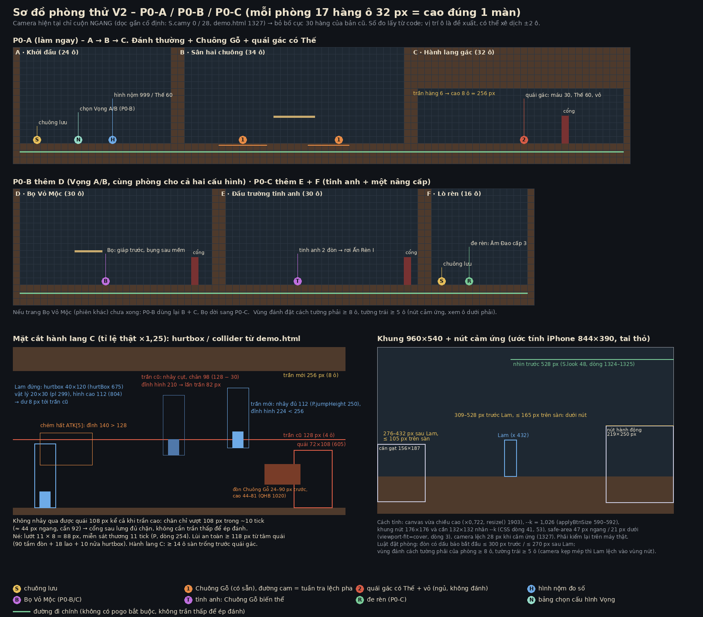

# Kế hoạch gameplay V2 – BẢN RÚT GỌN THEO PHẢN HỒI 1, SỬA THEO PHẢN HỒI 3 VÀ 5 (27/10/2026)

**Game chính chưa sửa, chưa publish.** Mọi con số là số để thử. Chưa chơi thử trên iPhone thật.
**Phản hồi 3** (`PHAN-HOI-3-KE-HOACH-V2-VA-BO-VO-MOC.md`, **PH3**): duyệt bắt đầu P0-A trên trang riêng sau khi sửa 3 luật – đã sửa, xem bảng cuối file "Đã sửa theo phản hồi 3".
**Phản hồi 5** (`PHAN-HOI-5-P0A.md`, **PH5**): P0-A đủ để thử người chơi và làm tiếp Âm Đao cấp 1–4, **chưa ghép vào game chính**. Sửa luật vỏ (mục 5), chốt 6 câu – xem bảng cuối file "Đã sửa theo phản hồi 5".
Bản cũ `KE-HOACH-GAMEPLAY.md` (**KHGP**) giữ nguyên để đối chiếu. Bản này theo đúng 10 điểm chốt của `PHAN-HOI-1-KE-HOACH-GAMEPLAY.md` (**PH1**), và khớp `KE-HOACH-VU-KHI.md` đã sửa theo `PHAN-HOI-2-KE-HOACH-VU-KHI.md` (**PH2**).

**Ưu tiên lúc này** (PH1): làm đánh thường ngon trước, rồi chứng minh bóng khiến chiến đấu hay hơn. Không dựng phòng lớn.

Thuật ngữ: **tick** = 1/60 giây. **Hộp đòn** = vùng gây sát thương (tính riêng, không đọc ảnh). **Thế** = thanh đứng vững của địch. **[máu, Thế]** = lượng một đòn trừ. Thang số ×10 (Chuông Gỗ 40 máu).

---

## 1. Mười điểm chốt → ở đâu trong bản này

| # | Chốt của PH1 | Mục |
|---|---|---|
| 1 | Bộ vũ khí Âm Đao / Xích Chuông / Liềm Chuông / Trượng Vọng. **Bỏ Búa/Chùy.** Dao cũ chỉ là placeholder khi thử độ nhạy | 3, 10 |
| 2 | P0-A làm ngay: buffer 1 nhát, `su` 7/7/9, ngưỡng hướng, Chuông Gỗ + quái gác có Thế; hình/VFX khớp hộp đòn; trang riêng | 3 |
| 3 | Vọng: không chạm đúp; 2 cấu hình chọn trước khi vào phòng; "Vọng Chiến" ≠ "Dư Âm" | 4 |
| 4 | Bóng có sát thương phụ thấp, phản hồi rõ; đổi từng biến một | 4 |
| 5 | Tách vỏ cứng với Thế tinh anh/boss; choáng, hồi phục, ổn định, chống chuỗi choáng | 5 |
| 6 | Công thức sát thương rõ, có ví dụ số | 6 |
| 7 | Phạm vi P0-A / P0-B / P0-C; hoãn Dơi và Mẹ Nấm đủ ba đòn | 7, 9 |
| 8 | Kiểm hành lang 128 px với hurtbox/collider; camera, né, dấu báo | 8 |
| 9 | Buffer giữ 1 nhát, có hạn, xoá đúng lúc; log 4 loại | 3 |
| 10 | Không mặc định checkpoint giữa hai pha boss; không sửa boss trong P0 | 7 |

---

## 2. Code đã đọc lại cho bản này

`game/demo.html` (không đổi từ commit `93014ae`). Không ghi file thì là file này.

| Điều | Code làm gì | Chỗ |
|---|---|---|
| Bộ đòn | `ATK[1..3]` combo đất: `su` 11/11/11, `ac` 8, `re` 8/8/16. Hộp `[dx,dy,w,h]` tính từ chân | `ATK` 260–267 |
| Buffer hiện tại | Bấm Chém → `atkBuf = 8` tick, giảm mỗi tick. Chỉ nối combo khi `atkT ≥ su + ac` (tick 19) → **bấm ở tick 0–10 của đòn bị mất** | `step()` 1298, 1335; `updatePlayer()` 787–791 |
| Chọn đòn theo hướng | Đất + "lên" → chém hất; trên không + "xuống" → chém nảy | 786–790 |
| Ngưỡng cần gạt | "lên/xuống" bật khi lệch > 0,38 (≈ 22°); pogo `pogoDown` 0,35 | `onTouch()` 565; `P` 255; `downHeld()` 534 |
| Xoá buffer | Rút dao xoá `atkBuf`; lướt đặt `atkN = 0`; bị đánh đặt `atkN = 0` | 707; 713–716; `hurt()` 1008 |
| Hình khớp hộp | Khung hình theo bảng `khung_theo_atkT`; ghi chú "khung TRÚNG bắt đầu đúng atkT = su"; vệt chém bật ở `vet_chem.bat_dau` = 10 | 827, 848, 1307; `art/modular/lam-moi/hanh-dong/sprite/lam-hanh-dong-2x.json` |
| Lam | Vật lý **20×30** (`pl` 299). Vùng ăn đòn **40×120** neo ở chân (`hurtBox()` 675). Hình cao **112** (804). Nhảy cao **112** (`P.jumpHeight` 250). Lướt 11 px × 8 tick, miễn sát thương 11 (`P` 254) | |
| Chuông Gỗ | Thân **72×108** (606). Máu 3 (`mkQuai` 608–611). Thấy Lam < 170 px → lấy đà 30 tick → đập (hộp bật tick 5–10) → thu 26 → nghỉ 60. Hộp đập `QHB {dx −90, dy −81, w 66, h 37}`: 24–90 px trước, cao 44–81 | `updateQuai` 1032–1071; `QHB` 1020 |
| Quái gác | `Q[2]` có cờ `guard`: chỉ ngủ/thức, **không đánh**, chỉ mất máu bởi Cộng hưởng | 612–613; 1045–1046; `strike()` 927–934 |
| Chống trúng lặp / Cộng hưởng | 1 ô nhớ mã nhát (`swP`, `swE`); Cộng hưởng ≤ 12 tick → ×3 | `strike()` 918–935; `resonance()` 950–963 |
| Vọng | V lần 1 ghi, lần 2 dừng (> 3 tick); ghi tối đa 180 tick **trạng thái** (không ghi phím) | `startRec` 891; `stopRec` 892–897; `recordFrame` 898–902; `updateEcho` 903–912 |
| Camera | Màn 960×540, ô 32, phòng cao 17 ô. Camera **chỉ cuộn ngang**, nhìn trước 48 px; dọc cố định 0 (bàn phím) / 28 (cảm ứng) | 271; 1321–1327 |
| Nút cảm ứng | Khung nút 176×176, cần 132×132, nhân `--k` theo cạnh ngắn màn; `viewport-fit=cover` | CSS 38–63; `applyBtnSize` 586–593; `resize` 1903–1912; dòng 3 |
| Boss chết là hồi đầy | `respawn()` gọi `resetBoss()` | 659–664, 629 |

---

## 3. P0-A – làm ngay (chi tiết)

**Trang riêng** `game/thu-p0a/`, sinh từ `demo.html` bằng script (cách `thu-re-muc`). **Không đổi game chính, không publish.** Lam rig-v4, **dao cũ làm placeholder** nhưng đi qua đúng giao diện dữ liệu ở mục 6 (để Âm Đao cắm vào sau).
**Bước 0 (trước mọi thứ):** chốt giao diện dữ liệu chung (mục 6a) và công thức (6b).

### 3a. Bốn thay đổi

| Thay đổi | Hiện tại | P0-A |
|---|---|---|
| Hàng chờ đòn | `atkBuf` 8 tick, mất nếu bấm sớm | **1 chỗ chờ**, luật ở 3b |
| Khởi động combo | `su` 11 / 11 / 11 | **7 / 7 / 9** (nhát 3 vẫn là nhát nặng) |
| Ngưỡng hướng **khi ra đòn** | 0,38 (≈ 22°) | **0,7** (≈ 45°). Di chuyển, leo ván, pogo tự động giữ nguyên |
| Quái | Chuông Gỗ máu 3; quái gác chỉ chết bởi Cộng hưởng | Chuông Gỗ [40, –], không bị ngắt khi đã lấy đà ≥ 18 tick. Quái gác [30, 60, vỏ] theo luật Thế (mục 5), **vẫn không đánh** |

### 3b. Luật hàng chờ (PH1 mục 1, 9)

- **Một chỗ** `pl.cho`. Không bao giờ có hai nhát chờ.
- Nhận từ **tick 1** của đòn đang đánh. Thực hiện ở **tick đầu tiên được phép**: nhát tiếp của combo ở `atkT = su + ac`; sau nhát 3 là nhát 1 mới khi nhát 3 hết.
- **Hạn**: tới hết đòn đang đánh **+ 6 tick**. Quá hạn → bỏ, log `het-han`.
- Bấm thêm khi đã có nhát chờ → **thay thế** (lấy hướng cần gạt của lần bấm mới), vẫn 1 nhát.
- **Xoá** khi: lướt (hủy đòn), bị đánh, chết, đổi phòng, rút dao. Tạm dừng thì không nhận.
- Hệ quả: bấm 5 lần trong một nhát vẫn chỉ ra **1** nhát tiếp. Lam không tự đánh tiếp ngoài ý muốn.

Log mỗi lần chạm Chém (một dòng khi nhận + đúng một dòng kết cục):

| Khi nhận | Kết cục sau đó |
|---|---|
| `ra-ngay` (rảnh, ra đòn tick đó) | – |
| `xep-hang` (đang đánh, vào chỗ chờ) | `thuc-hien` / `het-han` / `xoa:<lý do>` / `bi-thay` |
| `thay-the` (đè nhát đang chờ) | như trên |
| `loai:<luật>` (tạm dừng, đang bị đánh `hurtT > 8`, đang chết) | – |

**Tiêu chí** (thay "0 lần bấm bị mất"): **mọi lần bấm đều có dòng nhận và đúng một kết cục theo luật trên**; không lần nào biến mất không lý do; không đòn nào ra mà không có lần bấm tương ứng.

### 3c. Hình và VFX khớp hộp đòn – quy ước đếm tick (PH3 sửa 3)

**Quy ước đếm** (một chỗ, mọi số trong file này theo quy ước này):

| Khái niệm | Định nghĩa (đọc từ `step()` / `updatePlayer()` / `atkBox()` / `huUpdate()`) |
|---|---|
| Tick | Một lần `step()` chạy qua dòng `if(S.hitstop>0)…return` (`S.frame++`). **Bước hitstop không đếm** (đòn, hiệu ứng, bóng cùng đứng) |
| Tick của đòn | Giá trị `atkT` **sau** `updatePlayer()` của bước đó. Bước ra đòn = **tick 1** (`startAtk` đặt 0, cuối `updatePlayer` tăng lên 1). Bấm lúc rảnh → bước bấm cũng là tick 1 |
| `su` | Số tick của đòn **tới và gồm** tick hộp bật đầu tiên: hộp bật ở tick `su … su+ac−1` (`atkBox`: `t ≥ su` và `t < su+ac`). Từ bước bấm (tick 1) tới bước hộp bật là `su − 1` bước sau |
| Khung trúng | Hình vẽ ở lần render sau tick `t` là `khung_theo_atkT[t−1]`. "Khung trúng ở `su`" ⇔ phần tử thứ `su` (chỉ số `su−1`) là khung trúng |
| `vetBatDau` | Tick của đòn mà **khung 0 của vệt chém hiện ra lần đầu** ở render. Đúng luật khi `vetBatDau = su` |

**Vì sao code cũ ghi `bat_dau` = 10 = su − 1 mà vẫn gọi là "cùng tick":** hiệu ứng tạo bằng `hu()` có `t = 0`, nhưng `huUpdate()` chạy **trong cùng bước** (sau `huVet`) nên `t` thành 1 trước khi vẽ. Khung 0 của vệt dài 1 bước (`buoc [1,3,3,4]`) **không bao giờ hiện**, còn khung 1 hiện ngay ở render của tick 10 – **sớm 1 tick** so với hộp (tick 11). Trừ 1 là bù sai chỗ: vệt sớm 1 tick và mất khung 0.

**P0-A chốt:** `vetBatDau = su` (7 / 7 / 9) và vệt tạo với `t = −1`, nên sau `huUpdate()` cùng bước là `t = 0` → **khung 0 hiện đúng ở render của tick `su`**, cùng tick với hộp và khung trúng. Bóng phát lại theo cùng luật (`c.at === vetBatDau` trong bản ghi). Không chỉ đổi số theo phép trừ: phải đo.

- ~~Cắt bảng `khung_theo_atkT` cho `su` mới (bỏ 4 / 4 / 2 phần tử đầu)~~ → **PH5: phân bố lại** khung trong cùng startup 7 / 7 / 9 (không vẽ lại): nhát 1 `chuanbi×2 giuong×3 vung×1` → `trung` ở tick 7 (×2) → `trung2×6 thu×4 ve×4`; nhát 2 `chuanbi×1 giuong×4 vung×1`; nhát 3 `chuanbi×2 giuong×4 giuong~vung×1 vung×1` → `trung` ở tick 9. Còn tư thế lấy đà đọc rõ, không bật thẳng sang vung; không tăng rung / hitstop. Khung "trúng" vẫn rơi **đúng tick `su`**. Bản cắt cũ giữ ở `?khung=cat` chỉ để so.
- Bóng dùng cùng bảng (`updateEcho` 906) nên tự khớp.
- Kiểm bằng **debug chậm**: lớp debug hộp đòn + số `atkT` / hộp / khung / khung vệt trên đầu Lam, chạy ¼ tốc độ (mỗi tick giữ 4 hình video), ghi bảng từng tick cho cả nhịp cũ (`?p0=0`) và mới. **Lệch 0 tick** mới đạt.

### 3d. Đạt P0-A khi

| Tiêu chí | Đạt khi |
|---|---|
| Nhạy | Chạm → hộp đòn ≤ `su` + 1 tick. 3 người thử, ≥ 2 thấy bản mới nhạy hơn (so với `su` 11 bằng nút ⚙) |
| Mọi lần bấm có kết cục | Log 3b không có dòng thiếu kết cục |
| Không ra nhầm hướng | Chém hất ra khi đang chạy < 5 % số đòn (log hướng cần gạt lúc ra đòn), trên iPhone thật |
| Hình khớp | 3c lệch 0 tick |
| Thế đọc được | Người chưa chơi tự phá được quái gác, nói được "nhát 3 làm nứt vỏ" (quái gác không đánh: chỉ kiểm **đọc vỏ**, không kết luận trận đánh đã hay – PH5) |

**Thử người chơi (PH5), trước khi ghép vào game chính:** link mặc định (tắt log / hộp đòn) trên iPhone; so nhịp cũ / mới **cùng điều kiện** (cùng phòng, cùng quái, cùng máy), **đổi thứ tự** giữa người thử; hỏi **riêng** 3 câu: phản hồi có nhanh không · có đánh tiếp ngoài ý muốn không · có ra nhầm chém hất không. Báo cáo **tách hai phần**: số đo code (log, tick) và cảm nhận người chơi.

---

## 4. Vọng: hai cấu hình, bóng có sát thương phụ (P0-B)

**Không dùng chạm đúp.** Chọn cấu hình ở bảng trước khi vào phòng; trong phòng nút V chỉ có **một** nghĩa.

| | **A – Ghi chủ động** (hiện tại) | **B – Vọng Chiến** (prototype) |
|---|---|---|
| Nút V | Chạm bắt đầu ghi, chạm dừng → bóng phát | **Chạm 1 lần** → bóng phát lại **1,5 s (90 tick) vừa qua** |
| Ghi | Khi người chơi bật | Vòng đệm 90 tick **luôn ghi** (trạng thái, không ghi phím); dừng trong hitstop |
| Tốn | Miễn phí | 1 nấc Vọng (2 nấc, hồi 1 nấc / 150 tick) |
| Lưu ý | – | Mới vào phòng chưa đủ 90 tick → phát đoạn đang có (> 3 tick), nút mờ nếu chưa đủ |

- **"Dư Âm" chỉ là kỹ năng Âm Đao.** Không dùng tên này cho Vọng.
- Chung cho A và B: 1 bóng; gọi bóng mới thì bóng cũ mất; **đổi phòng xoá bóng** (hiện code không xoá); chết xoá bóng.
- Ghi chú (PH5): demo cũ được các báo cáo trước xác định **bóng gây 1 máu như Lam** (không phải 0). Trang P0-A giữ `BONG_MAU` 0,25 làm **cấu hình kiểm công thức**, giống hệt ở nhịp cũ và mới; `?bm=0` chỉ là cấu hình thử **tắt** sát thương bóng, không phải bản tái hiện demo cũ.
- Bóng trúng **có sát thương phụ**: `goc × BONG_MAU` (thử 0,25) máu và `× BONG_THE` (thử 0,5) Thế, tối thiểu 1 máu khi đòn gốc có máu (mục 6b). Quái nhỏ không Thế vẫn mất máu vì bóng.
- **Phản hồi rõ** khi bóng trúng: số nhỏ màu teal mờ, chớp viền mục tiêu, tiếng "tíc" nhẹ. Bị vỏ chặn thì hiện "Keng" mờ.
- Phòng P0-B **không có câu đố cần ghi** (cấu hình B không có ghi chủ động). Game chính không đổi.

### 4a. So sánh từng biến một (PH1 mục 4)

Ba biến tách riêng: **sát thương bóng** (`BONG_MAU`, `BONG_THE`), **Cộng hưởng** (`CH_MAU`, `CH_THE`), **tài nguyên** (số nấc, hồi nấc). Mỗi vòng thử chỉ đổi **một** nhóm, các nhóm khác giữ ở mốc gốc.

| Vòng | Đổi | Giữ nguyên | Đo |
|---|---|---|---|
| 0 – mốc gốc | – | 0,25 / 0,5 · CH_MAU 1, CH_THE 50 % · 2 nấc, 150 tick | |
| 1 | `BONG_MAU` 0,15 / 0,25 / 0,4 | Cộng hưởng, tài nguyên | Thời gian qua phòng B–D; % quái chết có bóng góp; người thử chấm "bóng có ích" 1–5 |
| 2 | `CH_MAU` 0,5 / 1 / 1,5 | `BONG_*` = kết quả vòng 1, tài nguyên | Số lần Cộng hưởng; % lần thắng tinh anh có Cộng hưởng |
| 3 | 2 nấc / 150 tick so với 3 nấc / 120 | Bóng, Cộng hưởng | Số lần gọi bóng mỗi phút; có lúc "hết nấc" không |
| A ↔ B | Cấu hình Vọng | Mọi số | Mỗi người chơi cả hai, **đổi thứ tự** (người 1 A→B, người 2 B→A). Hỏi: "Cách nào làm trận đánh hay hơn?" |

Mọi log ghi kèm chuỗi cấu hình (ví dụ `B|bm0.25|bt0.5|ch1|ct0.5|n2|h150`). Không kết luận tính năng nào tốt từ một vòng đổi nhiều nhóm.

---

## 5. Thế: vỏ cứng tách khỏi tinh anh / boss (sửa theo PH5)

**Luật chốt PH5:** vỏ **vật lý** của quái thường phá **một lần** và giữ vỡ tới chết. Thế của tinh anh / boss hồi được và phá nhiều lần, có trạng thái ổn định để chống chuỗi choáng. **Ổn định chỉ ngăn phá Thế tiếp, không tự khôi phục vỏ đã mất.** Mục tiêu đã mất vỏ nhận máu bình thường từ mọi nguồn (Lam, bóng, phần thêm của Cộng hưởng). Nếu sau này có quái tái tạo vỏ, đó là **một hành động riêng có báo trước và ngắt được**, không phải bộ đếm vô hình.

| | **Vỏ cứng** (quái thường có `vo` hoặc `mat`: quái gác, Bọ Vỏ Mộc) | **Tinh anh / boss** |
|---|---|---|
| Thế còn | Đòn bị chặn máu ("Keng") – `vo`: mọi hướng; `mat`: chỉ phía trước | Vừa mất máu vừa mất Thế |
| Thế về 0 | **Vỏ vỡ hẳn** (`phaMotLan`): choáng 1 lần, đứng dậy với vỏ **vẫn vỡ** tới chết, đánh hướng nào cũng mất máu, quái **đánh tiếp** bình thường | Vỡ Thế: choáng → hồi phục (Thế về đầy) → ổn định → phá lại được |
| Cộng hưởng | **Vỡ ngay** (nếu vỏ còn); vỏ đã mất → chỉ cộng máu thêm, không bị chặn | Trừ `CH_THE` (thử 50 % Thế tối đa), **không về 0 mặc định** |
| Hồi khi không bị đánh | **Không** (vết nứt chỉ tăng) | Có |

**Các trạng thái Thế** (số thử, tick):

| Trạng thái | Nghĩa | Vỏ cứng | Tinh anh | Boss | Nhận Thế? |
|---|---|---|---|---|---|
| Bình thường | | | | | Có |
| Vỡ | Thế ≤ 0: "Choang", hitstop 6, vòng đồng | tức thì, **một lần** | tức thì | tức thì | – |
| **Choáng** | Không đánh, đòn đang ra bị hủy, 3 chấm quay | 120 | 150 | 90 | **Không** (không trừ, không tích cho lần phá sau) |
| Hồi phục | Đứng dậy | 20 – **vỏ vẫn vỡ** | 20 – Thế về đầy | 20 – Thế về đầy | Không |
| **Ổn định** | Đánh được bình thường; Thế giảm nhưng **không xuống dưới 1**. Viền vòng Thế sáng. Không khôi phục vỏ / Thế đã mất | **không có** (không còn vỏ để bảo vệ) | 120 | 120 | Có, sàn 1 |
| **Mất vỏ** | Sau hồi phục, tới chết: không chặn máu, không nhận Thế, không hồi | ✓ | – | – | Không |
| Hồi Thế khi không bị đánh | Chờ 90 tick, rồi +1 Thế / 3 tick | **không** | ✓ | ✓ | |

Cấu hình (trang P0-A, `cong-cu/khoi-p0a.js`): `THE_VO` (`phaMotLan: true`, `hoiThe: false`, `onDinh: 0`) cho quái gác; `THE_TINH_ANH`, `THE_BOSS` (`phaMotLan: false`, `hoiThe: true`) **ghi sẵn cho sau**, chưa quái nào dùng trong P0-A; hình nộm giữ luật Thế hồi được (công cụ đo).
**Quái gác không đánh** → chỉ là **bài kiểm đọc vỏ** (Keng / nứt / vỡ / mất vỏ), **không dùng để kết luận trận đánh đã hay**.

**Chống chuỗi choáng** (tinh anh / boss): lần vỡ thứ 2 trong 600 tick → choáng ×0,6; lần 3 trở đi ×0,4 (tối thiểu 45). Cộng hưởng khóa 45 tick mỗi mục tiêu (giữ từ KHGP).
Ước lượng xấu nhất với tinh anh [160, 80]: choáng 150 / (150 + 20 + 120 + ~60 tick để phá lại) ≈ **43 %** thời gian ở vòng đầu, rồi ≈ 30 %, ≈ 23 %. Không có lúc địch bị khóa liên tục.

**Quái nhỏ không Thế** (Chuông Gỗ, Dơi, Nấm): chỉ mất máu. Trúng lúc chưa vào đòn → khựng 16 tick; đã lấy đà ≥ 18 tick → **không bị ngắt**.

---

## 6. Giao diện dữ liệu chung và công thức sát thương

### 6a. Giao diện dữ liệu (chốt **trước** P0-A)

```js
// Thang ×10, mọi thời gian = tick. P0-A chỉ dùng: DON (dao placeholder), THE, LOAI_QUAI, CFG, D.
DON = { id, su, ac, re, hs, rung, box:[dx,dy,w,h],      // hoặc hopTheoTick:[…] (Liềm)
        goc:[mau, the],
        chiMang:{ kieu:'khong'|'ngauNhien'|'dieuKien', tyLe, heSo },
        co:{ ch, duChan, hieuUng, kichDau },             // cờ chống dây chuyền (VK mục 5b)
        khung:'atk1', vetBatDau,                         // khớp hình (3c)
        baoTruoc, dauHinh, dauAm }                       // CHỈ đòn của quái: dấu báo; dauAm phải đi kèm dauHinh
VK[id]     = { ten, don:{1..6:DON}, kyNang:{ id, giu, hoi, don:DON, … }, pogo, luotHuy }
CAP_VK[id] = [ null, {mo,an}, {cong|dat|nhan}, … ]      // chỉ ghi thay đổi; Âm Phù dùng cùng dạng + dieuKien
THE        = { toiDa, vo, mat, choang, hoiPhuc, onDinh, choHoi:90, hoiMoi:3,
               giamChoangLap:[1,0.6,0.4], cuaSoLap:600, chThe:'voNgay'|0.5 }
LOAI_QUAI[id] = { ten, mau, the:THE|null, nang:'nhe'|'vua'|'nang'|'neo',
                  than:[w,h], anDon:[w,h], khongNgatSau:18, vaiTro, don:{…DON} }
CFG = { resWindow:12, khoaCH:45, hsCH:8, CH_MAU:1, CH_THE:0.5, BONG_MAU:0.25, BONG_THE:0.5 }
// Lần đòn: tạo LÚC RA ĐÒN GỐC, chỉ số CHỐT tại đây, không đọc lại khi trúng. SỐNG SUỐT VÒNG ĐỜI ĐÒN (mọi tick hộp bật)
D   = { ma, src:'p'|'e'|'k', vk, loai, goc:[mau,the], chiMang, heSoCM, hs, co, hb, daTrung:[] }
// Bản ghi bóng mỗi tick (cả cấu hình A và B). maGoc = D.ma của đòn gốc (giống nhau ở mọi tick của cùng một đòn)
REC[i] = { x, y, khung, vk, n, hop:[ {loai, x,y,w,h, ve, goc, co, maGoc} ×≤4 ] }
// Mỗi LẦN PHÁT bóng có một bảng ánh xạ riêng, xoá khi bóng mới phát / bóng mất
PHAT = { id, bang:{ maGoc → D bóng } }   // D bóng tạo ở tick ĐẦU TIÊN gặp maGoc đó, dùng lại ở các tick sau
```

- `pl.cs` = gốc vũ khí → cấp → Âm Phù, gộp **một lần** khi trang bị / nâng cấp / đổi Âm Phù. `D.goc` chép từ `pl.cs` lúc tạo đòn.
- Bản ghi bóng giữ `goc` đã chốt → bóng không tra lại cấp lúc phát (PH2 mục 4).
- Danh sách hộp ≤ 4 và luật "có hộp phải có hình": `KE-HOACH-VU-KHI.md` mục 5f.

**Mã đòn bền suốt vòng đời đòn (PH3 sửa 1).**
- Lam: `D` tạo **một lần** lúc ra đòn (`startAtk`), dùng cho mọi tick hộp bật (`su … su+ac−1`). `daTrung` chỉ xoá khi đòn mới bắt đầu.
- Bóng: mỗi **lần phát** có bảng `maGoc → maReplay`. Tick đầu tiên gặp hộp có `maGoc` chưa có trong bảng → tạo **một** `D` bóng (`src 'e'`, mã mới, `goc`/`co` lấy từ bản ghi, `daTrung` rỗng); các tick sau của cùng hộp **dùng lại đúng `D` đó**. **Không** tạo `D`/`daTrung` mới mỗi tick → hộp bật 8 tick vẫn trúng mỗi mục tiêu **1 lần**.
- Lần phát sau (bản ghi mới, hoặc phát lại bản ghi cũ) có bảng mới → mã mới: không "dùng lại" dấu Cộng hưởng của lần phát trước.
- Xích (sau này): lượt đi và lượt về là **hai `maGoc` khác nhau** (`ma·2 + lượt`) khi luật cho phép trúng cả hai lượt; nếu luật chỉ cho 1 lần / ném thì dùng chung một `maGoc`.
- Kiểm: log mỗi lần trúng ghi `ma`, `maGoc`, tick; video "hộp nhiều tick" phải ra đúng 1 dòng trúng / mục tiêu / đòn.

### 6b. Công thức (một lần `D` trúng mục tiêu `e`)

1. **Trúng** nếu hộp chồng `e` và `e` ∉ `D.daTrung`.
2. **Số gốc của lần trúng.** Lam / đòn phụ: `m = goc.máu × (D.chiMang ? heSoCM : 1)`, `t = goc.Thế`. Bóng: `m = goc.máu × BONG_MAU`, `t = goc.Thế × BONG_THE`. Chí mạng ngẫu nhiên **gieo một lần lúc tạo đòn**; bóng và đòn phụ không chí mạng.
3. **Chặn máu**, xét Thế **trước** lần trúng: `vo` và Thế > 0 → `m = 0`; `mat`, từ phía trước, Thế > 0 → `m = 0`. Nhát làm vỡ vỏ không gây máu; từ nhát sau mới gây.
4. **Trừ Thế** theo trạng thái ở mục 5. Về 0 → vỡ.
5. **Làm tròn xuống. Tối thiểu 1 chỉ khi `goc.máu > 0` và không bị chặn.** `goc.máu = 0` → luôn 0.
6. **Cộng hưởng**: nhát Lam (`'p'`) và nhát bóng (`'e'`), cả hai có `co.ch`, trúng cùng `e` cách ≤ `resWindow` tick, **chưa ghép lần nào**, `e` không bị khóa → **thêm một lần trúng**:
   - máu thêm = `floor(CH_MAU × máuCơSở)`; `máuCơSở` = `goc.máu` đã lưu của nhát Lam, **chưa nhân chí mạng**. Ai trúng trước cũng dùng **cùng công thức, cùng số** này.
   - Thế: vỏ cứng → vỡ ngay; tinh anh / boss → `−CH_THE × Thế tối đa` theo luật mục 5.
   - Phần thêm không bị vỏ chặn. Xoá nhớ của cả hai nhát (mỗi nhát ghép ≤ 1 lần), khóa `e` 45 tick, hitstop 8.
7. **Hitstop** = `Math.max` của các lần trúng trong tick, không cộng. Bóng `hs − 1`.
8. **Hiệu ứng vũ khí**: chỉ khi `D.co` cho phép (kéo, dấu, Dư Chấn). Vết Dư Âm sinh **theo lần dùng kỹ năng**, không theo lần trúng (`KE-HOACH-VU-KHI.md` 5b–5c).

Trả lời PH1 mục 6: Cộng hưởng là **cộng thêm**, không phải "×2 tổng". Cặp ghép = 1 nhát Lam + 1 nhát bóng, mỗi nhát ghép tối đa một lần trên một mục tiêu; mỗi lần phát bóng có mã đòn riêng (6a).

**Thứ tự trúng – cái gì được bảo đảm, cái gì không (PH3 sửa 2).** Luật "nhát làm vỡ vỏ không gây máu" **không** bảo đảm mọi thứ tự trúng cho cùng tổng máu: nếu nhát Lam đến trước vừa đủ phá Thế, bóng đến sau đánh vào vỏ đã vỡ và gây máu; đổi thứ tự thì bóng bị chặn, Lam phá vỏ – tổng máu lệch vì hai nhát có sát thương khác nhau. Không cố ép đối xứng tuyệt đối. Bảo đảm ba điều:
1. **Phần thưởng Cộng hưởng dùng cùng công thức** dù ai trúng trước: máu thêm từ `máuCơSở` của nhát Lam (chưa chí mạng), Thế theo bước 6.
2. **Hit trong cùng tick không phụ thuộc thứ tự duyệt mảng**: mọi lần trúng cùng tick trên một mục tiêu được gom lại rồi xét **một lần**: chặn máu theo trạng thái Thế **đầu tick** (trước mọi lần trúng của tick đó), Thế trừ = tổng, cặp Cộng hưởng chọn theo nguồn (`'p'` ↔ `'e'`, mã nhỏ nhất nếu nhiều), không theo ai được duyệt trước. Duyệt Lam trước hay bóng trước, mục tiêu nào trước → cùng kết quả.
3. **Hit ở tick sau xử lý theo trạng thái thực tại lúc trúng**: vỏ đã vỡ thì nhát sau gây máu (vỏ quái thường vỡ tới chết – PH5); đang choáng không trừ Thế; Thế tinh anh / boss đang ổn định không xuống dưới 1. Nhất quán cho mọi nguồn.

### 6c. Ví dụ số (dao placeholder P0-A: nhát 1–2 [10,10], nhát 3 [10,30])

**Ví dụ 1 – bóng một mình vào Chuông Gỗ [40, –].** Bóng phát lại nhát 1 `goc` [10,10]: máu `floor(2,5)` = **2** (≥ 1 vì gốc dương), Thế: không có. Sóng [0,15] vào Chuông Gỗ: **0** máu.

**Ví dụ 2 – Vọng Chiến (B) phá quái gác [30, 60, vỏ].** t = tick của Lam.

| t | Việc | Thế | Máu |
|---|---|---|---|
| 0–38 | Lam combo nhát 1 (hộp t 7), nhát 2 (hộp t 22), rồi dừng | 60 → 50 → 40 | 30 (Keng ×2) |
| 40 | Chạm V: bóng phát lại t −50…39. Bóng sẽ trúng ở t 97 (nhát 1) và t 112 (nhát 2) | | |
| 90 | Lam chạm Chém → hộp nhát 1 ở t 97 | | |
| 97 | Lam [10,10]: Thế trước 40 → chặn máu. Bóng cùng tick [2,5]: chặn | 40 → 30 → 25 | 30 |
| 97 | **Cộng hưởng**: vỏ vỡ ngay, choáng 120 (tới t 217); máu thêm 1 × 10 | **vỡ** | **20** |
| 112 | Lam nhát 2 [10] + bóng nhát 2 [2] (khóa Cộng hưởng tới t 142; đang choáng không trừ Thế) | – | 20 → **8** |
| 129 | Lam nhát 3 [10] | – | **chết** |

Không có bóng: từ Thế 40 cần thêm nhát 1 + nhát 2 + nhát 3 mới vỡ (nhát 3 không gây máu), rồi thêm 3 nhát máu → chậm khoảng **một combo**. Bóng là đường tắt, không bắt buộc.

**Ví dụ 3 – phần thưởng Cộng hưởng không đổi theo thứ tự** (tinh anh [160, 80], **không có vỏ**, Âm Đao cấp 5, Lam chí mạng 18, bóng phụ [3,5]): Lam trước hay bóng trước đều ra **[33 máu, 55 Thế]** = Lam 18 + bóng 3 + thêm 12 / Thế 10 + 5 + 40. Cùng tổng ở đây vì tinh anh không có vỏ chặn máu. Chi tiết: `KE-HOACH-VU-KHI.md` 5e ví dụ 3.

**Ví dụ 4 – có vỏ, khác tick, tổng máu được phép khác** (quái gác [30, 60, vỏ], Thế còn 10; Lam [10,10], bóng [2,5]):

| Thứ tự | Lần trúng 1 | Lần trúng 2 (cách 5 tick, ≤ 12) | Cộng hưởng | Tổng máu |
|---|---|---|---|---|
| Lam trước | Lam: Thế 10 > 0 → chặn máu, Thế 10 → 0 **vỡ** | Bóng: vỏ đã vỡ → **2** máu; đang choáng không trừ Thế | thêm 10 (vỏ đã vỡ) | **12** |
| Bóng trước | Bóng: Thế 10 > 0 → chặn, Thế 10 → 5 | Lam: Thế 5 > 0 → chặn; Cộng hưởng → vỡ ngay | thêm 10 | **10** |
| Cùng tick | Gom: Thế đầu tick 10 > 0 → **cả hai bị chặn**; Thế 10 − 10 − 5 → vỡ | – | thêm 10 | **10** (đổi thứ tự duyệt vẫn 10) |

Phần thưởng (10) giống nhau ở cả ba dòng; chỉ phần máu thường của bóng (2) phụ thuộc vỏ đã vỡ hay chưa **lúc nó trúng** – đúng luật 3.

---

## 7. Phạm vi P0-A / P0-B / P0-C

| Đợt | Câu hỏi kiểm chứng | Nội dung | Không có |
|---|---|---|---|
| **P0-A** | Đánh thường có nhạy và có đích không? | Mục 3. Phòng A–B–C (`so-do-phong-thu-v2.png`): hình nộm, 2 Chuông Gỗ lệch pha, quái gác có Thế | Vọng mới, tinh anh, nâng cấp |
| **P0-B** | Vọng Chiến có làm trận đánh hay hơn ghi chủ động không? | Mục 4: chọn A/B ở phòng A; bóng có sát thương phụ; Cộng hưởng mới. Thêm phòng D **Bọ Vỏ Mộc** (cùng phòng cho cả A và B) | Tinh anh, nâng cấp |
| **P0-C** | Tinh anh + một nâng cấp có tạo cảm giác tiến triển không? | Phòng E tinh anh 2 đòn, rơi **Ấn Rèn I**; phòng F đe rèn → **Âm Đao cấp 3 (mở Dư Âm)** | Đủ 8 cấp, vật liệu, menu, lưu game |

- **Prototype Âm Đao cấp 1–4** (`KE-HOACH-VU-KHI.md` mục 10) đã được duyệt, làm **sau P0-A**, song song P0-B, trên cùng phòng A–C. P0-C dùng lại phần Dư Âm của nó.
- **Bọ Vỏ Mộc** là quái mới đầu tiên, thử phá Thế bằng đổi hướng (giáp trước `mat`, bụng sau mềm). Trang thử `game/thu-bo-vo-moc/` của phiên khác đã lên nhánh (commit `58e0eb0`: rig 5 mảnh, 13 clip, mai dội, vỡ mai lật ngửa) – **không sửa thư mục đó**; P0-B chỉ dùng lại rig/clip sau khi chủ dự án trả lời các câu hỏi trong `game/kiem-thu-bo-vo-moc/GHI-CHU.md`. Lệch số trang Bọ (choáng 180 tick) đã được PH3 chốt: **120 tick**, cùng bảng mục 5. PH3: Bọ vào P0-B **như bài thử thứ hai** (so Vọng A/B trên B + C trước, rồi mới thử phòng Bọ).
- **Tinh anh đầu tiên: Chuông Gỗ biến thể** ("Chuông Gỗ Gác Lớn", [160, 80], nặng, 2 đòn: đập như Chuông Gỗ + húc ngang báo trước 36 tick). Lý do so với Người Gác Câm:

| | Chuông Gỗ biến thể (chọn cho P0-C) | Người Gác Câm |
|---|---|---|
| Asset | Rig + clip + code có sẵn (`QBR.capNhatQuai`), phóng to + tô màu | Mới có ảnh gốc nền trắng, chưa tách mảnh, chưa rig/clip |
| Công sức | S–M | M–L |
| Câu hỏi P0-C | Đủ: Thế tinh anh, chống chuỗi choáng, rơi Ấn Rèn | Đủ, nhưng chậm hơn nhiều |
| Về sau | Giữ làm vật canh giữ nhân tạo | **Tinh anh chính thức (P1)**, dùng cùng dữ liệu `THE` / `DON` |

- Tinh anh **rơi Ấn Rèn I** (PH2): mở Dư Âm trước boss đầu trong demo thật; trong P0-C là nâng cấp duy nhất.
- **Hoãn**: Dơi (Rễ hoặc Chuông), Mẹ Nấm Mốc đủ ba đòn, Nấm Thở, Phu Đèn Lạc, Âm Phù, né sát đòn, lối tắt, cửa sập, quái hồi sinh, vách nứt, chuông cổ thử thách.
- **Boss: không sửa trong P0.** Checkpoint giữa hai pha **không mặc định**: là lựa chọn độ khó, thử riêng sau P0 (bản có / không có, đo số lần chết và bỏ cuộc).
- Không làm: menu, lưu game, đủ 4 vũ khí, đổi runtime toàn game, kiểm thử tự động.

---

## 8. Phòng thử: hành lang, camera, né, dấu báo



**Hành lang 128 px (bản cũ) với số thật trong code:**

| Kiểm | Số | Kết luận |
|---|---|---|
| Lam đứng | Hurtbox cao 120, hình 112, vật lý 30 | Dư 8 px tới trần: không kẹt (vật lý chỉ 30 cao), nhưng sát |
| Lam nhảy | Vật lý chạm trần khi chân lên 98 (128 − 30) thay vì 112 | Nhảy bị cụt; hình (112) lên tới 210 px → **vẽ lấn vào trần 82 px** |
| Chém hất đứng yên | Đỉnh hộp 140 (`ATK[5]`) | Hộp và vệt chém xuyên trần |
| Dấu "!" của bóng | Vẽ ở 140 px trên chân (1811) | Nằm trong trần |
| Nhảy qua quái gác | Thân 108; chân chỉ vượt 108 px trong ~10 tick ≈ 44 px ngang, cần 92 | **Không nhảy qua được kể cả khi trần cao** → cổng sau lưng đủ chặn |

→ **Bỏ trần thấp.** Hành lang C cao **8 ô (256 px)**: nhảy đủ, đỉnh hình 224, chém hất khi nhảy tới 252. Sàn trống ≥ 14 ô trước quái gác để "đánh rồi lùi".

**Né:** đòn Chuông Gỗ phủ 24–90 px trước tâm, cao 44–81, báo trước 30 tick, lao 18 px. Lùi an toàn ≥ 118 px từ tâm (chạy 4,4 px/tick × 30 tick = 132 px, đủ). Lướt 88 px, miễn sát thương 11 tick. Sân B: 2 Chuông Gỗ cách nhau ≥ 14 ô để luôn có chỗ thoát.

**Camera và nút (ước tính iPhone 844×390, kiểm lại trên máy):**
- Toàn bộ chiều cao phòng luôn trong màn (camera dọc cố định) → **mọi phòng 17 ô**; bỏ bố cục 30 hàng của bản cũ (camera không cuộn dọc).
- Lam ở x ≈ 432; thấy 528 px phía trước, 432 phía sau.
- Nút hành động che ≈ 219 × 250 px góc phải dưới → vùng **309–528 px trước Lam, ≤ 165 px trên sàn**. Cần gạt che ≈ 156 × 187 px góc trái → 276–432 px sau Lam, ≤ 105 px trên sàn.

Luật đặt phòng:
- Đòn có dấu báo phải **bắt đầu** trong ≤ 300 px trước / ≤ 270 px sau Lam (Chuông Gỗ phát hiện 170 px: đạt).
- Vùng đánh cách tường phải của phòng ≥ 8 ô, tường trái ≥ 5 ô (camera kẹp mép thì Lam lệch vào vùng nút).
- Dấu báo phủ **cả thân quái** (lóe, đổi dáng), không chỉ một chấm nhỏ ở chân, để vẫn đọc được khi một phần bị ngón tay che.

---

## 9. Bộ quái

Theo `BO-QUAI-DE-XUAT.md`: không phải quái nào cũng là chuông. Chuông Gỗ giữ làm **vật canh giữ nhân tạo**.

| Vai trò | Quái | Đợt | [máu, Thế] (thử) | Nặng (Xích) |
|---|---|---|---|---|
| Cận chiến nền | **Chuông Gỗ** (có sẵn) → sau thay vai bằng Phu Đèn Lạc | P0-A | [40, –] | vừa |
| Giữ cổng, học Thế | **Quái gác** (Chuông Gỗ có vỏ) | P0-A | [30, 60, `vo`] | neo |
| Giáp trước, đổi hướng | **Bọ Vỏ Mộc** | P0-B (hoặc C) | [40, 40, `mat`] (= trang thử: máu 4, mai 4 nấc, ×10) | nặng |
| Tinh anh | **Chuông Gỗ Gác Lớn** → **Người Gác Câm** | P0-C → P1 | [160, 80] → [240, 120] | nặng |
| Cận chiến cung đánh | Phu Đèn Lạc | P1 | [40, –] | vừa |
| Bay / lao | Dơi Rễ | P1 (hoãn) | [20, –] | nhẹ |
| Giữ khoảng cách | Nấm Thở | P1 (hoãn) | [30, –] | neo |

**Ảnh gốc** (`art/huong-moi/nguon/quai/`, đủ 5 con, nền trắng – chưa dùng được ngay):

| Quái | Mảnh cần (BO-QUAI mục 5) | Đã có trên ảnh gốc | Còn thiếu |
|---|---|---|---|
| Bọ Vỏ Mộc | thân, mai, đầu, 2 cụm chân | **Đã tách 5 mảnh + 2 lớp nứt, rig, 13 clip** (`art/huong-moi/quai-rig/bo-vo-moc/`) | Chờ duyệt trang thử của phiên khác |
| Phu Đèn Lạc | đầu, áo, tay, đèn, 2 bàn chân | mũ trùm, áo choàng, tay, cán, đèn, giày | tách nền, cắt mảnh, rig, clip, hộp đòn |
| Dơi Rễ | thân, 2 cánh | dáng treo, dáng bay, thân, 2 cánh lá | như trên |
| Nấm Thở | thân, mũ, túi phồng | túi xẹp, túi phồng, gốc, mũ, túi bào tử | như trên |
| Người Gác Câm | (tinh anh) mũ, thân, 2 tay, 2 chân, trượng | đủ các mảnh đó | như trên + đòn nặng, lõi lộ |

**Mọi dấu báo âm thanh phải có dấu hình** (điện thoại hay tắt tiếng):

| Quái / đòn | Âm | Hình (bắt buộc) |
|---|---|---|
| Chuông Gỗ đập | "ting" (`sfx.warn`) | Chuông lóe vàng 30 tick (có sẵn) |
| Quái gác bị đánh | "Keng" / "Choang" | Tia Keng (có sẵn) / vòng đồng + vết nứt 3 mức |
| Bọ Vỏ Mộc húc | gõ gỗ khép mai | Mai khép lại + chân cào lùi + bụi |
| Chuông Gỗ Gác Lớn húc | tiếng chuông trầm | Thân ngả ra sau 36 tick + vạch cam đỏ trên sàn chỉ đường húc |
| Phu Đèn vung (P1) | xích đèn kẽo kẹt | Đèn kéo ra sau + cung mờ cam đỏ |
| Dơi Rễ lao (P1) | rít | Ngửa, rung cánh + vạch cam đỏ hướng lao |
| Nấm Thở phun (P1) | hít vào | Túi phồng (scale) + viền **cam đỏ** (khe teal giữ làm màu thân, vì teal = Vọng) |
| Bóng trúng | "tíc" nhẹ | Số teal mờ + chớp viền |
| Cộng hưởng | chuông ngân | Vòng + chữ (có sẵn) |

Trường `dauAm` trong `DON` không được dùng nếu thiếu `dauHinh` (mục 6a).

---

## 10. Đối chiếu với `KE-HOACH-VU-KHI.md` (bản đã sửa theo PH2)

| Xung đột / chỗ lệch | Bản cũ nói | Giải quyết |
|---|---|---|
| Vũ khí thứ hai | KHGP: Búa Chuông Nứt (P1/P2), đòn nặng đi cùng Búa | **Bỏ Búa.** 4 vũ khí theo VK. Đòn nặng thành "giữ Chém = kỹ năng" – **chỉ là phương án thử** (VK S3, 7a) |
| Tên "Dư Âm" | KHGP: chạm đúp V = Dư Âm | Vọng quá khứ = **Vọng Chiến** (cấu hình B). Dư Âm = kỹ năng Âm Đao |
| Bóng gây 0 máu | KHGP: bóng [0,1] | Bóng có phụ `BONG_MAU/BONG_THE` (biến, chưa chốt), tối thiểu 1 khi gốc dương |
| Cộng hưởng | KHGP: "Thế về 0 + máu ×2" | Vỏ: vỡ ngay. Tinh anh/boss: `CH_THE`. Máu: **cộng thêm** `CH_MAU × máuCơSở` |
| Lấy chỉ số cho bóng | VK cũ: cấp lúc bóng xuất hiện | **Chốt lúc tạo đòn gốc**, lưu trong bản ghi |
| Tối thiểu 1 sát thương | VK cũ: mọi đòn | Chỉ khi `goc.máu > 0` (0 là 0) |
| Chí mạng khi Cộng hưởng | VK cũ: nhát kích không gieo chí mạng | Gieo lúc vung, không hồi tố; thêm từ `máuCơSở` chưa chí mạng → đối xứng |
| Nhát làm vỡ vỏ có gây máu? | KHGP/VK cũ: có | **Không** (chặn theo Thế trước lần trúng) – luật thử "Keng → vỡ → đánh phần mềm" (PH3). **Không** bảo đảm cùng tổng máu mọi thứ tự; chỉ bảo đảm 3 điều ở 6b |
| Hộp đòn trong bản ghi | VK cũ: 1 cận chiến + 2 đạn | Danh sách ≤ 4 hộp, hộp nào cũng có hình (VK 5f) |
| Mở kỹ năng | VK cũ: Ấn I từ boss | **Ấn I từ tinh anh trước boss** (P0-C thử đúng việc này); boss thưởng Xích |
| Xích kéo | VK cũ: "máu ≤ 60" | Hạng nặng nhẹ/vừa/nặng/neo (`LOAI_QUAI.nang`, mục 9) |
| Phòng thử | KHGP: 64×30 ô, Mẹ Nấm, Dơi, Âm Phù, lối tắt | 6 phòng 17 ô chia P0-A/B/C; hoãn phần còn lại |
| Hành lang | KHGP: trần 4 ô để không nhảy qua quái | Trần 8 ô; cổng sau lưng đủ chặn (mục 8) |
| Boss | KHGP P1: hồi sinh vào pha 2 | Không mặc định; thử riêng sau P0 |
| Tiêu chí bấm | KHGP: "0 lần bấm bị mất" | "Mọi lần bấm có dòng nhận + đúng một kết cục" (3b) |
| Âm Phù | KHGP/VK cũ: cấm tăng sát thương / giảm hồi | Cho phép có điều kiện / đánh đổi (VK 6a); không làm ở P0 |
| Thế khi choáng | KHGP: Thế đầy lại sau choáng | Tinh anh / boss: hồi phục 20, ổn định, không tích Thế khi choáng, giảm choáng lặp. **Vỏ quái thường (PH5): vỡ một lần, không đầy lại** (mục 5) |

---

## 11. Bốn câu hỏi trước – đã có trả lời (PH3)

| Câu hỏi | Chủ dự án chốt |
|---|---|
| Giao diện dữ liệu 6a + công thức 6b đủ cho P0-A? | Đủ, sau khi sửa mã đòn replay (đã sửa ở 6a) |
| Nhát làm vỡ vỏ không gây máu? | Đồng ý làm **luật thử**, nhưng không coi là cách bảo đảm đối xứng (đã sửa ở 6b) |
| Tinh anh P0-C dùng Chuông Gỗ biến thể? | Đồng ý, hai đòn khác rõ nhịp |
| Bọ vào P0-B hay P0-C? | **P0-B, bài thử thứ hai**: so Vọng A/B trên B+C trước, rồi mới thử trên phòng Bọ. Số Bọ để thử: cao 74, máu 4, mai 4, choáng **120** tick (PH3 mục 4) |

---

## Đã sửa theo phản hồi 3

| # | Điểm PH3 | Đã sửa ở đâu | Tóm tắt |
|---|---|---|---|
| 1 | Mã đòn replay bền suốt vòng đời đòn | 6a (khối dữ liệu + đoạn "Mã đòn bền"), `KE-HOACH-VU-KHI.md` 5d, 8c, 8e | `maGoc → maReplay` theo từng lần phát; `D` bóng tạo ở tick đầu gặp `maGoc`, dùng lại các tick sau; không tạo `D`/`daTrung` mỗi tick; xích tách lượt đi/về bằng hai `maGoc` khi luật cho phép |
| 2 | Bỏ khẳng định "cùng tổng máu mọi thứ tự" | 6b (đoạn "Thứ tự trúng"), 6c ví dụ 3–4, 10, `KE-HOACH-VU-KHI.md` 5c bước 3, 5e ví dụ 3 | Chỉ bảo đảm: thưởng Cộng hưởng cùng công thức; hit cùng tick gom lại, chặn theo Thế đầu tick, không phụ thuộc thứ tự duyệt; hit khác tick theo trạng thái thực tại. Ví dụ 4 cho thấy tổng lệch (12 / 10) là đúng luật |
| 3 | Quy ước tick của `su`, khung trúng, `vetBatDau` | 3c (bảng quy ước) | Tick đòn = `atkT` sau `updatePlayer`, bước ra đòn = tick 1; hộp tick `su…su+ac−1`; khung `khung_theo_atkT[t−1]`; `vetBatDau = su` + tạo vệt với `t = −1`. Giải thích vì sao code cũ ghi `su − 1` (khung 0 bị `huUpdate` cùng bước nuốt, vệt sớm 1 tick). Kiểm bằng debug chậm ¼ ở trang P0-A |
| + | Bọ: choáng 120, vào P0-B bài thử thứ hai | 7, 11 | Ghi số chốt; chưa làm trong P0-A |

---

## Đã sửa theo phản hồi 5

`PHAN-HOI-5-P0A.md` (**PH5**). Code ở `game/thu-p0a/` và `game/thu-bo-vo-moc/`; chi tiết + video: `game/thu-p0a/GHI-CHU.md` mục "Sửa theo phản hồi 5".

| # | Điểm PH5 | Đã sửa ở đâu | Tóm tắt |
|---|---|---|---|
| 1 | Vỏ tự trở lại làm mất ý nghĩa phá giáp | Mục 5 (viết lại), 6b bước 3 luật 3, 10; trang P0-A (`THE_VO`), trang Bọ | Vỏ vật lý quái thường vỡ **một lần**, giữ vỡ tới chết; không ổn định, không hồi Thế khi không bị đánh. Tinh anh / boss giữ hồi + ổn định (ghi cấu hình cho sau). Ổn định không khôi phục vỏ. Mất vỏ → nhận máu bình thường, kể cả Cộng hưởng |
| 2 | Cộng hưởng xuyên ổn định? | Mục 5, 6b | Không phá Thế xuyên ổn định (tinh anh / boss); mục tiêu đã mất vỏ vẫn nhận máu bình thường |
| 3 | Một Cộng hưởng mỗi mục tiêu | 6b bước 6 (giữ), code P0-A | Tính theo **từng mục tiêu**; mỗi cặp nhát ghép tối đa 1 lần trên mỗi mục tiêu (code ghi rõ danh sách nhát đã ghép trên từng mục tiêu) |
| 4 | Bóng 0,25 máu phụ | Mục 4 (ghi chú), P0-A | Giữ làm cấu hình kiểm công thức, **giống nhau** ở nhịp cũ và mới. Demo cũ được báo cáo bóng gây **1 máu như Lam**; `?bm=0` = cấu hình thử tắt sát thương bóng, không phải "giống demo cũ" |
| 5 | Nhát 1 bật thẳng sang vung | 3c, trang P0-A | Không vẽ / gen lại; phân bố lại khung trong cùng startup 7 / 7 / 9 tick (tư thế lấy đà đọc rõ → vung 1 tick → chạm sắc → hồi có trọng lượng); không tăng rung / hitstop |
| 6 | Luật dash | 3b (giữ) | Xoá lệnh chờ cũ; chém mới trong dash giữ một lệnh, ra khi được phép |
| 7 | Gen vòng Thế / vết nứt | – | Chưa gen; dùng hình code |
| 8 | Thử người chơi trước khi ghép | 3d, GHI-CHU P0-A | Link mặc định tắt log / hộp đòn; so nhịp cũ / mới cùng điều kiện, **đổi thứ tự** giữa người thử; hỏi riêng 3 câu; tách số đo code và cảm nhận người chơi |
| 9 | Quái gác không đánh | Mục 5 | Chỉ là bài kiểm đọc vỏ, không dùng kết luận trận đánh đã hay |
| 10 | Bọ: mai vẫn vỡ sau khi đứng dậy | Mục 5, trang Bọ | Bỏ "dậy lại → mai đầy" và mai tự hồi; hết choáng Bọ đánh tiếp |
