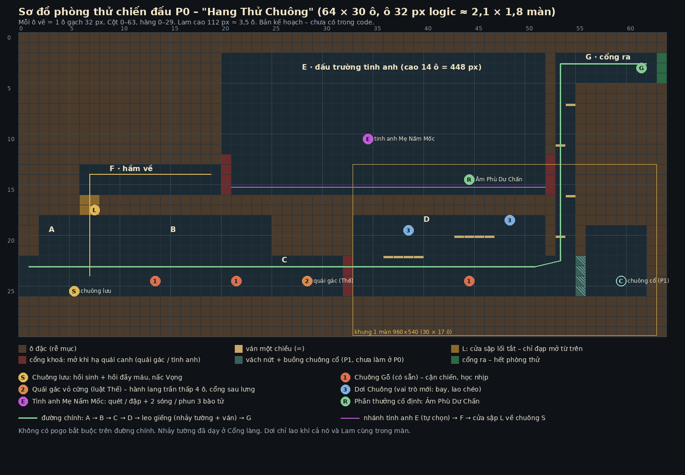

# Kế hoạch mở rộng gameplay – BẢN ĐỂ DUYỆT (27/10/2026)

Trả lời `docs/gameplay/YEU-CAU-KE-HOACH-GAMEPLAY.md`. **Chưa sửa code, chưa publish.** Mọi con số ở mục F là số để thử, chưa cân bằng.
Chưa chơi thử trên iPhone thật: mọi nhận xét về cảm giác cảm ứng là suy luận từ code, phải kiểm lại trên máy.

Cách đọc thuật ngữ:
- **tick**: một bước mô phỏng. Game chạy 60 tick mỗi giây, nên 1 tick ≈ 16,7 ms.
- **hộp đòn**: vùng vô hình gây sát thương.
- **hitstop**: game khựng lại vài tick khi đòn trúng.
- **buffer**: game nhớ một lần bấm trong vài tick để dùng ngay khi được phép.
- **Thế**: thanh "đứng vững" của địch. Thanh này cạn thì địch bị choáng.

---

## A. Điều đã xác minh trong code và điều chỉ là giả định

Số dòng tính theo nhánh `tieng-vong-cuoi-cung`, commit `2ddc000`. Nếu không ghi tên file thì là `game/demo.html`.

### A1. Đã xác minh (đọc code)

| Hệ thống | Code làm gì | Chỗ |
|---|---|---|
| Nhịp cố định | Logic chạy 60 tick/s với bộ cộng dồn thời gian. Mỗi khung hình chạy tối đa 4 tick. Phần vẽ nội suy theo `accT/DT`. | `DT`, `MAX_STEPS`, `loop()` dòng 2200–2218 |
| Tốc độ chơi | Chỉ có trong chế độ debug: `DBG.speed` nhân thời gian thật (×1, ½, ¼, ⅒). Game không có tốc độ chơi riêng cho người chơi. | dòng 2100, 2214 |
| Tạm dừng | `step()` vẫn đọc phím rồi thoát khi `S.paused`. Cài đặt (⚙) và màn kết bật cờ này. | `step()` 1294–1295; `openSet` 2072; `endScreen` 2081–2086 |
| Hitstop | Một bộ đếm chung `S.hitstop`. Mọi chỗ gán đều dùng `Math.max`, nên Lam và bóng trúng cùng lúc **không cộng dồn**. Trong lúc khựng, phím bấm vẫn được ghi vào buffer nhưng mô phỏng (cả bóng) đứng yên. | `step()` 1297–1303; `strike()` 930, 947; `resonance()` 951, 956 |
| Thông số Lam | Gom trong `P`: chạy 4,4 px/tick, lướt 11 px/tick × 8 tick, miễn sát thương 11 tick, hồi lướt 18 tick, coyote 6, buffer nhảy 8, `resWindow` 12, máu 5, miễn sát thương sau khi trúng đòn 60 tick | `P` dòng 250–256 |
| Bộ đòn | `ATK[1..6]` có `su` (chuẩn bị), `ac` (hộp đòn bật), `re` (thu), hitstop, rung, hộp `[dx,dy,w,h]` tính từ chân. Đòn 1–3 là combo đất, đều `su` **11 tick**. Đòn 4 chém nảy, 5 chém hất, 6 chém trên không. | `ATK` 260–267 |
| Hộp đòn độc lập hình | `atkBox()` tính theo `ATK.box`, không đọc ảnh. Vùng ăn đòn của Lam 40×120, vật lý 20×30. | `atkBox` 676–682; `hurtBox` 675; ghi chú 816 |
| Chọn đòn | Trên không + giữ xuống (hoặc tự động khi có địch ngay dưới, `P.autoPogo`) → chém nảy. Trên không → đòn 6. Trên đất + giữ lên → chém hất. Còn lại → đòn 1. | `updatePlayer()` 786–790 |
| Nối combo | Chỉ nối khi `atkT ≥ su+ac` (từ tick 19). Lần bấm Chém lưu trong `atkBuf = 8` tick. **Bấm ở tick 0–10 của đòn sẽ hết hạn trước tick 19 và bị mất.** | 791; `step()` 1298, 1335 |
| Hủy đòn | Lướt cắt ngang đòn bất cứ lúc nào, cả lúc đang chuẩn bị (`pl.atkN=0`), chỉ bị giới hạn bởi thời gian hồi lướt. Trúng đòn cũng xóa đòn đang đánh. Nhảy không hủy đòn: đòn vẫn chạy tiếp trên không. | lướt 713–716; `hurt()` 1008; nhảy 763–776 |
| Cần gạt cảm ứng | Gạt chệch hơn khoảng 22° khỏi phương ngang (ngưỡng 0,38) là bật "lên"/"xuống". Pogo cần `stickY > 0,35`. | `onTouch()` 565; `downHeld()` 534 |
| Nút cảm ứng | 4 nút: Vọng, Chém, Lướt, Nhảy, cộng cần gạt. Không có nút thứ năm. | HTML 153–158 |
| Pogo | Trúng là nảy lên. Hồi lại lướt **và cho thêm một lần nhảy trên không** (`airJump=true`). Miễn sát thương 8 tick. | `pogoBounce()` 970–976 |
| Chống trúng nhiều lần | Mỗi mục tiêu nhớ mã nhát chém cuối của Lam (`swP`) và của bóng (`swE`), nên một nhát chỉ trúng một mục tiêu một lần. | `strike()` 918 |
| Tiếng Vọng ghi/phát | Bấm V lần 1 bắt đầu ghi (`startRec`, xóa bóng cũ), bấm lần 2 dừng (`stopRec`, cần ghi trên 3 tick). Ghi tối đa `P.echoFrames` = 180 tick. Mỗi tick ghi **trạng thái** (vị trí, khung hình, hộp đòn tuyệt đối). Không ghi phím bấm. | `startRec` 891; `stopRec` 892–897; `recordFrame` 898–902; `REC` 310; `step()` 1300, 1313 |
| Bóng phát lại | Phát một lần rồi đứng nguyên tư thế cuối. Đòn của bóng dùng **đúng hộp đòn đã ghi, ở toạ độ thế giới cũ**. Dấu `!` (`echo.warn`) báo bóng sắp chém trong 18 tick tới. | `updateEcho` 903–912; `step()` 1315 |
| Bóng gây sát thương | Bóng chém trúng mất **1 máu, bằng nhát của Lam**. GDD ghi "40%" nhưng code không làm vậy. | `strike()` 935; `docs/gdd.md` dòng 90 |
| Mất bóng | Bóng mất khi chết (`hurt` 1012 bỏ bản ghi, `respawn` 660), khi chơi lại, khi bắt đầu ghi mới. **Đổi phòng không xóa bóng.** | 646, 660, 891, 1012; không có trong `step()` 1322 |
| Cộng hưởng | Nhát của Lam và nhát của bóng trúng cùng mục tiêu cách nhau ≤ 12 tick (đếm `S.frame`, không tăng trong hitstop) → sát thương ×3, hitstop 8, rung, chớp, chữ. Không có giới hạn số lần. | `strike()` 920–922, 935; `resonance()` 950–963 |
| Vỏ cứng | Quái gác (`guard`) chỉ mất máu khi bị Cộng hưởng. Đòn thường chỉ ra "Keng" và hitstop 2. Quái gác **không bao giờ tấn công**: chỉ chuyển qua lại `sleep`/`awake`. | `strike()` 927–934; `updateQuai` 1045–1046; `Q[2]` 612 |
| Quái Chuông Gỗ | Máu 3. Đi 0,9 px/tick. Thấy Lam trong 170 px thì lấy đà 30 tick, đập 16 tick (hộp đòn bật tick 5–10), thu 26, nghỉ 60. **Mỗi nhát trúng đổi trạng thái thành `hit` 16 tick, kể cả khi đang lấy đà, nên đòn của quái bị ngắt.** Đụng thân cũng mất máu. | `mkQuai` 608–611; `updateQuai` 1032–1071 (1052–1063, 1067); `strike()` 940 |
| Chém hất | Chỉ là hộp đòn hướng lên, **không hất địch**: quái chỉ bị đẩy ngang (`kvx`). | `strike()` 940 |
| Boss pha 1 | Máu 18. Pha 1 dừng ở 9. Đi bộ 50 tick rồi đập nhảy (báo trước 30, sóng 2 bên 5,2 px/tick) hoặc quét thấp (báo trước 30, hộp 170×40). Bị đánh **không ngắt** đòn boss. | `boss` 616; `updateBoss` 1106–1137; khóa máu 937 |
| Boss pha 2 | Boss treo trần, thả 3 mảnh (báo trước 42 tick, mảnh đầu rơi ngay chỗ Lam). Bóng đứng trên nút `SW.btn` thì kéo boss xuống, choáng 180 tick, rồi bay lên lại. Mỗi bóng mới kéo được 1 lần (`pulledBy`). **Đứng trên nút, bấm V, chờ hơn 3 tick, bấm V là đủ để kéo**, vì bóng xuất hiện ngay trên nút. | `checkPull` 1096–1103; `hang`/`shakeCeil`/`pulled`/`stun` 1143–1165; nút 600 |
| Chết trong trận boss | `respawn()` gọi `resetBoss()`: boss **đầy máu, quay về pha 1**. Chuông lưu gần nhất ở Điểm lưu, cột 14. | 659–664, 629–634; `BELLS` 603 |
| Sau boss | Boss chết → 170 tick sau tới màn kết. Không còn gì để chơi sau boss. | `bossDie` 1080–1085; 1169 |
| Phần thưởng | Quái vỡ rơi 1–2 mảnh chuông, mỗi mảnh +1 máu. Không có vật liệu, tiền hay đồ. | `killQuai` 1028–1031; `dropShards` 1015–1017; `updateHazards` 1188–1191 |
| Cổng, công tắc | Cổng mở theo điều kiện, có 3 kiểu chốt (`now`, `open`, `pass`). Công tắc nhận Lam hoặc bóng (`byEcho`/`byPl`). | `mkDoor` 602, 622–625; `updateWorld` 1196–1226 |
| Ngẫu nhiên | `Math.random` dùng cho vị trí mảnh trần, mảnh nhặt, hạt. Bóng phát lại **trạng thái đã ghi** nên không bị ảnh hưởng. | `spawnShards` 1087–1095; `dropShards` 1016 |
| Bản đồ demo | 6 phòng: Cổng làng ×2, Sân chuông, Câu đố chuông, Điểm lưu, Chuông Gác Làng. Cao 17 hàng ô 32 px. | `room()` 273–274 |
| Rễ Mục | Là **trang thử riêng**, chưa vào `demo.html`. Tường mục gãy sau 120 tick bám (`GAY`), mất 180 tick (`MAT`), hồi đồng hồ 0,25/tick (`HOI`). | `game/thu-re-muc/cong-cu/khoi-re-muc.js` 7–12, 117–154 |
| Runtime quái | `QBR.capNhatQuai/capNhatBoss` đổi trạng thái gameplay ra clip. Đã có sẵn `capNhatNam`, `capNhatDoi`, `capNhatMeNam`. Gói `quai-moi-rig.json` + 23 mảnh nằm trong `runtime/quai-boss/`. | `game/runtime/quai-boss-runtime.js` 187, 260, 348, 365, 383 |
| Trang trí địa hình | Chỉ là hình: không có va chạm, không đổi gameplay. | `game/runtime/trang-tri-dia-hinh.js` 1–3 |
| Hiệu ứng ảnh gen | Có 9 loại: vệt chém, trúng đòn, bụi, lướt, trượt tường, Lam bị đánh, Vọng, Cộng hưởng, Keng. | `HU_TEN` 330 |
| Lam mới | Mới có đứng, chạy, chém đòn 1, khớp `ATK[1]` (su 11/ac 8/re 8). Mũi dao xa nhất 68,5 px, mép hộp đòn 95 px, lệch 26,5 px. **Hộp đòn chưa chốt**: đề xuất (a) thu còn rộng ~66. | `game/thu-lam-moi/GHI-CHU.md` mục 2, 4, 5 |
| Số đề xuất quái mới | Nấm Mốc, Dơi Chuông, Mẹ Nấm Mốc: hộp đòn, nhịp đòn, máu, ghi rõ "đề xuất, chưa có trong game". | `art/re-muc/quai-boss/GHI-CHU.md` mục 2, 4 |

### A2. Giả định (chưa kiểm được, cần thử)

| Giả định | Cách kiểm |
|---|---|
| Người chơi cảm ứng hay bấm Chém liên tục, nên nhiều lần bấm rơi vào tick 0–10 và bị mất | Ghi log lần bấm bị mất trong phòng thử, cho 3 người chơi trên iPhone |
| Khi chạy, ngón cái hay đẩy cần chéo lên và ra nhầm chém hất | Log `I.u` lúc ra đòn khi đang chạy, trên máy thật |
| 11 tick chuẩn bị (≈ 183 ms) khiến dao ngắn cảm giác "ì" | Thử A/B 11 với 7 tick. Đây là cảm nhận, không phải số đo |
| iPhone giữ 60 tick/s khi có boss, bóng và 6 quái cùng màn | Đo bằng nút "Chép số" trên máy thật. Số Chromium giả lập không dùng được |
| Người chơi hiểu "Thế" mà không cần đọc chữ | Thử với người chưa chơi, không hướng dẫn |

---

## B. Ba vấn đề làm giảm cảm giác đánh nhiều nhất

| # | Vấn đề | Vì sao quan trọng | Bằng chứng trong code |
|---|---|---|---|
| 1 | **Nút Chém bị nuốt, đòn khởi động chậm.** Bấm sớm trong đòn thì mất lượt nối combo. Mỗi đòn đất chờ 11 tick mới có hộp đòn. | Trên cảm ứng không có cảm giác "phím". Nếu bấm mà không ra đòn, người chơi nghĩ game lỗi. Dao ngắn mà chậm thì vừa yếu vừa ì. | `atkBuf=8` (1298) so với điều kiện nối `atkT ≥ 19` (791); `ATK.su=11` (261–263) |
| 2 | **Địch không có sức ép.** Chuông Gỗ bị ngắt đòn mỗi nhát và chết sau 3 nhát. Quái gác không đánh. Không loại địch nào buộc Lam đổi vị trí hay đọc đòn. | Đánh thường thành "chém bao cát": không cần nhìn dấu báo, không có lúc nguy hiểm, không có lúc nắm thời cơ. | `strike()` 940 (luôn chuyển `hit`); máu 3 (610); quái gác chỉ `sleep`/`awake` (1045–1046) |
| 3 | **Cộng hưởng vừa bắt buộc vừa nông.** Vỏ cứng chỉ vỡ bằng Cộng hưởng. Kết quả chỉ là ×3 sát thương và chữ to. Boss pha 2 giải được bằng "đứng lên nút, bấm V hai lần". | Đi ngược yêu cầu "không biến mọi quái thành bài toán chờ Cộng hưởng". Tiếng Vọng trong trận không tạo được lúc ra tay, cũng không có cái giá. | 927–934, 935; `checkPull` 1098; `stopRec` 894 |

Vấn đề kề bên (gộp vào cách sửa của #1): gạt cần chéo khoảng 22° là ra chém hất hoặc chém nảy thay vì combo (565, 534, 789).

---

## C. Đề xuất theo từng hệ thống

Công sức tính cho một người làm, có Claude viết code: **S** ≤ 1 ngày, **M** 2–4 ngày, **L** 1–2 tuần.

| Hệ thống | Quyết định | Nội dung | Lợi ích | Công sức | Rủi ro |
|---|---|---|---|---|---|
| Lướt | **Giữ** | Lướt vẫn là cách né chính, hủy được mọi đòn của dao | Đã chạy tốt, ai cũng hiểu | – | – |
| Combo dao 3 nhát | **Sửa** | Hàng chờ 1 lần bấm, khởi động ngắn hơn, nhát 3 phá Thế | Sửa vấn đề B1 | S code + S chỉnh khung | Đổi `su` thì phải chỉnh lại mảng khung `khung_theo_atkT` trong JSON hành động |
| Chém hất, chém nảy | **Sửa** | Hướng lên/xuống cần gạt dốc hơn (≥ 0,7). Vẫn là kỹ thuật tùy chọn | Bớt ra nhầm đòn | S | Người quen bấm chéo phải gạt dốc hơn |
| Thế / phá giáp | **Thêm (gộp)** | **Một thanh Thế**, thêm 2 cờ: `vo` (Thế còn thì không mất máu) và `mat` (chỉ chặn đòn từ phía trước). Thay cho luật "chỉ Cộng hưởng mới đau" | Đánh thường cũng có đích. Cộng hưởng thành đường tắt chứ không phải cách duy nhất | M | Thêm thanh trên đầu địch, phải giữ dễ đọc |
| Phản ứng của quái nhỏ | **Sửa** | Quái nhỏ không có thanh Thế. Đã vào đòn (lấy đà ≥ 18 tick) thì không bị ngắt | Phải tôn trọng dấu báo | S | Khó hơn. Cần chỉnh lại máu |
| Né sát đòn (thưởng năng lượng) | **Hoãn P1** | Chỉ làm khi đã có tài nguyên Vọng và có đòn đáng né | Tránh thêm luật khi chưa cần | M | Dễ thành farm. Luật chống farm ở mục 2 |
| Đòn nặng giữ–thả | **Hoãn P1, đi cùng Búa** | Ở P0, nhát 3 combo đóng vai đòn nặng | Không thêm thao tác, không làm đòn thường trễ | M (Búa: L) | Xung đột combo: phương án ở mục 3 |
| Tiếng Vọng: ghi chủ động | **Giữ nguyên** | Chạm V bắt đầu, chạm V dừng. Câu đố và kéo xích như cũ | Không phá câu đố | – | – |
| Tiếng Vọng: "Dư Âm" (nhắc lại 1,5 s vừa qua) | **Thêm – prototype** | **Chạm đúp V** → bóng lặp lại 90 tick vừa qua. Tốn 1 nấc Vọng | Gọi bóng nhanh trong trận, không thêm nút | M | Lẫn chạm đơn với chạm đúp. Phải đo trên máy thật |
| Bóng một mình gây sát thương | **Sửa** | Bóng một mình: 0 máu, trừ 1 Thế. Cộng hưởng mới gây sát thương lớn | Bóng không thành "máy cắt máu". Giữ được giá trị của Cộng hưởng | S | Boss pha 1 mất phần sát thương phụ từ bóng (ít) |
| Cộng hưởng | **Sửa** | Vỡ Thế ngay + máu ×2 nhát của Lam. Mỗi mục tiêu khóa 45 tick sau mỗi lần | Tạo lúc ra tay rõ ràng, không spam chữ | S | – |
| Vai trò địch: bay | **Thêm (P0)** | Dơi Chuông, asset đã có | Buộc nhìn lên, dùng chém hất / chém trên không | M | Lao từ ngoài màn → phải chặn |
| Vai trò địch: tầm xa | **Thêm (P1)** | Nấm Phun: Nấm Mốc dùng đạn bào tử | Buộc tiếp cận | M | Đạn chồng đạn khi đi theo nhóm |
| Vai trò địch: giữ hướng trước | **Hoãn P1** | Quái gác đổi thành "Chuông Khiên" có cờ `mat` | Buộc lướt vòng ra sau | S–M | Gần với quái gác vỏ, dễ trùng |
| Tinh anh | **Thêm (P0)** | Mẹ Nấm Mốc có Thế, asset đã có | Mốc thử sức + thưởng đồ cố định | M | Cỡ 330 px cần đấu trường cao |
| Búa Chuông Nứt | **Hoãn P1/P2** | Vũ khí thứ hai | Đổi nhịp đánh thật sự | L | Tốn animation nhiều nhất |
| Âm Phù (2 ô) | **P0: 1 Âm Phù. P1: ô + đổi đồ** | Dư Chấn ở P0. Thay "Chuông Nặng" (trùng Búa) bằng "Bóng Chắn" | Đồ thay cách chơi | S–M | Menu đổi đồ (P1) |
| Lối tắt, nhánh tinh anh | **Thêm (P0, trong phòng thử)** | Cửa sập chỉ mở từ phía trong. Nhánh đấu trường tự chọn | Khám phá có thưởng | S | – |
| Vách nứt, chuông cổ thử thách | **Hoãn P1** | Có chỗ chờ sẵn trong sơ đồ | | M | |
| Boss Chuông Gác Làng | **Sửa (P1)** | Pha 2 cần phối hợp, tối đa 2 lần kéo, giữ tiến độ khi chết, có thưởng sau boss | Boss là bài thi thật | M | Đụng code boss đã duyệt |
| Vùng mới, online, NG+, cây kỹ năng, loot ngẫu nhiên, 6 vũ khí, 52 Âm Phù | **Hoãn** | Ngoài phạm vi | | | |

### Đánh giá chi tiết theo 9 mục yêu cầu

**1. Thế thủ / phá giáp.** Ba thứ "vỏ cứng", "đỡ hướng trước" và "thế thủ" gộp thành **một** thanh Thế. Hai cờ chỉ quyết định thanh đó hoạt động thế nào:

| Loại địch | Thanh Thế | Cờ | Đánh vào thì sao |
|---|---|---|---|
| Quái nhỏ (Chuông Gỗ, Dơi) | không có | – | Mất máu. Chỉ bị ngắt đòn khi chưa vào đòn |
| Quái gác vỏ cứng | 6 | `vo` | Thế còn thì "Keng", không mất máu. Thế cạn: vỏ nứt, choáng 120 tick, mất máu bình thường |
| Chuông Khiên (P1) | 4 | `mat` | Đánh từ trước: trừ Thế. Đánh từ sau: mất máu thẳng |
| Tinh anh, boss | có | – | Vừa mất máu vừa mất Thế. Thế cạn: choáng, đòn đang đánh bị hủy |

Mỗi loại đòn có một việc riêng: **đòn thường** trừ máu, ít Thế. **Nhát 3 / đòn nặng** trừ nhiều Thế. **Cộng hưởng** làm vỡ Thế ngay, tức là mở ra thời cơ chứ không chỉ hiện số to.
Thế hồi lại khi địch không bị đánh 90 tick. Địch choáng xong thì Thế đầy lại.

Dấu hiệu nhìn thấy được:
- Thanh Thế là một vòng cung mảnh màu đồng trên đầu, chỉ hiện với địch có Thế và chỉ khi đã bị đánh.
- Vỏ có 3 mức nứt (vẽ bằng mảnh nứt đè lên hình).
- Lúc vỡ: tiếng "Choang", hitstop 6, vòng sáng màu đồng (không dùng teal để khỏi lẫn với Vọng).
- Lúc choáng: 3 chấm sáng quay trên đầu.
- Đòn của bóng trừ Thế thì chỉ nhấp nháy viền, không hiện số, để màn hình không rối khi có bóng.

**2. Né sát đòn.** Đánh giá: **chưa cần ở P0.** Phải có tài nguyên đáng kiếm (nấc Vọng) và có đòn đáng né thì mới cần. Để sang P1, làm cùng Âm Phù Tàn Ảnh. Luật khi làm:
- Điều kiện: một hộp đòn của địch **đang bật** chạm vùng ăn đòn của Lam trong lúc Lam miễn sát thương **do lướt**, và cú lướt bắt đầu ≤ 10 tick trước đó.
- Không áp dụng cho đụng thân và cho miễn sát thương sau khi bị đánh.
- Mỗi đòn có một mã riêng (`atkId`, tăng mỗi lần địch ra đòn). Mỗi mã chỉ thưởng 1 lần. Toàn game có thời gian chờ 60 tick giữa hai lần thưởng.
- Thưởng: +⅓ nấc Vọng, kèm âm "ngân" nhỏ.
- Cần một hàm `hurt(dir, atkId)` thay cho `hurt(dir)` (1006).

**3. Bộ đòn cho cảm ứng.**
- Bấm Chém lúc nào cũng nhận: giữ **1 lần bấm chờ** từ tick 1 của đòn, nối đúng ở tick `su+ac`. Bỏ tình trạng buffer 8 tick hết hạn.
- Khởi động nhát 1 và 2 giảm 11 → 7 tick. Nhát 3 giảm 11 → 9 tick, giữ vai đòn nặng.
- Đòn nặng giữ–thả: **không làm ở P0.** Nếu làm (P1, đi cùng Búa), nhát 1 vẫn ra ngay lúc bấm. Nếu còn giữ tới hết nhát 1 (≥ 20 tick) thì chuyển sang tụ lực, thả ra mới tung. Như vậy không có lúc chờ phân biệt bấm hay giữ. Xung đột duy nhất: bấm liên tục thì không bao giờ tụ, và đó là đúng ý.
- Hủy đòn: lướt hủy được mọi đòn dao (giữ như code). Riêng đòn nặng / Búa thì không hủy được từ lúc hộp đòn bật tới hết `ac`. Có thời gian hồi lướt 26 tick nên không hủy vô hạn được.
- Chém hất và chém nảy: ngưỡng hướng của cần gạt **chỉ khi ra đòn** đổi 0,38 → 0,7 (≈ 45°). Pogo tự động giữ nguyên. Không đặt chỗ nào trên đường chính bắt buộc phải pogo.

**4. Tiếng Vọng trong chiến đấu – so sánh**

| | A. Giữ cơ chế, tăng tốc độ dùng | B. "Dư Âm": nhắc lại quá khứ (đề xuất prototype) |
|---|---|---|
| Thao tác | Như cũ: chạm V ghi, chạm V dừng. Thêm: dấu `!` rõ hơn, nới cửa sổ 12 → 15 | Chạm V = ghi như cũ. **Chạm đúp V** (2 lần cách nhau ≤ 10 tick) = bóng lặp lại 90 tick vừa qua ngay lập tức |
| Độ nhanh trong trận | Chậm: phải đoán trước 1–3 s rồi làm lại cùng đoạn đó lần nữa | Nhanh: vừa đánh xong là gọi, bóng đánh lại đúng chỗ |
| Dễ đoán | Cao | Cao: luôn là "1,5 s vừa rồi của tôi" |
| Câu đố, kéo xích | Không đổi | Không đổi. Chạm đúp trên nút cũng kéo được (đứng trên nút 1,5 s rồi chạm đúp) |
| Tính xác định | Như cũ | Như cũ: vòng đệm ghi trạng thái mỗi tick, không ghi phím. Hitstop thì cả vòng đệm cũng dừng |
| Rủi ro | Không sửa vấn đề B3 | Chạm đúp có thể lẫn với "ghi rồi dừng ngay". Hôm nay đoạn ghi ≤ 10 tick vô dụng, nên lấy khoảng đó là an toàn |

Chọn **B làm prototype**, chỉ trong trang phòng thử. `demo.html` giữ nguyên tới khi duyệt.

Luật chung cho cả hai:
- **Chỉ 1 bóng.** Gọi bóng mới thì bóng cũ mất.
- **Tài nguyên:** 2 nấc Vọng. Dư Âm tốn 1 nấc, ghi chủ động không tốn (để câu đố không bao giờ bị khóa). Tự hồi 1 nấc / 150 tick. Lam chém trúng (không tính bóng) rút đồng hồ hồi bớt 20 tick. Chạm chuông lưu thì đầy.
- **Chết / đổi phòng:** chết thì mất bóng, nấc đầy lại khi hồi sinh. Đổi phòng thì **xóa bóng** (hiện code không xóa), vì hộp đòn của bóng là toạ độ thế giới cũ.
- **Bóng kích hoạt được:** công tắc, nút kéo xích, Cộng hưởng (cần cả Lam và bóng), Dư Chấn (sinh ra từ Cộng hưởng).
- **Bóng không kích hoạt:** hồi nấc Vọng, thưởng né, pogo, hồi máu, rơi đồ.
- **Không proc vô hạn:** mỗi nhát của bóng trúng mỗi mục tiêu 1 lần (đã có `swE`). Một Dư Âm mới phát lại nhát cũ thì mang **mã nhát mới**, vì vậy phải tốn thêm 1 nấc. Mỗi mục tiêu khóa Cộng hưởng 45 tick.

Ảnh hưởng tới phần khác:
- Kéo xích: không đổi luật `pulledBy`.
- Bản ghi: dùng lại mảng `REC` làm vòng đệm 90 tick (cần thêm chỉ số đầu vòng).
- Hitstop: vẫn `Math.max`.

**5. Địch.** Bốn vai trò:
1. Cận chiến: Chuông Gỗ, đã có.
2. Giữ hướng trước: Chuông Khiên.
3. Tầm xa: Nấm Phun.
4. Bay: Dơi Chuông.

Chọn **bay và tầm xa** vì hai loại này khác Chuông Gỗ nhiều nhất: một loại đổi trục không gian, một loại đổi khoảng cách. Giữ hướng trước quá gần quái gác vỏ hiện có.
P0 làm **Dơi**: asset, clip và số đề xuất đều có, `QBR.capNhatDoi` đã viết.

| Địch | Dấu báo | Điểm yếu | Khoảng hồi |
|---|---|---|---|
| Chuông Gỗ | Lóe vàng 30 tick + tiếng "ting" | Đánh sau khi nó đập hụt | Thu 26 + nghỉ 60 |
| Dơi Chuông | Bốc lên, ngửa, rung cánh 27 tick + vạch cam mờ chỉ hướng lao | Trúng 1 nhát lúc đang lao là rơi luôn. Máu 2 | Bay về 27 tick + nghỉ ≥ 90 |
| Nấm Phun (P1) | Túi bào tử phồng 30 tick | Đạn chậm (≈ 2,5 px/tick), chém tan được đạn | Hồi 40 |
| Mẹ Nấm Mốc (tinh anh) | Quét: vuốt kéo ra sau 27. Đập: vuốt giơ qua mũ 30. Phun: túi phồng 30 | Thế vỡ thì choáng 150 tick | Thu 37–55 tick tùy đòn |

Nhóm địch có chủ đích:
- **B:** 2 Chuông Gỗ tuần tra lệch pha, dạy "đừng để bị kẹp hai phía".
- **D:** 1 Chuông Gỗ dưới đất + 2 Dơi trên cao, dạy "nhìn lên, dùng chém hất".
- Tối đa 1 địch được ra đòn cùng lúc trong nhóm: khi một con lấy đà, con kia chờ thêm 20 tick.
- Dơi chỉ lao khi cả nó và Lam cùng trong màn, nên không có đòn từ ngoài màn.
- Không địch nào được giữ Lam trong trạng thái bị đánh liên tục: đã có miễn sát thương 60 tick sau khi trúng.

**6. Vũ khí.**

| | Dao Giữ Chuông (giữ) | Búa Chuông Nứt (P1/P2) |
|---|---|---|
| Nhịp | 3 nhát nhanh (su 7/7/9) | 2 nhát chậm (su 18 / 22). Giữ–thả: nện tụ lực |
| Ưu | Nhanh, đánh trên không, pogo, hủy bằng lướt | Trừ Thế ×3, có giáp lúc vung (không bị ngắt), đẩy lùi xa |
| Nhược | Ít Thế, tầm ngắn (nhất là Lam mới) | Không hủy được lúc hộp đòn bật. Đi chậm 50 % khi vung. Không chém trên không: thay bằng nện xuống |
| Với Vọng | Bóng chém nhiều nhát, dễ trùng nhịp Cộng hưởng | Bóng nện + Lam nện → "Cộng hưởng nặng" tạo sóng đất phá vách |
| Đổi vũ khí | – | Chỉ đổi ở chuông lưu, không thêm nút |
| Chi phí | đã có | Mảnh búa cho rig Lam mới + 4 clip (vung 1, vung 2, tụ, nện) + 2 hiệu ứng (sóng đất, vệt búa) + chỉnh mọi hộp đòn ≈ **L (1–2 tuần)** |

**7. Âm Phù và nâng cấp.** Tách ba loại:
- **Vĩnh viễn:** Mảnh Âm (+1 nấc Vọng), Mảnh Tim (+1 máu). Chỉ có ở chỗ cố định, không farm được.
- **Trang bị:** Âm Phù, 2 ô, đổi ở chuông lưu.
- **Phần thưởng khám phá:** chỗ đặt cố định, không ngẫu nhiên, không có độ hiếm.

| Âm Phù | Đánh giá | Quyết định |
|---|---|---|
| Dư Chấn | Cộng hưởng (hoặc vỡ Thế) phát 2 sóng ngắn trúng địch xung quanh. Đổi cách đánh đám đông | **P0** |
| Tàn Ảnh | Né sát đòn hồi thêm nấc. Phụ thuộc mục 2 | **P1** |
| Chuông Nặng | Trùng vai trò với Búa (đổi tốc độ lấy Thế) | **Loại**, thay bằng **Bóng Chắn**: bóng đang đứng chặn 1 viên đạn rồi tan. Ăn với địch tầm xa, P1 |

Luật cộng dồn và chống vòng lặp:
- Không cắm trùng một Âm Phù.
- Hiệu ứng cộng thẳng, không nhân.
- Thế vỡ do sóng Dư Chấn **không sinh sóng mới** (chặn dây chuyền).
- Không Âm Phù nào hồi nấc từ đòn của bóng.
- Không vật phẩm nào cần để làm được cơ chế cơ bản.

**8. Khám phá.** Ba loại cổng, mỗi loại một dấu riêng để không lẫn:

| Loại cổng | Dấu | Mở bằng |
|---|---|---|
| Năng lực | Vách nứt có vệt sáng teal rỉ qua khe, bụi rơi khi đi ngang, tiếng chuông cổ vọng nhỏ | Cộng hưởng hoặc sóng Dư Chấn (P1: Búa) |
| Chìa khóa | Cửa có ổ hình chuông | Chìa rơi từ tinh anh (P1) |
| Câu đố | Cổng có đèn công tắc (như hiện có) | Công tắc + bóng |

Bốn điểm khám phá theo yêu cầu:

| Điểm | Ở P0 | Cách làm |
|---|---|---|
| Lối tắt | Có | Cửa sập L: từ dưới nhìn như trần, từ trên đạp mở. Nối đấu trường với chuông lưu |
| Nhánh tinh anh | Có | Đường vào bên trái giếng. Thưởng **cố định**: Âm Phù Dư Chấn |
| Vách nứt | Chờ sẵn ở P1 | Dấu như bảng trên. Không bắt chém mọi vách: vách thật luôn có vệt sáng |
| Chuông cổ thử thách | P1 | Đánh chuông thì gọi 3 đợt địch trong 60 s, không hồi máu. **Thưởng hiện trước trên chuông** (biểu tượng Mảnh Âm). Bỏ giữa chừng không mất gì |

Đường chính không có pogo khó, cũng không có thao tác bấm nhiều nút cùng lúc.

**9. Boss Chuông Gác Làng.** Giữ boss, sửa ở P1:

| Vấn đề (đã xác minh) | Sửa |
|---|---|
| Chết là boss hồi đầy, về pha 1 (662) | Đã vào pha 2 thì hồi sinh vào thẳng pha 2 (máu 9). Chuông lưu hiện tại đã gần |
| Pha 2: đứng trên nút bấm V hai lần là kéo được, không cần phối hợp | Thêm nút thứ hai ở góc phải. Hai xích phải **bị đè cùng lúc**: bóng một nút, Lam một nút. Mảnh trần rơi trúng 1 trong 2 nút trước, buộc chọn thứ tự. Không phải ghi chuỗi dài: Dư Âm hoặc 1 đoạn ghi ngắn là đủ |
| Kéo nhiều lần | **Tối đa 2 lần kéo.** Lần 2 boss rơi luôn, không treo lại. Trong lúc choáng, Thế đã vỡ: mỗi nhát trúng trừ 1,5 máu |
| Pha 1 chưa có Thế | Thêm Thế 10. Vỡ Thế (nhát 3 hoặc Cộng hưởng sau cú đập hụt) → choáng 90 tick. Không tăng máu |
| Không có gì sau boss (1169) | Boss rơi phần thưởng (Mảnh Âm hoặc Búa ở P2), rồi có lối xuống Rễ Mục ngắn với 3–4 địch để dùng ngay, sau đó mới tới màn kết |

---

## D. Đợt P0: 3 thay đổi gameplay

| # | Thay đổi | Vì sao chọn |
|---|---|---|
| 1 | **Đòn nhạy:** 1 lần bấm chờ, khởi động 7/7/9 tick, ngưỡng cần gạt 0,7 khi ra đòn | Sửa B1. Rẻ nhất, cả game được lợi, kể cả khi không dùng Vọng |
| 2 | **Thế (một thanh, 2 cờ):** quái nhỏ không bị ngắt khi đã vào đòn, nhát 3 trừ nhiều Thế, quái gác chuyển sang luật Thế, Cộng hưởng làm vỡ Thế | Sửa B2 và B3. Là nền cho tinh anh, Búa, Âm Phù sau này |
| 3 | **Dư Âm (prototype B) + 2 nấc Vọng + bóng một mình không trừ máu** | Thử đúng câu hỏi "Vọng có nhanh và có ý nghĩa trong trận không". Không thêm nút. Câu đố giữ nguyên |

Nội dung trong phòng thử (dựng trên 3 thay đổi trên, không thêm hệ thống mới):
- Chuông Gỗ ×3 + quái gác ×1 (có sẵn).
- **Dơi Chuông** ×2 (vai trò mới).
- **Mẹ Nấm Mốc** (tinh anh).
- **Âm Phù Dư Chấn** (nâng cấp duy nhất, tự gắn vào ô 1).
- Lối tắt + nhánh tinh anh.

Cách làm:
- Làm thành trang riêng `game/thu-chien-dau/`, sinh từ `demo.html` bằng script như `thu-re-muc`. `demo.html` không đổi tới khi duyệt.
- Dùng Lam rig-v4 đang chạy trong game. Lam mới chưa có đòn 2, 3, nhảy, lướt.
- Hộp đòn để trong `ATK` để đổi một chỗ khi chốt hộp đòn của Lam mới.

Không làm: vùng mới, online, NG+, cây kỹ năng, loot, menu đổi đồ, Búa, né sát đòn.

---

## E. Phòng thử và chuỗi trải nghiệm

`so-do-phong-thu.png`: lưới 64 × 30 ô, ô 32 px. Đấu trường cao 14 ô (448 px) cho tinh anh 330 px. Hành lang quái gác cao 4 ô (128 px) nên không nhảy qua đầu quái được, có cổng sau lưng nó.
Bản đồ thật có thể xê dịch ±2 ô khi dựng.

| Phút | Vùng | Người chơi làm gì | Học được gì |
|---|---|---|---|
| 0:00–0:30 | A | Chạm chuông lưu. Gợi ý một dòng: "Chạm đúp Vọng: bóng nhắc lại 1,5 s vừa qua" | Có 2 nấc Vọng trên HUD |
| 0:30–2:00 | B | 2 Chuông Gỗ lệch pha. Combo không bị nuốt nút. Quái đã vào đòn thì không ngắt được | Đọc dấu báo, né rồi mới đánh |
| 2:00–3:00 | C | Quái gác vỏ chắn hành lang. Cách 1: 2 combo (nhát 3 làm nứt vỏ). Cách 2: chạm đúp V ngay sau combo → Cộng hưởng → vỡ ngay | Thế. Bóng là đường tắt, không bắt buộc |
| 3:00–4:30 | D | 2 Dơi lao chéo + 1 Chuông Gỗ dưới đất, ván một chiều để đứng cao | Nhìn lên, chém hất, chém trên không |
| 4:30–5:00 | Giếng | Nhảy tường + ván lên. Thấy cổng ra G và lối vào đấu trường bên trái | Chọn: đi tiếp hay rẽ nhánh |
| 5:00–8:00 | E (tự chọn) | Mẹ Nấm Mốc: quét / đập + 2 sóng / phun. Vỡ Thế → choáng 150 tick → dồn đòn. Cổng khóa tới khi thắng | Dùng mọi thứ đã học |
| 8:00–8:30 | E → F → L | Nhặt Dư Chấn. Đi hầm F, đạp cửa sập L, rơi xuống ngay chuông lưu (lối tắt) | Thưởng thay cách chơi + lối tắt |
| 8:30–10:00 | B → D | Quay lại đường cũ để thử Dư Chấn. Luật mới của phòng thử: chạm chuông lưu thì quái hồi sinh (code hiện chưa có), rồi ra G | Sóng Dư Chấn khi đánh đám đông |

---

## F. Thông số ban đầu để thử (chưa cân bằng)

Gom vào một bảng cấu hình duy nhất, ví dụ `CAU_HINH_CHIEN` đặt cạnh `P`/`ATK`. Mọi thời gian tính bằng tick.

| Nhóm | Thông số | Hiện tại | Thử |
|---|---|---|---|
| Đòn | `ATK[1].su / [2].su / [3].su` | 11 / 11 / 11 | **7 / 7 / 9** |
| | `ac`, `re`, hộp đòn | như code | giữ (chờ chốt hộp đòn Lam mới: 91 → ~66) |
| | Bấm chờ nối combo | buffer 8, mất nếu bấm sớm | nhận từ tick 1, giữ 1 lần |
| | Ngưỡng lên/xuống khi ra đòn | 0,38 / 0,35 | 0,7 / 0,7 (pogo tự động giữ nguyên) |
| Sát thương [máu, Thế] | nhát 1, 2 / nhát 3 / trên không / nảy | 1 máu | [1,1] / [1,3] / [1,1] / [1,2] |
| | Bóng một mình | 1 máu | [0,1] |
| | Cộng hưởng | ×3 máu | máu ×2 nhát của Lam + **Thế về 0**. Khóa 45 tick mỗi mục tiêu |
| | `resWindow` | 12 | 12 (thử 15 nếu người chơi trượt nhiều) |
| Thế | hồi sau khi không bị đánh | – | chờ 90, hồi 1 điểm / 30 tick |
| | Vỡ Thế | – | hitstop 6, choáng: quái gác 120, tinh anh 150, boss 90 |
| Chuông Gỗ | máu / không bị ngắt khi lấy đà ≥ | 3 / – | **4 / 18** |
| Quái gác | máu / Thế / cờ | 3, chỉ Cộng hưởng | 3 / 6 / `vo` |
| Dơi Chuông | máu, tầm phát hiện, chuẩn bị, lao, hồi, nghỉ | – | 2, 220 px, 27, 30 tick × (4,4; 4,5) px/tick, 27, ≥ 90 |
| Mẹ Nấm Mốc | máu / Thế | – | 24 / 12 |
| | Quét | – | báo 27, hộp {−275, −62, 205, 62} bật tick 2–10 |
| | Đập | – | báo 30, hộp {−250, −70, 110, 70}, 2 sóng 5 px/tick |
| | Phun | – | báo 30, 3 đạn 2,2–2,8 px/tick |
| | Chọn đòn | – | gần → quét, vừa → đập, xa → phun |
| Vọng | Nấc / chi phí Dư Âm / ghi chủ động | không có | 2 / 1 / 0 |
| | Hồi nấc | – | 150 tick/nấc. Lam chém trúng: −20 tick |
| | Dư Âm: độ dài / khoảng chạm đúp | – | 90 / ≤ 10 tick |
| Dư Chấn | sóng | – | 2 bên, 5 px/tick, tầm 160 px, [0 máu, 1 Thế], đẩy lùi 4. Không dây chuyền |
| Nhóm | chờ khi con khác đang ra đòn | – | 20 |

---

## G. Asset

| Dùng lại được | Ở đâu |
|---|---|
| Chuông Gỗ, boss (rig + 14 mảnh) | `game/runtime/quai-boss/` |
| Nấm Mốc, Dơi Chuông, Mẹ Nấm Mốc (rig + 23 mảnh + clip đánh, trúng, chết) | `game/runtime/quai-boss/quai-moi-rig.json`; `quai-boss-runtime.js` 348–403 |
| Gạch, nền 3 lớp, đồ vật, trang trí Rễ Mục; tường mục (TẠM) | `art/re-muc/`, `game/runtime/trang-tri/re-muc.js`, `thu-re-muc/cong-cu/khoi-re-muc.js` |
| Cổng rễ, công tắc, chuông lưu, HUD chuông máu, vòng Vọng | `TT.veCong`; `art/lang-hoan-thien/`; `veHUD()` 1680 |
| 9 hiệu ứng ảnh gen (vệt chém, trúng, bụi, lướt, Vọng, Cộng hưởng, Keng…) | `art/hieu-ung/sprite/` |
| Sóng đất (boss), mảnh nhặt, âm thanh WebAudio (`sfx`) | `spawnWave` 1086; `PICKS`; `sfx` 485–511 |
| Lam rig-v4 + sheet hành động | đang chạy trong game |

| Thật sự thiếu (P0) | Ghi chú |
|---|---|
| Vòng Thế trên đầu + 3 mức nứt vỏ cho quái gác | Vòng vẽ bằng code (đơn giản). Nứt cần 1 ảnh gen 3 trạng thái |
| Hiệu ứng "vỡ Thế" (vòng đồng + mảnh văng) | 1 ảnh gen, hoặc tạm dùng `cong-huong` tô màu đồng |
| HUD 2 nấc Vọng | Sửa từ `hud-vong-san/hoi` hiện có |
| Biểu tượng Âm Phù Dư Chấn + sóng Dư Chấn | 1 ảnh gen nhỏ. Sóng tạm dùng sóng boss |
| Đạn bào tử, sóng vuốt Mẹ Nấm | Hiện là hình tạm vẽ bằng code trong trang thử. Dùng tạm được |
| Cửa sập gỗ (lối tắt) | 2 trạng thái |
| Vạch báo hướng lao của Dơi | Vẽ bằng code, màu cam đỏ (theo bảng màu tư vấn: cam đỏ = nguy hiểm) |

P1 mới cần: đòn 2, 3, nhảy, lướt cho Lam mới; Búa; vách nứt + chuông cổ; Nấm Phun (dùng lại đạn của Mẹ Nấm).

---

## H. Tiêu chí kiểm thử

Kiểm bằng người chơi, có log (không viết kiểm thử tự động). Phần cảm ứng **bắt buộc trên iPhone thật**.

| Tiêu chí | Đạt khi |
|---|---|
| Dễ hiểu | 3 người chưa chơi, không hướng dẫn thêm: ≥ 2 người tự phá được quái gác. Sau khi chơi tự giải thích được "nhát 3 làm nứt vỏ / bóng làm vỡ ngay" |
| Đánh có lực | Log: **0 lần bấm Chém bị mất** khi đang đánh. Từ lúc bấm tới hộp đòn ≤ `su` + 1 tick. Người thử chấm cảm giác ≥ 4/5 ở trận B và E |
| Lựa chọn có ý nghĩa | Ở quái gác và tinh anh, người thử dùng **ít nhất 2 cách** khác nhau (combo, Dư Âm, ghi chủ động). Không có cách nào chiếm > 80 % số lần thắng |
| Cảm ứng ổn | Trên iPhone ngang: chém hất ra nhầm khi chạy < 5 % số đòn (log `I.u`). Chạm đúp Vọng thành công ≥ 90 %, không có lần ghi nhầm. 60 tick/s ổn định khi có tinh anh + bóng (nút "Chép số") |
| Không phá replay | Cùng một đoạn ghi → bóng đi đúng vị trí ở 60, 120 Hz và khi có hitstop (so log vị trí mỗi tick) |
| Không trúng thừa | Lam và bóng cùng trúng: hitstop vẫn ≤ 8. Mỗi nhát trúng mỗi mục tiêu ≤ 1 lần (log `swP/swE`). Cộng hưởng ≤ 1 lần / 45 tick / mục tiêu |
| Không khóa đường | Câu đố Cổng làng, Câu đố chuông, kéo xích boss vẫn qua được khi có 0 nấc Vọng (ghi chủ động miễn phí) |
| Tạm dừng / chết / đổi phòng | Tạm dừng giữa Dư Âm, chết giữa lúc bóng phát, đổi phòng khi bóng còn: không có bóng "ma" hay hộp đòn ở toạ độ cũ |

---

## I. Kế hoạch P1 (sau khi P0 được duyệt)

Thứ tự theo phụ thuộc. Mỗi bước có cổng duyệt riêng.

| # | Việc | Phụ thuộc | Công sức |
|---|---|---|---|
| 1 | Chốt Dư Âm (B) hay quay về A theo kết quả H. Nếu B: ghép vào `demo.html` | P0 | S |
| 2 | Boss: Thế pha 1, 2 nút xích, tối đa 2 lần kéo, hồi sinh vào pha 2, thưởng sau boss + đoạn Rễ Mục ngắn | P0 #2 | M |
| 3 | Né sát đòn (`atkId`) + Âm Phù Tàn Ảnh + 2 ô Âm Phù đổi ở chuông lưu | P0 #3 | M |
| 4 | Nấm Phun (tầm xa) + Âm Phù Bóng Chắn | asset có sẵn | M |
| 5 | Vách nứt + chuông cổ thử thách + Mảnh Âm | P0 #2, Dư Chấn | M |
| 6 | Ghép Lam mới (chốt hộp đòn, đòn 2–3, nhảy, lướt) và chỉnh lại `ATK` | duyệt hướng mỹ thuật | L |
| 7 | Búa Chuông Nứt + đòn nặng giữ–thả (không hủy được lúc hộp đòn bật) | #6, P0 #2 | L |
| 8 | Chuông Khiên (giữ hướng trước, cờ `mat`), nếu vẫn cần sau khi có Búa | P0 #2 | S–M |

Mục tiêu P1: ghép phòng thử vào demo thành đoạn sau boss. Vòng chơi đủ là: khám phá → địch mới → học → đồ cố định → chọn Âm Phù → tinh anh/boss → mở đường mới.
